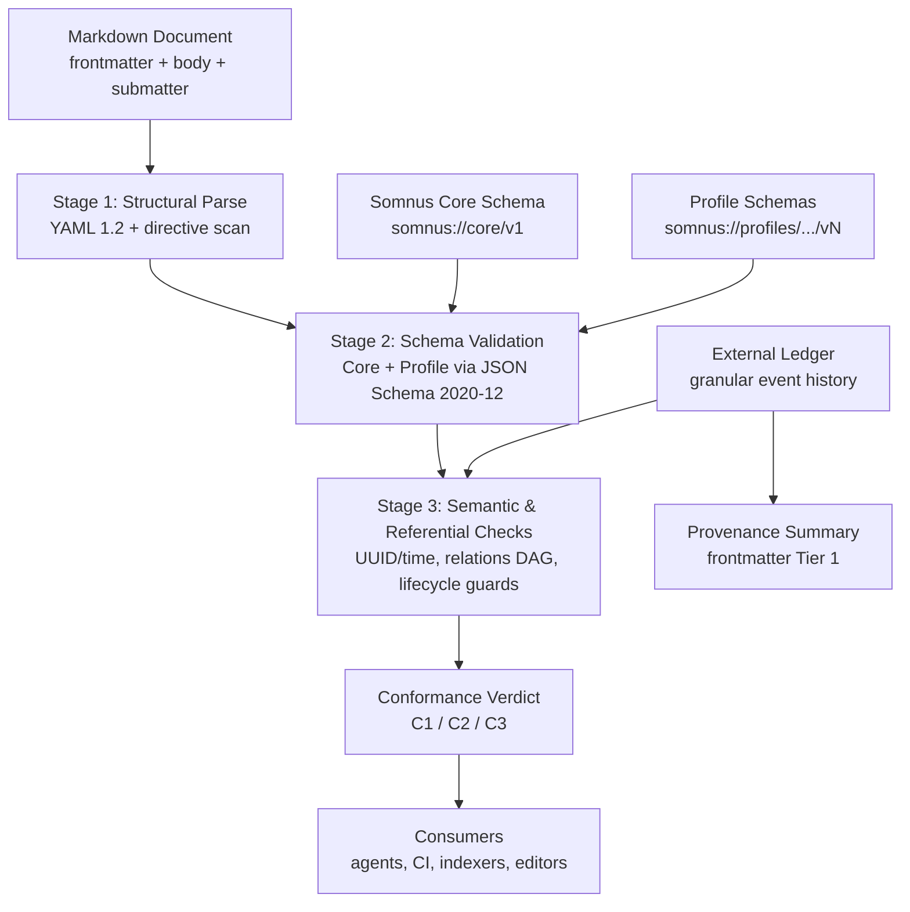
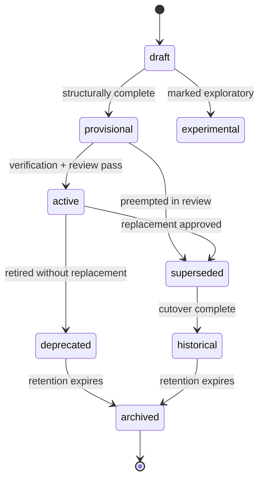
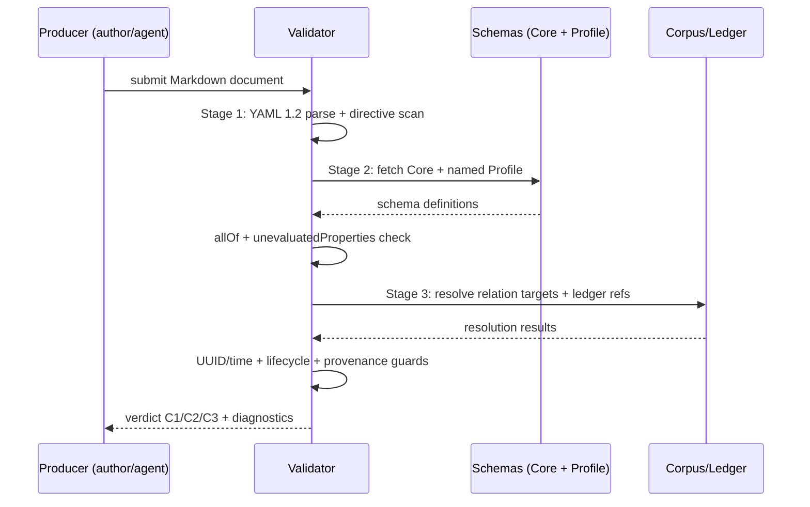

# SOMNUS MARKDOWN METADATA STANDARD v0.1 — NORMATIVE SPECIFICATION

```text
DOCUMENT TITLE:  Somnus Markdown Metadata Standard v0.1 — Normative Specification
Classification:  INTERNAL
Version:         0.1.0
Date:            2026-09-22
Author/Origin:   defense-grade-doc-engine (derived from Somnus Markdown Metadata
                 Standard Research.md, read-only source of truth)
Status:          PROPOSED
Supersedes:      (none — initial normative derivation)
Source of truth: Somnus Markdown Metadata Standard Research.md (685 lines; DO NOT OVERWRITE)
```

> This document is a normative derivation. Where it conflicts with the source
> research file, this specification governs only after operator acceptance of
> `DECISIONS.md`. Until then its status remains PROPOSED. All unresolved
> points are marked `TODO(needs-owner)`.

## Executive Summary

The Somnus Markdown Metadata Standard defines a uniform frontmatter grammar, document classification system, lifecycle model, provenance model, and in-body submatter mechanism for Markdown artifacts in a local-first, AI-integrated engineering ecosystem. It solves identifier instability across renames, conflated taxonomies, untraceable multi-agent authorship, and unvalidatable ad hoc frontmatter. Its operational significance is that conformant documents become machine-validatable, graph-traversable, and safe for autonomous agents to trust, edit, and cite.

## Table of Contents

1. Scope and Normative Language
2. Conformance Levels
3. Terminology
4. System Architecture
5. Core Frontmatter Grammar (Hybrid Semi-Flat)
6. Classification Enums (Closed and Open Vocabularies)
7. Temporal Record
8. Lifecycle State Machine and Canonical Authority
9. Provenance — Two-Tier Model
10. Relations — Directed Graph with Inverse Semantics
11. Stable Identity and Location Decoupling
12. Profile Extension via JSON Schema Draft 2020-12
13. Submatter — Container Directive Grammar
14. YAML 1.2 Interoperability Rules
15. Versioning and Migration Policy (SemVer)
16. AI-Agent Ergonomics
17. Validation Pipeline
18. Security and Threat Considerations
19. Repository Map (Non-Normative)
20. Appendices
    - A. Normative Field Registry
    - B. Bibliography (Cleaned Works Cited)
    - C. Source Audit Log (Fixed vs. Deferred)
    - D. TODO Registry (Requires Owner)
    - E. Change Log

---

## 1. Scope and Normative Language

### 1.1 In scope

This specification normatively defines:

- (a) The mandatory core frontmatter grammar and field registry (Section 5, Appendix A).
- (b) Closed classification vocabularies and open-vocabulary patterns (Section 6).
- (c) The lifecycle state machine and canonical-authority flag (Section 8).
- (d) The two-tier provenance model and controlled action vocabulary (Section 9).
- (e) The relations directed acyclic graph (DAG) model and inverse semantics (Section 10).
- (f) The UUIDv7 identity rule and identity/location decoupling (Section 11).
- (g) The profile extension mechanism via JSON Schema Draft 2020-12 (Section 12).
- (h) The submatter container-directive grammar (Section 13).
- (i) YAML 1.2 quoting and structural rules (Section 14).
- (j) Schema versioning and migration policy (Section 15).
- (k) AI-agent ergonomic constraints (Section 16).
- (l) The three-stage validation pipeline and conformance levels (Sections 2, 17).

### 1.2 Out of scope

The following are explicitly out of scope for v0.1 and MUST NOT be treated as normative:

- (a) Any specific validator implementation language, binary name, or distribution
  mechanism beyond the abstract pipeline in Section 17. The research proposes a
  native binary; that proposal is recorded but not ratified.
  `TODO(needs-owner): ratify validator implementation and distribution.`
- (b) Any specific schema file hosting path or ledger directory layout beyond the
  abstract URI and reference requirements. Illustrative paths from research are
  non-normative.
- (c) Rendering behavior of any specific editor (Obsidian, Hugo, GitHub). Compatibility
  notes in this specification are informative, not conformance requirements.

### 1.3 Normative language

The key words MUST, MUST NOT, REQUIRED, SHALL, SHALL NOT, SHOULD, SHOULD NOT,
RECOMMENDED, MAY, and OPTIONAL in this document are to be interpreted as described
in RFC 2119 / RFC 8174.

Conformance statements use these keywords. Informative text uses plain language and
does not create obligations. Each normative statement applies to producers (authors,
agents, migration tooling) and validators unless stated otherwise.

### 1.4 Source audit posture

The source research file contains encoding artifacts (`&nbsp;` entities in code
samples, `[span_N]` garble tokens, a truncated works-cited entry 18) and terminological
inconsistencies (kebab-case vs. snake_case; dual provenance shapes; dual temporal
placements). This specification resolves what the evidence supports and marks the
remainder as `TODO(needs-owner)`. The full audit is in Appendix C.

---

## 2. Conformance Levels

A document is conformant only relative to a stated level. Validators MUST report the
highest level achieved and the first failing check.

| Level | Designation | Requirement |
|---|---|---|
| C1 | Core-Wellformed | Passes Stage 1 (Section 17.1): `---`-delimited frontmatter extracts; strict YAML 1.2 parse succeeds with zero tabs, zero duplicate keys; all REQUIRED core fields present with correct primitive types. |
| C2 | Profile-Conformant | Passes C1 plus Stage 2 (Section 17.2): frontmatter validates against Somnus Core schema AND the profile schema named by `classification.profile`, with `unevaluatedProperties: false` enforced at the composition root. A document claiming conformance to this specification MUST achieve at least C2. |
| C3 | Graph-Consistent | Passes C2 plus Stage 3 (Section 17.3): UUIDv7/timestamp consistency holds; every relation target resolves to a known identifier or registered external identifier scheme; inverse pairs are consistent; lifecycle guards in Section 8.4 hold. Any document with `lifecycle.is_canonical: true` MUST achieve C3. |

Additional rules:

- A validator MUST distinguish errors (C-level failure) from warnings (informative).
  Under the recommended Zero Tolerance policy (see `DECISIONS.md` Decision 5),
  unknown root or core-namespace properties are errors at C2.
- Experimental content under `extensions` (Section 12.4) MUST NOT cause C2 failure
  if confined to the extension namespace and correctly typed as an object.
- Conformance claims MUST name the specification version: e.g.,
  `somnus.version: "0.1.0"`. Unversioned claims are non-conformant.

---

## 3. Terminology

Normative definitions reside in `GLOSSARY.md`. Key terms reused with normative force
in this specification: Entity, Activity, Agent, Author, Operator, Model/Provider,
Tool, Verifier, Core, Profile, Submatter, Directive, Canonical, Classification
(category, type, subtype, role, scope, tags), Relation, Ledger, Identity, Origin,
Location, Extension, Conformance, DAG.

A validator MUST interpret these terms per `GLOSSARY.md`. In case of conflict between
a glossary definition and a section of this specification, the section governs for its
scope and the conflict MUST be logged as `TODO(needs-owner)`.

---

## 4. System Architecture

### Figure 1 — Somnus metadata system context



Legend: Boxes are components or artifacts. Arrows are data flow or dependency.
The document is the sole input. Schemas are version-controlled inputs to Stage 2.
The external ledger is an input to Stage 3 and the backing store for Tier 1
provenance. The verdict is consumed by agents, CI gates, indexers, and editors.

Trust boundaries:

- Zone 1 (authoring): editors, agents, CLI. Untrusted input until validated.
- Zone 2 (validation): parser and schema engine. Deterministic; no network fetch
  REQUIRED during validation unless profile resolution is explicitly configured.
  `TODO(needs-owner): define profile resolution policy (vendored vs. fetched).`
- Zone 3 (consumption): indexers and autonomous agents. MUST NOT treat a document
  as ground truth unless its conformance level satisfies Section 2 for its
  `lifecycle.status` and `is_canonical` claim.

---

## 5. Core Frontmatter Grammar (Hybrid Semi-Flat)

### 5.1 Structural rule

Documents MUST use a Hybrid Semi-Flat root structure:

- (a) Document envelope fields (`somnus`, `id`, `slug`, `aliases`, `title`,
  `description`, temporal markers) reside at the frontmatter root. This preserves
  compatibility with third-party indexers that read `title` and tag-like keys
  natively.
- (b) Operational namespaces (`classification`, `lifecycle`, `location`, `origin`,
  `relations`, `provenance`, `extensions`) are mappings at the root.
- (c) Profile payloads reside under exactly one top-level key named for the profile
  (e.g., `specification`, `benchmark`). Profile keys MUST NOT collide with core keys.
- (d) Strict full namespacing (every field nested under a single `somnus:` key) MUST
  NOT be used in v0.1. Rationale and rejected alternative are recorded in
  `DECISIONS.md` Decision 2.

Property-name casing rule: all core and namespace property names MUST be
`snake_case` (lowercase, digits, underscore). All open-vocabulary values (tags,
subtype) and slugs MUST be kebab-case per Section 6.4. This resolves the
research inconsistency where `is_canonical`/`created_at` (snake) coexisted with
an unstated casing policy.

### 5.2 Normative frontmatter skeleton

The following skeleton is normative for field presence and nesting. Types,
cardinality, and value domains are in Appendix A. All `version`, `status`, and
date scalars are quoted per Section 14.

```yaml
---
# SOMNUS METADATA CORE (v0.1)
somnus:
  version: "0.1.0"
  schema: "somnus://core/v1"
id: "0195e364-bb40-7f22-9df8-8bc6289b5c30"
slug: "memory-hierarchy-invariants"
aliases:
  - "memory-invariants"
  - "agent-mem-spec"
title: "Deterministic Invariants for Hierarchical Agent Memory"
description: "Binding invariants for the canonical memory tier."
classification:
  category: "engineering"
  type: "specification"
  subtype: "memory-subsystem"
  profile: "somnus://profiles/engineering/specification/v1"
  role: "normative"
  scope: "subsystem"
  tags:
    - "agent-architecture"
    - "memory"
    - "invariants"
lifecycle:
  status: "active"
  is_canonical: true
created_at: "2026-03-30T10:00:00Z"
updated_at: "2026-03-30T10:14:00Z"
verified_at: "2026-03-30T14:22:01Z"
location:
  repository: "git@github.com:somnus-org/somnus-core.git"
  repository_root: "docs/specifications"
  path: "specs/memory/invariants.md"
  historical_paths:
    - "drafts/vance/consensus-draft.md"
origin:
  repository: "git@github.com:somnus-org/somnus-core.git"
  path: "drafts/vance/memory-draft.md"
  initial_commit: "9f83a1b490f23b7e12"
relations:
  supersedes:
    - "0194a112-9c01-7111-a203-018273645500"
  superseded_by: []
  derived_from:
    - "0193f440-2a3b-7890-bcde-998877665544"
  cites:
    - "doi:10.1145/3318464.3389700"
  complements: []
provenance:
  authors:
    - name: "Dr. Eleanor Vance"
      id: "user:vance@somnus.org"
      role: "author"
  operators:
    - name: "Somnus Copilot"
      id: "agent:somnus-autodoc-04"
      role: "editor"
      model: "anthropic/claude-3-7-sonnet"
      operator: "user:vance@somnus.org"
      interaction_at: "2026-03-30T10:14:00Z"
      actions:
        - "edited"
        - "verified"
  verification:
    verified_by: "system:somnus-core-ci"
    verified_at: "2026-03-30T14:22:01Z"
    status: "passed"
  history_ledger: "provenance/ledger/2026-03-30-0195e34a.json"
specification:
  system_target: "somnus-node"
  compliance_level: "mandatory"
  verification_suite: "tests/compliance/memory_suite.rs"
---
```

Notes on the skeleton:

- `purpose` (named in the research dimension table) is OPTIONAL and MAY appear at
  root as a string. It is omitted from the skeleton to keep the minimal example
  lean; when present it MUST be a non-empty string.
- `lifecycle.reviewed_at` appearing in the research candidate is NOT part of v0.1.
  Temporal authority resides in root `created_at` / `updated_at` / `verified_at`
  (Section 7). Producers MUST NOT emit `lifecycle.reviewed_at`.
  `TODO(needs-owner): confirm deprecation of lifecycle.reviewed_at is acceptable.`
- `provenance.created_by`, `provenance.last_modified_by`, and `provenance.created_with`
  appearing in one research illustration are NOT part of v0.1. The normative
  provenance shape is `authors` / `operators` / `verification` / `history_ledger`
  (Section 9). Producers MUST NOT emit the older shape.
  `TODO(needs-owner): confirm removal of created_by/last_modified_by/created_with.`
- Illustrative values for `history_ledger`, `verification_suite`, repository URIs,
  and profile URIs are carried over from research without alteration of meaning.
  Their operational backing stores are not ratified (Section 1.2).

### 5.3 Field presence summary

| Root key | Presence | Notes |
|---|---|---|
| `somnus` | REQUIRED | MUST contain `version` (quoted SemVer) and `schema` (URI). |
| `id` | REQUIRED | UUIDv7 string, Section 11. Immutable. |
| `slug` | REQUIRED | Kebab-case human alias, Section 11. |
| `aliases` | OPTIONAL | Array of kebab-case strings. MUST be unique within the document. |
| `title` | REQUIRED | Non-empty string. Exactly one. |
| `description` | RECOMMENDED | Non-empty string. |
| `purpose` | OPTIONAL | Non-empty string. |
| `classification` | REQUIRED | Section 6. `category` and `type` always REQUIRED. |
| `lifecycle` | REQUIRED | Section 8. `status` and `is_canonical` always REQUIRED. |
| `created_at` | REQUIRED | Quoted ISO 8601 UTC, Section 7. |
| `updated_at` | REQUIRED | Quoted ISO 8601 UTC, Section 7. |
| `verified_at` | OPTIONAL | Quoted ISO 8601 UTC. REQUIRED if `verification.status` is `"passed"`. |
| `location` | REQUIRED | Section 11. Current placement. |
| `origin` | REQUIRED | Section 11. Birth placement. Immutable after creation. |
| `relations` | RECOMMENDED | Section 10. When present, each named list MUST be an array (possibly empty). |
| `provenance` | REQUIRED | Section 9. `authors` REQUIRED; remainder per Section 9. |
| `extensions` | OPTIONAL | Section 12.4. MUST be a mapping when present. |
| `<profile-key>` | CONDITIONAL | REQUIRED when `classification.profile` names a profile; MUST validate per Section 12. |

---

## 6. Classification Enums (Closed and Open Vocabularies)

### 6.1 Design rule

Fields that drive validation routing, security boundaries, or agent trust MUST use
closed enums. Discovery-only fields MUST remain open but pattern-constrained.
This prevents the flat-taxonomy anti-pattern (genre, state, topic, and urgency
merged into one list) identified in the research.

### 6.2 Closed vocabularies (normative)

Validators MUST reject unlisted values for the following fields.

**category** — broad institutional domain.

| Value | Definition |
|---|---|
| `research` | Inquiry, theory, experiment, and analysis artifacts. |
| `engineering` | Design, specification, implementation, and architecture artifacts. |
| `operations` | Runbooks, deployment, incident, and maintenance artifacts. |
| `governance` | Decisions, policy, compliance, and authority artifacts. |
| `context` | Session, memory, and situational artifacts supporting other work. |
| `archive` | Cold or historical artifacts retained for reference only. |

**type** — structural genre; deterministic key binding the document to a profile.

| Value | Definition |
|---|---|
| `whitepaper` | Long-form research exposition. |
| `specification` | Binding technical rules for an implementation target. |
| `architecture-record` | Structural design record for a system or subsystem. |
| `report` | Findings, summaries, or status accounts. |
| `task` | Bounded unit of work with acceptance criteria. |
| `plan` | Sequenced intent spanning multiple tasks or phases. |
| `notepad` | Transient scratch; no conformance expectations beyond C1. |
| `benchmark` | Workload, environment, and metrics record. |
| `test-result` | Outcome of a verification or test execution. |
| `decision-record` | Single architectural decision with rationale (ADR family). |
| `runbook` | Operational procedure for a known situation. |
| `index` | Machine- or human-readable catalog of other artifacts. |
| `state` | Snapshot of system or process state at a point in time. |
| `memory` | Agent or operator memory artifact. |

`TODO(needs-owner): confirm the 14-value type list is complete for v0.1; no
additions without a MINOR schema revision (Section 15).`

**role** — authority tier and epistemic intent.

| Value | Definition |
|---|---|
| `normative` | Binding; implementations and agents MUST conform. |
| `informative` | Explanatory; safe to rely on but not binding. |
| `working` | In-progress coordination artifact; expect change. |
| `exploratory` | Hypothesis or prototype; explicitly non-binding. |
| `historical` | Preserved record; MUST NOT be treated as current guidance. |

**scope** — blast radius or governed system boundary, ordered narrow to wide
(component < module < subsystem < repository < fleet < ecosystem).

| Value | Definition |
|---|---|
| `ecosystem` | Cross-repository, cross-fleet concerns. |
| `fleet` | Multi-repository coordinated behavior. |
| `repository` | Single repository. |
| `subsystem` | Coherent subsystem within a repository. |
| `module` | Single module or package. |
| `component` | Single component or unit. |

### 6.3 Profile pointer

`classification.profile` MUST be a URI matching:

```text
^somnus://profiles/[a-z0-9/\-]+/v[0-9]+$
```

It MUST resolve to the JSON Schema that validates the document's profile block
(Section 12). Validators MUST fail C2 when the profile URI is syntactically valid
but unresolvable under the configured resolution policy.
`TODO(needs-owner): define profile resolution policy.`

### 6.4 Open vocabularies (pattern-constrained)

| Field | Pattern | Rule |
|---|---|---|
| `subtype` | `^[a-z0-9]+(-[a-z0-9]+)*$` | OPTIONAL kebab-case specialization. MUST NOT be used to smuggle a new `type`; new structural genres REQUIRE a MINOR revision. |
| `tags` | Array of `^[a-z0-9]+(-[a-z0-9]+)*$` | Open discovery keywords. MUST be lowercase kebab-case. MUST NOT encode lifecycle state, role, or scope. |
| `slug`, `aliases` | `^[a-z0-9]+(-[a-z0-9]+)*$` | Human-readable aliases. |

---

## 7. Temporal Record

- `created_at`, `updated_at`, and (when present) `verified_at` MUST be strings in
  ISO 8601 UTC form `YYYY-MM-DDTHH:MM:SSZ`, always quoted (Section 14).
- `created_at` is immutable after creation. `updated_at` MUST advance on every
  semantic modification. `verified_at` MUST equal `provenance.verification.verified_at`
  when both are present; mismatch is a Stage 3 error.
- The millisecond timestamp embedded in the document UUIDv7 (Section 11) MUST be
  consistent with `created_at` within clock-skew tolerance defined by the validator
  configuration. Exact tolerance is implementation-defined and MUST be documented
  by the validator.
  `TODO(needs-owner): set canonical clock-skew tolerance (research is silent).`
- Producers MUST NOT emit native YAML timestamps (unquoted dates). All temporal
  scalars MUST be quoted strings; validators parse them as strings then validate
  format, never as language-native dates.

---

## 8. Lifecycle State Machine and Canonical Authority

### 8.1 Orthogonal properties

Lifecycle maturity (`lifecycle.status`) and authority (`lifecycle.is_canonical`)
are orthogonal:

- `status` states the operational phase of the document.
- `is_canonical` (boolean) asserts whether the document is the binding single
  source of truth for its scope and type. It MUST be a native YAML boolean
  (`true` / `false`, unquoted).

Conflation of these axes (e.g., treating `active` as implying canonical, or
encoding state in directory paths) is non-conformant.

### 8.2 Status vocabulary (closed)

| Status | Definition |
|---|---|
| `draft` | Incomplete; internal consistency is not guaranteed. |
| `provisional` | Complete and coherent; awaiting formal verification or review. |
| `active` | Formally accepted, operational, actively maintained. |
| `experimental` | Exploratory alternative; explicitly non-binding regardless of `is_canonical`. |
| `superseded` | Replaced by a newer artifact; retained for lineage. MUST name at least one target in `relations.superseded_by`. |
| `deprecated` | Phase-out announced; use discouraged; no direct replacement asserted. |
| `historical` | Former active state; preserved for archival reference only. |
| `archived` | Cold storage; immutable; exempt from ongoing validation except C1. |

All status scalars MUST be quoted.

### 8.3 State machine diagram

#### Figure 2 — Document lifecycle transitions



### 8.4 Transition guards (normative)

- draft → provisional: document is structurally complete (achieves C2).
- draft → experimental: explicitly marked exploratory; `role` SHOULD be
  `exploratory` and `is_canonical` MUST be `false`.
- provisional → active: passes verification and review; achieves C3.
- provisional → superseded: preempted during review; `relations.superseded_by`
  MUST be non-empty.
- active → superseded: an explicit replacement is approved; `relations.superseded_by`
  MUST be non-empty and every listed target MUST resolve (Stage 3).
- active → deprecated: retired without replacement; agents SHOULD warn on reliance.
- superseded → historical: active system cutover is complete.
- historical → archived and deprecated → archived: retention policy satisfied;
  content becomes immutable. Any post-archive modification except ledger-appended
  location bookkeeping is a violation.
  `TODO(needs-owner): define retention policy or delegate to repository policy.`
- No other transitions are permitted. Validators MUST flag off-graph transitions
  (e.g., `archived` → `active` without a new-identity successor) as Stage 3 errors.
  Re-activation REQUIRES a new document identity that `supersedes` the archived one.

### 8.5 Canonical authority rule

- `is_canonical: true` asserts binding single-source-of-truth status for the
  declared `classification.scope` and `type`.
- A canonical claim with `status` of `draft`, `experimental`, or `provisional`
  is a Stage 3 error, except `provisional` canonical claims explicitly permitted
  by repository policy during cutover windows (policy MUST be documented).
- Competing canonical claims (two documents, same scope+type, both
  `is_canonical: true` and `status: active`) are a graph-level inconsistency that
  validators SHOULD detect when the corpus is available and MUST NOT silently pass
  at C3 when detected.

---

## 9. Provenance — Two-Tier Model

### 9.1 Tiering rule

Somnus uses a two-tier provenance model (ratified direction; see `DECISIONS.md`
Decision 4):

- Tier 1 (in-frontmatter summary): immutable origin, current operational state,
  latest verification signature. Boundedly sized. This is the only provenance
  REQUIRED in the Markdown file.
- Tier 2 (external ledger): complete ordered event history. Referenced by
  `provenance.history_ledger`. Offloads merge-conflict-prone micro-edits and
  token-heavy histories from the frontmatter.

Recording unbounded per-edit history inline in Git-tracked frontmatter is
non-conformant for documents above `notepad` type: it inflates AI context windows,
causes merge conflicts, and duplicates version-control data.

### 9.2 Actor disambiguation (normative roles)

| Actor slot | Definition | Distinguishes |
|---|---|---|
| Author / Creator | Intellectual originator responsible for content. | Creative origination. |
| Operator | Immediate actor executing a session or modification (human directing an IDE, or autonomous repository agent). | Direct system interaction. |
| Model / Provider | Machine-intelligence runtime including provider namespace and release (e.g., `anthropic/claude-3-7-sonnet` — illustrative value from research). | Runtime execution. |
| Tool | Client software or environment mediating the write (illustrative: `Somnus-Author/1.2.0`). | Mediation layer. |
| Verifier / Reviewer | Independent entity certifying correctness, safety, or compliance. | Certification, not authorship. |

Collapsing distinct actors into a single undifferentiated `author` string is
non-conformant for `role: normative` documents.

### 9.3 Controlled action vocabulary (closed)

Actions in `operators[].actions` MUST use only the following verbs:

| Verb | Meaning |
|---|---|
| `authored` | Initial creative creation. |
| `generated` | Initial synthetic production via automated agent or LLM. |
| `edited` | Incremental structural or semantic modification. |
| `reviewed` | Formal inspection without direct text mutation. |
| `verified` | Cryptographic, empirical, or deterministic verification of assertions. |
| `tested` | Execution of attached benchmarks or verification suites. |
| `migrated` | Translocation, re-encoding, or relocation across repository boundaries. |
| `reformatted` | Non-semantic adjustments (whitespace, frontmatter realignment). |
| `canonized` | Administrative elevation to normative authority. |
| `deprecated` | Administrative transition to superseded or obsolete. |

### 9.4 Tier 1 schema (normative)

```yaml
provenance:
  authors:            # REQUIRED, non-empty
    - name: "Dr. Eleanor Vance"
      id: "user:vance@somnus.org"
      role: "author"  # closed: author | editor | reviewer | verifier
  operators:          # OPTIONAL, ordered newest-last in-file
    - name: "Somnus Copilot"
      id: "agent:somnus-autodoc-04"
      role: "editor"
      model: "anthropic/claude-3-7-sonnet"
      operator: "user:vance@somnus.org"
      interaction_at: "2026-03-30T10:14:00Z"
      actions:
        - "edited"
        - "verified"
  verification:       # OPTIONAL; REQUIRED when lifecycle.status is "active" and role is "normative"
    verified_by: "system:somnus-core-ci"
    verified_at: "2026-03-30T14:22:01Z"
    status: "passed"  # closed: passed | failed | waived
  history_ledger: "provenance/ledger/2026-03-30-0195e34a.json"  # OPTIONAL path or id reference
```

Rules:

- `authors` MUST be non-empty. At least one entry MUST carry `role: "author"`.
- `operators[].interaction_at` and `verification.verified_at` MUST be quoted ISO 8601 UTC.
- `verification.status` MUST be quoted. `waived` REQUIRES a ledger entry recording
  the waiver authority and rationale.
  `TODO(needs-owner): define waiver authority policy.`
- `history_ledger` value is a reference (illustrative form above is a path). Its
  backing format and location policy are not ratified in v0.1.
  `TODO(needs-owner): ratify ledger location convention and event schema.`
- Transient pre-commit `transient_events` arrays described in research MAY exist
  only in working-tree copies and MUST be flushed to the ledger before commit;
  committed documents MUST NOT contain `transient_events` at C2 or above.

---

## 10. Relations — Directed Graph with Inverse Semantics

### 10.1 Addressing rule

Relation targets MUST be stable identifiers, not volatile file paths:

- Somnus documents: UUIDv7 string form (`0195e364-...`) or `urn:somnus:doc:<uuid>` form.
  Validators MUST accept both and MUST normalize before comparison.
- External works: registered scheme identifiers (`doi:...`, plus any scheme allowlist
  configured by the validator). Bare URLs SHOULD be avoided in `cites` in favor of
  persistent identifiers where available.

### 10.2 Relation vocabulary and inverses (normative)

Validators MUST enforce the pairing. Asserting a forward relation without a
resolvable inverse target is a Stage 3 warning; asserting a forward relation whose
target exists but lacks the matching inverse is a Stage 3 error when the target
corpus is available.

| Forward field | Inverse field | Semantics |
|---|---|---|
| `supersedes` | `superseded_by` | Lineage replacement. Acyclic. `superseded` status REQUIRES non-empty `superseded_by`. |
| `superseded_by` | `supersedes` | Reverse replacement pointer. Preferably maintained by tooling, not hand-edited. |
| `derived_from` | `derived_into` | Lineage synthesis. Acyclic. |
| `derived_into` | `derived_from` | Reverse derivation pointer. |
| `cites` | `cited_by` | Evidential reference. Cyclicity permitted (mutual citation). |
| `cited_by` | `cites` | Reverse citation pointer. |
| `complements` | `complemented_by` | Peer augmentation. Cyclicity permitted. |
| `complemented_by` | `complements` | Reverse complement pointer. |
| `continues` | `continued_by` | Serial continuation. Acyclic. |
| `continued_by` | `continues` | Reverse continuation pointer. |
| `describes` | `described_by` | Metadata-about relation. |
| `described_by` | `describes` | Reverse description pointer. |
| `has_version` | `is_version_of` | Version grouping. |
| `is_version_of` | `has_version` | Reverse version pointer. |

Notes:

- The research candidate frontmatter shows only `supersedes`, `superseded_by`,
  `derived_from`, `cites`, `complements`. The fuller DataCite-inspired set above is
  normative for validators: validators MUST accept all listed fields and MUST reject
  unlisted relation fields at C2 (subject to the extensions escape hatch, which
  MUST NOT be used to smuggle new relation verbs — new verbs REQUIRE a MINOR revision).
- Research illustration uses `urn:somnus:doc:<uuid>` targets; the v0.1 skeleton
  (Section 5.2) uses bare UUID strings. Both forms are conformant.

### 10.3 Graph integrity rules

- Lineage relations (`supersedes`, `derived_from`, `continues`, `has_version` families)
  MUST form a DAG. Cycles are Stage 3 errors.
- `cites` and `complements` families MAY form cycles.
- Every non-empty lineage list entry MUST resolve to a known document or a declared
  tombstone for a retired document. Dangling lineage pointers are Stage 3 errors.
- Validators SHOULD support automatic inverse injection (writing the matching inverse
  into the target) as a non-destructive operation, but MUST NOT silently mutate
  canonical documents; injection into `active` canonical targets REQUIRES review.

Example (both identifier forms conformant):

```yaml
relations:
  supersedes:
    - "urn:somnus:doc:0195e34a-89a2-7b1c-92e1-45601278abcd"
  superseded_by: []
  derived_from:
    - "0195e11f-22b0-7c2a-88f4-00129845ef01"
  cites:
    - "doi:10.1145/3318464.3389700"
  complements:
    - "urn:somnus:doc:0195e200-1111-7a3b-bf20-998877665544"
```

---

## 11. Stable Identity and Location Decoupling

### 11.1 Identifier standard

The mandatory primary identifier is **UUIDv7 per RFC 9562**, rendered as the
standard 36-character hexadecimal-and-dash string (e.g.,
`0195e364-bb40-7f22-9df8-8bc6289b5c30`). See `DECISIONS.md` Decision 3 for the
UUIDv7-over-ULID rationale.

- `id` MUST be a valid UUIDv7 (version nibble `7`, correct variant bits).
  UUIDv4 or other versions are non-conformant as primary `id`.
- `id` is immutable for the life of the artifact. Splits and merges REQUIRE new
  identities linked via `derived_from` / `derived_into`; the antecedent MUST NOT
  be reused.
- The embedded 48-bit millisecond timestamp MUST be consistent with `created_at`
  within validator tolerance (Section 7).
- Content hashes (Git blob SHA) and file paths MUST NOT serve as primary identity:
  a single-character mutation changes a content hash, and renames break paths.

### 11.2 Human aliases

- `slug` is REQUIRED, kebab-case, and SHOULD be unique within its repository scope.
  Uniqueness beyond repository scope is not guaranteed and MUST NOT be relied upon.
- `aliases` is OPTIONAL. Entries MUST be kebab-case and unique within the document.
- Slugs and aliases are conveniences. All machine references (relations, ledger
  pointers, citations) MUST use `id`, never `slug` or path.

### 11.3 Location vs. origin

```yaml
id: "0195e35b-1729-7d88-b21a-e7c6530a21cf"
slug: "consensus-safety-invariants"
location:
  repository: "git@github.com:somnus-org/somnus-core.git"
  repository_root: "docs/specifications"
  path: "docs/specifications/consensus-safety.md"
  historical_paths:
    - "drafts/vance/consensus-draft.md"
    - "rfc/rfc-012-invariants.md"
origin:
  repository: "git@github.com:somnus-org/research-sandbox.git"
  path: "experiments/2026-02/consensus-notes.md"
  initial_commit: "9f83a1b490f23b7e12"
```

Rules:

- `location` describes transient physical placement; `origin` describes birth
  placement and is immutable after creation.
- `location.path` MUST reflect the actual file path at validation time when the
  validator has filesystem context; drift is a Stage 3 warning with automatic-update
  eligibility.
- `location.historical_paths` SHOULD append on every cross-directory move; tooling
  MAY maintain this automatically.
- `origin.initial_commit` SHOULD be a full or abbreviated commit hash of the
  introducing commit when the origin repository is Git-managed; otherwise it MAY
  be omitted with a ledger note.

---

## 12. Profile Extension via JSON Schema Draft 2020-12

### 12.1 Core-plus-profiles model

Somnus uses a small universal Core plus composable document Profiles:

- Somnus Core: identity, classification, lifecycle, temporal markers, location,
  origin, base provenance, relations envelope.
- Profiles: constrained property sets keyed to `classification.type`, scoped under
  a single top-level profile key.

Monolithic mega-schemas (every document carries every field) and schema-free
extension (arbitrary root keys) are both non-conformant patterns.

### 12.2 Composition mechanics (normative)

Profiles MUST compose via JSON Schema Draft 2020-12 using `allOf` plus
`unevaluatedProperties: false` at the composition root:

```json
{
  "$schema": "https://json-schema.org/draft/2020-12/schema",
  "$id": "somnus://profiles/engineering/benchmark/v1",
  "title": "Somnus Benchmark Profile",
  "type": "object",
  "allOf": [
    { "$ref": "somnus://core/v1" }
  ],
  "properties": {
    "benchmark": {
      "type": "object",
      "required": ["workload", "environment", "metrics"],
      "properties": {
        "workload": { "type": "string" },
        "environment": {
          "type": "object",
          "required": ["cpu", "memory_gb", "os"],
          "properties": {
            "cpu": { "type": "string" },
            "memory_gb": { "type": "number" },
            "os": { "type": "string" }
          }
        },
        "metrics": {
          "type": "array",
          "items": {
            "type": "object",
            "required": ["name", "value", "unit"],
            "properties": {
              "name": { "type": "string" },
              "value": { "type": "number" },
              "unit": { "type": "string" }
            }
          }
        }
      }
    }
  },
  "unevaluatedProperties": false
}
```

Rules:

- The `unevaluatedProperties: false` keyword (not `additionalProperties: false`)
  MUST be used at the composition root so properties declared across `allOf`
  branches are correctly evaluated. Use of `additionalProperties: false` alongside
  `allOf` is a schema-authoring error.
- Each profile's unique payload MUST be scoped under a single top-level key
  (e.g., `benchmark`, `specification`) to prevent root-namespace collisions with
  future Core revisions.
- Rejected alternatives (CUE lattices, YAML merge keys, JSON-LD framing) are
  documented in the research and summarized in Appendix C. JSON Schema was selected
  for portability across Rust, Python, TypeScript, Go, and C++ validators.

### 12.3 Profile authoring example (frontmatter side)

```yaml
classification:
  category: "engineering"
  type: "benchmark"
  profile: "somnus://profiles/engineering/benchmark/v1"
  role: "informative"
  scope: "subsystem"
  tags:
    - "storage-engine"
benchmark:
  workload: "random-read-4k"
  environment:
    cpu: "ryzen-5-5625u"
    memory_gb: 16
    os: "linux"
  metrics:
    - name: "p99-latency"
      value: 1.42
      unit: "ms"
```

### 12.4 Extension escape hatch (normative)

Standard Core and official profile properties are closed. To permit experimentation
without breaking CI:

- An OPTIONAL root mapping `extensions` is provided. Its value MUST be an object
  with `additionalProperties: true` semantics (open).
- Prefixed experimental root keys (`x-somnus-*`) SHOULD be avoided in v0.1 in favor
  of the `extensions` mapping, to keep the root namespace enumerable.
- Properties inside `extensions` MUST NOT affect C2 verdicts for Core/Profile
  conformance. Validators MUST ignore `extensions` content for Core/Profile checks
  while still requiring it to be a well-formed mapping.
- Promotion of an experimental field into Core or a Profile REQUIRES a MINOR (or
  MAJOR, if breaking) schema revision (Section 15), never silent validator
  accommodation.

---

## 13. Submatter — Container Directive Grammar

### 13.1 Mechanism selection

Section-level metadata MUST use Generic Container Directives (`:::` fences per
remark-directive / mdast-util-directive and the CommonMark Directives Proposal).
See `DECISIONS.md` Decision 1 for the Directives-over-HTML-comments rationale.

Custom HTML/XML container elements (e.g., `<somnus-region>`) MUST NOT be used:
under CommonMark Sections 4.6 Types 6–7, inner content of such blocks is raw
literal text — headings, emphasis, lists, and links inside do not form AST nodes —
and GitHub server-side sanitization strips custom tags. HTML comments MUST NOT be
used as the primary submatter mechanism (nesting is unsupported; extraction
requires regex rather than AST traversal).

### 13.2 Grammar (normative)

```text
submatter-block  := open-fence EOL content close-fence
open-fence       := ":"{3,} "submatter:" region-type ("{" attr-list "}")?
close-fence      := ":"{3,} EOL
region-type      := "invariant" | "decision" | "hypothesis" | "evidence" | "archive" | subtype-token
subtype-token    := kebab-case string matching ^[a-z0-9]+(-[a-z0-9]+)*$
attr-list        := attr (ws+ attr)*
attr             := name "=" quoted-string
name             := "id" | "status" | "authority" | "test_ref" | extension-attr
quoted-string    := '"' [^"]* '"'
content          := arbitrary Markdown blocks (headings, lists, code, math)
nesting          := inner blocks use strictly more colons than their parent
```

Attribute rules:

- `id` is REQUIRED on every submatter block and MUST be a UUIDv7 string uniquely
  identifying the block within the document. Searching for
  `:::submatter:<type>{id="<uuid>"` MUST deterministically locate the block.
- `status` is REQUIRED and MUST use the document lifecycle vocabulary
  (`draft`, `provisional`, `active`, `experimental`, `superseded`, `deprecated`,
  `historical`, `archived`), quoted.
- `authority` is OPTIONAL; when present it MUST be `canonical` or `non-canonical`,
  quoted. `canonical` asserts the block is ground truth for its scope.
- `test_ref` is OPTIONAL and SHOULD be present on `hypothesis` and `evidence` blocks,
  naming the verification suite or benchmark that adjudicates the claim.
- Unknown attributes MUST be preserved by editors and MUST NOT fail validation at
  C2; validators SHOULD warn on unknown attributes at C3.

### 13.3 Normative examples

```markdown
# System Memory Architecture

The memory subsystem is divided into episodic, working, and canonical tiers.

:::submatter:invariant{id="0195e366-0210-7a00-98ff-112233445566" status="active" authority="canonical"}
### Invariant 1: Single-Writer Principle

Only the designated core consolidation agent may commit updates to the canonical tier.
Any secondary agent attempting concurrent write operations must be rejected with
a concurrency exception.
:::

The following hypothesis is currently undergoing verification:

:::submatter:hypothesis{id="0195e366-0210-7a01-bcae-223344556677" status="provisional" test_ref="tests/bench_mem.py"}
Increasing working memory tier caching from 16KB to 64KB will decrease retrieval latency
without causing context thrashing.
:::
```

Epistemic block types:

| Type | Intent | Agent handling |
|---|---|---|
| `invariant` | Non-negotiable structural constraint. | MUST NOT be violated by refactoring; extract for ground-truth prompts. |
| `decision` | Accepted architectural choice. | Treat as binding within its authority scope. |
| `hypothesis` | Theoretical assertion awaiting validation. | MUST NOT be cited as fact; requires `test_ref` or linked `evidence`. |
| `evidence` | Empirical observation, benchmark run, or test output. | Adjudicates linked hypotheses. |
| `archive` | Deprecated context preserved for tracing. | Exclude from operational prompts; retain for lineage. |

### 13.4 Degradation and nesting

- On renderers without directive support, fences degrade to visible literal-text
  lines. They MUST NOT mangle enclosing paragraphs or trigger HTML sanitizers.
  This visible-text cost is accepted (see Decision 1).
- Nesting uses strictly increasing fence length (`::::` wraps `:::`). Validators
  MUST support arbitrary depth; unbalanced fences are Stage 1 errors.

---

## 14. YAML 1.2 Interoperability Rules

### 14.1 Parser requirement

Frontmatter MUST be parsed with a YAML 1.2 Core Schema parser. Parsers pinned to
YAML 1.1 (notably PyYAML in its default configuration) MUST NOT be used for
validation verdicts without a 1.2-conformant loader, because 1.1 silently coerces
`yes`/`no`/`on`/`off` to booleans (the Norway Problem: `country: NO` → `false`).

### 14.2 Quoting rule (normative)

All `version`, `status`-family, and date scalars MUST be explicitly quoted strings:

| Scalar class | Fields | Correct | Incorrect (non-conformant) |
|---|---|---|---|
| Versions | `somnus.version`, profile versions | `version: "0.1.0"` | `version: 1.20` (parses as float `1.2`) |
| Status tokens | `lifecycle.status`, `verification.status`, submatter `status` | `status: "active"` | `status: active` |
| Dates | `created_at`, `updated_at`, `verified_at`, `interaction_at` | `created_at: "2026-03-30T10:00:00Z"` | `created_at: 2026-03-30` (native date object; timezone drift on JSON round-trip) |
| Enums (recommended) | `category`, `type`, `role`, `scope`, actions | `type: "specification"` | `type: specification` (tolerated but discouraged) |

Rationale: quoting eliminates 1.1/1.2 divergence on booleans, float truncation of
versions, and loader-dependent date deserialization. Validators SHOULD warn on
unquoted enum scalars even where tolerated, to drive convergence toward uniform
quoting.

### 14.3 Structural rules

- Indentation MUST be spaces, exactly 2 per level. Tabs are forbidden and are
  Stage 1 errors.
- Duplicate mapping keys are forbidden and are Stage 1 errors, even on lenient
  parsers that would otherwise apply last-key-wins silently.
- The frontmatter block MUST be bounded by opening and closing `---` lines at the
  start of the file. Unclosed or missing delimiters are Stage 1 errors.

---

## 15. Versioning and Migration Policy (SemVer)

### 15.1 Declaration

Every document MUST declare its schema generation via the composite:

```yaml
somnus:
  version: "1.0.0"
  schema: "somnus://core/v1"
```

`version` is the SemVer 2.0.0 version of the Core schema generation; `schema` is
the resolvable Core schema URI. Both MUST be quoted strings.

### 15.2 Evolution rules

| Bump | Trigger | Compatibility promise |
|---|---|---|
| PATCH (`1.0.0` → `1.0.1`) | Description updates, non-breaking regex refinements, documentation fixes. | Older validators continue to pass newer documents. |
| MINOR (`1.0.0` → `1.1.0`) | New OPTIONAL fields, new non-normative `type` values, new submatter region types. | Older validators continue to parse; unknown OPTIONAL additions under correct `unevaluatedProperties` scoping are ignored, not failed. |
| MAJOR (`1.0.0` → `2.0.0`) | Field renames or removals, default enum changes, submatter delimiter grammar changes. | Automated batch migration REQUIRED. Cross-major validation is not promised. |

### 15.3 Migration requirements

- MAJOR migrations MUST be performed by migration tooling that preserves
  hand-written YAML comments, field ordering, and Markdown body formatting. Plain
  deserialize/re-serialize round-trips that strip comments or reflow whitespace
  are non-conformant migration behavior; a concrete-syntax-tree (CST) preserving
  engine is REQUIRED (research notes ruamel.yaml-class tooling as an example;
  the specific engine is not ratified).
- Migration runs MUST be recorded as `migrated` actions in the external ledger
  (Section 9) with `from`/`to` schema URIs.
- Illustrative invocation shape from research (`somnus migrate --from ... --to ...`)
  is informative only and creates no CLI contract in v0.1.
  `TODO(needs-owner): ratify migration tool contract if any.`

---

## 16. AI-Agent Ergonomics

Normative ergonomic constraints (validators MAY check these; agent harnesses MUST
enforce them when generating documents):

- 2-space indentation (Section 14.3). Prevents model indentation drift.
- Lowercase `snake_case` property names; lowercase kebab-case values for tags,
  subtypes, slugs, aliases (Sections 5.1, 6.4). Eliminates CamelCase oscillation
  (`createdDate` / `createDate` / `CreatedDate`).
- Flat root mappings for core identity, status, and classification (Section 5.1).
  Deep nesting (`metadata.temporal_data.creation_information.iso_timestamp_utc`)
  is non-conformant style; the flat form (`created_at: "..."`) is REQUIRED.
- Closed grounding: agent system prompts and tool definitions SHOULD inject the
  compact JSON Schema of the target profile into the model context window so
  generation is bounded by the closed enums. Open-ended classification without
  schema grounding is an operational risk (hallucinated keys such as
  `status: review-ready`).
- Block stability: agents editing long documents SHOULD address submatter blocks
  by `id`-anchored fence search (`:::submatter:decision{id="<uuid>"`) and rewrite
  only the delimited block, avoiding ambient-context rewrites of neighboring sections.
- Epistemic tagging: agents compiling operational prompts SHOULD select only
  `invariant` and `decision` blocks with `authority="canonical"` and `status="active"`,
  excluding `hypothesis` and `archive` blocks unless explicitly tasked with review.

---

## 17. Validation Pipeline

### 17.1 Stage 1 — Grammar and structural parse

Inputs: raw Markdown file. Procedure:

1. Extract the `---`-bounded frontmatter block.
2. Parse with a strict YAML 1.2 Core parser. Reject tabs, duplicate keys, and
   unquoted ambiguous scalars per Section 14 (errors, not warnings).
3. Extract submatter regions by directive-delimiter scan or AST traversal; report
   unbalanced fences as errors.

Pass criterion: C1 achieved.

### 17.2 Stage 2 — Schema conformance

1. Validate frontmatter data against the Somnus Core schema (`somnus://core/v1`).
2. Resolve `classification.profile` and validate the profile-scoped block against
   the profile schema.
3. Enforce `unevaluatedProperties: false` at the composition root: any unmapped
   root or core-namespace property is an error (subject to Section 12.4 escape hatch).

Pass criterion: C2 achieved.

### 17.3 Stage 3 — Semantic and referential integrity

Checks outside structural schema scope:

- UUIDv7/timestamp consistency (Sections 7, 11.1).
- Relation target resolution, inverse-pair consistency, DAG acyclicity for lineage
  families (Section 10.3).
- Lifecycle guards: `superseded` REQUIRES non-empty `superseded_by`; canonical
  claims satisfy Section 8.5; off-graph transitions flagged.
- Provenance checks: `authors` non-empty; `verified_at` coherence; `waived`
  verification backed by ledger entry.

Pass criterion: C3 achieved.

### Figure 3 — Validation sequence



---

## 18. Security and Threat Considerations

- Attack surface: frontmatter is executable-adjacent input to indexers, agents, and
  CI. Malformed YAML (billion-laughs-class expansion, duplicate-key smuggling),
  oversized `extensions` blobs, and relation-graph bombs (dense cyclic references)
  MUST be bounded by validator resource limits (input size caps, resolution depth
  caps, parse timeouts). Exact limits are implementation-defined and MUST be
  documented by the validator.
  `TODO(needs-owner): set validator resource limits.`
- Trust model: `authors` asserts intellectual responsibility; it is not authentication.
  Validators MUST NOT treat frontmatter identity strings (`user:...`, `agent:...`,
  `system:...`) as authenticated principals without external signature or
  version-control attestation. `verification.status: "passed"` is meaningful only
  when `verified_by` chains to a trusted attestor configured by the repository.
- Canonical poisoning: a forged or hallucinated `is_canonical: true` document can
  redirect agent behavior. Consumers MUST require C3 for canonical claims (Section 2)
  and SHOULD require ledger-backed verification for `role: normative` scope.
- Ledger integrity: the external ledger is a tamper-evidence boundary. Repositories
  SHOULD anchor ledger files in version control with append-only merge policy and
  SHOULD detect history-rewriting (rebase/filter) that invalidates `origin` claims.
- Access control: normative specifications and governance artifacts SHOULD carry
  repository-level read/write policy out-of-band; this specification does not define
  an access-control language and MUST NOT be interpreted as granting access.
- Compliance notes: no project-specific compliance regime (NIST, FIPS, MIL-STD) is
  asserted in v0.1. If a deployment requires one, its mapping to provenance and
  verification fields is `TODO(needs-owner)`.

---

## 19. Repository Map (Non-Normative)

This section maps known files. It creates no routing, dispatch, or build behavior.

```text
/home/daeron/LAB/Experiments/projects/somnus-metadata/
  Somnus Markdown Metadata Standard Research.md   # read-only source of truth (685 lines)
  SOMNUS-METADATA-SPEC-v0.1.md                    # this specification (PROPOSED)
  DECISIONS.md                                    # 5 open decisions with recommendations (PROPOSED)
  GLOSSARY.md                                     # normative term definitions
```

No test commands, runtimes, or additional paths are specified in v0.1. Any future
schema, ledger, or tooling paths MUST be added here as map entries with explicit
`TODO(needs-owner)` markers until ratified, never as executable routing logic.

---

## 20. Appendices

### Appendix A. Normative Field Registry

Types: `str` = string, `bool` = YAML boolean, `arr` = array, `map` = mapping.
Presence: R = REQUIRED, O = OPTIONAL, C = CONDITIONAL, REC = RECOMMENDED.

| Field | Type | Presence | Domain / Constraint | Mutability |
|---|---|---|---|---|
| `somnus.version` | str (quoted) | R | SemVer 2.0.0 | Per Section 15 |
| `somnus.schema` | str (quoted) | R | `^somnus://core/v[0-9]+$` | Immutable per generation |
| `id` | str | R | UUIDv7 36-char | Immutable |
| `slug` | str | R | Kebab-case | Mutable (alias change; `id` stable) |
| `aliases` | arr[str] | O | Kebab-case, unique | Mutable |
| `title` | str | R | Non-empty | Mutable |
| `description` | str | REC | Non-empty | Mutable |
| `purpose` | str | O | Non-empty | Mutable |
| `classification.category` | str (quoted) | R | Closed enum, Section 6.2 | Mutable (reclassification allowed; new profile validation REQUIRED) |
| `classification.type` | str (quoted) | R | Closed enum, Section 6.2 | Mutable only via revision |
| `classification.subtype` | str | O | Kebab-case regex | Mutable |
| `classification.profile` | str | R | Profile URI, Section 6.3 | Mutable only via revision |
| `classification.role` | str (quoted) | R | Closed enum | Mutable via review |
| `classification.scope` | str (quoted) | R | Closed enum | Mutable via review |
| `classification.tags` | arr[str] | O | Kebab-case array | Mutable |
| `lifecycle.status` | str (quoted) | R | Closed enum, Section 8.2 | Per state machine |
| `lifecycle.is_canonical` | bool | R | `true`/`false` unquoted | Per Section 8.5 |
| `created_at` | str (quoted) | R | ISO 8601 UTC | Immutable |
| `updated_at` | str (quoted) | R | ISO 8601 UTC | Advances on semantic change |
| `verified_at` | str (quoted) | C | ISO 8601 UTC; REQUIRED if verification passed | Advances on verification |
| `location.repository` | str | R | URI or identifier | Mutable (mirrors allowed) |
| `location.repository_root` | str | O | Path prefix | Mutable |
| `location.path` | str | R | Current file path | Mutable (moves tracked) |
| `location.historical_paths` | arr[str] | O | Prior paths | Append-only |
| `origin.repository` | str | R | Birth repository | Immutable |
| `origin.path` | str | R | Birth path | Immutable |
| `origin.initial_commit` | str | O | Commit hash | Immutable |
| `relations.*` | arr[str] | REC | Section 10 vocabulary | Mutable (graph edits) |
| `provenance.authors` | arr[map] | R | Non-empty; `role` closed | Append (origin entries immutable) |
| `provenance.operators` | arr[map] | O | Action verbs closed | Append |
| `provenance.verification` | map | C | Section 9.4 | Advances on verification |
| `provenance.history_ledger` | str | O | Reference | Advances |
| `extensions` | map | O | Open object | Mutable |
| `<profile-key>` | map | C | Per profile schema | Per profile |

### Appendix B. Bibliography (Cleaned Works Cited)

Derived from the research Works Cited block (lines 683–685). Entries are numbered
as in the source. URLs are reproduced verbatim. Garbled `[span_N]` tokens and the
truncated entry are flagged rather than silently repaired.

1. Instruments@DataCite — Metadata Game Changers.
   https://metadatagamechangers.com/blog/2024/9/12/instrumentsdatacite
2. RelationType code list: source and casing — The PID Forum.
   https://pidforum.org/t/relationtype-code-list-source-and-casing/2688
3. relationType — DataCite Metadata Schema 4.5 documentation.
   https://datacite-metadata-schema.readthedocs.io/en/4.5/appendices/appendix-1/relationType/
4. YAML-LD 1.0 — W3C. https://www.w3.org/TR/yaml-ld-10/
5. What's in a name: the release of Metadata Schema 4.4 — DataCite.
   https://datacite.org/blog/the-release-of-metadata-schema-4-4/
6. 3. Collecting the metadata — PIDinst.
   https://docs.pidinst.org/en/latest/datacite-cookbook/metadata.html
7. Introducing DataCite Metadata Schema 4.5.
   https://datacite.org/blog/introducing-datacite-metadata-schema-4-5/
8. Release History — DataCite Metadata Schema. https://schema.datacite.org/versions.html
9. SPDX Specification v3.0.1 (PDF).
   https://spdx.dev/wp-content/uploads/sites/31/2024/12/SPDX-3.0.1-1.pdf
10. Relationship — SPDX Specification 3.0.1.
    https://spdx.github.io/spdx-spec/v3.0.1/model/Core/Classes/Relationship/
11. CreationInfo — SPDX Specification 3.0.1.
    https://spdx.github.io/spdx-spec/v3.0.1/model/Core/Classes/CreationInfo/
12. using/docs/getting-started.md at main · spdx/using — GitHub.
    https://github.com/spdx/using/blob/main/docs/getting-started.md
13. spdx-3-serialization-prototype-playground/jsonld/examples … — GitHub.
    https://github.com/spdx/spdx-3-serialization-prototype-playground/blob/main/jsonld/examples/package_sbom.json
    [NOTE: source renders this URL with an escaped underscore (`package\_sbom.json`);
    normalized here to `package_sbom.json`. Verify before operational use.]
14. SPDX SBOM Specification Practical Guide for Security Teams.
    https://safeguard.sh/resources/blog/spdx-specification-practical-guide
15. Feature Log — Write On! with Retype. https://retype.com/feature-log/
16. Clean Copy — Obsidian Plugin. https://community.obsidian.md/plugins/clean-copy
17. obsidian-markdown | Skills Hub — Mentalok. https://mentalok.io/en/skills-hub/obsidian-markdown
18. UUID v7 (UUIDv7) Gener… — `[TRUNCATED IN SOURCE — UNVERIFIED. DO NOT USE.]`
    The source line 685 terminates mid-title at approximately the 2000-character
    read cap. Full title, publisher, and URL are unrecoverable from the provided
    artifact. `TODO(needs-owner): supply complete entry 18 or strike it.`

Additional authorities cited inline in research without works-cited entries
(normative dependencies of this specification; full citations pending):

- R1. Dublin Core Metadata Element Set (ISO 15836). `TODO(needs-owner): add canonical citation.`
- R2. Schema.org class lattice (Thing → CreativeWork → Article → TechArticle). `TODO(needs-owner).`
- R3. W3C PROV-DM / PROV-O. `TODO(needs-owner).`
- R4. CommonMark Specification, Section 4.6 (HTML blocks). `TODO(needs-owner): pin version.`
- R5. RFC 9562 (UUIDv7). `TODO(needs-owner): add section references.`
- R6. JSON Schema Draft 2020-12 (`allOf`, `unevaluatedProperties`). `TODO(needs-owner).`
- R7. Semantic Versioning 2.0.0. `TODO(needs-owner).`
- R8. remark-directive / mdast-util-directive; CommonMark Directives Proposal. `TODO(needs-owner).`
- R9. YAML 1.2 Core Schema. `TODO(needs-owner).`

### Appendix C. Source Audit Log (Fixed vs. Deferred)

| # | Finding (source location) | Disposition in v0.1 |
|---|---|---|
| C-1 | Works-cited entry 18 truncated (line 685). | DEFERRED. Flagged in Appendix B as `[TRUNCATED — UNVERIFIED]` with `TODO(needs-owner)`. Not reconstructed. |
| C-2 | `[span_N](start_span)` / `(end_span)` garble tokens (e.g., relations `derived_from` line 229; hypothesis fence line 648; YAML hazard lines 416–426; validation line 456). | FIXED. All garble tokens stripped; affected lines re-emitted cleanly (Sections 10, 13, 14, 17). Original byte positions logged here, not carried forward. |
| C-3 | `&nbsp;` HTML entities inside fenced code samples (classification, provenance, relations, frontmatter candidate, profile JSON). | FIXED. All samples re-emitted with native 2-space indentation and no entities. |
| C-4 | Kebab-case vs. snake_case inconsistency (`is_canonical`, `created_at` snake vs. unstated general policy). | FIXED by rule: property names MUST be `snake_case`; open values/slugs MUST be kebab-case (Section 5.1). |
| C-5 | Dual provenance shapes (`created_by`/`last_modified_by`/`created_with` vs. `authors`/`operators`/`verification`). | FIXED by selection: normative shape is `authors`/`operators`/`verification`/`history_ledger` (Section 9.4); older shape prohibited, with `TODO(needs-owner)` confirmation. |
| C-6 | Dual temporal placements (`lifecycle.reviewed_at` vs. root `created_at`/`updated_at`/`verified_at`). | FIXED by selection: root temporal record is normative (Section 7); `lifecycle.reviewed_at` prohibited, with `TODO(needs-owner)` confirmation. |
| C-7 | Bare vs. URN relation targets (`0194a112-…` vs. `urn:somnus:doc:…`). | FIXED by acceptance: both forms conformant with normalization (Section 10.1). |
| C-8 | Missing normative language (research uses evidence-supported recommendations, no MUST/SHOULD/MAY). | FIXED. RFC 2119 keywords applied throughout; informative vs. normative text separated (Section 1.3). |
| C-9 | Undefined terms (canonical, provisional, profile, submatter, ledger, DAG discipline). | FIXED. Defined in `GLOSSARY.md` and bound in Section 3. |
| C-10 | Rejected composition mechanisms (CUE, YAML merge keys, JSON-LD) rationale scattered. | FIXED. Consolidated into Section 12.2 with explicit rejection reasons. |
| C-11 | Validator binary specifics (Rust crates, `somnus validate`, `somnus migrate` invocations, schema/ledger/test paths). | DEFERRED. Recorded as informative proposals only (Sections 1.2, 15.3, 17); no CLI or path contract created. `TODO(needs-owner)`. |
| C-12 | Profile URI authority and resolution policy (`somnus://…`). | DEFERRED. Syntax constrained (Section 6.3); resolution policy is `TODO(needs-owner)`. |
| C-13 | Clock-skew tolerance, retention policy, waiver authority, resource limits. | DEFERRED. Each flagged inline as `TODO(needs-owner)`. |

### Appendix D. TODO Registry (Requires Owner)

- D-1: Accept or amend each of the 5 recommendations in `DECISIONS.md`; flip status PROPOSED → ACCEPTED per decision.
- D-2: Confirm removal of `lifecycle.reviewed_at` and `created_by`-family provenance keys (Sections 5.2, 9.4).
- D-3: Confirm 14-value `type` enum completeness (Section 6.2).
- D-4: Ratify profile URI resolution policy (Sections 4, 6.3).
- D-5: Ratify ledger location convention and event schema (Section 9.4).
- D-6: Supply or strike bibliography entry 18; supply citations R1–R9 (Appendix B).
- D-7: Set UUID/clock-skew tolerance, retention policy, waiver authority, validator resource limits (Sections 7, 8.4, 9.4, 18).
- D-8: Ratify or reject validator implementation/distribution and migration tool contract (Sections 1.2, 15.3).
- D-9: Assert any compliance-regime mapping if required (Section 18).

### Appendix E. Change Log

| Version | Date | Status | Notes |
|---|---|---|---|
| 0.1.0 | 2026-09-22 | PROPOSED | Initial normative derivation from 685-line research source. No prior normative version. |
