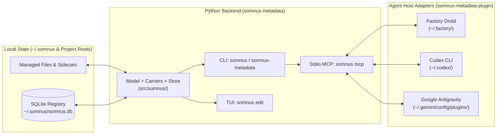
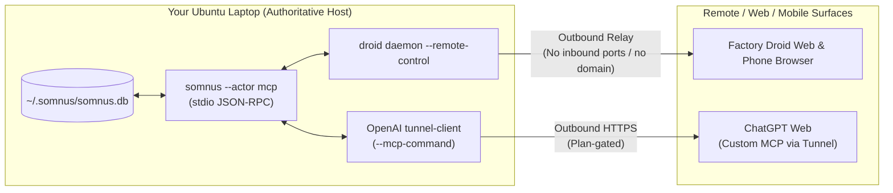

# Somnus Metadata — Operator and Agent Usage Guide

```
DOCUMENT TITLE: Somnus Metadata Operator and Agent Usage Guide
Classification: PUBLIC (repository documentation)
Version: 2.1.0
Date: 2026-10-31
Author/Origin: Somnus Metadata Engineering / Colony Chronicler
Status: OPERATIONAL
```

## Executive Summary

Somnus Metadata is a local-first metadata standard (`somnus://metadata/core/2.0.0`) and Python stdlib-only toolkit that attaches one validated `somnus:` header to any managed file and indexes all managed files into a single global SQLite registry (`~/.somnus/somnus.db`). Markdown files use frontmatter or HTML comment envelopes, source code and configuration files use native comment envelopes, and arbitrary binary or unstructured files use `<file>.somnus.yaml` sidecars, while every write verifies that host bytes outside the metadata envelope remain unchanged byte-for-byte (`E_HOST`). This guide provides the complete, step-by-step operational walkthrough for a Linux operator or coding agent going from a clean machine to creating, adopting, validating, searching, and governing documents across the CLI, Terminal UI (TUI), Model Context Protocol (MCP) server, and multi-host agent plugin.

---

## Table of Contents

1. [What Somnus Metadata Is and How It Is Layered](#1-what-somnus-metadata-is-and-how-it-is-layered)
2. [Installation on Ubuntu / Linux](#2-installation-on-ubuntu--linux)
   - [2.1 Package Name vs. Command Name](#21-package-name-vs-command-name)
   - [2.2 Primary Install Path (`uv tool install`)](#22-primary-install-path-uv-tool-install)
   - [2.3 Why Plain `pip install` Fails or Shadows on Ubuntu](#23-why-plain-pip-install-fails-or-shadows-on-ubuntu)
   - [2.4 Checking Which Binary Is Running](#24-checking-which-binary-is-running)
   - [2.5 Upgrading and Uninstalling](#25-upgrading-and-uninstalling)
3. [First-Run Walkthrough (Step by Step)](#3-first-run-walkthrough-step-by-step)
   - [3.1 Initialize the Registry and Register a Project Root (`init`)](#31-initialize-the-registry-and-register-a-project-root-init)
   - [3.2 Reconcile the Project Root (`index`)](#32-reconcile-the-project-root-index)
   - [3.3 Adopt Existing Files (`stamp` Preview and `--write`)](#33-adopt-existing-files-stamp-preview-and---write)
   - [3.4 Create a New Conformant Document (`new`)](#34-create-a-new-conformant-document-new)
   - [3.5 Validate Files (`check`)](#35-validate-files-check)
   - [3.6 Edit Header Fields Non-Interactively (`set`)](#36-edit-header-fields-non-interactively-set)
   - [3.7 Transition Lifecycle State (`status`)](#37-transition-lifecycle-state-status)
   - [3.8 Record Body Changes (`bump`)](#38-record-body-changes-bump)
   - [3.9 List and Query Managed Artifacts (`ls`, `q`, `stale`)](#39-list-and-query-managed-artifacts-ls-q-stale)
4. [Searching and Adopting Any File Type](#4-searching-and-adopting-any-file-type)
   - [4.1 Full-Text Search Rules (`q --text`)](#41-full-text-search-rules-q---text)
   - [4.2 Why Unmanaged Files Do Not Appear in Search](#42-why-unmanaged-files-do-not-appear-in-search)
   - [4.3 Carriers and Sidecars (`<file>.somnus.yaml`)](#43-carriers-and-sidecars-filesomnusyaml)
   - [4.4 Direct Read-Only SQL Queries (`q`)](#44-direct-read-only-sql-queries-q)
5. [The Terminal UI (`somnus edit`)](#5-the-terminal-ui-somnus-edit)
   - [5.1 Launching the Browser or Direct Editor](#51-launching-the-browser-or-direct-editor)
   - [5.2 Browser Screen Layout and Keys](#52-browser-screen-layout-and-keys)
   - [5.3 Editor Screen Layout, Fields, and Keys](#53-editor-screen-layout-fields-and-keys)
6. [Coding Agents: MCP Server and Host Plugin](#6-coding-agents-mcp-server-and-host-plugin)
   - [6.1 The Stdio MCP Server (`somnus mcp`)](#61-the-stdio-mcp-server-somnus-mcp)
   - [6.2 The Multi-Host Agent Plugin (`somnus-metadata-plugin`)](#62-the-multi-host-agent-plugin-somnus-metadata-plugin)
   - [6.3 What the Plugin Writes per Host](#63-what-the-plugin-writes-per-host)
7. [Remote Access and Hosting Architecture](#7-remote-access-and-hosting-architecture)
   - [7.1 Architectural Decision: Extend the Laptop Outward](#71-architectural-decision-extend-the-laptop-outward)
   - [7.2 Factory Droid Web and Phone via Remote Control (Primary)](#72-factory-droid-web-and-phone-via-remote-control-primary)
   - [7.3 ChatGPT Web via OpenAI Secure MCP Tunnel (Secondary, Plan-Gated)](#73-chatgpt-web-via-openai-secure-mcp-tunnel-secondary-plan-gated)
   - [7.4 Rejected Tunneling Approaches](#74-rejected-tunneling-approaches)
8. [Troubleshooting Common Failure Modes](#8-troubleshooting-common-failure-modes)
9. [Current System State and Verification Matrix](#9-current-system-state-and-verification-matrix)

---

## 1. What Somnus Metadata Is and How It Is Layered

Somnus Metadata gives every tracked file in your repositories a durable identity (`urn:somnus:artifact:<uuidv7>`), an integer revision counter, controlled classification and lifecycle fields, and an entry in one global SQLite database at `~/.somnus/somnus.db`. The database stores plain text and canonical restricted YAML (never JSON), maintains an append-only `events` audit ledger, tracks cross-document relations and conflicts, and maintains a derived SQLite FTS5 full-text search index over file paths, titles, summaries, tags, and UTF-8 file bodies.

The system is strictly layered so that all metadata rules live in one place:



- **Python Backend (`src/somnus/`)**: Owns all schema validation, carrier placement, host-byte preservation, and SQLite indexing. Has zero third-party runtime dependencies (Python 3.11+ standard library only).
- **CLI (`somnus`), TUI (`somnus edit`), and MCP Server (`somnus mcp`)**: Thin surfaces over the same backend. `somnus mcp` generates its 16 MCP tool schemas directly from the CLI `argparse` definitions and runs the CLI in a child process for each call, so CLI and MCP behavior can never drift.
- **Agent Host Plugin (`calisweetleaf/somnus-metadata-plugin`)**: A zero-dependency Node.js installer that copies the `somnus-metadata` agent skill and registers `somnus --actor <host> mcp` in Factory Droid, Codex, and Google Antigravity. It contains no metadata logic; upgrading the Python backend never requires a plugin release.

---

## 2. Installation on Ubuntu / Linux

### 2.1 Package Name vs. Command Name

- **Distribution / package name**: `somnus-metadata` (used because an unrelated project already owned the bare name `somnus` on PyPI).
- **Command name**: `somnus` (primary CLI command and Python import name `somnus`).
- **Command alias in 2.1.0**: Starting in version **2.1.0** (in the repository checkout), `pyproject.toml` also installs `somnus-metadata` as a console-script alias for `somnus`, so typing either `somnus` or `somnus-metadata` runs the exact same CLI.
- **Version 2.0.0 vs. 2.1.0**: Public PyPI currently serves **2.0.0**, which exposes **only** the `somnus` command (not the `somnus-metadata` alias) and uses registry schema 1 (no `q --text` full-text search). The repository checkout is at **2.1.0** (registry schema 2 with `q --text` full-text search, agent hints, and the `somnus-metadata` command alias).

> **Warning:** Never install the unrelated PyPI package named `somnus` (`pip install somnus`). It is a different project and collides with the `somnus` command and Python module namespace.

### 2.2 Primary Install Path (`uv tool install`)

On Ubuntu and other Linux distributions, install the CLI into an isolated tool environment placed on `~/.local/bin` using `uv`:

**To install 2.1.0 from your local repository checkout (recommended today):**

```sh
uv tool install --force /home/daeron/Repositories/somnus-metadata
```

**To install from PyPI (currently installs 2.0.0 until 2.1.0 is published):**

```sh
uv tool install somnus-metadata
```

If you do not use `uv`, `pipx` provides the same isolated tool installation:

```sh
pipx install /home/daeron/Repositories/somnus-metadata
```

### 2.3 Why Plain `pip install` Fails or Shadows on Ubuntu

On modern Ubuntu systems, two traps occur when running `pip install somnus-metadata`:

1. **PEP 668 `externally-managed-environment` refusal**: If you run system `/usr/bin/pip install somnus-metadata` outside a virtual environment, Ubuntu refuses the install because `/usr/lib/python3.*/EXTERNALLY-MANAGED` protects system Python packages.
2. **The Global-Venv / PyPI 2.0.0 Shadow Trap (What Happened Today)**: If your shell startup activates a global default virtual environment (for example `~/.venvs/global/bin` placed ahead of `~/.local/bin` on `PATH`) and you run `pip install somnus-metadata`, `pip` downloads **2.0.0** from PyPI into `~/.venvs/global/bin/somnus`.
   - Because 2.0.0 did not yet have the `somnus-metadata` alias, running `somnus-metadata` returned `command not found`.
   - Worse, `~/.venvs/global/bin/somnus` (2.0.0, registry schema 1) shadowed `~/.local/bin/somnus` (2.1.0, registry schema 2). When 2.0.0 tried to open a schema-2 registry created by 2.1.0, it failed with:
     `error E_IO -: registry schema version 2 is newer than this tool (1)`.

**Rule:** Always install `somnus-metadata` as a user tool via `uv tool install`, and never `pip install somnus-metadata` into a shared virtual environment that sits ahead of `~/.local/bin` on your `PATH`.

### 2.4 Checking Which Binary Is Running

Run `which -a` and `--version` to confirm that `~/.local/bin/somnus` (2.1.0) is first on your `PATH` and no older copy shadows it:

```sh
$ which -a somnus somnus-metadata
/home/daeron/.local/bin/somnus
/home/daeron/.local/bin/somnus-metadata

$ somnus --version
somnus 2.1.0

$ somnus-metadata --version
somnus 2.1.0

$ uv tool list
somnus-metadata v2.1.0
- somnus
- somnus-metadata
```

If `which -a somnus` shows a second path (such as `~/.venvs/global/bin/somnus`), remove the shadowing copy from that virtual environment:

```sh
~/.venvs/global/bin/pip uninstall somnus-metadata
hash -r
```

### 2.5 Upgrading and Uninstalling

```sh
# Upgrade or reinstall from the local 2.1.0 checkout
uv tool install --force /home/daeron/Repositories/somnus-metadata

# Uninstall the CLI tool (leaves ~/.somnus/somnus.db intact)
uv tool uninstall somnus-metadata
```

---

## 3. First-Run Walkthrough (Step by Step)

Every command and output snippet below was executed with `~/.local/bin/somnus` 2.1.0 against an isolated `$SOMNUS_HOME`. By default, `somnus` stores its configuration and SQLite registry in `~/.somnus/` (`~/.somnus/config.toml` and `~/.somnus/somnus.db`). If you want to practice or run throwaway experiments without touching your real `~/.somnus/somnus.db` registry, set `export SOMNUS_HOME=$(mktemp -d)` in that shell first. You can also pass `--actor <name>` before any subcommand (or set `SOMNUS_ACTOR`) so the registry ledger records who performed the action.

### 3.1 Initialize the Registry and Register a Project Root (`init`)

Register each repository or folder you want Somnus Metadata to track:

```sh
$ somnus --actor daeron init --root /path/to/project
created config: /home/daeron/.somnus/config.toml
registry: /home/daeron/.somnus/somnus.db (created)
root: /path/to/project
```

You can run `somnus init --root /another/project` at any time to add more project roots to the same global registry.

### 3.2 Reconcile the Project Root (`index`)

Run `somnus index` to scan all registered roots. If a root contains ordinary Markdown or code files that do not yet have a `somnus:` header, `index` reports them as `unmanaged` and shows how to adopt them:

```sh
$ somnus index
scanned 2, indexed 0, unchanged 0, new revisions 0, unmanaged 2, examples 0, invalid 0, missing 0, conflicts opened 0, resolved 0
unmanaged (no Somnus header, so not searchable): /path/to/project/CONTRIBUTING.md, /path/to/project/src/somnus/yamlsub.py
adopt one with 'somnus stamp PATH' (preview) then 'somnus stamp PATH --write'
```

### 3.3 Adopt Existing Files (`stamp` Preview and `--write`)

`somnus stamp PATH` infers a complete `somnus:` header from the file's title, extension, and path.

- **Without `--write`**, it is a safe dry run that prints a unified diff of the header it would insert. (The preview generates a temporary UUIDv7; `--write` mints the real UUIDv7 written to disk.)
- **With `--write`**, it writes the header into the file (or creates a `<file>.somnus.yaml` sidecar for non-comment file types), verifies that every host byte outside the envelope is preserved, and indexes the file in `~/.somnus/somnus.db`.
- **Important:** `somnus stamp` takes one or more **file** paths, not a directory path. Passing a directory returns `error E_IO -: file not found` (exit `2`).

```sh
# 1. Dry-run preview on a Markdown file (leaves the file untouched)
$ somnus stamp /path/to/project/CONTRIBUTING.md
--- a/CONTRIBUTING.md
+++ b/CONTRIBUTING.md
@@ -1,3 +1,34 @@
+---
+somnus:
+  schema: "somnus://metadata/core/2.0.0"
+  id: "urn:somnus:artifact:<preview-id>"
+  revision: 1
+  title: "Contributing to somnus-metadata"
...

# 2. Apply the stamp to Markdown (frontmatter) and Python (comment envelope)
# (Note: stamp prints the stamped path relative to the current directory when inside it)
$ somnus stamp /path/to/project/CONTRIBUTING.md --write
/path/to/project/CONTRIBUTING.md: stamped urn:somnus:artifact:01a194fc-824f-7231-84e1-2fc147396d18

$ somnus stamp /path/to/project/src/somnus/yamlsub.py --write
/path/to/project/src/somnus/yamlsub.py: stamped urn:somnus:artifact:<id>
```

Re-running `somnus index` now shows both files tracked and `unmanaged 0`:

```sh
$ somnus index
scanned 2, indexed 0, unchanged 2, new revisions 0, unmanaged 0, examples 0, invalid 0, missing 0, conflicts opened 0, resolved 0
```

### 3.4 Create a New Conformant Document (`new`)

Use `somnus new TYPE "Title" --dir DIR` to scaffold a new Markdown document with a freshly minted UUIDv7 at `revision: 1` and register it immediately:

```sh
$ somnus new report "Scout Tasting Notes" --dir /path/to/project
/path/to/project/scout-tasting-notes.md
created urn:somnus:artifact:<id> revision 1
```

The 20 controlled document types (`classification.type`) are: `whitepaper`, `specification`, `architecture-record`, `report`, `task`, `plan`, `notepad`, `benchmark`, `test-result`, `decision-record`, `runbook`, `index`, `state`, `memory`, `source-code`, `configuration`, `dataset`, `equation-set`, `conversation`, and `asset`. Run `somnus schema classification.type` to inspect the field definition.

If a registered document already has a near-duplicate title (similarity >= 0.90), `somnus new` refuses with `[E_IO]` so you do not accidentally create duplicate documents; pass `--force` to override deliberately.

### 3.5 Validate Files (`check`)

Run `somnus check` at `core` (default), `semantic`, or `canon` level. Passing a directory checks all managed files inside it:

```sh
$ somnus check /path/to/project --level semantic
checked 3 file(s) at level semantic: 0 error(s), 0 warning(s)
```

At `--level canon`, the validator additionally requires that the artifact be in `active` or `provisional` status with `authority.standing: accepted` and a resolved `acceptance_ref` (a draft artifact fails `canon` with `E_AUTHORITY: status 'draft' is not eligible for current canon` and `canon requires standing 'accepted'`).

### 3.6 Edit Header Fields Non-Interactively (`set`)

Never hand-edit `somnus:` headers in a text editor. Use `somnus set PATH FIELD=VALUE...`, which validates vocabulary rules, increments `revision`, preserves host bytes, and records a `set` event in the registry:

```sh
$ somnus set /path/to/project/scout-tasting-notes.md \
    "title=Scout Tasting Notes v2" \
    "classification.tags=colony, tasting" \
    --reason "retitled and tagged"
/path/to/project/scout-tasting-notes.md: set title, classification.tags (revision 2)
```

**Editable fields in `somnus set` (and `somnus edit`):**
- `title` (required string)
- `summary` (optional string; pass `summary=` with an empty value to remove)
- `purpose` (optional string; pass `purpose=` with an empty value to remove)
- `classification.category` (`research`, `engineering`, `operations`, `governance`, `context`, `archive`)
- `classification.type` (20 controlled values: `whitepaper`, `specification`, `architecture-record`, `report`, `task`, `plan`, `notepad`, `benchmark`, `test-result`, `decision-record`, `runbook`, `index`, `state`, `memory`, `source-code`, `configuration`, `dataset`, `equation-set`, `conversation`, `asset`; inspect with `somnus schema classification.type`)
- `classification.role` (`normative`, `informative`, `working`, `exploratory`, `historical`)
- `classification.scope` (`ecosystem`, `fleet`, `repository`, `subsystem`, `module`, `component`, `artifact`)
- `classification.tags` (comma-separated list, e.g. `"classification.tags=alpha, beta"`)
- `access.visibility` (`operator-only`, `internal`, `public`)
- `ingestion.disposition` (`candidate`, `archive-only`, `excluded`, `canonical-candidate`)

> **Trap:** Always write `classification.tags=a, b`, not bare `tags=a, b`. Bare `tags` is rejected (`-:0:0: error E_IO -: 'tags' cannot be set; settable fields: title, summary, purpose, classification.category, classification.type, classification.role, classification.scope, classification.tags, access.visibility, ingestion.disposition`, exit `2`).

### 3.7 Transition Lifecycle State (`status`)

Lifecycle changes go through `somnus status PATH NEW_STATUS [--reason "..."]`, which enforces the state machine in SPEC §7.1 and creates a new revision:

```sh
$ somnus status /path/to/project/scout-tasting-notes.md proposed --reason "ready for review"
/path/to/project/scout-tasting-notes.md: draft -> proposed (revision 3)

$ somnus status /path/to/project/scout-tasting-notes.md active
/path/to/project/scout-tasting-notes.md: proposed -> active (revision 4)
```

If you attempt an illegal transition (for example, `active -> draft`), `somnus status` refuses with exit code `1` and lists the allowed next states:

```text
/path/to/project/scout-tasting-notes.md:1:1: error E_LIFECYCLE somnus.lifecycle.status: transition active -> draft is not permitted (allowed: deprecated, historical, superseded)
```

When transitioning to `superseded`, you must also supply `--replacement urn:somnus:artifact:<uuid>`.

### 3.8 Record Body Changes (`bump`)

Whenever you edit the body of an indexed file (outside the `somnus:` header), run `somnus bump` afterward so the registry records the new `body_digest` under a new revision:

```sh
$ somnus bump /path/to/project/scout-tasting-notes.md --reason "added walkthrough observations"
/path/to/project/scout-tasting-notes.md: revision 4 -> 5
```

If you edit an indexed file's body and run `somnus index` without bumping, `index` detects that the file on disk has the same revision number but a different `body_digest` and opens a `revision` conflict (exit `1`). Running `somnus bump PATH --reason "..."` resolves that conflict cleanly.

### 3.9 List and Query Managed Artifacts (`ls`, `q`, `stale`)

```sh
# List all present managed documents
$ somnus ls
id                                                     title                            type         status  standing   revision  path
-----------------------------------------------------  -------------------------------  -----------  ------  ---------  --------  ------------------------------------------------
urn:somnus:artifact:01a194fc-824f-7231-84e1-2fc147396d18  Contributing to somnus-metadata  report       draft   candidate  1         /path/to/project/CONTRIBUTING.md
urn:somnus:artifact:<id>                               Scout Tasting Notes v2           report       active  candidate  5         /path/to/project/scout-tasting-notes.md
urn:somnus:artifact:<id>                               yamlsub                          source-code  draft   candidate  1         /path/to/project/src/somnus/yamlsub.py

# Filter by type, status, standing, tag, or path substring
$ somnus ls --tag colony
$ somnus ls --type report --status active
$ somnus ls --path-contains yamlsub

# Search across titles, summaries, tags, paths, and file bodies
$ somnus q --text "walkthrough"
id                        title                   type    status  path                                     excerpt
------------------------  ----------------------  ------  ------  ---------------------------------------  ---------------------------------------------
urn:somnus:artifact:<id>  Scout Tasting Notes v2  report  active  /path/to/project/scout-tasting-notes.md  ...added [walkthrough] observations...

# View the append-only audit history (optionally filtered to one file)
$ somnus q --history /path/to/project/scout-tasting-notes.md

# Check for open conflicts or stale work
$ somnus q --conflicts
no rows

$ somnus stale
no rows
```

---

## 4. Searching and Adopting Any File Type

### 4.1 Full-Text Search Rules (`q --text`)

`somnus q --text WORDS` queries the SQLite FTS5 `search` table (Porter stemmer over `unicode61` tokens):

- **Every word must match** (implicit boolean `AND`).
- **Quoted or unquoted words both work**: `somnus q --text "host bytes"` and `somnus q --text host bytes` execute the same multi-word search.
- **Prefix matching**: Append `*` to any word (for example, `somnus q --text "valid*"`) to match prefixes (`validate`, `validation`, `validator`).
- **BM25 ranking weights**: Matches are ranked by BM25 with column weights: `title` (10), `summary` (5), `tags` (5), `path` (2), and `body` (1).
- **Row cap**: Pass `--limit N` (default `50`) to limit returned rows, and `--tsv` if you want tab-separated output.

### 4.2 Why Unmanaged Files Do Not Appear in Search

Only files with a `somnus:` header (or a `<file>.somnus.yaml` sidecar) are indexed into `~/.somnus/somnus.db`. For example, in this repository on first setup, `SPEC.md` and `DECISIONS.md` had headers and were searchable, while 236 other files had no header and were invisible to `somnus ls` and `somnus q --text`.

Whenever `somnus q --text` returns `no matches`, or whenever you run `somnus index`, the CLI reminds you how to adopt unmanaged files:
1. Run `somnus index` to see unmanaged files in your registered roots.
2. Run `somnus stamp /abs/path/to/file` to preview the header, then `somnus stamp /abs/path/to/file --write` to adopt and index it.

### 4.3 Carriers and Sidecars (`<file>.somnus.yaml`)

Somnus Metadata can track **any** file type without corrupting host syntax:

| File Type | Carrier Used by `somnus stamp` | How Content Is Indexed in `search` |
| --- | --- | --- |
| Markdown (`.md`, `.markdown`, `.mdx`) | YAML frontmatter (`---`) or hidden HTML comment (`<!-- somnus:metadata:v2 ... -->`) | Full Markdown body outside the envelope (up to 1,000,000 chars) |
| Source code & config (`.py`, `.sh`, `.toml`, `.yaml`, `.sql`, `.js`, `.ts`, `.rs`, `.c`, `.go`, `.css`, `.html`, `.xml`, `.tex`, ...) | Native line-comment (`#`, `//`, `--`, `%`) or block-comment (`/* */`, `<!-- -->`) envelope placed after any mandatory preamble (shebang `#!`, encoding cookie, `<?xml ...?>`) | Full source/config text outside the comment envelope |
| Any other file (`.json`, `.pdf`, `.png`, `.zip`, `.parquet`, `.sqlite`, binary weights, ...) | External sidecar file named `<filename>.somnus.yaml` in the same directory | Title, summary, tags, and path are always searchable; if the host file decodes as valid UTF-8 (e.g., `.json` or `.csv`), its text body is indexed too; binary host bodies are skipped cleanly |

**Example: Adopting a binary archive or image via sidecar:**

```sh
$ somnus stamp /path/to/project/notes-bundle.zip --write --type asset --title "Notes Archive Bundle"
notes-bundle.zip.somnus.yaml: stamped urn:somnus:artifact:01a194fc-81ff-7420-8832-e881af8dfee6
```

`notes-bundle.zip` is never modified; `notes-bundle.zip.somnus.yaml` holds the metadata and a `bindings:` entry (`target: "notes-bundle.zip"`, `role: "primary"`). (`somnus stamp` prints the path relative to the current directory.)

### 4.4 Direct Read-Only SQL Queries (`q`)

Because the registry is a human-readable SQLite database (D4), you can run any read-only `SELECT` statement directly with `somnus q`:

```sh
# List all tables and views
$ somnus q --tables

# Query the docs view directly
$ somnus q "SELECT id, title, type, status, revision FROM docs ORDER BY title"

# Query the FTS5 table with column-scoped MATCH syntax
$ somnus q "SELECT path, title FROM search WHERE search MATCH 'title : spec*' LIMIT 10"
```

---

## 5. The Terminal UI (`somnus edit`)

`somnus edit` is a full-screen, pure-stdlib terminal application (using alternate screen and raw terminal modes with no `curses` dependency).

### 5.1 Launching the Browser or Direct Editor

- **Browse the entire registry**:
  ```sh
  somnus edit
  ```
  (Requires an initialized registry; if `~/.somnus/somnus.db` does not exist yet, it exits with `no registry; run 'somnus init' and 'somnus index'`.)
- **Open one specific file's header directly**:
  ```sh
  somnus edit /path/to/file.md
  ```

### 5.2 Browser Screen Layout and Keys

When launched without a file path, `somnus edit` opens the **Browser Screen**:
- **Left pane (55% width)**: Scrollable list of registered documents showing `Title  [type, status, rN]`.
- **Right pane (45% width)**: Wrapped detail view for the highlighted document (`ID`, `Title`, `Type`, `Status`, `Standing`, `Revision`, `Path`).
- **Bottom bars**: Status/message line and keybinding bar.

| Key | Action in Browser Screen |
| --- | --- |
| `Up` / `Down` | Move selection by one row |
| `PgUp` / `PgDn` | Move selection by 10 rows |
| `Home` / `End` | Jump to first or last document |
| `/` | Open interactive case-insensitive substring filter across all columns (type to filter, `Backspace` to shorten, `Enter` to keep filter and return to navigation, `Esc` to clear filter) |
| `Enter` | Open the highlighted document in the **Editor Screen** |
| `r` | Reload rows from `~/.somnus/somnus.db` |
| `q` / `Esc` / `Ctrl-C` | Quit `somnus edit` and restore the terminal |

### 5.3 Editor Screen Layout, Fields, and Keys

The **Editor Screen** displays the 10 editable fields at the top (`Title`, `Summary`, `Purpose`, `Category`, `Type`, `Role`, `Scope`, `Tags`, `Visibility`, `Disposition`) followed by 5 read-only reference rows (`ID`, `Revision`, `Status`, `Standing`, `Authority scopes`) and a live validation status line (`valid` or the first validation error).

> **Note:** Lifecycle status is intentionally read-only in the TUI (`status changes use 'somnus status'`).

| Key | Action in Editor Screen |
| --- | --- |
| `Up` / `Down` | Move cursor between the 10 editable fields |
| `Enter` | Edit the selected field: opens a **Picker** list for controlled-vocabulary fields (`Category`, `Type`, `Role`, `Scope`, `Visibility`, `Disposition`) or a **TextInput** prompt for text/tag fields (`Enter` accepts, `Esc` cancels) |
| `s` | Save changes: validates the payload, increments `revision`, writes the envelope while preserving host bytes, records an `edit` event in the registry, and reloads |
| `u` | Undo / discard all unsaved header edits in the current form |
| `e` | Open the file in your external text editor (`$EDITOR`, then `$VISUAL`, else `vi` on Linux / `notepad` on Windows) to edit the body, then reload and validate on exit (requires saving or discarding unsaved header edits first) |
| `q` / `Esc` / `Ctrl-C` | Return to the Browser Screen (or exit if launched with a file path); prompts `unsaved changes; quit anyway? [y/N]` if the form has unsaved edits |

---

## 6. Coding Agents: MCP Server and Host Plugin

### 6.1 The Stdio MCP Server (`somnus mcp`)

`somnus mcp` runs a newline-delimited JSON-RPC 2.0 Model Context Protocol server over standard input/output (D17, SPEC §20):

```sh
/home/daeron/.local/bin/somnus --actor droid mcp
```

- **Actor attribution**: Passing `--actor <host>` before `mcp` stamps every registry ledger event (`new`, `stamp`, `set`, `status`, `bump`, `index`, `fork`, `migrate`, `regions`) with which agent performed the operation.
- **Always pass absolute paths over MCP**: The MCP server runs in whatever working directory the agent host spawned it in. Relative paths resolve against that server working directory, not your current chat workspace. Always pass `/abs/path/to/file`.
- **16 exposed MCP tools** (every CLI subcommand except interactive `edit` and `mcp` itself):

| Tool Name | Read-Only? | Purpose |
| --- | --- | --- |
| `brief` | Yes | Return the compact agent rules and command cheat sheet |
| `q` | Yes | Full-text search (`text`), shortcuts (`docs`, `conflicts`, `history`, `tables`), or read-only SQL (`sql`) |
| `ls` | Yes | List present artifacts with optional `type`, `status`, `standing`, `tag`, `path_contains` filters |
| `check` | Yes | Validate files (`paths`) or all roots (`all: true`) at `core`, `semantic`, or `canon` level |
| `stale` | Yes | Report stale drafts, missing files, unreplaced supersessions, near-duplicate titles, and conflicts |
| `schema` | No* | Inspect schema field definitions or export JSON Schema (`--out`) |
| `init` | No | Initialize `$SOMNUS_HOME` and register project `root` directories |
| `index` | No | Scan and reconcile registered roots (`full: true` to force re-read) |
| `stamp` | No | Preview (`write: false`) or write (`write: true`) a header/sidecar to adopt unmanaged files |
| `new` | No | Scaffold and register a new Markdown document (`type`, `title`, `dir`) |
| `set` | No | Update editable header fields (`path`, `assignments`, `reason`) in one new revision |
| `status` | No | Transition `lifecycle.status` (`path`, `status`, `reason`, `replacement`) |
| `bump` | No | Increment `revision` after a body edit (`path`, `reason`) |
| `fork` | No | Derive a new artifact at revision 1 with a `derived_from` relation (`path`, `title`, `out`) |
| `regions` | No | Audit or synchronize (`sync: true`, `write: true`) in-document comment region markers |
| `migrate` | No | Preview or upgrade (`write: true`) legacy v0.1 documents |

*(\*`schema` without `--out` only prints field documentation to stdout.)*

### 6.2 The Multi-Host Agent Plugin (`somnus-metadata-plugin`)

The repository `github.com/calisweetleaf/somnus-metadata-plugin` is a **private** GitHub repository that installs the `somnus-metadata` agent skill and registers the `somnus-metadata` MCP server across Factory Droid, OpenAI Codex CLI, and Google Antigravity.

**Prerequisites:**
1. Node.js 18.17+ (`node` and `npx`).
2. `somnus` 2.1.0+ installed (`~/.local/bin/somnus`).
3. Authenticated GitHub access to the private repository `calisweetleaf/somnus-metadata-plugin` (via `gh auth login` or SSH/HTTPS git credentials) when invoking via `npx github:...`, or a local clone at `/home/daeron/Repositories/somnus-metadata-plugin`.

**Commands:**

```sh
# List detected agent hosts and current install state
npx github:calisweetleaf/somnus-metadata-plugin hosts

# Preview what install will do without modifying any files
npx github:calisweetleaf/somnus-metadata-plugin install --dry-run

# Install the skill and MCP server into every detected host (Droid, Codex, Antigravity)
npx github:calisweetleaf/somnus-metadata-plugin install

# Target specific hosts only, or install/upgrade the Python backend at the same time
npx github:calisweetleaf/somnus-metadata-plugin install --host droid,codex
npx github:calisweetleaf/somnus-metadata-plugin install --install-backend /home/daeron/Repositories/somnus-metadata

# Verify backend version, registry health, skill SHA-256 drift, and live 16-tool MCP handshake per host
npx github:calisweetleaf/somnus-metadata-plugin doctor

# Remove the plugin skill directories and MCP entries (leaves somnus and ~/.somnus/somnus.db untouched)
npx github:calisweetleaf/somnus-metadata-plugin uninstall
```

If you have the plugin repository cloned locally at `/home/daeron/Repositories/somnus-metadata-plugin`, you can also run `node /home/daeron/Repositories/somnus-metadata-plugin/bin/somnus-plugin.mjs <command>` directly with no network access.

**Sample `doctor` output on a healthy machine:**

```text
ok   backend: /home/daeron/.local/bin/somnus (somnus 2.1.0)
ok   registry: 5 managed artifact(s) present
ok   droid: skill 1.0.0 at /home/daeron/.factory/skills/somnus-metadata matches the packaged skill
ok   droid: MCP '/home/daeron/.local/bin/somnus --actor droid mcp' serves 16 tools (somnus 2.1.0)
ok   codex: skill 1.0.0 at /home/daeron/.codex/skills/somnus-metadata matches the packaged skill
ok   codex: MCP '/home/daeron/.local/bin/somnus --actor codex mcp' serves 16 tools (somnus 2.1.0)
ok   antigravity: skill 1.0.0 at /home/daeron/.gemini/config/plugins/somnus-metadata matches the packaged skill
ok   antigravity: MCP '/home/daeron/.local/bin/somnus --actor antigravity mcp' serves 16 tools (somnus 2.1.0)
all checks passed
```

### 6.3 What the Plugin Writes per Host

Before modifying any host configuration file, the plugin creates a timestamped backup `<file>.bak-somnus-plugin-<UTC-timestamp>` and marks managed skill directories with `.somnus-plugin.json` (storing `plugin`, `version`, `skillHash`, and `installedAt`).

| Agent Host | Skill Location Written | MCP Server Configuration Written | Actor Flag Used |
| --- | --- | --- | --- |
| **Factory Droid** | `~/.factory/skills/somnus-metadata/` (`SKILL.md`, `references/recipes.md`, `.somnus-plugin.json`) | `mcpServers["somnus-metadata"]` in `~/.factory/mcp.json` | `--actor droid` |
| **Codex CLI** | `$CODEX_HOME/skills/somnus-metadata/` (default `~/.codex/skills/somnus-metadata/`) | Managed `# >>> somnus-metadata-plugin` ... `# <<< somnus-metadata-plugin` block in `~/.codex/config.toml` defining `[mcp_servers.somnus-metadata]` | `--actor codex` |
| **Google Antigravity** | `~/.gemini/config/plugins/somnus-metadata/skills/somnus-metadata/` | `~/.gemini/config/plugins/somnus-metadata/plugin.json` and `mcp_config.json` | `--actor antigravity` |

**Important:** Restart each running agent host (Droid, Codex, Antigravity) after running `install` or `uninstall` so the host reloads its skill catalog and spawns the MCP server. To make agents check the registry proactively in every session even before a skill is triggered, paste the global snippet from [`docs/AGENTS.appendix.md`](AGENTS.appendix.md) into your global `AGENTS.md`.

---

## 7. Remote Access and Hosting Architecture

### 7.1 Architectural Decision: Extend the Laptop Outward

**Question asked by the operator:** *Did we ever decide who hosts Somnus Metadata so I can reach my registry from Factory Droid web, my phone, or ChatGPT when my laptop is on, without buying a domain?*

**Answer (Decided 2026-10-31):**
- **Your laptop hosts it.** There is no third-party cloud database and no public HTTPS server to deploy. `~/.somnus/somnus.db` and `somnus mcp` stay on your laptop and are available whenever your laptop is powered on.
- **Do not expose `~/.somnus/somnus.db` over a public HTTPS tunnel.** `somnus mcp` is a stdio-only server (`src/somnus/mcp.py` has no HTTP transport or authentication layer). Instead of putting the registry on the public internet, use the outbound relay built into your agent platform so remote sessions execute against your laptop's local stdio server.



### 7.2 Factory Droid Web and Phone via Remote Control (Primary)

Factory Droid includes **Remote Control**, which connects your local laptop to Factory Droid web (and mobile browsers) over Factory's outbound relay. Because the session executes on your laptop, the local `somnus-metadata` stdio MCP server and skill installed by `somnus-metadata-plugin` work in Droid web and from a phone browser with zero extra MCP configuration, zero domains, and zero inbound ports.

**Step-by-step setup (~5 minutes):**
1. On your laptop, start the remote-control daemon:
   ```sh
   droid daemon --remote-control
   ```
   *(Alternatively, enable Remote Control in the Factory App under **Settings → Droid Computers → Remote Control**.)*
2. Confirm your laptop appears as connected under **Settings → Droid Computers** in the Factory App.
3. Open Factory App in any browser (or on your phone `[UNVERIFIED — CONFIRM BEFORE OPERATIONAL USE: phone browser UI ergonomics are inferred from Factory's "web or other devices" documentation and not yet live-tested on your phone]`), start a session targeting your laptop, and run a `somnus-metadata` query (such as `q --text`).

### 7.3 ChatGPT Web via OpenAI Secure MCP Tunnel (Secondary, Plan-Gated)

OpenAI provides **Secure MCP Tunnel** (`github.com/openai/tunnel-client`), an outbound-only client that wraps a local stdio MCP server via `--mcp-command` and exposes it to ChatGPT web ("Add custom MCP server → Connection: Tunnel") without opening inbound ports or owning a domain.

- **Verified Plan Availability (OpenAI Help Center article 12584461, checked 2026-10-31):**
  - **ChatGPT Business / Enterprise / Edu**: Full custom MCP server support on ChatGPT web.
  - **ChatGPT Pro**: Custom MCP server support with **read/fetch permissions** (sufficient for `q`, `ls`, `check`, `stale`, `brief`).
  - **ChatGPT Plus**: `[UNVERIFIED — CONFIRM BEFORE OPERATIONAL USE: OpenAI's availability documentation lists Business, Enterprise/Edu, and Pro, and does not list ChatGPT Plus. Check ChatGPT web -> Settings / Plugins -> Add custom MCP server on your account to confirm whether Developer mode offers it on Plus.]`
  - **ChatGPT Mobile App**: OpenAI's FAQ states custom MCP servers are currently **web only**, not available in the native mobile app.

**If your ChatGPT plan offers "Add custom MCP server → Connection: Tunnel":**
1. Create a tunnel in your personal OpenAI Platform organization (`platform.openai.com` tunnel settings) and associate it with your ChatGPT workspace to obtain a `<tunnel_id>`.
2. Set `CONTROL_PLANE_API_KEY` in your shell environment (using a Platform runtime API key with Tunnels Read + Use permissions; never commit keys to any repository).
3. Initialize and run `tunnel-client` wrapping `somnus mcp`:
   ```sh
   tunnel-client init \
     --sample sample_mcp_stdio_local \
     --profile local-stdio \
     --tunnel-id <tunnel_id> \
     --mcp-command "/home/daeron/.local/bin/somnus --actor chatgpt mcp"
   tunnel-client run --profile local-stdio
   ```
4. In ChatGPT web, open **Plugins → Add custom MCP server**, select **Connection: Tunnel**, and choose your tunnel.

### 7.4 Rejected Tunneling Approaches

Raw public HTTPS tunnels (`cloudflared`, Tailscale Funnel, `ngrok`) were evaluated and **rejected**:
1. `somnus mcp` speaks stdio JSON-RPC only, not HTTP/SSE.
2. Exposing an unauthenticated local command runner over a public HTTPS URL would create an immediate security boundary violation.
3. Keep `somnus-metadata` separate from `/home/daeron/Somnus-MCP` (which serves the Muad'Dib substrate); do not couple the two planes.

---

## 8. Troubleshooting Common Failure Modes

| Symptom / Exact Diagnostic | Root Cause | Exact Fix |
| --- | --- | --- |
| `somnus-metadata: command not found` or `somnus: command not found` | Either `somnus-metadata` is not installed in `~/.local/bin`, `~/.local/bin` is not on `PATH`, or you installed PyPI `2.0.0` (which only had `somnus`, not the `2.1.0` `somnus-metadata` alias). | Run `uv tool install --force /home/daeron/Repositories/somnus-metadata`, ensure `~/.local/bin` is on `PATH`, and run `hash -r`. Verify with `which -a somnus somnus-metadata`. |
| `error E_IO -: registry schema version 2 is newer than this tool (1)` | An older `somnus 2.0.0` binary (for example, pip-installed inside `~/.venvs/global/bin/somnus`) is first on `PATH` and trying to open a schema-2 `~/.somnus/somnus.db` created by `somnus 2.1.0`. | Run `which -a somnus`. Uninstall the 2.0.0 copy from the shadowing venv (`~/.venvs/global/bin/pip uninstall somnus-metadata`), then run `hash -r` and confirm `somnus --version` prints `somnus 2.1.0`. |
| `error E_IO -: registry /home/.../.somnus/somnus.db does not exist; run 'somnus init'` (or TUI `no registry; run 'somnus init' and 'somnus index'`) | `~/.somnus/somnus.db` has not been created yet in the active `$SOMNUS_HOME`. | Run `somnus init --root /abs/path/to/project` followed by `somnus index`. |
| `error E_IO -: file not found` on an MCP call, followed by `note: relative path(s) <path> resolve from the server directory <dir>; pass absolute paths` | An agent called an MCP tool (`check`, `stamp`, `set`, `status`, `bump`, ...) with a relative path. The MCP server resolves relative paths against its own working directory. | Always pass **absolute paths** (`/home/.../file.md`) in every MCP tool call. |
| `error E_IO -: no roots are registered and the fallback /home/daeron is too broad to scan; register a project with 'somnus init --root DIR' or name one: 'somnus index DIR'` | `somnus index` was run with no registered roots in `config.toml` while the fallback directory was `$HOME` or `/`. | Register a specific project directory first: `somnus init --root /abs/path/to/project`, then run `somnus index`. |
| `somnus stamp /path/to/dir` fails with `error E_IO -: file not found` | `somnus stamp` operates on individual files, not directories. | Pass specific file paths: `somnus stamp /path/to/dir/file.md --write`. Use `somnus index` to list unmanaged files first. |
| `-:0:0: error E_IO -: 'tags' cannot be set; settable fields: title, summary, purpose, classification.category, classification.type, classification.role, classification.scope, classification.tags, access.visibility, ingestion.disposition` | You passed `tags=...` instead of the full dotted schema path `classification.tags=...`. | Use `somnus set PATH "classification.tags=tag1, tag2"`. |
| `somnus fork` fails with `unrecognized arguments: --dir` | Unlike `somnus new` (which takes `--dir DIR`), `somnus fork` takes `--out /abs/path/to/new-file.md`. | Pass `--out /abs/path/to/derived.md` (or omit `--out` to write `<stem>-fork<ext>` beside the source file). |
| Files in your repository do not show up in `somnus ls` or `somnus q --text` | The files have no `somnus:` header or sidecar yet (`unmanaged`). | Run `somnus index` to list unmanaged files, then adopt the ones you want tracked with `somnus stamp /abs/path/to/file --write`. |
| `somnus index` exits `1` with `conflicts opened 1` (`revision` conflict) | A tracked file's header or body was edited on disk without incrementing `revision`. | Run `somnus q --conflicts` to inspect, then run `somnus bump /abs/path/to/file --reason "describe edit"` to record the new revision and close the conflict. |
| `error E_HOST -: refusing to write: content outside the envelope would change` | A carrier placement would alter host file content (for example, an XML file with a multi-line `<?xml ...?>` declaration). The file on disk is left untouched. | See `runbooks/host-write-incident.md`. Either normalize the single-line preamble or track the file via a sidecar. |

---

## 9. Current System State and Verification Matrix

Every item below reflects verified state as of **2026-10-31**:

| Surface / Capability | Current Status | Verification Evidence |
| --- | --- | --- |
| **Core Specification & Decisions** | **OPERATIONAL** (`somnus://metadata/core/2.0.0`, `SPEC.md` r9, `DECISIONS.md` r5 D1–D19) | `somnus check SPEC.md DECISIONS.md --level semantic` -> `0 error(s), 0 warning(s)` (exit `0`). |
| **Python Backend & CLI (`2.1.0` checkout)** | **OPERATIONAL** (`~/.local/bin/somnus` and `~/.local/bin/somnus-metadata` `2.1.0`, registry schema 2 with FTS5 `q --text`) | Unit suite: **534/534 tests pass** (`0 ResourceWarning`, **88.76%** branch+statement coverage); `mypy` clean across **49 source files**; `ruff` clean under the `.pre-commit-config.yaml` rule selection (enforced in CI `hooks and coverage`, not repo-wide default `ruff`); `import-linter` **6/6 architecture contracts kept**; installed-package acceptance harness: **66/66 checks pass** (including `somnus-metadata` alias, PTY TUI, MCP stdio, FTS5 search, conflict recovery). |
| **GitHub CI & CodeQL (`calisweetleaf/somnus-metadata`)** | **OPERATIONAL** | GitHub Actions `CI` (including `installed_package_acceptance.py`), `CodeQL`, and `Droid Wiki Refresh` workflows all passing on `main`. |
| **Multi-Host Agent Plugin (`calisweetleaf/somnus-metadata-plugin`)** | **OPERATIONAL** (v1.0.0 installed on this laptop for Droid, Codex, and Antigravity) | `npm test` **18/18 unit tests pass** (and 6/6 matrix jobs on GitHub Actions CI); `somnus-plugin doctor` passes all checks (`16 tools` handshake per host, SHA-256 skill-drift check clean); in-host MCP calls verified live in Factory Droid, Codex CLI, and Google Antigravity. |
| **Public PyPI Distribution (`pypi.org/project/somnus-metadata/`)** | **AT VERSION 2.0.0** (`2.1.0` not yet uploaded) | PyPI currently serves `2.0.0` (verified 60/60 at release). Version `2.1.0` (which adds registry schema 2 FTS5 `q --text`, agent hints, and the `somnus-metadata` console-script alias) is installed locally from the checkout and awaits an authorized PyPI release upload (`runbooks/package-release.md`). |
| **Live Windows OS Console TUI (`kernel32`/`msvcrt`)** | **UNIT-TESTED VIA FAKES ONLY** | `tests/test_term_windows.py` (12 tests, 96% coverage of `src/somnus/tui/term.py`) and plugin `win32` `spawnForm()` unit tests pass on Linux; live execution on a physical Windows console is **NOT RUN**. |
| **Remote Access Setup (Droid Remote Control / ChatGPT Tunnel)** | **ARCHITECTURE DECIDED; LIVE TUNNEL NOT YET STARTED** | Decision recorded in Section 7: use `droid daemon --remote-control` for Droid web/phone; ChatGPT Plus custom MCP tunnel eligibility requires a 1-step UI check in ChatGPT web (`[UNVERIFIED — CONFIRM BEFORE OPERATIONAL USE]`). |
