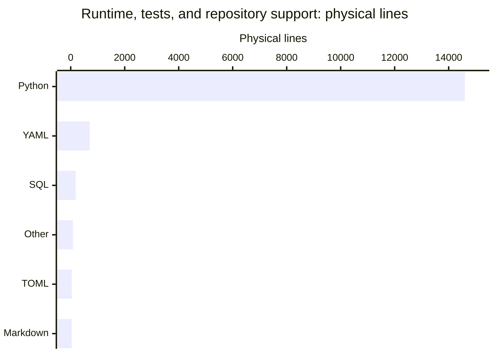

# By the numbers

Data collected on **2026-11-02 UTC** (clock checked at **00:58:52 UTC**), committed HEAD `803f1e21bb69fa1078fcffeeb7b17b9a4c0fa6db` on `main` in [the repository](https://github.com/calisweetleaf/somnus-metadata). This snapshot measures committed files and full reachable history, excluding staged and working-tree changes. Physical lines use Python `str.splitlines()`; blanks count and CRLF counts once. AST measurements are static inspection, not executed tests.

The size scope is deliberately limited to runtime source, tests, and the configuration/support files listed below. It excludes generated `droid-wiki/`, archives, ZIP bundles, documentation, research, and operator materials, except the GitHub pull-request template explicitly included with repository support files. This is not whole-repository LOC. See [architecture](overview/architecture.md), [lore](lore.md), and [CI/release boundaries](deployment.md).

Source-size, dependency, and AST metrics below are retained from the previous snapshot, not recomputed: the only committed changes since base `61412d8c73ff65e8fd1b32d54d35ce5614dca65c` are in `AGENTS.md` and `HANDOFF.md`, outside the measured inventory. Git confirms the inventory paths are unchanged.

## Size

### Lines by language

| Language | Files | Physical lines | Scope |
| --- | ---: | ---: | --- |
| Python | 64 | 14,601 | Runtime 8,146; tests 6,455 |
| YAML | 10 | 701 | GitHub configuration 575; Doctor profiles 126 |
| SQL | 2 | 187 | `src/somnus/db/schema.sql` (175); `src/somnus/db/search.sql` (12) |
| Other support text | 4 | 85 | `.gitattributes`, `.gitignore`, `CODEOWNERS`, `MANIFEST.in` |
| TOML | 1 | 41 | `pyproject.toml` |
| Markdown | 1 | 34 | `.github/pull_request_template.md` |
| **Total** | **82** | **15,649** | Scoped inventory, not all tracked files |

Runtime dependencies remain empty in `pyproject.toml`; Python requires 3.11 or newer. Distribution `somnus-metadata` is version 2.1.0 in `pyproject.toml` and `src/somnus/__init__.py`; the import remains `somnus`, and `pyproject.toml` exposes both `somnus` and `somnus-metadata` as aliases of `somnus.cli:main`. `docs/USAGE_GUIDE.md` records publication of 2.1.0, confirmed by [public PyPI release metadata](https://pypi.org/pypi/somnus-metadata/2.1.0/json) during the previous snapshot; no fresh public-release check was made for these statistics. Older unpublished-release statements in `PLAN.md` predate that publication. Core remains 2.0.0 in `SPEC.md`; registry schema 2 adds derived FTS5 search under D19 in `DECISIONS.md`. Registry output is text/TSV; JSON-RPC framing is the MCP exception, not a runtime dependency. See [querying](features/querying.md) and [registry](systems/registry.md).

### Lines by area

| Area | Files | Physical lines | Contents |
| --- | ---: | ---: | --- |
| `src/somnus/`, recursive | 51 | 8,333 | 49 Python modules (8,146 lines) plus two SQL files (187) |
| `tests/`, recursive | 15 | 6,455 | 14 discovered test modules (5,487) plus explicit acceptance harness (968) |
| Configuration/support | 16 | 861 | All tracked `.github/` files, two `.somnus-debug/` YAML profiles, and five root support files |
| **Total** | **82** | **15,649** | |

The five root support files are `.gitattributes`, `.gitignore`, `CODEOWNERS`, `MANIFEST.in`, and `pyproject.toml`. `.github/` contributes eight YAML files and one Markdown template; the two Doctor profiles bring the YAML count to ten. Configuration/support here describes an explicit inventory, not a language classification.

### Runtime layers

| Area | Python + SQL lines |
| --- | ---: |
| `src/somnus/model/` | 1,756 |
| `src/somnus/commands/` | 1,494 |
| `src/somnus/tui/` | 1,221 |
| `src/somnus/db/` | 948 |
| `src/somnus/yamlsub.py` | 759 |
| `src/somnus/carriers/` | 560 |
| `src/somnus/document.py` | 334 |
| `src/somnus/mcp.py` | 320 |
| `src/somnus/regions.py` | 210 |
| `src/somnus/config.py` | 176 |
| `src/somnus/cli.py` | 171 |
| `src/somnus/infer.py` | 145 |
| `src/somnus/ids.py` | 130 |
| `src/somnus/output.py` | 92 |
| `src/somnus/__init__.py` | 9 |
| `src/somnus/__main__.py` | 8 |

Directories are recursive and disjoint from the individually listed root modules.

## Activity

The full HEAD history contains **36 commits**, all within the 90-calendar-day UTC window **2026-08-05 through 2026-11-02 inclusive**. The collection date fixes the window; HEAD's author and committer timestamps are both **2026-11-02 00:56:46 UTC**, before the clock check.

History uses author timestamps converted to UTC. Consequently, the late October 11 local-time commits fall on October 12 UTC. Count each reachable commit once; churn sums `git show --format= --numstat --find-renames` for each non-merge commit, including initial additions, archives, and wiki history. Multi-parent merges would count toward activity but contribute no churn, avoiding recounting their branch changes. There are no multi-parent merges in this history; PR-style subjects do not imply multiple parents. Pure renames contribute zero; binary `-` entries contribute no lines. History and size scopes are intentionally different.

| UTC month in window | Commits | Added | Deleted |
| --- | ---: | ---: | ---: |
| 2026-08, from August 5 | 0 | 0 | 0 |
| 2026-09 | 0 | 0 | 0 |
| 2026-10 | 33 | 31,634 | 1,979 |
| 2026-11, through November 2 | 3 | 917 | 93 |

| UTC day | Weekday | Commits | Added | Deleted |
| --- | --- | ---: | ---: | ---: |
| 2026-10-02 | Friday | 1 | 5,637 | 0 |
| 2026-10-11 | Sunday | 13 | 14,016 | 520 |
| 2026-10-12 | Monday | 4 | 4,342 | 90 |
| 2026-10-20 | Tuesday | 2 | 449 | 719 |
| 2026-10-24 | Saturday | 1 | 4,966 | 188 |
| 2026-10-31 | Saturday | 12 | 2,224 | 462 |
| 2026-11-01 | Sunday | 2 | 812 | 93 |
| 2026-11-02 | Monday | 1 | 105 | 0 |

| UTC ISO week | Commits | Added | Deleted |
| --- | ---: | ---: | ---: |
| 2026-W40 | 1 | 5,637 | 0 |
| 2026-W41 | 13 | 14,016 | 520 |
| 2026-W42 | 4 | 4,342 | 90 |
| 2026-W43 | 3 | 5,415 | 907 |
| 2026-W44 | 14 | 3,036 | 555 |
| 2026-W45, through November 2 | 1 | 105 | 0 |

Weeks without commits are omitted. Since the incremental wiki base `61412d8c73ff65e8fd1b32d54d35ce5614dca65c`, one documentation commit changes **2 files: 105 additions + 0 deletions = 105 changed lines**, a net gain of **105 lines**. `AGENTS.md` adds five lines directing work pickup to the new 100-line `HANDOFF.md`, which outranks older `PLAN.md` next actions until its completion criteria are met. The handoff records operator-host pip 2.1.0/plugin 1.1.0 installation evidence, 534 tests, and 66 acceptance checks; bulk indexing and fresh Droid/Codex MCP search proof remain unfinished. Runtime source, tests, package configuration, and workflows are byte-identical to the base, confirmed by `git diff`; their static metrics are retained. These committed deltas exclude staged and working-tree wiki edits. This statistics refresh did not run tests, semantic checks, mypy, installed-package acceptance, or external hosts. See [testing](how-to-contribute/testing.md) for exercised boundaries and [CI/release boundaries](deployment.md) for automation.

### Churn hotspots

The window totals **34,623 changed lines** (32,551 additions and 2,072 deletions) and a net gain of **30,479**. Selected live runtime paths, counting each path at most once per commit:

| Path | Commits touching | Added | Deleted | Churn |
| --- | ---: | ---: | ---: | ---: |
| `src/somnus/model/validate.py` | 4 | 884 | 41 | 925 |
| `src/somnus/db/store.py` | 7 | 776 | 20 | 796 |
| `src/somnus/yamlsub.py` | 4 | 766 | 7 | 773 |
| `src/somnus/model/schema.py` | 2 | 628 | 27 | 655 |
| `src/somnus/tui/app.py` | 3 | 424 | 13 | 437 |
| `src/somnus/commands/migrate.py` | 4 | 412 | 6 | 418 |
| `src/somnus/document.py` | 5 | 348 | 14 | 362 |

For comparison, `tests/test_tui.py` has 4 touching commits, 881 additions, and 5 deletions (886 lines of churn). `tests/acceptance/installed_package_acceptance.py` has 4 touching commits, 971 additions, and 3 deletions (974 lines of churn). `docs/USAGE_GUIDE.md` now has two touching commits, 750 additions, and 71 deletions (821 lines of churn).

Selected direct-directory hotspots (nested directories excluded from each row):

| Directory | Commits touching | Added | Deleted | Churn |
| --- | ---: | ---: | ---: | ---: |
| `tests/` | 12 | 5,499 | 12 | 5,511 |
| `src/somnus/` | 10 | 2,388 | 34 | 2,422 |
| `src/somnus/model/` | 5 | 1,827 | 71 | 1,898 |
| `src/somnus/commands/` | 7 | 1,526 | 32 | 1,558 |

The new handoff adds 100 lines in one commit; `AGENTS.md` now has 9 touching commits, 267 additions, and 113 deletions (380 lines of churn).

Initial creation is included: these are not defect rankings. Rename detection follows each commit's numstat paths, not a reconstructed lifetime identity. See [cleanup opportunities](cleanup-opportunities.md) for source-backed maintenance observations.

## Bot-attributed commits

The declared-attribution lower bound is **1 of 36 commits (2.78%)**, for both the full reachable history and the 90-day window. Inspect each commit's author name/email and case-insensitive `Co-authored-by:` message lines; count a commit once if either channel matches `[bot]`, a standalone `bot`, `dependabot`, `renovate`, or `github-actions`, case-insensitively. The dependency-update commit `954d5b446b2398f4f0c0fe6e8c9023219bc542cf` matches through both its `dependabot[bot]` author identity and its `Co-authored-by:` trailer; these are one attributed commit, not two. The other 35 commits match neither channel.

This measures declared bot attribution, not AI assistance: a dependency-update bot is not evidence of AI use, and undeclared assistance and unrecognized bot names are invisible. No individual contributor statistics are reported. The bot commit is evidenced by git history; configured workflows alone do not prove a hosted run occurred.

## Complexity

### Largest files

Selected public implementation, tests, normative/product documents, and historical `archive/` files; generated wiki and private/operator materials are excluded.

| Lines | File |
| ---: | --- |
| 1,287 | `archive/v0.1/SOMNUS-METADATA-SPEC-v0.1.md` |
| 1,115 | `archive/v0.1/tools/validate.py` |
| 968 | `tests/acceptance/installed_package_acceptance.py` |
| 962 | `SPEC.md` |
| 876 | `tests/test_tui.py` |
| 843 | `src/somnus/model/validate.py` |
| 831 | `archive/v2-proposal/SOMNUS_FRONTMATTER_SPEC_v2.md` |
| 759 | `src/somnus/yamlsub.py` |
| 756 | `src/somnus/db/store.py` |
| 693 | `tests/test_validate.py` |

### Average file size by directory

| Directory, direct files | Files | Lines | Average |
| --- | ---: | ---: | ---: |
| `src/somnus/` | 11 | 2,354 | 214.0 |
| `src/somnus/carriers/` | 5 | 560 | 112.0 |
| `src/somnus/commands/` | 20 | 1,494 | 74.7 |
| `src/somnus/db/` | 4 | 948 | 237.0 |
| `src/somnus/model/` | 6 | 1,756 | 292.7 |
| `src/somnus/tui/` | 5 | 1,221 | 244.2 |
| `tests/` | 14 | 5,487 | 391.9 |
| `tests/acceptance/` | 1 | 968 | 968.0 |
| `.github/workflows/` | 4 | 384 | 96.0 |
| `.somnus-debug/` | 2 | 126 | 63.0 |

Averages are physical lines divided by files, rounded to one decimal. The database row includes both SQL files.

### Static import depth

The 49 runtime Python modules have **142 distinct directed, non-self internal import edges**. These graph measurements are retained because `src/somnus/` is byte-identical to incremental base `3512d12db71a069237741f8b4036afc1905664bd`; the graph was not rederived for this snapshot. The graph includes imports nested in functions or conditionals and resolves relative imports. For `from package import member`, use the member module when it exists, otherwise the package. Implicit parent-package loading, dynamic imports, subprocess invocations, tests, and archive code are excluded. This includes the direct `fts_query` import from `src/somnus/db/store.py` in `src/somnus/commands/query.py`.

One multi-module strongly connected component contains `src/somnus/carriers/__init__.py`, `src/somnus/carriers/blockcomment.py`, `src/somnus/carriers/linecomment.py`, and `src/somnus/carriers/markdown.py`. Collapse it to a single node.

A deepest chain has **12 component nodes / 11 edges**:

`src/somnus/commands/mcp.py` → `src/somnus/mcp.py` → `src/somnus/cli.py` → `src/somnus/commands/_common.py` → `src/somnus/db/__init__.py` → `src/somnus/db/store.py` → `src/somnus/model/validate.py` → `src/somnus/document.py` → `src/somnus/carriers/sidecar.py` → carrier component → `src/somnus/regions.py` → `src/somnus/ids.py`.

This is static dependency reach, not runtime stack depth or startup order. In particular, `src/somnus/mcp.py` imports the CLI parser inside a function.

### Public-definition proxy

Count non-underscore top-level AST function, async-function, and class definitions in direct Python files, including package initializers. Exclude methods, constants, imports, and re-exports; public-named definitions in private modules still count. These AST counts are retained from the base snapshot because runtime source is unchanged. This is not a supported-public-API promise.

| Package directory | Classes | Functions | Total |
| --- | ---: | ---: | ---: |
| `src/somnus/` | 15 | 44 | 59 |
| `src/somnus/carriers/` | 11 | 10 | 21 |
| `src/somnus/commands/` | 2 | 37 | 39 |
| `src/somnus/db/` | 2 | 8 | 10 |
| `src/somnus/model/` | 13 | 23 | 36 |
| `src/somnus/tui/` | 10 | 26 | 36 |
| **Total** | **53** | **148** | **201** |

### Test-to-code ratio

| Measure | Value |
| --- | ---: |
| All test Python / runtime Python lines | 6,455 / 8,146 = 0.79 |
| Discovered-module lines / runtime Python lines | 5,487 / 8,146 = 0.67 |
| AST functions/methods named `test_*` | 534 |
| Source Python modules | 49 |
| `test_*` definitions per source module | 10.9 |
| Conformance fixtures in `tests/test_conformance.py` | 21 |

`tests/test_validate.py` has 80 test definitions, `tests/test_yamlsub.py` 75, and `tests/test_tui.py` 60. `tests/test_commands.py` has 45 definitions in 601 lines. `tests/test_term_windows.py` is the smallest module by test count, with 12 definitions in 191 lines; `tests/test_mcp.py` has 17 definitions in 268 lines. Test-definition counts are retained because the discovered modules are unchanged. The 968-line `tests/acceptance/installed_package_acceptance.py` uses an explicit **66-check harness**, not `test_*` definitions, and is not collected by unittest discovery.

These are static counts, not a fresh test run, coverage result, installed-tool check, or external MCP-host validation. Prior exact-wheel release evidence is recorded in `runbooks/package-release.md`; see [testing](how-to-contribute/testing.md) for the exercised boundaries.
