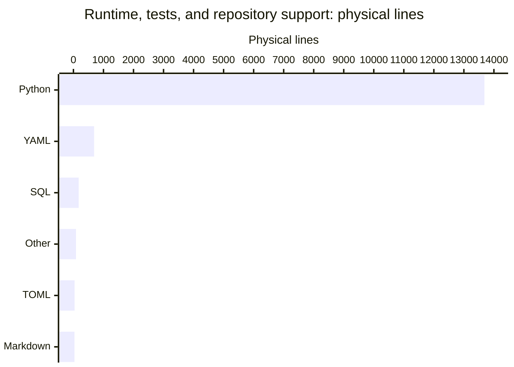

# By the numbers

Snapshot: **2026-10-24 UTC**, committed HEAD `13bb88873b9a3d6dc9b514d88f4965569d2dbd26`. Size and AST figures read tracked blobs at HEAD, not staged or working-tree wiki changes. Physical lines count LF bytes plus one for a nonempty unterminated final line; blanks count and CRLF counts once.

The size scope is deliberately limited to runtime source, tests, and the configuration/support files listed below. It excludes generated `droid-wiki/`, archives, ZIP bundles, documentation, research, and operator materials, except the GitHub pull-request template explicitly included with repository support files. This is not whole-repository LOC. See [architecture](overview/architecture.md), [lore](lore.md), and [CI/release boundaries](deployment.md).

## Size

### Lines by language

| Language | Files | Physical lines | Scope |
| --- | ---: | ---: | --- |
| Python | 63 | 13,683 | Runtime 8,016; tests 5,667 |
| YAML | 10 | 688 | GitHub configuration 562; Doctor profiles 126 |
| SQL | 1 | 175 | `src/somnus/db/schema.sql` |
| Other support text | 4 | 85 | `.gitattributes`, `.gitignore`, `CODEOWNERS`, `MANIFEST.in` |
| TOML | 1 | 39 | `pyproject.toml` |
| Markdown | 1 | 34 | `.github/pull_request_template.md` |
| **Total** | **80** | **14,704** | Scoped inventory, not all tracked files |

Runtime dependencies remain empty in `pyproject.toml`; Python requires 3.11 or newer. Distribution `somnus-metadata` is version 2.0.0, while the import and command remain `somnus`. Registry output is text/TSV; JSON-RPC framing is the MCP exception, not a runtime dependency.

### Lines by area

| Area | Files | Physical lines | Contents |
| --- | ---: | ---: | --- |
| `src/somnus/`, recursive | 50 | 8,191 | 49 Python modules (8,016 lines) plus SQL (175) |
| `tests/`, recursive | 14 | 5,667 | 13 discovered test modules (4,742) plus explicit acceptance harness (925) |
| Configuration/support | 16 | 846 | All tracked `.github/` files, two `.somnus-debug/` YAML profiles, and five root support files |
| **Total** | **80** | **14,704** | |

The five root support files are `.gitattributes`, `.gitignore`, `CODEOWNERS`, `MANIFEST.in`, and `pyproject.toml`. `.github/` contributes eight YAML files and one Markdown template; the two Doctor profiles bring the YAML count to ten. Configuration/support here describes an explicit inventory, not a language classification.

### Runtime layers

| Area | Python + SQL lines |
| --- | ---: |
| `src/somnus/model/` | 1,757 |
| `src/somnus/commands/` | 1,455 |
| `src/somnus/tui/` | 1,221 |
| `src/somnus/db/` | 862 |
| `src/somnus/yamlsub.py` | 759 |
| `src/somnus/carriers/` | 560 |
| `src/somnus/document.py` | 334 |
| `src/somnus/mcp.py` | 304 |
| `src/somnus/regions.py` | 210 |
| `src/somnus/config.py` | 176 |
| `src/somnus/cli.py` | 169 |
| `src/somnus/infer.py` | 145 |
| `src/somnus/ids.py` | 130 |
| `src/somnus/output.py` | 92 |
| `src/somnus/__init__.py` | 9 |
| `src/somnus/__main__.py` | 8 |

Directories are recursive and disjoint from the individually listed root modules.

## Activity

The full HEAD history contains **21 commits**, all within the 90-calendar-day UTC window **2026-07-27 through 2026-10-24 inclusive**. July's partial window, August, and September have zero commits. October has 21 commits, 29,410 inserted lines, and 1,517 deleted lines.

History uses author timestamps converted to UTC, unlike earlier surveys using the recorded UTC-05:00 offset. Consequently, the late October 11 local-time commits fall on October 12 UTC. Churn sums `git show --numstat --find-renames` for each commit, including initial additions, archives, and wiki history. Pure renames contribute zero; binary `-` entries contribute no lines. History and size scopes are intentionally different.

| UTC day | Weekday | Commits | Added | Deleted |
| --- | --- | ---: | ---: | ---: |
| 2026-10-02 | Friday | 1 | 5,637 | 0 |
| 2026-10-11 | Sunday | 13 | 14,016 | 520 |
| 2026-10-12 | Monday | 4 | 4,342 | 90 |
| 2026-10-20 | Tuesday | 2 | 449 | 719 |
| 2026-10-24 | Saturday | 1 | 4,966 | 188 |

| UTC ISO week | Commits | Added | Deleted |
| --- | ---: | ---: | ---: |
| 2026-W40 | 1 | 5,637 | 0 |
| 2026-W41 | 13 | 14,016 | 520 |
| 2026-W42 | 4 | 4,342 | 90 |
| 2026-W43, through October 24 | 3 | 5,415 | 907 |

Weeks without commits are omitted. Since the previous wiki base `56c2e449d295bfc765c88d133a8a85db916b2af4`, one commit changes 57 files: **4,966 additions + 188 deletions = 5,154 changed lines**. This is not 5,154 net new lines.

### Churn hotspots

The window totals **30,927 changed lines** and a net gain of **27,893**. Selected live runtime paths, counting each path at most once per commit:

| Path | Commits touching | Added | Deleted | Churn |
| --- | ---: | ---: | ---: | ---: |
| `src/somnus/model/validate.py` | 3 | 884 | 40 | 924 |
| `src/somnus/yamlsub.py` | 4 | 766 | 7 | 773 |
| `src/somnus/db/store.py` | 4 | 693 | 11 | 704 |
| `src/somnus/model/schema.py` | 2 | 628 | 27 | 655 |
| `src/somnus/tui/app.py` | 2 | 423 | 12 | 435 |
| `src/somnus/commands/migrate.py` | 3 | 411 | 5 | 416 |
| `src/somnus/document.py` | 4 | 344 | 10 | 354 |

Initial creation is included: these are not defect rankings. Rename detection follows each commit's numstat paths, not a reconstructed lifetime identity. See [cleanup opportunities](cleanup-opportunities.md) for source-backed maintenance observations.

## Bot-attributed commits

The declared-attribution lower bound is **0 of 21 commits (0%)**. Inspect each commit's author name/email and case-insensitive `Co-authored-by:` message lines; count a commit once if either channel matches `[bot]`, a standalone `bot`, `dependabot`, `renovate`, or `github-actions`, case-insensitively. No channel matches.

This does not measure agent assistance: undeclared assistance and unrecognized bot names are invisible. No individual contributor statistics are reported. Configured workflows do not prove a hosted run or bot commit occurred.

## Complexity

### Largest files

Selected public implementation, tests, normative/product documents, and historical `archive/` files; generated wiki and private/operator materials are excluded.

| Lines | File |
| ---: | --- |
| 1,287 | `archive/v0.1/SOMNUS-METADATA-SPEC-v0.1.md` |
| 1,115 | `archive/v0.1/tools/validate.py` |
| 936 | `SPEC.md` |
| 925 | `tests/acceptance/installed_package_acceptance.py` |
| 863 | `tests/test_tui.py` |
| 844 | `src/somnus/model/validate.py` |
| 831 | `archive/v2-proposal/SOMNUS_FRONTMATTER_SPEC_v2.md` |
| 759 | `src/somnus/yamlsub.py` |
| 693 | `tests/test_validate.py` |
| 682 | `src/somnus/db/store.py` |

### Average file size by directory

| Directory, direct files | Files | Lines | Average |
| --- | ---: | ---: | ---: |
| `src/somnus/` | 11 | 2,336 | 212.4 |
| `src/somnus/carriers/` | 5 | 560 | 112.0 |
| `src/somnus/commands/` | 20 | 1,455 | 72.8 |
| `src/somnus/db/` | 3 | 862 | 287.3 |
| `src/somnus/model/` | 6 | 1,757 | 292.8 |
| `src/somnus/tui/` | 5 | 1,221 | 244.2 |
| `tests/` | 13 | 4,742 | 364.8 |
| `tests/acceptance/` | 1 | 925 | 925.0 |
| `.github/workflows/` | 4 | 371 | 92.8 |
| `.somnus-debug/` | 2 | 126 | 63.0 |

Averages are physical lines divided by files, rounded to one decimal. The database row includes its SQL schema.

### Static import depth

AST inspection of the 49 runtime Python modules finds **141 distinct directed, non-self internal import edges**. It includes imports nested in functions or conditionals and resolves relative imports. For `from package import member`, use the member module when it exists, otherwise the package. Implicit parent-package loading, dynamic imports, subprocess invocations, tests, and archive code are excluded.

One multi-module strongly connected component contains `src/somnus/carriers/__init__.py`, `src/somnus/carriers/blockcomment.py`, `src/somnus/carriers/linecomment.py`, and `src/somnus/carriers/markdown.py`. Collapse it to a single node.

A deepest chain has **12 component nodes / 11 edges**:

`src/somnus/commands/mcp.py` → `src/somnus/mcp.py` → `src/somnus/cli.py` → `src/somnus/commands/_common.py` → `src/somnus/db/__init__.py` → `src/somnus/db/store.py` → `src/somnus/model/validate.py` → `src/somnus/document.py` → `src/somnus/carriers/sidecar.py` → carrier component → `src/somnus/regions.py` → `src/somnus/ids.py`.

This is static dependency reach, not runtime stack depth or startup order. In particular, `src/somnus/mcp.py` imports the CLI parser inside a function.

### Public-definition proxy

Count non-underscore top-level AST function, async-function, and class definitions in direct Python files, including package initializers. Exclude methods, constants, imports, and re-exports; public-named definitions in private modules still count. This is not a supported-public-API promise.

| Package directory | Classes | Functions | Total |
| --- | ---: | ---: | ---: |
| `src/somnus/` | 15 | 44 | 59 |
| `src/somnus/carriers/` | 11 | 10 | 21 |
| `src/somnus/commands/` | 2 | 37 | 39 |
| `src/somnus/db/` | 2 | 6 | 8 |
| `src/somnus/model/` | 13 | 23 | 36 |
| `src/somnus/tui/` | 10 | 26 | 36 |
| **Total** | **53** | **146** | **199** |

### Test-to-code ratio

| Measure | Value |
| --- | ---: |
| All test Python / runtime Python lines | 5,667 / 8,016 = 0.71 |
| Discovered-module lines / runtime Python lines | 4,742 / 8,016 = 0.59 |
| AST functions/methods named `test_*` | 476 |
| Source Python modules | 49 |
| `test_*` definitions per source module | 9.7 |
| Conformance fixtures in `tests/test_conformance.py` | 21 |

`tests/test_validate.py` has 80 test definitions, `tests/test_yamlsub.py` 75, and `tests/test_tui.py` 59. The smallest module, `tests/test_mcp.py`, has 11. The 925-line `tests/acceptance/installed_package_acceptance.py` uses an explicit **60-check harness**, not `test_*` definitions, and is not collected by unittest discovery.

These are static counts, not a fresh test run, coverage result, installed-tool check, or external MCP-host validation. Prior exact-wheel release evidence is recorded in `runbooks/package-release.md`; see [testing](how-to-contribute/testing.md) for the exercised boundaries.
