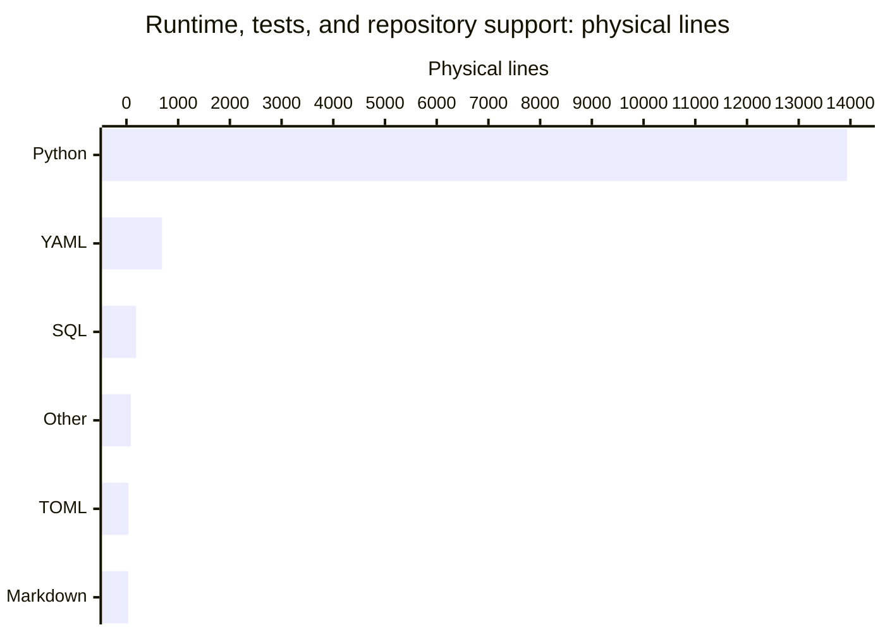

# By the numbers

Data collected on **2026-10-31 UTC**, committed HEAD `954d5b446b2398f4f0c0fe6e8c9023219bc542cf` on `main`. Physical size and history figures are refreshed from committed HEAD; runtime AST figures are retained after confirming that runtime and test trees are unchanged from the incremental base `b0cc64e774ef34cf45bcdb1d3bf039ad1281bf6d`. Four workflow files change action major tags without changing scoped line counts. All figures exclude staged or working-tree wiki changes. Physical lines use Python `str.splitlines()`; blanks count and CRLF counts once.

The size scope is deliberately limited to runtime source, tests, and the configuration/support files listed below. It excludes generated `droid-wiki/`, archives, ZIP bundles, documentation, research, and operator materials, except the GitHub pull-request template explicitly included with repository support files. This is not whole-repository LOC. See [architecture](overview/architecture.md), [lore](lore.md), and [CI/release boundaries](deployment.md).

## Size

### Lines by language

| Language | Files | Physical lines | Scope |
| --- | ---: | ---: | --- |
| Python | 63 | 13,936 | Runtime 8,138; tests 5,798 |
| YAML | 10 | 688 | GitHub configuration 562; Doctor profiles 126 |
| SQL | 2 | 187 | `src/somnus/db/schema.sql` (175); `src/somnus/db/search.sql` (12) |
| Other support text | 4 | 85 | `.gitattributes`, `.gitignore`, `CODEOWNERS`, `MANIFEST.in` |
| TOML | 1 | 39 | `pyproject.toml` |
| Markdown | 1 | 34 | `.github/pull_request_template.md` |
| **Total** | **81** | **14,969** | Scoped inventory, not all tracked files |

Runtime dependencies remain empty in `pyproject.toml`; Python requires 3.11 or newer. Distribution `somnus-metadata` is version 2.1.0 in `pyproject.toml` and `src/somnus/__init__.py`, while the import and command remain `somnus`. `PLAN.md` records 2.0.0 as published and 2.1.0 as not yet published. Core remains 2.0.0 in `SPEC.md`; registry schema 2 adds derived FTS5 search under D19 in `DECISIONS.md`. Registry output is text/TSV; JSON-RPC framing is the MCP exception, not a runtime dependency. See [querying](features/querying.md) and [registry](systems/registry.md).

### Lines by area

| Area | Files | Physical lines | Contents |
| --- | ---: | ---: | --- |
| `src/somnus/`, recursive | 51 | 8,325 | 49 Python modules (8,138 lines) plus two SQL files (187) |
| `tests/`, recursive | 14 | 5,798 | 13 discovered test modules (4,873) plus explicit acceptance harness (925) |
| Configuration/support | 16 | 846 | All tracked `.github/` files, two `.somnus-debug/` YAML profiles, and five root support files |
| **Total** | **81** | **14,969** | |

The five root support files are `.gitattributes`, `.gitignore`, `CODEOWNERS`, `MANIFEST.in`, and `pyproject.toml`. `.github/` contributes eight YAML files and one Markdown template; the two Doctor profiles bring the YAML count to ten. Configuration/support here describes an explicit inventory, not a language classification.

### Runtime layers

| Area | Python + SQL lines |
| --- | ---: |
| `src/somnus/model/` | 1,757 |
| `src/somnus/commands/` | 1,493 |
| `src/somnus/tui/` | 1,221 |
| `src/somnus/db/` | 940 |
| `src/somnus/yamlsub.py` | 759 |
| `src/somnus/carriers/` | 560 |
| `src/somnus/document.py` | 334 |
| `src/somnus/mcp.py` | 320 |
| `src/somnus/regions.py` | 210 |
| `src/somnus/config.py` | 176 |
| `src/somnus/cli.py` | 171 |
| `src/somnus/infer.py` | 145 |
| `src/somnus/ids.py` | 130 |
| `src/somnus/output.py` | 92 |
| `src/somnus/__init__.py` | 9 |
| `src/somnus/__main__.py` | 8 |

Directories are recursive and disjoint from the individually listed root modules.

## Activity

The full HEAD history contains **26 commits**, all within the 90-calendar-day UTC window **2026-08-03 through 2026-10-31 inclusive**. The collection date fixes the window; HEAD's author and committer timestamps are both **2026-10-31 22:59:12 UTC**, so no reachable commit is dated beyond the collection day.

History uses author timestamps converted to UTC, unlike earlier surveys using the recorded UTC-05:00 offset. Consequently, the late October 11 local-time commits fall on October 12 UTC. Churn sums `git show --numstat --find-renames` for each commit, including initial additions, archives, and wiki history. Pure renames contribute zero; binary `-` entries contribute no lines. History and size scopes are intentionally different.

| UTC month in window | Commits | Added | Deleted |
| --- | ---: | ---: | ---: |
| 2026-08, from August 3 | 0 | 0 | 0 |
| 2026-09 | 0 | 0 | 0 |
| 2026-10, through October 31 | 26 | 29,945 | 1,673 |

| UTC day | Weekday | Commits | Added | Deleted |
| --- | --- | ---: | ---: | ---: |
| 2026-10-02 | Friday | 1 | 5,637 | 0 |
| 2026-10-11 | Sunday | 13 | 14,016 | 520 |
| 2026-10-12 | Monday | 4 | 4,342 | 90 |
| 2026-10-20 | Tuesday | 2 | 449 | 719 |
| 2026-10-24 | Saturday | 1 | 4,966 | 188 |
| 2026-10-31 | Saturday | 5 | 535 | 156 |

| UTC ISO week | Commits | Added | Deleted |
| --- | ---: | ---: | ---: |
| 2026-W40 | 1 | 5,637 | 0 |
| 2026-W41 | 13 | 14,016 | 520 |
| 2026-W42 | 4 | 4,342 | 90 |
| 2026-W43 | 3 | 5,415 | 907 |
| 2026-W44, through October 31 | 5 | 535 | 156 |

Weeks without commits are omitted. Since the incremental wiki base `b0cc64e774ef34cf45bcdb1d3bf039ad1281bf6d`, one commit changes four workflow files: **19 additions + 19 deletions = 38 changed lines**, with no net line growth. Only action major tags change in `.github/workflows/ci.yml`, `.github/workflows/codeql.yml`, `.github/workflows/droid-wiki-refresh.yml`, and `.github/workflows/release.yml`. Runtime source, tests, and all other configuration/support blobs are unchanged. This committed delta excludes staged and working-tree wiki edits; see [CI/release boundaries](deployment.md) for the workflow changes.

### Churn hotspots

The window totals **31,618 changed lines** and a net gain of **28,272**. Selected live runtime paths, counting each path at most once per commit:

| Path | Commits touching | Added | Deleted | Churn |
| --- | ---: | ---: | ---: | ---: |
| `src/somnus/model/validate.py` | 3 | 884 | 40 | 924 |
| `src/somnus/db/store.py` | 6 | 767 | 19 | 786 |
| `src/somnus/yamlsub.py` | 4 | 766 | 7 | 773 |
| `src/somnus/model/schema.py` | 2 | 628 | 27 | 655 |
| `src/somnus/tui/app.py` | 2 | 423 | 12 | 435 |
| `src/somnus/commands/migrate.py` | 3 | 411 | 5 | 416 |
| `src/somnus/document.py` | 4 | 344 | 10 | 354 |

The runtime rows are unchanged from the incremental base. `tests/test_tui.py` also remains unchanged in this delta; its window totals are 3 touching commits, 871 additions, and 5 deletions (876 lines of churn). The new workflow commit adds 38 lines of churn: 20 in `.github/workflows/ci.yml`, 6 in `.github/workflows/codeql.yml`, 8 in `.github/workflows/droid-wiki-refresh.yml`, and 4 in `.github/workflows/release.yml`.

Initial creation is included: these are not defect rankings. Rename detection follows each commit's numstat paths, not a reconstructed lifetime identity. See [cleanup opportunities](cleanup-opportunities.md) for source-backed maintenance observations.

## Bot-attributed commits

The declared-attribution lower bound is **1 of 26 commits (3.85%)**, for both the full reachable history and the 90-day window. Inspect each commit's author name/email and case-insensitive `Co-authored-by:` message lines; count a commit once if either channel matches `[bot]`, a standalone `bot`, `dependabot`, `renovate`, or `github-actions`, case-insensitively. HEAD matches through both its `dependabot[bot]` author identity and its `Co-authored-by:` trailer; these are one attributed commit, not two. The other 25 commits match neither channel.

This measures declared bot attribution, not AI assistance: a dependency-update bot is not evidence of AI use, and undeclared assistance and unrecognized bot names are invisible. No individual contributor statistics are reported. The bot commit is evidenced by git history; configured workflows alone do not prove a hosted run occurred.

## Complexity

### Largest files

Selected public implementation, tests, normative/product documents, and historical `archive/` files; generated wiki and private/operator materials are excluded.

| Lines | File |
| ---: | --- |
| 1,287 | `archive/v0.1/SOMNUS-METADATA-SPEC-v0.1.md` |
| 1,115 | `archive/v0.1/tools/validate.py` |
| 962 | `SPEC.md` |
| 925 | `tests/acceptance/installed_package_acceptance.py` |
| 866 | `tests/test_tui.py` |
| 844 | `src/somnus/model/validate.py` |
| 831 | `archive/v2-proposal/SOMNUS_FRONTMATTER_SPEC_v2.md` |
| 759 | `src/somnus/yamlsub.py` |
| 748 | `src/somnus/db/store.py` |
| 693 | `tests/test_validate.py` |

### Average file size by directory

| Directory, direct files | Files | Lines | Average |
| --- | ---: | ---: | ---: |
| `src/somnus/` | 11 | 2,354 | 214.0 |
| `src/somnus/carriers/` | 5 | 560 | 112.0 |
| `src/somnus/commands/` | 20 | 1,493 | 74.7 |
| `src/somnus/db/` | 4 | 940 | 235.0 |
| `src/somnus/model/` | 6 | 1,757 | 292.8 |
| `src/somnus/tui/` | 5 | 1,221 | 244.2 |
| `tests/` | 13 | 4,873 | 374.8 |
| `tests/acceptance/` | 1 | 925 | 925.0 |
| `.github/workflows/` | 4 | 371 | 92.8 |
| `.somnus-debug/` | 2 | 126 | 63.0 |

Averages are physical lines divided by files, rounded to one decimal. The database row includes both SQL files.

### Static import depth

AST inspection of the 49 runtime Python modules finds **142 distinct directed, non-self internal import edges**, unchanged from the incremental base. It includes imports nested in functions or conditionals and resolves relative imports. For `from package import member`, use the member module when it exists, otherwise the package. Implicit parent-package loading, dynamic imports, subprocess invocations, tests, and archive code are excluded. This includes the direct `fts_query` import from `src/somnus/db/store.py` in `src/somnus/commands/query.py`.

One multi-module strongly connected component contains `src/somnus/carriers/__init__.py`, `src/somnus/carriers/blockcomment.py`, `src/somnus/carriers/linecomment.py`, and `src/somnus/carriers/markdown.py`. Collapse it to a single node.

A deepest chain has **12 component nodes / 11 edges**:

`src/somnus/commands/mcp.py` → `src/somnus/mcp.py` → `src/somnus/cli.py` → `src/somnus/commands/_common.py` → `src/somnus/db/__init__.py` → `src/somnus/db/store.py` → `src/somnus/model/validate.py` → `src/somnus/document.py` → `src/somnus/carriers/sidecar.py` → carrier component → `src/somnus/regions.py` → `src/somnus/ids.py`.

This is static dependency reach, not runtime stack depth or startup order. In particular, `src/somnus/mcp.py` imports the CLI parser inside a function.

### Public-definition proxy

Count non-underscore top-level AST function, async-function, and class definitions in direct Python files, including package initializers. Exclude methods, constants, imports, and re-exports; public-named definitions in private modules still count. This is not a supported-public-API promise.

| Package directory | Classes | Functions | Total |
| --- | ---: | ---: | ---: |
| `src/somnus/` | 15 | 44 | 59 |
| `src/somnus/carriers/` | 11 | 10 | 21 |
| `src/somnus/commands/` | 2 | 37 | 39 |
| `src/somnus/db/` | 2 | 8 | 10 |
| `src/somnus/model/` | 13 | 23 | 36 |
| `src/somnus/tui/` | 10 | 26 | 36 |
| **Total** | **53** | **148** | **201** |

### Test-to-code ratio

| Measure | Value |
| --- | ---: |
| All test Python / runtime Python lines | 5,798 / 8,138 = 0.71 |
| Discovered-module lines / runtime Python lines | 4,873 / 8,138 = 0.60 |
| AST functions/methods named `test_*` | 486 |
| Source Python modules | 49 |
| `test_*` definitions per source module | 9.9 |
| Conformance fixtures in `tests/test_conformance.py` | 21 |

`tests/test_validate.py` has 80 test definitions, `tests/test_yamlsub.py` 75, and `tests/test_tui.py` 59. `tests/test_commands.py` has 30 definitions in 437 lines. The smallest module by test count, `tests/test_mcp.py`, has 11 definitions in 203 lines. The test tree is unchanged from the incremental base; the retained static total remains 486 `test_*` definitions. The 925-line `tests/acceptance/installed_package_acceptance.py` uses an explicit **60-check harness**, not `test_*` definitions, and is not collected by unittest discovery.

These are static counts, not a fresh test run, coverage result, installed-tool check, or external MCP-host validation. Prior exact-wheel release evidence is recorded in `runbooks/package-release.md`; see [testing](how-to-contribute/testing.md) for the exercised boundaries.
