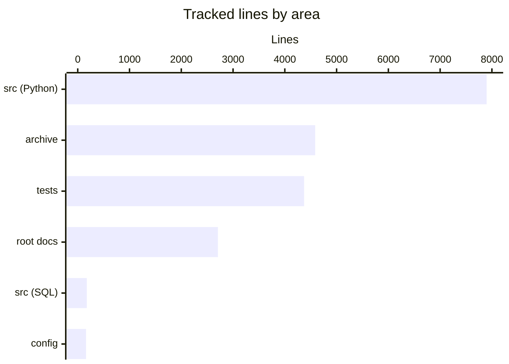

# By the numbers

Data collected on 2026-10-11.

All counts cover files tracked by git at `43ab360`, the last commit that changed code. Wiki pages under `droid-wiki/` (added in `f2b1b96`, 36 pages) are not counted; the blank-line reformat of `PLAN.md` from that commit is. Line counts are physical lines from `@(Get-Content -Encoding UTF8 <file>).Count`, so blank lines are included. Commit figures come from `git log --shortstat` and `git log --name-only`. For what the pieces do, see [the overview](overview/index.md) and [the architecture page](overview/architecture.md).

## Size

### Lines by language

| Language | Files | Lines | Where |
| --- | ---: | ---: | --- |
| Python | 64 | 13,480 | 7,898 in `src/somnus/`, 4,372 in `tests/`, 1,210 in `archive/v0.1/tools/` |
| Markdown | 15 | 5,665 | Root documents plus `archive/` |
| JSON | 3 | 420 | `archive/v0.1/schemas/v1/` only |
| SQL | 1 | 175 | `src/somnus/db/schema.sql` |
| YAML | 2 | 126 | `.somnus-debug/python_doctor.yaml`, `.somnus-debug/python_doctor.src.yaml` |
| TOML | 1 | 20 | `pyproject.toml` |
| Other | 2 | 14 | `.gitignore`, `.gitattributes` |
| **Total** | **88** | **19,900** | |

Apart from `droid-wiki/.wiki-meta.json`, the page-order file for this wiki, the only JSON files in the repository are archived v0.1 schemas. Live code has none, which matches decision D4 (see [design decisions](background/design-decisions.md)).

### Lines by area

| Area | Files | Lines | Contents |
| --- | ---: | ---: | --- |
| `src/somnus/` | 50 | 8,073 | 49 Python modules plus `src/somnus/db/schema.sql` |
| `tests/` | 13 | 4,372 | 13 unittest suites |
| `archive/` | 13 | 4,587 | v0.1 spec, glossary, examples, schemas, tools, v2 proposal |
| Root documents | 7 | 2,708 | `SPEC.md` 911, `Somnus Markdown Metadata Standard Research.md` 685, `PLAN.md` 647, `DECISIONS.md` 300, `AGENTS.md` 59, `README.md` 54, `filetree.md` 52 |
| Config | 5 | 160 | `.somnus-debug/`, `pyproject.toml`, `.gitignore`, `.gitattributes` |

### Source, test, and docs file counts

| Kind | Files | Lines |
| --- | ---: | ---: |
| Source (`src/somnus/`) | 50 | 8,073 |
| Tests (`tests/`) | 13 | 4,372 |
| Docs (all tracked `.md` outside `droid-wiki/`) | 15 | 5,665 |
| Archived code (`archive/v0.1/tools/`) | 2 | 1,210 |

## Activity

The repository has 16 commits on `main`. All of them landed on two days.

| Day | Weekday | ISO week | Commits | Lines added | Lines deleted |
| --- | --- | ---: | ---: | ---: | ---: |
| 2026-10-02 | Friday | 40 | 1 | 5,637 | 0 |
| 2026-10-11 | Sunday | 41 | 15 | 17,978 | 538 |

The first thirteen commits on 2026-10-11 ran from 06:26 to 08:38 (UTC-5), and eleven of them fall in the 06:00 hour. The wiki commit `f2b1b96` (3,240 lines added, 4 deleted) followed at 22:19, and `43ab360` (722 added, 14 deleted), which added `somnus set` and `somnus mcp`, at 23:42. Five commits share the timestamp 06:26:04 or 06:26:05, which suggests they were split from one working session and committed back to back.

| Hour on 2026-10-11 | Commits |
| --- | ---: |
| 06:00 | 11 |
| 07:00 | 1 (`8f0db0d`, unit tests and bug fixes) |
| 08:00 | 1 (`dc3c981`, mojibake repair) |
| 22:00 | 1 (`f2b1b96`, this wiki) |
| 23:00 | 1 (`43ab360`, `somnus set` and `somnus mcp`) |

### Churn hotspots

`git log --name-only` over all history lists 136 distinct paths, counting both sides of the archive renames and the 36 wiki pages. Because the repository is young, no file has been touched more than four times.

| Times touched | Files |
| ---: | --- |
| 4 | `filetree.md`, `DECISIONS.md`, `AGENTS.md` |
| 3 | `src/somnus/db/store.py`, `src/somnus/yamlsub.py`, `src/somnus/document.py`, `src/somnus/ids.py`, `src/somnus/cli.py`, `src/somnus/commands/brief.py`, `tests/test_store.py`, `SPEC.md` |
| 2 | `src/somnus/commands/migrate.py`, `src/somnus/carriers/__init__.py`, `src/somnus/carriers/markdown.py`, `src/somnus/carriers/linecomment.py`, `src/somnus/carriers/blockcomment.py`, `src/somnus/carriers/sidecar.py`, `src/somnus/db/__init__.py`, `src/somnus/db/schema.sql`, `src/somnus/model/lifecycle.py`, `src/somnus/model/schema.py`, `src/somnus/model/validate.py`, `src/somnus/model/vocab.py`, `src/somnus/regions.py`, `tests/test_conformance.py`, `tests/test_commands.py`, `PLAN.md`, `README.md`, `archive/README.md` |

Most repeat touches come from three commits: `8f0db0d` (four bug fixes), `dc3c981` (the encoding repair across 26 files), and `43ab360`, which changed the governance files (`AGENTS.md`, `DECISIONS.md`, `filetree.md`, `SPEC.md`) together with the CLI to record D16 and D17. The largest single rewrite is `df72af4`, which changed `DECISIONS.md` by 526 lines while adding `PLAN.md`. The history behind these commits is on [the lore page](lore.md), and the encoding repair is covered in [pitfalls](background/pitfalls.md).

## Bot-attributed commits

`git log --format=%B | Select-String "Co-authored-by"` finds no trailers in any of the 16 commit messages. The measured bot-attributed share is therefore 0 of 16 (0%). Treat this as a lower bound. It only detects commits that declare a co-author trailer, and agent-written commits made under the operator's identity would not show up.

## Complexity

### Largest files

| Lines | File |
| ---: | --- |
| 1,287 | `archive/v0.1/SOMNUS-METADATA-SPEC-v0.1.md` |
| 1,115 | `archive/v0.1/tools/validate.py` |
| 911 | `SPEC.md` |
| 832 | `src/somnus/model/validate.py` |
| 831 | `archive/v2-proposal/SOMNUS_FRONTMATTER_SPEC_v2.md` |
| 757 | `src/somnus/yamlsub.py` |
| 693 | `tests/test_validate.py` |
| 685 | `Somnus Markdown Metadata Standard Research.md` |
| 675 | `src/somnus/db/store.py` |
| 647 | `PLAN.md` |

The three largest live source files are the validator, the restricted YAML parser, and the SQLite store. The field schema, `src/somnus/model/schema.py` (601 lines), is next; it dropped out of the top ten when `f2b1b96` reformatted `PLAN.md` to 647 lines.

### Average file size by directory

| Directory | Files | Lines | Average |
| --- | ---: | ---: | ---: |
| `src/somnus/` (top level) | 11 | 2,331 | 212 |
| `src/somnus/carriers/` | 5 | 559 | 112 |
| `src/somnus/commands/` | 20 | 1,425 | 71 |
| `src/somnus/db/` | 3 | 855 | 285 |
| `src/somnus/model/` | 6 | 1,736 | 289 |
| `src/somnus/tui/` | 5 | 1,167 | 233 |
| `tests/` | 13 | 4,372 | 336 |
| `archive/v0.1/` | 10 | 3,512 | 351 |
| `archive/v2-proposal/` | 2 | 1,052 | 526 |

Command modules are small (71 lines on average) because each one is a thin layer over `src/somnus/model/` and `src/somnus/db/`.

### Test-to-code ratio

| Measure | Value |
| --- | ---: |
| Test lines / source Python lines | 4,372 / 7,898 = 0.55 |
| Test functions (`rg -c "def test_" tests`) | 459 |
| Source Python modules | 49 |
| Tests per module | 9.4 |
| Conformance fixtures in `tests/test_conformance.py` | 21 |

The suite with the most tests is `tests/test_validate.py` (80), followed by `tests/test_yamlsub.py` (75). The smallest is `tests/test_mcp.py` (11).
