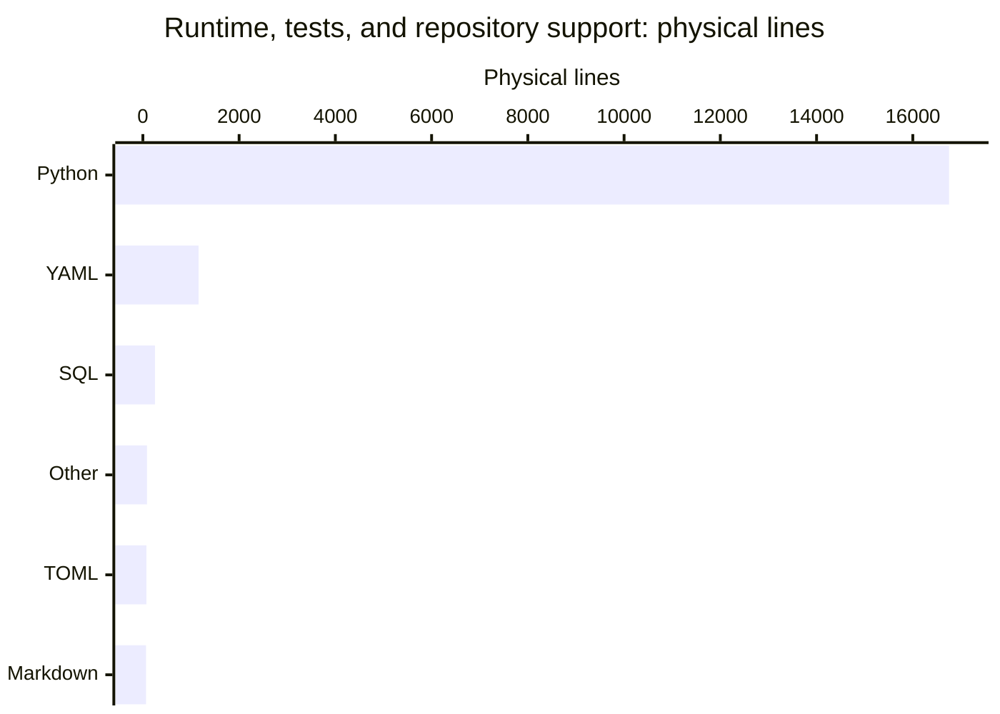

# By the numbers

Data collected on **2026-11-02 UTC** (clock checked at **06:56:37 UTC**), committed HEAD `fe19ce3278ccdd610483ee73262e309be2bf3131` on `main` in [the repository](https://github.com/calisweetleaf/somnus-metadata). This snapshot measures committed files and full reachable history, excluding staged and working-tree changes. Physical lines use Python `str.splitlines()`; blanks count and CRLF counts once. AST measurements are static inspection, not executed tests.

The size scope is deliberately limited to runtime source, tests, and the configuration/support files listed below. It excludes generated `droid-wiki/`, archives, ZIP bundles, documentation, research, and operator materials, except the GitHub pull-request template explicitly included with repository support files. This is not whole-repository LOC. See [architecture](overview/architecture.md), [lore](lore.md), and [CI/release boundaries](deployment.md).

Physical sizes, history, and test definitions are recomputed from committed files. Runtime source is unchanged from `6cfc132`, preserving its prior public-definition and internal-import-graph measurements rather than claiming a fresh graph analysis. Adoption commit `e82e8bc` added 32-line native Somnus metadata envelopes to each of the 64 Python and two SQL files without changing host content. The subsequent `6cfc132` repair changes runtime ASTs: `src/somnus/db/store.py` repairs unmanaged sidecar-host discovery, and `src/somnus/__init__.py` advances the version. Commit `07a6039` changes three test assertions and their metadata, not runtime source or physical line counts. Latest commit `fe19ce3` changes only `HANDOFF.md`, `PLAN.md`, and `docs/USAGE_GUIDE.md`, all outside the scoped size inventory; source, tests, configuration, workflows, dependencies, and scoped physical line counts are unchanged. The prior `605c5a8` statement, covering `AGENTS.md` plus the same three documentation files, is historical. Four Python envelopes have 33 lines. Physical growth includes metadata as well as implementation and test changes.

## Size

### Lines by language

| Language | Files | Physical lines | Scope |
| --- | ---: | ---: | --- |
| Python | 64 | 16,753 | Runtime 9,732; tests 7,021 |
| YAML | 14 | 1,157 | GitHub configuration 831; Doctor profiles 190; four root sidecars 136 |
| SQL | 2 | 251 | `src/somnus/db/schema.sql` (207); `src/somnus/db/search.sql` (44) |
| Other support text | 4 | 85 | `.gitattributes`, `.gitignore`, `CODEOWNERS`, `MANIFEST.in` |
| TOML | 1 | 74 | `pyproject.toml` |
| Markdown | 1 | 66 | `.github/pull_request_template.md` |
| **Total** | **86** | **18,386** | Scoped inventory, not all tracked files |

Runtime dependencies remain empty in `pyproject.toml`; Python requires 3.11 or newer. Distribution `somnus-metadata` is version 2.1.1 in `pyproject.toml` and `src/somnus/__init__.py`; the import remains `somnus`, and `pyproject.toml` exposes both `somnus` and `somnus-metadata` as aliases of `somnus.cli:main`. `PLAN.md` and `HANDOFF.md` record public 2.1.1 publication, matching artifact digests, and a no-cache plain-pip installation; no fresh public-release check was made for these statistics. Earlier unpublished-2.1.0 statements are historical. Core remains 2.0.0 in `SPEC.md`; registry schema 2 adds derived FTS5 search under D19 in `DECISIONS.md`. Registry output is text/TSV; JSON-RPC framing is the MCP exception, not a runtime dependency. See [querying](features/querying.md) and [registry](systems/registry.md).

### Lines by area

| Area | Files | Physical lines | Contents |
| --- | ---: | ---: | --- |
| `src/somnus/`, recursive | 51 | 9,983 | 49 Python modules (9,732 lines) plus two SQL files (251) |
| `tests/`, recursive | 15 | 7,021 | 14 discovered test modules (6,003) plus explicit acceptance harness (1,018) |
| Configuration/support | 20 | 1,382 | All tracked `.github/` files, two Doctor profiles, five root support files, and their four sidecars |
| **Total** | **86** | **18,386** | |

The five root support files are `.gitattributes`, `.gitignore`, `CODEOWNERS`, `MANIFEST.in`, and `pyproject.toml`. Their four sidecars are `.gitattributes.somnus.yaml`, `.gitignore.somnus.yaml`, `CODEOWNERS.somnus.yaml`, and `MANIFEST.in.somnus.yaml`, counted as separate YAML files at 34 lines each; `pyproject.toml` uses a native envelope. `.github/` contributes eight YAML files and one Markdown template, all with native envelopes and no sidecars. The two Doctor profiles are `.somnus-debug/python_doctor.yaml` and `.somnus-debug/python_doctor.src.yaml`. Sidecars outside this explicit support inventory remain excluded with their host files. Configuration/support describes an inventory, not a language classification.

The earlier `e82e8bc` snapshot contained 86 scoped files and 18,281 lines; `6cfc132` added a net **105 physical lines** in that same inventory, and `07a6039`, `0881ad7`, `3e09b64`, `605c5a8`, and `fe19ce3` leave those sizes unchanged. Removing each complete native envelope through its `somnus:end` marker leaves **8,162 runtime Python lines**, **187 SQL lines**, and **6,539 test Python lines**. Python metadata contributes 2,052 lines, including four envelopes extended by an `updated_at` field. The host-content test/runtime ratio is 6,539 / 8,162 = 0.80. These are still physical host lines, including blanks, comments, and docstrings.

### Runtime layers

| Area | Python + SQL lines |
| --- | ---: |
| `src/somnus/model/` | 1,948 |
| `src/somnus/commands/` | 2,134 |
| `src/somnus/tui/` | 1,381 |
| `src/somnus/db/` | 1,093 |
| `src/somnus/yamlsub.py` | 791 |
| `src/somnus/carriers/` | 720 |
| `src/somnus/document.py` | 366 |
| `src/somnus/mcp.py` | 352 |
| `src/somnus/regions.py` | 242 |
| `src/somnus/config.py` | 208 |
| `src/somnus/cli.py` | 203 |
| `src/somnus/infer.py` | 177 |
| `src/somnus/ids.py` | 162 |
| `src/somnus/output.py` | 124 |
| `src/somnus/__init__.py` | 42 |
| `src/somnus/__main__.py` | 40 |

Directories are recursive and disjoint from the individually listed root modules.

## Activity

The full HEAD history contains **43 commits**, all within the 90-calendar-day UTC window **2026-08-05 through 2026-11-02 inclusive**. The collection date fixes the window; HEAD's author and committer timestamps are both **2026-11-02 06:49:21 UTC** (November 2 at 00:49:21 UTC-06:00), after the clock check above. The checkout is not shallow.

History uses author timestamps converted to UTC. Consequently, the late October 11 local-time commits fall on October 12 UTC. Count each reachable commit once; churn sums `git show --format= --numstat --find-renames` for each non-merge commit, including initial additions, archives, and wiki history. Multi-parent merges would count toward activity but contribute no churn, avoiding recounting their branch changes. There are no multi-parent merges in this history; PR-style subjects do not imply multiple parents. Pure renames contribute zero; binary `-` entries contribute no lines. History and size scopes are intentionally different.

| UTC month in window | Commits | Added | Deleted |
| --- | ---: | ---: | ---: |
| 2026-08, from August 5 | 0 | 0 | 0 |
| 2026-09 | 0 | 0 | 0 |
| 2026-10 | 33 | 31,634 | 1,979 |
| 2026-11, through November 2 | 10 | 6,289 | 357 |

| UTC day | Weekday | Commits | Added | Deleted |
| --- | --- | ---: | ---: | ---: |
| 2026-10-02 | Friday | 1 | 5,637 | 0 |
| 2026-10-11 | Sunday | 13 | 14,016 | 520 |
| 2026-10-12 | Monday | 4 | 4,342 | 90 |
| 2026-10-20 | Tuesday | 2 | 449 | 719 |
| 2026-10-24 | Saturday | 1 | 4,966 | 188 |
| 2026-10-31 | Saturday | 12 | 2,224 | 462 |
| 2026-11-01 | Sunday | 2 | 812 | 93 |
| 2026-11-02 | Monday | 8 | 5,477 | 264 |

| UTC ISO week | Commits | Added | Deleted |
| --- | ---: | ---: | ---: |
| 2026-W40 | 1 | 5,637 | 0 |
| 2026-W41 | 13 | 14,016 | 520 |
| 2026-W42 | 4 | 4,342 | 90 |
| 2026-W43 | 3 | 5,415 | 907 |
| 2026-W44 | 14 | 3,036 | 555 |
| 2026-W45, through November 2 | 8 | 5,477 | 264 |

Weeks without commits are omitted. For the historical `e82e8bca40917c93b4010c8c6fbe547282e991d3` → `6cfc132` comparison, one repair/release commit changed **13 files: 394 additions + 166 deletions = 560 changed lines**, a net gain of **228 lines**. `src/somnus/db/store.py` now lists unmanaged hosts without an embedded carrier or sidecar without loading their payloads. Three new tests in `tests/test_store.py` cover discovery/exclusions, bounded binary allocation, and real CLI adoption followed by sidecar removal. `tests/acceptance/installed_package_acceptance.py` adds discovery acceptance and derives version expectations from `pyproject.toml`.

For the historical `6cfc132cd9d017fc4abab571da118aa6403fcafb` → `07a6039` comparison, one commit changes **5 files: 28 additions + 20 deletions = 48 changed lines**, a net gain of **8 lines**. Three expected unmanaged-path values in `tests/test_store.py` now use `Path.resolve().as_posix()` to match canonical registry roots under macOS `/var` symlinks and Windows path aliases. The remaining changes update test metadata and operator documentation; no source, version, dependency, or workflow changes occur.

Since incremental wiki base `605c5a81bee423cb4dd74c3e1eb262c53a8c208f`, the single docs-only commit `fe19ce3` changes **3 files: 35 additions + 9 deletions = 44 changed lines**, a net gain of **26 lines**. Only `HANDOFF.md`, `PLAN.md`, and `docs/USAGE_GUIDE.md` change; the scoped size inventory and runtime measurements are unchanged. The earlier `3e09b64` → `605c5a8` paragraph (4 files, 105 changed lines) is historical.

Bulk adoption is no longer in progress: the operator stopped the cross-root effort on 2026-11-01, and the release/install commission is recorded complete in `HANDOFF.md` and `PLAN.md`. `docs/USAGE_GUIDE.md` §9 records the last scan as the final inventory, with **2,659 managed / 21,554 unmanaged / 0 invalid / 0 missing / 0 conflicts** across five roots, and classifies adoption as optional usage, not a completion gate. The earlier 1,064-managed and 21,174-candidate checkpoints are obsolete history. See [adopting files](features/adopting-files.md).

The operator record reports 537 source tests, semantic 0/0, 67 installed checks, exact-wheel evidence, and 49-file mypy. Plugin **1.2.1** at commit 35c228a has **26 passing tests** and is installed in both Codex and Factory from the clean production payload: both catalogs select the checked-in reproducible 8-file native export, and both installed caches were inspected after a clean native remove/install with 0 .somnus.yaml files and no Node development adapter code. Plugin 1.2.0 at commit 4deee50 established the native installed/enabled records in both hosts (Codex installed=true/enabled=true at 1.2.0; Factory Enabled/user/4deee507dc7a), with both native cached skill trees and custom skill copies matching the canonical skill, and fresh native MCP lifecycle queries from both hosts returning the lifecycle.py path (Factory session 52dcef09-320e-4d43-851c-e60b1025cf83). The earlier 1.1.1/3000082 report was a direct skill/MCP adapter surface, not native plugin registration, which the operator corrected on 2026-11-02. Backend 07a6039 passed hosted CI 41390991791 and CodeQL 41390991803; plugin 35c228a passed CI 41402125903. Current `PLAN.md`/`HANDOFF.md`/`AGENTS.md` checkpoints supersede older guide/`CONTEXT.md` statements, including the earlier paragraph version that left the Codex skill read open. These are recorded operator-host results, not new runner results. See [agent integration](features/agent-integration.md).

Committed deltas exclude staged and working-tree wiki edits. This statistics refresh repeated the 537 checkout tests (pass) and the semantic check (0 errors, 0 warnings); it did not run mypy, installed-package acceptance, or external hosts. See [testing](how-to-contribute/testing.md) and [CI/release boundaries](deployment.md).

### Churn hotspots

The window totals **40,259 changed lines** (37,923 additions and 2,336 deletions) and a net gain of **35,587**. Selected live runtime paths, counting each path at most once per commit:

| Path | Commits touching | Added | Deleted | Churn |
| --- | ---: | ---: | ---: | ---: |
| `src/somnus/model/validate.py` | 5 | 916 | 41 | 957 |
| `src/somnus/db/store.py` | 9 | 829 | 24 | 853 |
| `src/somnus/yamlsub.py` | 5 | 798 | 7 | 805 |
| `src/somnus/model/schema.py` | 3 | 660 | 27 | 687 |
| `src/somnus/tui/app.py` | 4 | 456 | 13 | 469 |
| `src/somnus/commands/migrate.py` | 5 | 444 | 6 | 450 |
| `src/somnus/document.py` | 6 | 380 | 14 | 394 |

For comparison, `tests/test_tui.py` has 5 touching commits, 913 additions, and 5 deletions (918 lines of churn). `tests/acceptance/installed_package_acceptance.py` has 6 touching commits, 1,025 additions, and 7 deletions (1,032 lines of churn). `docs/USAGE_GUIDE.md` has 8 touching commits, 822 additions, and 101 deletions (923 lines of churn).

Selected direct-directory hotspots (nested directories excluded from each row):

| Directory | Commits touching | Added | Deleted | Churn |
| --- | ---: | ---: | ---: | ---: |
| `tests/` | 15 | 6,022 | 19 | 6,041 |
| `src/somnus/` | 12 | 2,744 | 37 | 2,781 |
| `src/somnus/model/` | 6 | 2,019 | 71 | 2,090 |
| `src/somnus/commands/` | 8 | 2,166 | 32 | 2,198 |

`HANDOFF.md` has 8 touching commits, 285 additions, and 34 deletions (319 lines of churn); `AGENTS.md` has 12 touching commits, 314 additions, and 123 deletions (437 lines of churn). Adoption commit `e82e8bc` added 32 metadata lines to each selected source path; the latest `src/somnus/db/store.py` change, in `6cfc132`, includes implementation, docstring, and metadata edits.

Initial creation is included: these are not defect rankings. The document-path comparison rows now count every commit in the window; the previous snapshot's rows omitted the `3e09b64` contribution to `docs/USAGE_GUIDE.md`, `HANDOFF.md`, and `AGENTS.md`, and are corrected here. Rename detection follows each commit's numstat paths, not a reconstructed lifetime identity. See [cleanup opportunities](cleanup-opportunities.md) for source-backed maintenance observations.

## Bot-attributed commits

The declared-attribution lower bound is **1 of 43 commits (2.33%)**, for both the full reachable history and the 90-day window. Inspect each commit's author name/email and case-insensitive `Co-authored-by:` message lines; count a commit once if either channel matches `[bot]`, a standalone `bot`, `dependabot`, `renovate`, or `github-actions`, case-insensitively. The dependency-update commit `954d5b446b2398f4f0c0fe6e8c9023219bc542cf` matches through both its `dependabot[bot]` author identity and its `Co-authored-by:` trailer; these are one attributed commit, not two. The other 42 commits match neither channel.

This measures declared bot attribution, not AI assistance: a dependency-update bot is not evidence of AI use, and undeclared assistance and unrecognized bot names are invisible. No individual contributor statistics are reported. The bot commit is evidenced by git history; configured workflows alone do not prove a hosted run occurred.

## Complexity

### Largest files

Selected public implementation, tests, normative/product documents, and historical `archive/` files; generated wiki and private/operator materials are excluded.

| Lines | File |
| ---: | --- |
| 1,287 | `archive/v0.1/SOMNUS-METADATA-SPEC-v0.1.md` |
| 1,115 | `archive/v0.1/tools/validate.py` |
| 1,018 | `tests/acceptance/installed_package_acceptance.py` |
| 962 | `SPEC.md` |
| 908 | `tests/test_tui.py` |
| 875 | `src/somnus/model/validate.py` |
| 831 | `archive/v2-proposal/SOMNUS_FRONTMATTER_SPEC_v2.md` |
| 805 | `src/somnus/db/store.py` |
| 791 | `src/somnus/yamlsub.py` |
| 725 | `tests/test_validate.py` |

### Average file size by directory

| Directory, direct files | Files | Lines | Average |
| --- | ---: | ---: | ---: |
| `src/somnus/` | 11 | 2,707 | 246.1 |
| `src/somnus/carriers/` | 5 | 720 | 144.0 |
| `src/somnus/commands/` | 20 | 2,134 | 106.7 |
| `src/somnus/db/` | 4 | 1,093 | 273.2 |
| `src/somnus/model/` | 6 | 1,948 | 324.7 |
| `src/somnus/tui/` | 5 | 1,381 | 276.2 |
| `tests/` | 14 | 6,003 | 428.8 |
| `tests/acceptance/` | 1 | 1,018 | 1,018.0 |
| `.github/workflows/` | 4 | 512 | 128.0 |
| `.somnus-debug/` | 2 | 190 | 95.0 |

Averages are physical lines divided by files, rounded to one decimal. The database row includes both SQL files.

### Static import depth

The 49 runtime Python modules have **142 distinct directed, non-self internal import edges**, retained from the prior AST measurement because runtime files are unchanged from `6cfc132`. The discovery repair changes behavior without adding an internal import edge. The graph includes imports nested in functions or conditionals and resolves relative imports. For `from package import member`, use the member module when it exists, otherwise the package. Implicit parent-package loading, dynamic imports, subprocess invocations, tests, and archive code are excluded. This includes the direct `fts_query` import from `src/somnus/db/store.py` in `src/somnus/commands/query.py`.

One multi-module strongly connected component contains `src/somnus/carriers/__init__.py`, `src/somnus/carriers/blockcomment.py`, `src/somnus/carriers/linecomment.py`, and `src/somnus/carriers/markdown.py`. Collapse it to a single node.

A deepest chain has **12 component nodes / 11 edges**:

`src/somnus/commands/mcp.py` → `src/somnus/mcp.py` → `src/somnus/cli.py` → `src/somnus/commands/_common.py` → `src/somnus/db/__init__.py` → `src/somnus/db/store.py` → `src/somnus/model/validate.py` → `src/somnus/document.py` → `src/somnus/carriers/sidecar.py` → carrier component → `src/somnus/regions.py` → `src/somnus/ids.py`.

This is static dependency reach, not runtime stack depth or startup order. In particular, `src/somnus/mcp.py` imports the CLI parser inside a function.

### Public-definition proxy

Count non-underscore top-level AST function, async-function, and class definitions in direct Python files, including package initializers. Exclude methods, constants, imports, and re-exports; public-named definitions in private modules still count. These counts retain the prior measurement because runtime files are unchanged from `6cfc132`. This is not a supported-public-API promise.

| Package directory | Classes | Functions | Total |
| --- | ---: | ---: | ---: |
| `src/somnus/` | 15 | 44 | 59 |
| `src/somnus/carriers/` | 11 | 10 | 21 |
| `src/somnus/commands/` | 2 | 37 | 39 |
| `src/somnus/db/` | 2 | 8 | 10 |
| `src/somnus/model/` | 13 | 23 | 36 |
| `src/somnus/tui/` | 10 | 26 | 36 |
| **Total** | **53** | **148** | **201** |

### Test-to-code ratio

| Measure | Value |
| --- | ---: |
| All test Python / runtime Python physical lines | 7,021 / 9,732 = 0.72 |
| Discovered-module / runtime Python physical lines | 6,003 / 9,732 = 0.62 |
| AST functions/methods named `test_*` | 537 |
| Source Python modules | 49 |
| `test_*` definitions per source module | 11.0 |
| Conformance fixtures in `tests/test_conformance.py` | 21 |

`tests/test_validate.py` has 80 test definitions, `tests/test_yamlsub.py` 75, and `tests/test_tui.py` 60. `tests/test_commands.py` has 45 definitions in 633 lines. `tests/test_term_windows.py` is the smallest module by test count, with 12 definitions in 223 lines; `tests/test_mcp.py` has 17 definitions in 300 lines. `tests/test_store.py` now has 35 definitions in 513 lines, including three new `TestUnmanagedSidecarHosts` methods. The 1,018-line `tests/acceptance/installed_package_acceptance.py` uses an explicit **67-check harness**, not `test_*` definitions, and is not collected by unittest discovery. Stripping complete native envelopes gives host-content ratios of 0.80 overall and 0.68 for discovered modules.

These are static counts, not a fresh test run, coverage result, installed-tool check, or external MCP-host validation. Prior exact-wheel release evidence is recorded in `runbooks/package-release.md`; see [testing](how-to-contribute/testing.md) for the exercised boundaries.
