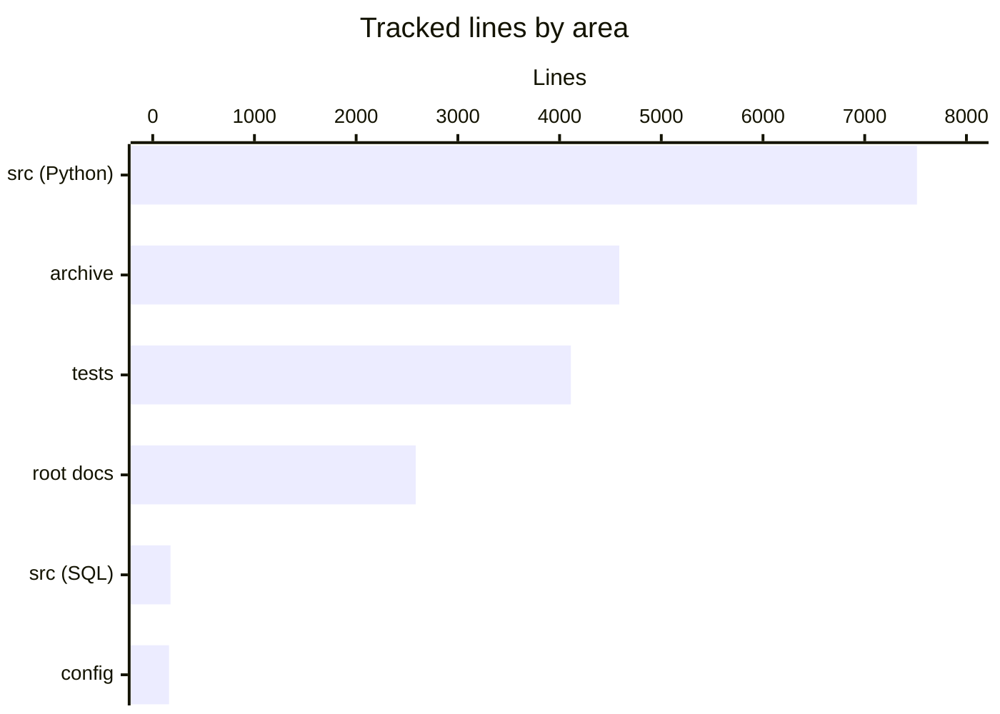

# By the numbers

Data collected on 2026-10-11.

All counts cover files tracked by git at `HEAD` (`dc3c981`). The `droid-wiki/` folder is untracked and is not counted. Line counts are physical lines from `@(Get-Content -Encoding UTF8 <file>).Count`, so blank lines are included. Commit figures come from `git log --shortstat` and `git log --name-only`. For what the pieces do, see [the overview](overview/index.md) and [the architecture page](overview/architecture.md).

## Size

### Lines by language

| Language | Files | Lines | Where |
| --- | ---: | ---: | --- |
| Python | 60 | 12,835 | 7,514 in `src/somnus/`, 4,111 in `tests/`, 1,210 in `archive/v0.1/tools/` |
| Markdown | 15 | 5,543 | Root documents plus `archive/` |
| JSON | 3 | 420 | `archive/v0.1/schemas/v1/` only |
| SQL | 1 | 175 | `src/somnus/db/schema.sql` |
| YAML | 2 | 126 | `.somnus-debug/python_doctor.yaml`, `.somnus-debug/python_doctor.src.yaml` |
| TOML | 1 | 20 | `pyproject.toml` |
| Other | 2 | 14 | `.gitignore`, `.gitattributes` |
| **Total** | **84** | **19,133** | |

The only JSON files in the repository are archived v0.1 schemas. Live code has none, which matches decision D4 (see [design decisions](background/design-decisions.md)).

### Lines by area

| Area | Files | Lines | Contents |
| --- | ---: | ---: | --- |
| `src/somnus/` | 47 | 7,689 | 46 Python modules plus `src/somnus/db/schema.sql` |
| `tests/` | 12 | 4,111 | 12 unittest suites |
| `archive/` | 13 | 4,587 | v0.1 spec, glossary, examples, schemas, tools, v2 proposal |
| Root documents | 7 | 2,586 | `SPEC.md` 908, `Somnus Markdown Metadata Standard Research.md` 685, `PLAN.md` 588, `DECISIONS.md` 253, `AGENTS.md` 57, `filetree.md` 51, `README.md` 44 |
| Config | 5 | 160 | `.somnus-debug/`, `pyproject.toml`, `.gitignore`, `.gitattributes` |

### Source, test, and docs file counts

| Kind | Files | Lines |
| --- | ---: | ---: |
| Source (`src/somnus/`) | 47 | 7,689 |
| Tests (`tests/`) | 12 | 4,111 |
| Docs (all tracked `.md`) | 15 | 5,543 |
| Archived code (`archive/v0.1/tools/`) | 2 | 1,210 |

## Activity

The repository has 14 commits on `main`. All of them landed on two days.

| Day | Weekday | ISO week | Commits | Lines added | Lines deleted |
| --- | --- | ---: | ---: | ---: | ---: |
| 2026-10-02 | Friday | 40 | 1 | 5,637 | 0 |
| 2026-10-11 | Sunday | 41 | 13 | 14,016 | 520 |

The 2026-10-11 burst ran from 06:26 to 08:38 (UTC-5). Eleven of its thirteen commits fall in the 06:00 hour. Five commits share the timestamp 06:26:04 or 06:26:05, which suggests they were split from one working session and committed back to back.

| Hour on 2026-10-11 | Commits |
| --- | ---: |
| 06:00 | 11 |
| 07:00 | 1 (`8f0db0d`, unit tests and bug fixes) |
| 08:00 | 1 (`dc3c981`, mojibake repair) |

### Churn hotspots

`git log --name-only` over all history lists 96 distinct paths, counting both sides of the archive renames. Because the repository is young, no file has been touched more than three times.

| Times touched | Files |
| ---: | --- |
| 3 | `src/somnus/db/store.py`, `src/somnus/yamlsub.py`, `src/somnus/document.py`, `src/somnus/ids.py`, `filetree.md`, `DECISIONS.md`, `AGENTS.md` |
| 2 | `src/somnus/model/lifecycle.py`, `src/somnus/regions.py`, `src/somnus/model/schema.py`, `src/somnus/model/validate.py`, `src/somnus/model/vocab.py`, `src/somnus/db/schema.sql`, `tests/test_store.py`, `tests/test_conformance.py` |

Most second and third touches come from two commits: `8f0db0d` (four bug fixes) and `dc3c981` (the encoding repair across 26 files). The largest single rewrite is `df72af4`, which changed `DECISIONS.md` by 526 lines while adding `PLAN.md`. The history behind these commits is on [the lore page](lore.md), and the encoding repair is covered in [pitfalls](background/pitfalls.md).

## Bot-attributed commits

`git log --format=%B | Select-String "Co-authored-by"` finds no trailers in any of the 14 commit messages. The measured bot-attributed share is therefore 0 of 14 (0%). Treat this as a lower bound. It only detects commits that declare a co-author trailer, and agent-written commits made under the operator's identity would not show up.

## Complexity

### Largest files

| Lines | File |
| ---: | --- |
| 1,287 | `archive/v0.1/SOMNUS-METADATA-SPEC-v0.1.md` |
| 1,115 | `archive/v0.1/tools/validate.py` |
| 908 | `SPEC.md` |
| 832 | `src/somnus/model/validate.py` |
| 831 | `archive/v2-proposal/SOMNUS_FRONTMATTER_SPEC_v2.md` |
| 757 | `src/somnus/yamlsub.py` |
| 693 | `tests/test_validate.py` |
| 685 | `Somnus Markdown Metadata Standard Research.md` |
| 675 | `src/somnus/db/store.py` |
| 601 | `src/somnus/model/schema.py` |

The four largest live source files are the validator, the restricted YAML parser, the SQLite store, and the field schema.

### Average file size by directory

| Directory | Files | Lines | Average |
| --- | ---: | ---: | ---: |
| `src/somnus/` (top level) | 10 | 2,015 | 202 |
| `src/somnus/carriers/` | 5 | 559 | 112 |
| `src/somnus/commands/` | 18 | 1,357 | 75 |
| `src/somnus/db/` | 3 | 855 | 285 |
| `src/somnus/model/` | 6 | 1,736 | 289 |
| `src/somnus/tui/` | 5 | 1,167 | 233 |
| `tests/` | 12 | 4,111 | 343 |
| `archive/v0.1/` | 10 | 3,512 | 351 |
| `archive/v2-proposal/` | 2 | 1,052 | 526 |

Command modules are small (75 lines on average) because each one is a thin layer over `src/somnus/model/` and `src/somnus/db/`.

### Test-to-code ratio

| Measure | Value |
| --- | ---: |
| Test lines / source Python lines | 4,111 / 7,514 = 0.55 |
| Test functions (`rg -c "def test_" tests`) | 443 |
| Source Python modules | 46 |
| Tests per module | 9.6 |
| Conformance fixtures in `tests/test_conformance.py` | 21 |

The suite with the most tests is `tests/test_validate.py` (80), followed by `tests/test_yamlsub.py` (75). The smallest is `tests/test_store.py` (15).
