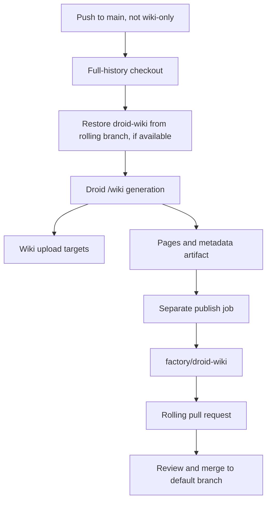

# Automation

GitHub Actions tests the package, analyzes Python security, creates tag-triggered GitHub Releases, and refreshes this wiki. `.github/workflows/release.yml` is not a PyPI publisher or service deployment. The recorded PyPI publication is a separate operator procedure in `runbooks/package-release.md`.

The action-only update in commit `954d5b4` changes checkout to v7, setup-python to v7, Gitleaks to v3, CodeQL to v4, and the wiki artifact upload/download actions to v7/v8. It does not change workflow triggers, permissions, jobs, or package behavior. [Dependencies](reference/dependencies.md#github-actions) maps each ref to its workflow source. Hosted execution and upstream release-age checks were not performed by this documentation refresh.

## CI

`.github/workflows/ci.yml` runs on pushes to `main`, all pull requests, and manual dispatch. It grants `contents: read` and cancels superseded runs for the same branch or pull request.

| Job | Configuration | Checks |
| --- | --- | --- |
| `test` | Python 3.11 and 3.14 on Ubuntu, Windows, macOS; Python 3.12 and 3.13 on Ubuntu | Full unittest discovery and semantic validation of `SPEC.md` and `DECISIONS.md` |
| `policy` | Ubuntu, Python 3.11 | Empty runtime dependencies; mypy; AST scan rejects imports of `archive` or its submodules under `src/` |
| `secrets` | Ubuntu, full-history checkout | Gitleaks scan using the workflow token |
| `tooling` | Ubuntu, Python 3.12 | All configured pre-commit hooks, six import contracts, branch coverage and test durations; `.coveragerc` fails below 85% |
| `install` | Ubuntu, Python 3.11 | Build distribution, install wheel, check import origin and run installed `somnus check` outside the checkout; explicitly run the current 67-check installed-package acceptance harness |

There are eight `test` matrix entries. They use Bash, `PYTHONPATH=src`, `PYTHONDONTWRITEBYTECODE=1`, and `fail-fast: false`. The install job does not use the source-checkout `PYTHONPATH`: after installation it changes to `$RUNNER_TEMP`, checks that `somnus.__file__` contains `site-packages`, and validates the managed documents using absolute workspace paths. See [Testing](how-to-contribute/testing.md) for local commands and suite coverage.

Commit `3dcde8b` adds an explicit `python tests/acceptance/installed_package_acceptance.py` step after those smoke checks. The harness builds its own wheel from a temporary source copy, installs it in a separate venv, and uses an isolated `SOMNUS_HOME` for real CLI, registry, stdio MCP, and POSIX PTY checks. It is not part of unittest discovery or the cross-platform matrix. Its exit code is `0` for all passing checks, `1` for failures, and `2` for missing prerequisites or required checks that could not run. The temporary tree is removed unless `--keep` is passed.

Commit `da82a7a` added the alias version check, bringing the harness from 65 to 66 checks. Commit `6cfc132` adds unmanaged JSON/binary discovery for 67 checks and compares both console-script versions to `[project].version` in `pyproject.toml` instead of hard-coded 2.1.0. The added discovery check verifies that indexing does not create sidecars (`tests/acceptance/installed_package_acceptance.py`).

The build backend and bundled `src/somnus/db/schema.sql` and `src/somnus/db/search.sql` are declared in `pyproject.toml`. Installing `pip`, `build`, and setuptools for CI does not change the stdlib-only runtime contract.

## Security analysis

`.github/workflows/codeql.yml` analyzes Python on pushes to `main`, pull requests, and Mondays at `04:23` UTC. It grants `contents: read` and `security-events: write` and uses CodeQL init/analyze actions. Configuration is not proof of a clean scan. Dependabot proposes weekly grouped Actions and pip dev/build updates; the seven-day release-age policy in `CONTRIBUTING.md` still requires manual review.

## Package releases

`.github/workflows/release.yml` triggers on pushed `v*` tags, runs checkout tests and semantic validation on Python 3.11, builds sdist/wheel, verifies that the tag equals `v` plus the `pyproject.toml` version, then installs the wheel outside the checkout and checks import origin and `somnus --version`. With `contents: write` and `github.token`, `gh release create` attaches `dist/*` and generates GitHub release notes.

The current file has no `id-token: write`, PyPI Trusted Publishing action, or PyPI-token fallback. Do not infer automatic PyPI publication from the workflow name. It also does not invoke the full installed-package acceptance harness; `CONTRIBUTING.md` requires that separately before release.

`runbooks/package-release.md` records the 2026-10-24 UTC manual PyPI publication and verification of **somnus-metadata 2.0.0**, including 60/60 exact-wheel acceptance checks and fresh public-index installation. The earlier 0.1.0 upload was a stale-version error, not v1 canon. The newer `docs/USAGE_GUIDE.md` records **2.1.0** publication after a clean-venv smoke test of the uploaded wheel and sdist, including both console scripts, full-text search, and a 16-tool MCP list. The [public release metadata](https://pypi.org/pypi/somnus-metadata/2.1.0/json), checked during a prior refresh, confirms uploads on **2026-11-01 at 04:10:57 and 04:10:59 UTC**, respectively (October 31 in the operator's local time). This is prior artifact-availability evidence, not a fresh installation or public-index check in this runner. Older unpublished-release statements in `PLAN.md` describe the earlier handoff.

Core metadata remains 2.0.0, while registry schema 2 adds FTS5 search and is refused by older writers (`src/somnus/db/store.py`). Back up the registry before upgrade. Both `src/somnus/db/schema.sql` and `src/somnus/db/search.sql` must ship in release artifacts. The primary command and Python import remain `somnus`; 2.1.0 also packages the equivalent `somnus-metadata` command alias. The unrelated PyPI distribution named `somnus` must not share the environment. `README.md` and the runbook do not grant an open-source license or imply a repository visibility change. No package release, tag, or PyPI upload was performed by this wiki refresh.

Both `[project.scripts]` entries in `pyproject.toml` target `somnus.cli:main`. The alias changes neither the 18-command CLI nor the 16-tool MCP surface; help and version output retain the name `somnus`. An older 2.0.0 install does not supply the alias. [`docs/USAGE_GUIDE.md`](../docs/USAGE_GUIDE.md) now recommends pip in a virtual environment on `PATH`, with links into a login-visible `~/.local/bin` for agent hosts; uv and pipx remain alternatives. Resolve apparent duplicate paths with `readlink -f` before removing a stale installation. See [Getting started](overview/getting-started.md) for commands.

The latest operator records in `PLAN.md` and `HANDOFF.md` identify toolkit **2.1.1** and separate private host plugin **1.2.1** at commit `35c228a`, superseding the 1.2.0 record (commit `4deee50`, 25 tests, hosted CI `41399524229`) and the earlier 1.1.1 record (commit `3000082`, 21 tests, hosted CI `41395258614`) and older `CONTEXT.md` snapshots. `docs/USAGE_GUIDE.md` now records plugin 1.2.1 as "Native multi-host plugin (1.2.1) — Installed in Codex and Factory from the clean production payload". `runbooks/package-release.md` records strict artifact checks, matching PyPI digests, exact-wheel 67/67 acceptance, and no-cache pip installation. Plugin 1.2.1 ships a checked-in reproducible export of exactly 8 runtime files under `native/somnus-metadata-plugin`, which both catalogs select instead of the development checkout; the build's `--check` and a new packaging regression reject stale or unexpected export files. The plugin supplies portable plugin.json/mcp.json, Codex compatibility manifest and catalog, Factory manifest and catalog, and the same shared skill; it updates host integration packaging, not metadata algorithms. Its fresh 26/26 tests and hosted CI `41402125903` passed according to `PLAN.md`. The plugin is not part of the Python distribution or built by these workflows.

Current operator evidence also includes actual Droid and Codex MCP searches for three known topics, three hits per topic in each host, one specification listing row, seven stale near-title advisories, and zero conflicts. Full paths were proved in both hosts using `tsv: true`/`--tsv`; human tables truncate paths to 60 characters. An OpenCode in-session tool call remains **NOT RUN**, as do native Windows and host-write acceptance. Older three-host read evidence used plugin 1.0.0. See [Agent integration](features/agent-integration.md) for configuration safety and evidence boundaries.

After plugin 1.1.1, `PLAN.md` recorded Droid reading its installed skill and both Droid and Codex successfully querying MCP for `host agnostic`, each returning three complete paths; at that point Codex's requested skill read was NOT RUN because that child could not locate Surgeon. The clean reinstall for Codex and Factory Droid closed those items, returning the same two real full paths (Factory session 039db1c1-ba79-4868-919b-9c9c6f8fd137). Plugin **1.2.0** then corrected a verification error the operator caught: a direct skill/MCP adapter had been misreported as a native installed plugin. After a native remove/uninstall and install refreshed both hosts' caches, the verified native identity is **somnus-metadata-plugin@somnus-metadata-plugin**: Codex reports installed=true, enabled=true, version 1.2.0, and Factory reports Enabled, user scope, commit 4deee507dc7a. Both native cached skill trees and the requested Codex/Factory custom skill copies match the canonical shared skill; the custom copies are compatibility projections, not native-installation evidence on their own. Fresh Codex and Factory sessions called the native-plugin MCP `q(text="lifecycle", limit=1, tsv=true)` and returned the same lifecycle.py source path (Factory session 52dcef09-320e-4d43-851c-e60b1025cf83). Factory's first reinstallation returned a settings-resolution error without changes; the next native install succeeded, and no speculative settings repair was performed. Codex and Factory hook contracts remain distinct, the plugin declares no hooks, and native MCP uses actor somnus-metadata-plugin while legacy direct adapters retain per-host actors. `PLAN.md` and `HANDOFF.md` record the corrected release/install commission complete. Plugin **1.2.1** then corrected the production payload: both catalogs now select the checked-in reproducible 8-file native export rather than the development checkout, and after a clean native remove/install both installed caches were inspected with 0 .somnus.yaml files, no package.json/.gitignore, and no Node development adapter code; 26 tests and hosted CI 41402125903 passed. The 1.2.0 native verification above remains the installed/enabled evidence; 1.2.1 changes packaging, not the MCP surface. A release or handshake alone still would not establish search evidence or skill fidelity; these operator records do.

Five roots are registered. The latest recorded scan in `docs/USAGE_GUIDE.md` section 9 has **2,659 managed / 21,554 unmanaged** hosts, with 0 invalid, 0 missing, and 0 conflicts. The operator stopped bulk adoption: adoption is optional usage, not a completion gate, and the remaining unmanaged files are preserved, not unfinished work. Older checkpoints of 1,064 / 23,148 (and earlier 27,202 unmanaged) are prior records whose reductions came from preservation exclusions, not new adoption. Protected-host sidecar handling has only an isolated fixture proof, not a bulk rollout. The repaired `Store.scan` in `src/somnus/db/store.py` includes hosts needing a new sidecar without loading their content. Use its native unmanaged list rather than another crawler. Do not repeat completed registration or adoption. See [Adopting files](features/adopting-files.md).

The optional [`docs/AGENTS.appendix.md`](../docs/AGENTS.appendix.md) is a manual global-instructions opt-in, not a package-install side effect or authorization for file changes. The usage guide's remote-control/tunnel section records architecture and proposed setup, not live remote acceptance. No HTTP/authentication server is implemented by `somnus mcp`, and neither a remote-control session nor a ChatGPT tunnel was validated here; the recorded ChatGPT setup remains incomplete.

## Wiki refresh

`.github/workflows/droid-wiki-refresh.yml` runs on pushes to `main`, except pushes changing only `droid-wiki/**`. Commit `66847b7` adds that path filter so merging a generated wiki pull request does not start another refresh merely to advance its recorded commit. Mixed source/wiki pushes still qualify. Its fixed concurrency group, `droid-wiki-refresh`, avoids overlapping refreshes; `cancel-in-progress: false` lets the active run finish.

The generation job fetches full history (`fetch-depth: 0`) and attempts to restore only `droid-wiki/` from `factory/droid-wiki`. It does not switch the source branch. If no pending wiki can be restored, generation starts from `droid-wiki/` on the checked-out branch, normally `main`; `/wiki` decides whether that is a valid incremental base. The fallback log now describes this behavior rather than claiming that a missing rolling branch forces full generation.

The job installs Factory Droid and runs `droid exec --auto high "/wiki"` with `FACTORY_API_KEY`. Repository permissions remain read-only during generation. The separate `wiki-publish` job receives `contents: write` and `pull-requests: write`, downloads the generated artifact, and uses `peter-evans/create-pull-request` pinned to the commit for v8.1.1.

The action updates `factory/droid-wiki` against the repository's default branch with the title and commit message `docs: refresh wiki` and the label `droid-wiki`. The workflow currently has no pull-request trigger; its branch-event guards prevent publication from pull-request events if triggers are expanded later.

Commit `a5c507c` sets `delete-branch: true` in `.github/workflows/droid-wiki-refresh.yml`. When the pull-request action finds nothing left to review, it deletes the rolling branch. This is action-managed cleanup during a publish run, not a promise of immediate deletion when a pull request merges. The merged wiki on the default branch seeds the next refresh; new page changes can recreate the rolling branch and pull request. No branch deletion or hosted publish job was exercised by this documentation refresh.

### Artifacts and cloud uploads

The `droid-wiki` artifact contains pages and hidden metadata, including `droid-wiki/.wiki-meta.json`. It excludes `droid-wiki/video/**` and `droid-wiki/images/**` and expires after one day. The pull-request action excludes the same asset directories from commits. Those exclusions keep captured visuals out of the rolling branch.

Hosted upload happens inside `/wiki`, before the publish job. The workflow itself does not choose an upload target; the active wiki skill, organization controls, repository access, and Git credentials decide which targets can accept it. A local page artifact is not proof that Factory or GitHub wiki publication succeeded.

### Credentials and permissions

| Name | Purpose |
| --- | --- |
| `FACTORY_API_KEY` | Authenticate the generation command to Factory |
| `FACTORY_WIKI_PR_TOKEN` | Optional repository-scoped token for writing the rolling branch and pull request |
| `github.token` | Publish-token fallback when the optional token is absent |

The optional publish token needs `contents: write` and `pull-requests: write` on this repository. Pull requests created with the `GITHUB_TOKEN` fallback do not trigger other workflows, as the comment in `.github/workflows/droid-wiki-refresh.yml` notes. If required checks must run on generated wiki pull requests, account for that token behavior. Neither these declarations nor a successful page-generation step proves that a token can push under the repository's branch rules.

## Failure checks

| Symptom | Where to look |
| --- | --- |
| A matrix entry fails | Unittest and semantic-check output in `.github/workflows/ci.yml`; do not infer other platforms passed |
| Policy job refuses a change | Runtime dependencies in `pyproject.toml` or an AST-visible archive import under `src/` |
| Installed command fails | Build/install logs, bundled `src/somnus/db/schema.sql` and `src/somnus/db/search.sql`, import-origin assertion, installed semantic check, and the installed-package acceptance step's per-check output |
| Previous wiki is not restored | A missing `factory/droid-wiki` is expected after no-diff cleanup; inspect fetch/path restoration and the checked-out branch's `droid-wiki/.wiki-meta.json` for an available base commit |
| Pages generate but no pull request appears | Publish action output, branch rules, token permissions, and repository settings that permit Actions-created pull requests |
| Hosted wiki is absent | `/wiki` upload output, organization cloud-sync controls, repository access, and GitHub wiki initialization/credentials |

The pull-request action uses `continue-on-error: true`; a final step emits a warning annotation when it fails. The workflow can therefore finish without a new rolling pull request. Inspect that warning rather than relying only on the run's overall status.

Workflow descriptions come from configuration, not fresh hosted-run inspection. `PLAN.md` records earlier core/plugin adoption commits and green CI, then the first 2.1.1 CI run (`41390329231`, `6cfc132`) failing three new tests on macOS/Windows. Commit `07a6039` resolves their expected temporary paths in `tests/test_store.py`; the scanner was already canonicalizing roots. `docs/USAGE_GUIDE.md` section 9 now records backend `07a6039` passing hosted CI `41390991791` and CodeQL `41390991803` (operator records; the runs were not inspected by this refresh). Runtime code and package version are unchanged. Historical 534-test, 65/65 and 66/66 acceptance, 88.76% coverage, and earlier lint/import-contract evidence retain their original boundaries.

The preceding wiki refresh from `e82e8bc` to `6cfc132` on 2026-11-02 passed the existing **537 checkout tests**, semantic validation (**0 errors, 0 warnings**), and **67/67 installed-package checks** with no failures or required checks unrun. System Python lacked mypy; temporary isolated **mypy 2.4.1 passed 49 source files** and was removed. Older mypy metadata-comment compatibility remains open; no dependency or product fix was made. Installed acceptance exercised real files, SQLite, a stdio MCP peer, and POSIX PTYs using a locally built 2.1.1 wheel. No product tests were added or changed by this refresh. Coverage, Doctor, public-index installation, hosted CI, and external hosts were not rerun. Host writes and native Windows console behavior remain unexercised; fake-console tests are separate evidence. See [Testing](how-to-contribute/testing.md).

The preceding `07a6039` refresh passed **537 existing checkout tests**, semantic validation (**0 errors, 0 warnings**), isolated **mypy 2.4.1 across 49 files**, and all three discovery methods under a real symlinked Linux temporary root. This docs-only `0881ad7` refresh repeated the 537-test suite, semantic check, and isolated mypy 2.4.1 successfully. System Python lacked mypy; the temporary environment/cache were removed. Installed acceptance and the symlink probe were not repeated for this operator-document-only delta. No hosted CI, coverage, Doctor, external-host checks, or public-index installation ran. See [Testing](how-to-contribute/testing.md).

## Key source files

| File | Purpose |
| --- | --- |
| `.github/workflows/ci.yml` | Matrix tests, policy guards, wheel smoke test |
| `.github/workflows/droid-wiki-refresh.yml` | Incremental generation, artifact handoff, rolling pull request |
| `.github/workflows/codeql.yml` | Scheduled and event-triggered Python security analysis |
| `.github/workflows/release.yml` | Tag validation, distribution build, GitHub Release artifacts |
| `runbooks/package-release.md` | Separate PyPI procedure and recorded publication evidence |
| `pyproject.toml` | Build backend, package discovery, empty runtime dependencies, SQL package data |
| `tests/acceptance/installed_package_acceptance.py` | Current 67-check installed boundary, including both console entry points and unmanaged JSON/binary discovery |
| `docs/USAGE_GUIDE.md`, `docs/AGENTS.appendix.md` | Installation walkthrough and optional manual agent guidance; not deployment automation |
| `AGENTS.md` | Authority, verification, and working-tree safety rules |
| `PLAN.md` | Delivered surface and separately verified environments |

For editing tools and diagnostic configuration, see [Tooling](how-to-contribute/tooling.md). For change review, see [Development workflow](how-to-contribute/development-workflow.md).
