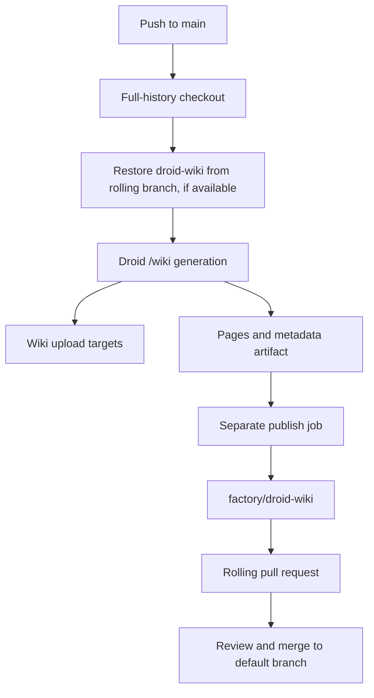

# Automation

GitHub Actions tests the package, analyzes Python security, creates tag-triggered GitHub Releases, and refreshes this wiki. `.github/workflows/release.yml` is not a PyPI publisher or service deployment. The recorded PyPI publication is a separate operator procedure in `runbooks/package-release.md`.

The action-only update in commit `954d5b4` changes checkout to v7, setup-python to v7, Gitleaks to v3, CodeQL to v4, and the wiki artifact upload/download actions to v7/v8. It does not change workflow triggers, permissions, jobs, or package behavior. [Dependencies](reference/dependencies.md#github-actions) maps each ref to its workflow source. Hosted execution and upstream release-age checks were not performed by this documentation refresh.

## CI

`.github/workflows/ci.yml` runs on pushes to `main`, all pull requests, and manual dispatch. It grants `contents: read` and cancels superseded runs for the same branch or pull request.

| Job | Configuration | Checks |
| --- | --- | --- |
| `test` | Python 3.11 and 3.14 on Ubuntu, Windows, macOS; Python 3.12 and 3.13 on Ubuntu | Full unittest discovery and semantic validation of `SPEC.md` and `DECISIONS.md` |
| `policy` | Ubuntu, Python 3.11 | Empty runtime dependencies; mypy; AST scan rejects imports of `archive` or its submodules under `src/` |
| `secrets` | Ubuntu, full-history checkout | Gitleaks scan using the workflow token |
| `tooling` | Ubuntu, Python 3.12 | All configured pre-commit hooks, six import contracts, branch coverage and test durations; `.coveragerc` fails below 85% |
| `install` | Ubuntu, Python 3.11 | Build distribution, install wheel, check import origin and run installed `somnus check` outside the checkout |

There are eight `test` matrix entries. They use Bash, `PYTHONPATH=src`, `PYTHONDONTWRITEBYTECODE=1`, and `fail-fast: false`. The install job does not use the source-checkout `PYTHONPATH`: after installation it changes to `$RUNNER_TEMP`, checks that `somnus.__file__` contains `site-packages`, and validates the managed documents using absolute workspace paths. See [Testing](how-to-contribute/testing.md) for local commands and suite coverage.

The build backend and bundled `src/somnus/db/schema.sql` and `src/somnus/db/search.sql` are declared in `pyproject.toml`. Installing `pip`, `build`, and setuptools for CI does not change the stdlib-only runtime contract.

## Security analysis

`.github/workflows/codeql.yml` analyzes Python on pushes to `main`, pull requests, and Mondays at `04:23` UTC. It grants `contents: read` and `security-events: write` and uses CodeQL init/analyze actions. Configuration is not proof of a clean scan. Dependabot proposes weekly grouped Actions and pip dev/build updates; the seven-day release-age policy in `CONTRIBUTING.md` still requires manual review.

## Package releases

`.github/workflows/release.yml` triggers on pushed `v*` tags, runs checkout tests and semantic validation on Python 3.11, builds sdist/wheel, verifies that the tag equals `v` plus the `pyproject.toml` version, then installs the wheel outside the checkout and checks import origin and `somnus --version`. With `contents: write` and `github.token`, `gh release create` attaches `dist/*` and generates GitHub release notes.

The current file has no `id-token: write`, PyPI Trusted Publishing action, or PyPI-token fallback. Do not infer automatic PyPI publication from the workflow name. It also does not invoke the full installed-package acceptance harness; `CONTRIBUTING.md` requires that separately before release.

`runbooks/package-release.md` records the 2026-10-24 UTC manual PyPI publication and verification of **somnus-metadata 2.0.0**, including 60/60 exact-wheel acceptance checks and fresh public-index installation. The earlier 0.1.0 upload was a stale-version error, not v1 canon. The checkout is now **2.1.0** (`pyproject.toml`); `PLAN.md` records that version as unpublished, with a prior 60/60 installed acceptance run. Core metadata remains 2.0.0, while registry schema 2 adds FTS5 search and is refused by older writers (`src/somnus/db/store.py`). Back up the registry before upgrade. Command/import remain `somnus`; the unrelated PyPI distribution named `somnus` must not share the environment. `README.md` and the runbook do not grant an open-source license or imply a repository visibility change. No package release, tag, PyPI upload, or installed-package rerun was performed by this wiki refresh.

The latest 2026-10-31 handoff in `PLAN.md` records a separate private Node 18+ host adapter, `calisweetleaf/somnus-metadata-plugin`, installed for Droid, Codex, and Antigravity on the operator's Linux laptop. That setup uses backend 2.1.0 from a checkout; it is not a public 2.1.0 package release or an artifact built by these workflows. See [Agent integration](features/agent-integration.md) for its diagnostic and in-host verification boundaries.

## Wiki refresh

`.github/workflows/droid-wiki-refresh.yml` runs on pushes to `main`. Its fixed concurrency group, `droid-wiki-refresh`, avoids overlapping refreshes; `cancel-in-progress: false` lets the active run finish.

The generation job fetches full history (`fetch-depth: 0`) and attempts to restore only `droid-wiki/` from `factory/droid-wiki`. It does not switch the source branch. If no pending wiki can be restored, generation starts from `droid-wiki/` on the checked-out branch, normally `main`; `/wiki` decides whether that is a valid incremental base. The fallback log now describes this behavior rather than claiming that a missing rolling branch forces full generation.

The job installs Factory Droid and runs `droid exec --auto high "/wiki"` with `FACTORY_API_KEY`. Repository permissions remain read-only during generation. The separate `wiki-publish` job receives `contents: write` and `pull-requests: write`, downloads the generated artifact, and uses `peter-evans/create-pull-request` pinned to the commit for v8.1.1.

The action updates `factory/droid-wiki` against the repository's default branch with the title and commit message `docs: refresh wiki` and the label `droid-wiki`. The workflow currently has no pull-request trigger; its branch-event guards prevent publication from pull-request events if triggers are expanded later.

Commit `a5c507c` sets `delete-branch: true` in `.github/workflows/droid-wiki-refresh.yml`. When the pull-request action finds nothing left to review, it deletes the rolling branch. This is action-managed cleanup during a publish run, not a promise of immediate deletion when a pull request merges. The merged wiki on the default branch seeds the next refresh; new page changes can recreate the rolling branch and pull request. No branch deletion or hosted publish job was exercised by this documentation refresh.

### Artifacts and cloud uploads

The `droid-wiki` artifact contains pages and hidden metadata, including `droid-wiki/.wiki-meta.json`. It excludes `droid-wiki/video/**` and `droid-wiki/images/**` and expires after one day. The pull-request action excludes the same asset directories from commits. Those exclusions keep captured visuals out of the rolling branch.

Hosted upload happens inside `/wiki`, before the publish job. The workflow itself does not choose an upload target; the active wiki skill, organization controls, repository access, and Git credentials decide which targets can accept it. A local page artifact is not proof that Factory or GitHub wiki publication succeeded.

### Credentials and permissions

| Name | Purpose |
| --- | --- |
| `FACTORY_API_KEY` | Authenticate the generation command to Factory |
| `FACTORY_WIKI_PR_TOKEN` | Optional repository-scoped token for writing the rolling branch and pull request |
| `github.token` | Publish-token fallback when the optional token is absent |

The optional publish token needs `contents: write` and `pull-requests: write` on this repository. Pull requests created with the `GITHUB_TOKEN` fallback do not trigger other workflows, as the comment in `.github/workflows/droid-wiki-refresh.yml` notes. If required checks must run on generated wiki pull requests, account for that token behavior. Neither these declarations nor a successful page-generation step proves that a token can push under the repository's branch rules.

## Failure checks

| Symptom | Where to look |
| --- | --- |
| A matrix entry fails | Unittest and semantic-check output in `.github/workflows/ci.yml`; do not infer other platforms passed |
| Policy job refuses a change | Runtime dependencies in `pyproject.toml` or an AST-visible archive import under `src/` |
| Installed command fails | Build/install logs, bundled `src/somnus/db/schema.sql` and `src/somnus/db/search.sql`, import-origin assertion, and installed semantic check |
| Previous wiki is not restored | A missing `factory/droid-wiki` is expected after no-diff cleanup; inspect fetch/path restoration and the checked-out branch's `droid-wiki/.wiki-meta.json` for an available base commit |
| Pages generate but no pull request appears | Publish action output, branch rules, token permissions, and repository settings that permit Actions-created pull requests |
| Hosted wiki is absent | `/wiki` upload output, organization cloud-sync controls, repository access, and GitHub wiki initialization/credentials |

The pull-request action uses `continue-on-error: true`; a final step emits a warning annotation when it fails. The workflow can therefore finish without a new rolling pull request. Inspect that warning rather than relying only on the run's overall status.

Workflow descriptions come from configuration, not hosted-run results. The 2026-10-31 checkout refresh at `22117e9` passed 486 tests, semantic validation (0 errors, 0 warnings), and isolated mypy 1.18.2 (49 files); see [Testing](how-to-contribute/testing.md) for the initial missing-tool result and prior POSIX PTY/installed-package evidence. The later handoff in `PLAN.md` records a real Droid MCP search call, not hosted CI acceptance. Codex and Antigravity in-host calls and native Windows terminal behavior remain unexercised.

## Key source files

| File | Purpose |
| --- | --- |
| `.github/workflows/ci.yml` | Matrix tests, policy guards, wheel smoke test |
| `.github/workflows/droid-wiki-refresh.yml` | Incremental generation, artifact handoff, rolling pull request |
| `.github/workflows/codeql.yml` | Scheduled and event-triggered Python security analysis |
| `.github/workflows/release.yml` | Tag validation, distribution build, GitHub Release artifacts |
| `runbooks/package-release.md` | Separate PyPI procedure and recorded publication evidence |
| `pyproject.toml` | Build backend, package discovery, empty runtime dependencies, SQL package data |
| `AGENTS.md` | Authority, verification, and working-tree safety rules |
| `PLAN.md` | Delivered surface and separately verified environments |

For editing tools and diagnostic configuration, see [Tooling](how-to-contribute/tooling.md). For change review, see [Development workflow](how-to-contribute/development-workflow.md).
