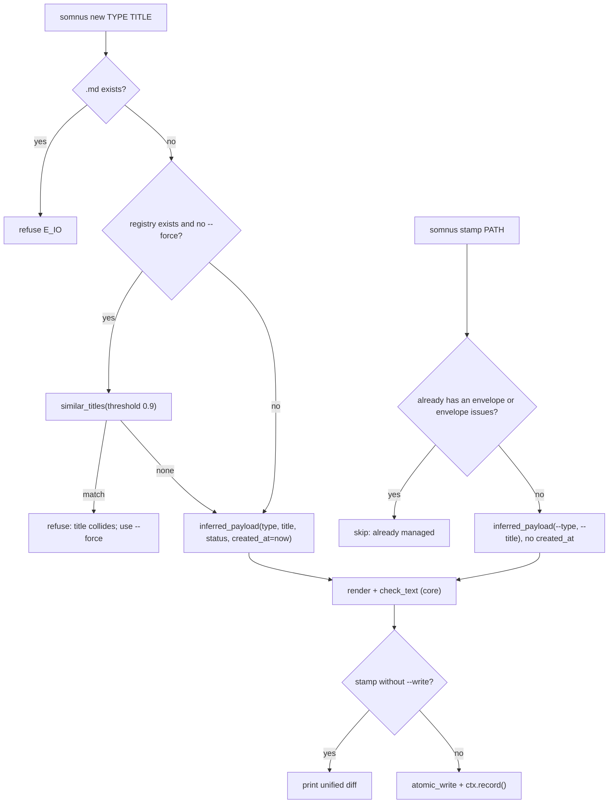

# Adopting files

Active contributors: calisweetleaf, Christian

`somnus new` creates a brand-new Markdown artifact, and `somnus stamp` adds a header to a file that already exists. Both build the header from configuration defaults plus heuristic inference, mint a fresh artifact ID, and validate the result before writing.

## Purpose

AGENTS.md tells agents never to create a document by copying another header, because that duplicates its `id`. These two commands are the sanctioned alternatives. They also enforce decision D6: the tool fills only values it can know (a minted UUIDv7, the configured defaults, an inferred type and title) and never invents dates, actors, licenses, evidence, or acceptance records.

## How it works

Both commands end in `new_payload()` in `src/somnus/commands/_common.py`, reached through `inferred_payload()`, which calls `infer()` in `src/somnus/infer.py`.



### `somnus new`

```powershell
somnus new specification "Region Marker Grammar" --dir docs
somnus new plan "Q3 Roadmap" --carrier html-comment --status proposed
```

`src/somnus/commands/new.py` writes `<slug>.md` (slug from `ids.slugify(title)`) into `--dir`, containing the header plus a `# <title>` heading. Rules:

- The title must be nonempty and the target directory must exist (exit 2 otherwise).
- An existing target file is refused with `E_IO`.
- When the registry exists, titles of present artifacts are compared with `Store.similar_titles(title, threshold=0.9)` (difflib ratio, case-folded). Any match is refused and up to three colliding titles and IDs are listed. `--force` skips the check. With no registry there is no check.
- `--carrier` chooses YAML frontmatter (default) or an HTML comment envelope.
- `--status` sets `lifecycle.status` (default `draft`).
- `time.created_at` is set to the current UTC instant from `lifecycle.now_utc()`. This is the one time value the tool records, because it is the moment of creation.

### `somnus stamp`

```powershell
somnus stamp README.md tools/build.ps1 data/results.csv
somnus stamp README.md --type index --title "Workspace index" --write
```

`src/somnus/commands/stamp.py` processes each path independently and keeps the highest exit code. A file is skipped as "already managed" when it has an envelope or any envelope parse issue. Without `--write` it prints a diff; with `--write` it writes atomically and records a `stamp` event.

Carrier choice follows the file extension through `carriers.for_path()`:

- **Embedded carrier available** (Markdown, TeX, Python, shell, PowerShell, YAML, TOML, JS/TS, C-family, SQL, CSS, HTML/XML/SVG; see `EXTENSIONS` in `src/somnus/carriers/__init__.py`): the envelope is rendered into the file. For Markdown with existing non-Somnus frontmatter, the `somnus:` block is appended inside that frontmatter; otherwise a new `---` block is inserted at the top. The comment carriers respect mandatory preambles such as shebangs and encoding cookies.
- **No embedded carrier** (JSON, CSV, `.txt`, `.ini`, `.cfg`, `.ipynb`, raster images, PDFs, and anything unrecognized): `stamp` writes a new `<file>.somnus.yaml` sidecar whose `bindings` lists the host as `{target: <name>, role: primary, required: true}`. The diff is shown against `/dev/null`. An existing sidecar counts as already managed.

`stamp` passes no `created_at`, so the header gets `time: {}`. The tool cannot know when an existing file was authored, so it records nothing.

### Bulk adoption

`HANDOFF.md` records the release/install commission as complete and marks the earlier bulk rollout superseded (operator correction, 2026-11-01), not a new recursive stamp command. `src/somnus/commands/stamp.py` accepts explicit file paths, including several paths per call; register directories separately with `somnus init --root DIR` in `src/somnus/commands/init.py`. Set `[index].exclude` before scanning, then use `somnus index` to identify unmanaged hosts. Registering or scanning a root does not stamp its files.

Toolkit 2.1.1 repairs discovery in `Store.scan()` in `src/somnus/db/store.py`: after exclusions and sidecar preference, hosts with no embedded carrier or sidecar increment both `scanned` and `unmanaged` and enter `ScanReport.unmanaged_paths` as absolute POSIX-form paths without loading their payloads. This includes JSON, text, extensionless files, and binaries. Hosts with sidecars are skipped in favor of observing each sidecar once. Use the full native report for batch planning; `src/somnus/commands/index.py` prints only ten examples. This replaces the separate embedded-only inventory, not authorization to adopt excluded files or a guarantee that loading/validation succeeded for every other file.

Before an authorized batch, test Markdown with existing frontmatter, a Python preamble, TOML/YAML, JSON, HTML, and a binary. Inspect the result and the consuming format: foreign frontmatter keys must survive, mandatory preambles must remain valid, and sidecar hosts must remain untouched. Existing [carrier](../systems/carriers.md) and [document](../systems/document-model.md) safeguards still apply. Record any `E_HOST` refusal rather than bypassing preservation.

The current top sections of `PLAN.md` and `HANDOFF.md` record the release/install commission as complete and mark the bulk-adoption frontier superseded (operator correction, 2026-11-01); they supersede the five-artifact starting snapshot and the earlier 160-path checkpoint. Five non-overlapping parent roots are registered. The latest recorded scan, cited in `docs/USAGE_GUIDE.md` section 9 as optional usage rather than a completion gate, reports **2,659 managed / 21,554 unmanaged** across the five roots, with **0 invalid / 0 missing / 0 conflicts**. The guide gives no per-root breakdown for that scan; the prior dated checkpoint, which included all carrier types, was:

| Root | Managed present hosts | Remaining unmanaged hosts |
| --- | ---: | ---: |
| Repositories | 161 | 2,780 |
| LAB | 0 | 19,736 |
| Somnus-MCP | 0 | 632 |
| Documents | 899 | 0 |
| Projects | 4 | 0 |
| **Total (prior checkpoint)** | **1,064** | **23,148** |

These are live-root operator checkpoints, not measurements made by this wiki refresh. The operator stopped bulk adoption on 2026-11-01: the remaining unmanaged hosts in Repositories, LAB, and Somnus-MCP are preserved, not unfinished work, and adoption is optional usage, not an open gate. The previous **21,174 embedded-only candidates** count is obsolete. `PLAN.md` records native body-digest checks before and after adopting the 903 Documents/Projects hosts, with no `E_HOST` refusals. Body preservation follows SPEC normalization: a leading BOM is accepted but not re-emitted, so this is not a whole-file byte-identity claim. Preflight also checked foreign frontmatter, preambles, native formats, and binary host bytes. Two pre-existing malformed Sentari Markdown files remain explicitly excluded after `E_ENVELOPE`, not repaired or counted as host-preservation failures.

Preserve exclusions for credentials, archives/frozen research, dependencies/caches, model weights, generated state, and the live Somnus-MCP data plane; see [Configuration](../reference/configuration.md). The 54,826 pnpm-store files excluded during full discovery are generated dependency state, not authored source removed to hide unfinished work. `PLAN.md` also excludes the historical `mash_merge_archive` and `old-non-applicable` trees. The latest preservation pass excludes generated hosting/runtime/test-run objects, private account-derived exports, and machine-owned `SOTA_RUN.md` artifacts. The reduction from 27,202 to 23,148 unmanaged hosts reflects these preservation exclusions, not new adoption.

Protected originals are planned for native-generated standard sidecars through Surgeon. An isolated supported-source fixture passed literal host-byte preservation, semantic validation, and native registry observation; no bulk protected-host rollout or Repositories sidecar adoption has occurred. This fixture proof does not change the existing native scan mechanism or authorize a bulk write.

Changes to already managed documents still use the owning commands, including `bump` for indexed content edits. Reconcile the existing five roots after authorized batches rather than registering nested roots again; account for remaining files, exclusions, refusals, and conflicts. Zero unmanaged is meaningful only within the scanned roots and exclusions, alongside diagnostics and reconciliation, and the operator explicitly retired zero-unmanaged as a completion criterion on 2026-11-01. The recorded Droid/Codex searches and the shared skill/plugin alignment are recorded complete for Codex and Factory Droid under the native plugin installation record (1.2.1 current, installed in both hosts from the clean 8-file production payload at commit 35c228a; the 1.2.0 record established the native installed/enabled identity and the fresh native-plugin MCP lifecycle queries); see [Agent integration](agent-integration.md) and [Querying](querying.md). No operator files were adopted by this wiki refresh.

`TestUnmanagedSidecarHosts` in `tests/test_store.py` covers JSON/text/binary discovery, exclusions, unchanged host bytes, a 64 MB sparse binary with less than 8 MB traced allocation, and real CLI stamping followed by sidecar deletion and missing-location reconciliation. `tests/acceptance/installed_package_acceptance.py` adds installed JSON/binary discovery without metadata creation. Current operator records report 537 source tests and 67/67 installed and exact-release wheel acceptance checks. The earlier refresh repeated the source suite and the three discovery methods under a real symlinked temporary root, not installed or exact-release acceptance. This incremental documentation update repeated the 537-test source suite and the semantic check (both passing) but not the installed, exact-release, or symlink-root checks. See [Testing](../how-to-contribute/testing.md).

### Inference

`infer()` in `src/somnus/infer.py` returns an `Inference(title, type, category, role, body_role)`. `--type` and `--title` override the corresponding guesses.

**Type** (`infer_type`), by extension first:

| Extension | Type |
| --- | --- |
| `.md`, `.markdown`, `.mdx`, `.txt`, `.rst` | First match of the filename stem against `_MD_KEYWORDS` (for example `spec` gives `specification`, `adr` or `decision` gives `decision-record`, `readme` or `filetree` gives `index`), else `report` |
| `.tex`, `.ltx` | `equation-set` when there are at least 3 equation environments and no `\section`, else `whitepaper` |
| `.toml`, `.yaml`, `.yml`, `.ini`, `.cfg`, `.psd1`, `.xml` | `configuration` |
| Source extensions (`.py`, `.ps1`, `.js`, `.ts`, `.rs`, `.go`, `.sql`, `.html`, and others) | `source-code` |
| `.json`, `.csv`, `.tsv`, `.parquet`, `.jsonl`, `.sqlite`, `.db` | `dataset` |
| `.ipynb` | `report` |
| Images, PDFs, Office files, archives, anything else | `asset` |

**Title** (`infer_title`): the first `#` or `##` heading outside frontmatter and code fences for Markdown; `\title{...}` for TeX; the first line of the module docstring for Python; otherwise the filename stem split on `-`, `_`, and spaces and capitalized. Markup characters `*`, `_`, and backticks are stripped.

**Category, role, body role**: looked up per type in `_TYPE_DEFAULTS` (for example `task` maps to `operations`, `working`, `instruction`; `conversation` maps to `context`, `historical`, `conversation`).

### Configuration defaults

`new_payload()` fills the remaining fields from `cfg.defaults` (built-ins in `src/somnus/config.py`, overridable by `$SOMNUS_HOME/config.toml` and the nearest `.somnus.toml`):

| Header field | Source | Built-in default |
| --- | --- | --- |
| `classification.scope` | `defaults.scope` | `component` |
| `authority.standing` | `defaults.standing` | `candidate` |
| `authority.scopes` | Self-scope `{target_ref: <id>, aspects: [content]}`, or empty when standing is `unasserted` | |
| `access.visibility` | `defaults.visibility` | `internal` |
| `access.allowed_uses` | `defaults.allowed_uses` | `archive`, `search`, `reason` |
| `ingestion.disposition` | `defaults.disposition` | `candidate` |
| `names.slug`, `knowledge.subjects` | Slug of the title; the new artifact ID | |

`classification.category`, `role`, and `ingestion.body_role` come from inference for these commands, not from `defaults`. Tags start empty.

A configured `defaults.standing = "accepted"` is refused with exit 2, because an accepted standing without an acceptance record would be invented authority. Use `candidate`.

### What is never invented

- No `created_at` for stamped files, and no `updated_at`, `reviewed_at`, or `authored_on` from either command.
- No owners, actors, licenses, evidence, claims, or relations in the header.
- No `accepted` standing or `acceptance_ref`.
- No reuse of an existing ID: every run mints a new `urn:somnus:artifact:<uuidv7>` through `ids.new_artifact_urn()`.

## Integration points

- Carrier placement and `E_HOST` checks: [Carriers](../systems/carriers.md), [Document model](../systems/document-model.md).
- Core validation of the rendered text: [Validation](../systems/validation.md).
- Title collision lookup and post-write observation: [Registry](../systems/registry.md).
- Default keys and precedence: [Configuration](../reference/configuration.md).
- Rationale for D6: [Design decisions](../background/design-decisions.md).

## Entry points for modification

- New filename keywords or extension mappings: `_MD_KEYWORDS`, `_SOURCE`, `_CONFIG`, `_DATA`, `_ASSET` in `src/somnus/infer.py`.
- Per-type category and role: `_TYPE_DEFAULTS` in `src/somnus/infer.py`.
- Header shape for new artifacts: `new_payload()` in `src/somnus/commands/_common.py`.
- Collision threshold: the `threshold=0.9` argument in `src/somnus/commands/new.py`.

## Key source files

| File | Role |
| --- | --- |
| `src/somnus/commands/new.py` | `somnus new` |
| `src/somnus/commands/stamp.py` | `somnus stamp`, including sidecar creation |
| `src/somnus/infer.py` | Type, title, and classification heuristics |
| `src/somnus/commands/_common.py` | `new_payload()`, `inferred_payload()`, `check_text()` |
| `src/somnus/config.py` | Built-in defaults and `config.toml` template |
| `src/somnus/db/store.py` | `Store.similar_titles()` and all-carrier unmanaged discovery |
| `tests/test_store.py` | `TestUnmanagedSidecarHosts` discovery, preservation, allocation, and reconciliation regressions |
| `tests/acceptance/installed_package_acceptance.py` | Installed CLI discovery of unmanaged JSON and binary hosts |
| `HANDOFF.md` | Release/install completion record and superseded bulk-adoption history |
| `PLAN.md`, `docs/USAGE_GUIDE.md` | Current operator adoption counts, exclusions, preflight, and partial-corpus search evidence |
