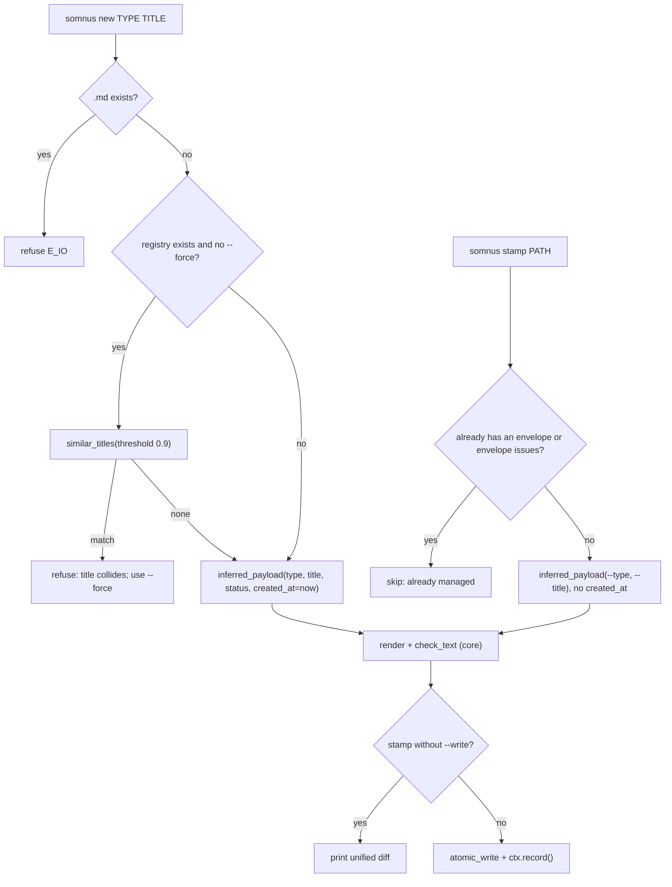

# Adopting files

`somnus new` creates a brand-new Markdown artifact, and `somnus stamp` adds a header to a file that already exists. Both build the header from configuration defaults plus heuristic inference, mint a fresh artifact ID, and validate the result before writing.

## Purpose

AGENTS.md tells agents never to create a document by copying another header, because that duplicates its `id`. These two commands are the sanctioned alternatives. They also enforce decision D6: the tool fills only values it can know (a minted UUIDv7, the configured defaults, an inferred type and title) and never invents dates, actors, licenses, evidence, or acceptance records.

## How it works

Both commands end in `new_payload()` in `src/somnus/commands/_common.py`, reached through `inferred_payload()`, which calls `infer()` in `src/somnus/infer.py`.



### `somnus new`

```powershell
somnus new specification "Region Marker Grammar" --dir docs
somnus new plan "Q3 Roadmap" --carrier html-comment --status proposed
```

`src/somnus/commands/new.py` writes `<slug>.md` (slug from `ids.slugify(title)`) into `--dir`, containing the header plus a `# <title>` heading. Rules:

- The title must be nonempty and the target directory must exist (exit 2 otherwise).
- An existing target file is refused with `E_IO`.
- When the registry exists, titles of present artifacts are compared with `Store.similar_titles(title, threshold=0.9)` (difflib ratio, case-folded). Any match is refused and up to three colliding titles and IDs are listed. `--force` skips the check. With no registry there is no check.
- `--carrier` chooses YAML frontmatter (default) or an HTML comment envelope.
- `--status` sets `lifecycle.status` (default `draft`).
- `time.created_at` is set to the current UTC instant from `lifecycle.now_utc()`. This is the one time value the tool records, because it is the moment of creation.

### `somnus stamp`

```powershell
somnus stamp README.md tools/build.ps1 data/results.csv
somnus stamp README.md --type index --title "Workspace index" --write
```

`src/somnus/commands/stamp.py` processes each path independently and keeps the highest exit code. A file is skipped as "already managed" when it has an envelope or any envelope parse issue. Without `--write` it prints a diff; with `--write` it writes atomically and records a `stamp` event.

Carrier choice follows the file extension through `carriers.for_path()`:

- **Embedded carrier available** (Markdown, TeX, Python, shell, PowerShell, YAML, TOML, JS/TS, C-family, SQL, CSS, HTML/XML/SVG; see `EXTENSIONS` in `src/somnus/carriers/__init__.py`): the envelope is rendered into the file. For Markdown with existing non-Somnus frontmatter, the `somnus:` block is appended inside that frontmatter; otherwise a new `---` block is inserted at the top. The comment carriers respect mandatory preambles such as shebangs and encoding cookies.
- **No embedded carrier** (JSON, CSV, `.txt`, `.ini`, `.cfg`, `.ipynb`, raster images, PDFs, and anything unrecognized): `stamp` writes a new `<file>.somnus.yaml` sidecar whose `bindings` lists the host as `{target: <name>, role: primary, required: true}`. The diff is shown against `/dev/null`. An existing sidecar counts as already managed.

`stamp` passes no `created_at`, so the header gets `time: {}`. The tool cannot know when an existing file was authored, so it records nothing.

### Inference

`infer()` in `src/somnus/infer.py` returns an `Inference(title, type, category, role, body_role)`. `--type` and `--title` override the corresponding guesses.

**Type** (`infer_type`), by extension first:

| Extension | Type |
| --- | --- |
| `.md`, `.markdown`, `.mdx`, `.txt`, `.rst` | First match of the filename stem against `_MD_KEYWORDS` (for example `spec` gives `specification`, `adr` or `decision` gives `decision-record`, `readme` or `filetree` gives `index`), else `report` |
| `.tex`, `.ltx` | `equation-set` when there are at least 3 equation environments and no `\section`, else `whitepaper` |
| `.toml`, `.yaml`, `.yml`, `.ini`, `.cfg`, `.psd1`, `.xml` | `configuration` |
| Source extensions (`.py`, `.ps1`, `.js`, `.ts`, `.rs`, `.go`, `.sql`, `.html`, and others) | `source-code` |
| `.json`, `.csv`, `.tsv`, `.parquet`, `.jsonl`, `.sqlite`, `.db` | `dataset` |
| `.ipynb` | `report` |
| Images, PDFs, Office files, archives, anything else | `asset` |

**Title** (`infer_title`): the first `#` or `##` heading outside frontmatter and code fences for Markdown; `\title{...}` for TeX; the first line of the module docstring for Python; otherwise the filename stem split on `-`, `_`, and spaces and capitalized. Markup characters `*`, `_`, and backticks are stripped.

**Category, role, body role**: looked up per type in `_TYPE_DEFAULTS` (for example `task` maps to `operations`, `working`, `instruction`; `conversation` maps to `context`, `historical`, `conversation`).

### Configuration defaults

`new_payload()` fills the remaining fields from `cfg.defaults` (built-ins in `src/somnus/config.py`, overridable by `$SOMNUS_HOME/config.toml` and the nearest `.somnus.toml`):

| Header field | Source | Built-in default |
| --- | --- | --- |
| `classification.scope` | `defaults.scope` | `component` |
| `authority.standing` | `defaults.standing` | `candidate` |
| `authority.scopes` | Self-scope `{target_ref: <id>, aspects: [content]}`, or empty when standing is `unasserted` | |
| `access.visibility` | `defaults.visibility` | `internal` |
| `access.allowed_uses` | `defaults.allowed_uses` | `archive`, `search`, `reason` |
| `ingestion.disposition` | `defaults.disposition` | `candidate` |
| `names.slug`, `knowledge.subjects` | Slug of the title; the new artifact ID | |

`classification.category`, `role`, and `ingestion.body_role` come from inference for these commands, not from `defaults`. Tags start empty.

A configured `defaults.standing = "accepted"` is refused with exit 2, because an accepted standing without an acceptance record would be invented authority. Use `candidate`.

### What is never invented

- No `created_at` for stamped files, and no `updated_at`, `reviewed_at`, or `authored_on` from either command.
- No owners, actors, licenses, evidence, claims, or relations in the header.
- No `accepted` standing or `acceptance_ref`.
- No reuse of an existing ID: every run mints a new `urn:somnus:artifact:<uuidv7>` through `ids.new_artifact_urn()`.

## Integration points

- Carrier placement and `E_HOST` checks: [Carriers](../systems/carriers.md), [Document model](../systems/document-model.md).
- Core validation of the rendered text: [Validation](../systems/validation.md).
- Title collision lookup and post-write observation: [Registry](../systems/registry.md).
- Default keys and precedence: [Configuration](../reference/configuration.md).
- Rationale for D6: [Design decisions](../background/design-decisions.md).

## Entry points for modification

- New filename keywords or extension mappings: `_MD_KEYWORDS`, `_SOURCE`, `_CONFIG`, `_DATA`, `_ASSET` in `src/somnus/infer.py`.
- Per-type category and role: `_TYPE_DEFAULTS` in `src/somnus/infer.py`.
- Header shape for new artifacts: `new_payload()` in `src/somnus/commands/_common.py`.
- Collision threshold: the `threshold=0.9` argument in `src/somnus/commands/new.py`.

## Key source files

| File | Role |
| --- | --- |
| `src/somnus/commands/new.py` | `somnus new` |
| `src/somnus/commands/stamp.py` | `somnus stamp`, including sidecar creation |
| `src/somnus/infer.py` | Type, title, and classification heuristics |
| `src/somnus/commands/_common.py` | `new_payload()`, `inferred_payload()`, `check_text()` |
| `src/somnus/config.py` | Built-in defaults and `config.toml` template |
| `src/somnus/db/store.py` | `Store.similar_titles()` |
