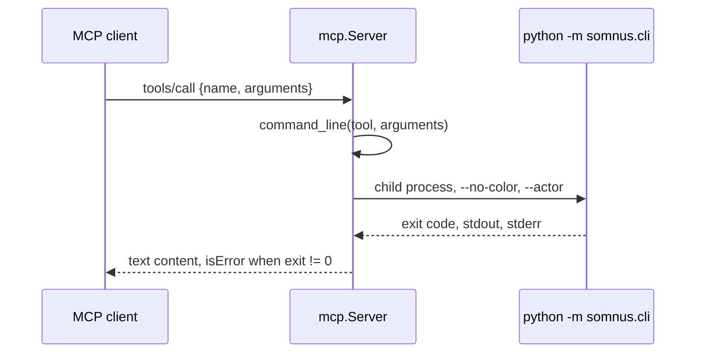

# Agent integration

Active contributors: calisweetleaf

`somnus brief` prints a Markdown cheat sheet meant to be pasted into an agent instruction file such as `AGENTS.md`, and `somnus schema` documents any header field or exports the whole header schema as JSON Schema Draft 2020-12. Both are read-only and need no registry. `somnus set` gives agents the header edits the terminal UI gives people, and `somnus mcp` serves every non-interactive command as a Model Context Protocol tool for clients without a shell.

## Purpose

Agents working in a Somnus-managed repository need the handful of rules that keep headers valid (never invent IDs or dates, never edit `id`, change status only through the tool), a way to look up a field's type and vocabulary without reading all of `SPEC.md`, and a way to change header fields without editing the envelope by hand. `brief` covers the rules, `schema FIELD` the lookup, and `set` the edits. `mcp` puts all of them behind one stdio server. The JSON Schema export exists for editors and external tooling that understand JSON Schema; apart from the MCP protocol framing, it is the only JSON the toolkit produces, by design, because D4 forbids JSON in the registry and the toolkit's own output is text or TSV.

## Integration surfaces

| Surface | What exists | Boundary |
| --- | --- | --- |
| CLI and MCP adapter | `src/somnus/cli.py` and `src/somnus/mcp.py`, installed by the `somnus-metadata` distribution | Executable tooling; MCP projects the same CLI rather than implementing another backend. |
| Repository instructions | `AGENTS.md`, `.factory/skills/somnus-metadata-dev/SKILL.md`, and `.claude/skills/somnus-metadata-dev/SKILL.md` | Markdown guidance for agents working in this checkout, not executable extensions or proof of host activation. |
| Optional global appendix | [`docs/AGENTS.appendix.md`](../../docs/AGENTS.appendix.md), with the walkthrough in [`docs/USAGE_GUIDE.md`](../../docs/USAGE_GUIDE.md) | Manual opt-in guidance for an operator's global instruction file; not auto-installed, host activation, or authorization to mutate files. |
| Private host adapter | Separate [somnus-metadata-plugin](https://github.com/calisweetleaf/somnus-metadata-plugin) repository, version 1.1.0 recorded in `docs/USAGE_GUIDE.md` | Installs a skill and MCP configuration for Droid, Codex, Antigravity, and OpenCode. It is outside this repository and Python distribution; its implementation was not inspected during this refresh. |

The two `somnus-metadata-dev` skills describe the authority spine, stdlib-only runtime, verification commands, safe metadata edits, and host-byte preservation. They are repository operating instructions, not a portable plugin installation. `MANIFEST.in` prunes `.factory/` and `.claude/` from source distributions; `pyproject.toml` discovers packages only under `src/`. Installing `somnus-metadata` therefore does not install these skills into a coding-agent host. See [Deployment](../deployment.md) for package boundaries and [Architecture](../overview/architecture.md) for shared runtime owners.

### Optional always-on guidance

`docs/AGENTS.appendix.md` supplies a fenced block the operator may manually copy into a global instruction file: `~/.factory/AGENTS.md`, `~/.codex/AGENTS.md`, `~/.config/opencode/AGENTS.md`, or global Antigravity rules. Neither installing the Python package nor adding its console alias performs that copy. The block complements `somnus brief` and the optional consumer skill; its presence in this repository does not prove any host loaded it.

Its workflow is to search before creating (`q --text`, `ls`), reuse or fork a matching artifact, adopt only files the operator wants tracked (`stamp` preview, then authorized `--write`), and validate managed-file edits with `check /abs/file --level semantic`. For substantial document work it recommends `index`, `q --conflicts`, and `stale`. These recommendations do not authorize bulk adoption of unmanaged files or changes to global configuration.

Use the owning mutation commands: `set` for supported header fields (including `classification.tags`, not bare `tags`), `status` for lifecycle transitions, and `bump` after body changes to indexed files. Do not hand-edit identity, revision, lifecycle, authority, or time metadata, or fabricate evidence. Always pass absolute paths to MCP tools because relative paths resolve from the server directory. The appendix's `/home/daeron/...` guide path is an operator-environment example; locate `docs/USAGE_GUIDE.md` in your own checkout rather than assuming that path exists.

The published 2.1.0 package's `somnus-metadata` console alias reaches the same `somnus.cli:main` as `somnus`, including `brief` and `mcp`; it adds no command or tool. The usage guide also records remote-control and tunnel architecture, but no live remote acceptance follows from those instructions. `src/somnus/mcp.py` remains stdio-only, with no HTTP transport or authentication server; ChatGPT tunnel setup remains unperformed in the recorded handoff.

### Private adapter handoff

`docs/USAGE_GUIDE.md` sections 6 and 9 record plugin 1.1.0 and 21/21 passing tests for the separate private adapter, superseding the older three-host/18-test handoff in `PLAN.md`. The adapter installs the `somnus-metadata` consumer skill and an MCP command of `somnus --actor <host> mcp`; this skill is distinct from the repository's `somnus-metadata-dev` instructions. These are guide-reported behaviors; no external adapter implementation was inspected here.

The plugin requires Node.js 18.17+, an installed Somnus backend 2.1.0+, and authenticated access to the private repository (or a local clone). The recorded diagnostic command is `npx github:calisweetleaf/somnus-metadata-plugin doctor`; it is not part of the Python CLI. `install --dry-run` previews changes, `install --host droid,codex` limits hosts, and `install --somnus /abs/path/to/somnus` pins the executable. Per the guide, `install --install-backend SRC` tries `pip install --upgrade SRC`, then `uv tool install`, then `pipx install` if pip is absent or refuses. No adapter download, installation, or host-configuration change was performed during this refresh.

| Host | Consumer skill directory | MCP configuration | Actor |
| --- | --- | --- | --- |
| Droid | `~/.factory/skills/somnus-metadata/` | `~/.factory/mcp.json`: `mcpServers["somnus-metadata"]` | `droid` |
| Codex | `$CODEX_HOME/skills/custom/somnus-metadata/` (default `~/.codex/skills/custom/somnus-metadata/`) | `~/.codex/config.toml`: managed `# >>> somnus-metadata-plugin` / `# <<< somnus-metadata-plugin` block defining `[mcp_servers.somnus-metadata]` | `codex` |
| Antigravity | `~/.gemini/skills/somnus-metadata/` | `~/.gemini/config/plugins/somnus-metadata/plugin.json` and `mcp_config.json` | `antigravity` |
| OpenCode | `~/.config/opencode/skills/somnus-metadata/` | `~/.config/opencode/opencode.jsonc` or `opencode.json`: `mcp["somnus-metadata"]`, `type: local`, `enabled: true` | `opencode` |

Each skill has `SKILL.md` plus `references/mcp-tools.md`, `references/recipes.md`, and `references/setup.md`. The guide records timestamped host-config backups and a `.somnus-plugin.json` marker carrying version, install time, and skill hash. Migration removes the old `~/.codex/skills/somnus-metadata/` and Antigravity plugin-local `skills/` copies only when plugin-marked; it must not remove unmarked user skills. Commented `opencode.jsonc` is never rewritten: the installer prints an entry for manual insertion into its `mcp` object.

Host entries use an absolute executable path. Rerun `install --somnus /abs/path/to/somnus` after relocating the backend. Restart hosts after install/uninstall to reload skills and MCP configuration; OpenCode's background service needs `opencode service restart`. See [Getting started](../overview/getting-started.md) for the pip-first backend installation.

| Boundary | Evidence recorded in `docs/USAGE_GUIDE.md` |
| --- | --- |
| Backend installation | Public PyPI 2.1.0; operator's pip installation in `~/.venvs/global`, linked into `~/.local/bin`. Publication availability is distinct from the guide's recorded clean-venv release smoke test. |
| Host configuration | Plugin 1.1.0 installed for all four hosts; `opencode debug config` loads the entry. |
| Diagnostic protocol checks | Doctor reported clean skill hashes and live 16-tool handshakes for all four hosts (2026-11-01 output). This is not proof of an in-session host call. |
| In-host read use | Droid, Codex, and Antigravity made real read calls with plugin 1.0.0; those results do not establish host acceptance of every 1.1.0 change. |
| Still unexercised | In-session OpenCode MCP call, host write tools, live remote-control/tunnel sessions, and native Windows execution remain NOT RUN. |

These are recorded operator-environment results, not observations from the current CI runner or a review of the external adapter's source. The adapter configures consumers of `src/somnus/mcp.py`; it does not change core 2.0.0 or add a second metadata backend.

### Full-index acceptance

`AGENTS.md` now directs completion work to `HANDOFF.md` before older next actions in `PLAN.md`. The 2026-11-01 handoff records a healthy backend and four-host plugin, but only five indexed artifacts at its starting snapshot. That is an adoption/indexing gap, not evidence that carrier support or toolkit features were removed.

After the intended roots have been adopted and indexed, the handoff requires searches through Droid's MCP connection and a `codex exec` session using its MCP tool, not a shell substitute. The required surfaces are `q` with `text` for three known topics, `ls` filtered to `specification`, `stale`, and `q` with `conflicts`. Record returned artifacts and conflict dispositions; a tool list or doctor handshake alone cannot prove that agents can find the intended content. See [Querying](querying.md) for registry scope and [Adopting files](adopting-files.md) for preparation.

These fresh full-corpus search checks remain part of the unfinished operator job. The earlier successful in-host queries above do not satisfy it, and this wiki refresh did not access the operator's roots or exercise those external clients.

## How it works

### `somnus brief`

```powershell
somnus brief
somnus brief > somnus-brief.md     # then paste the section into AGENTS.md
```

`src/somnus/commands/brief.py` prints the constant `BRIEF` string, a Markdown section headed `## Somnus metadata (core somnus://metadata/core/2.0.0)`. It contains:

- where the normative contract lives (`SPEC.md`) and the three carrier families;
- **Rules for agents**: never hand-invent IDs, dates, actors, licenses, evidence, or acceptance records; never edit `id`; indexed changes are new revisions via `somnus bump`; lifecycle changes go through `somnus status`; unknown fields are errors and tool data goes under `extensions.<owner>`; region markers carry identity only and are registered with `somnus regions PATH --sync --write`; `normative` role is intent, and only `authority.standing: accepted` with an acceptance record is authoritative;
- **Commands**: a table mapping needs (new document, adopt a file, validate, change status, edit fields, new revision, derive a copy, upgrade v0.1, registry, content search, field docs, MCP tools) to command lines;
- the exit-code meanings `0`, `1`, `2`.

The content-search row in `src/somnus/commands/brief.py` is `somnus q --text "words to find"` and explains that every word must match and `word*` is a prefix. Because `src/somnus/mcp.py` includes `BRIEF` in its initialization instructions, MCP clients receive the same guidance.

The root `AGENTS.md` of this repository carries the same rules in its "Rules for Somnus-managed files" section. When an authorized rule change is made, keep `BRIEF`, `AGENTS.md`, and `SPEC.md` aligned.

### `somnus schema FIELD`

```powershell
somnus schema                          # the payload root
somnus schema classification
somnus schema lifecycle.status
somnus schema knowledge.claims.region_ref
```

`resolve()` in `src/somnus/commands/schema.py` walks the declarative schema tree in `src/somnus/model/schema.py`. The leading `somnus.` is optional, `[]` is ignored, and array items are stepped through automatically, so `knowledge.claims.region_ref` reaches the field inside each claim. Profile payloads are reachable under `profile_data` through their short keys, for example `somnus schema profile_data.specification`. An unknown member is a usage error (exit 2) naming the part that failed.

The output starts with plain lines:

```text
field: somnus.lifecycle.status
type: one of: draft, proposed, provisional, active, experimental, superseded, deprecated, historical, archived, rejected
required: yes
```

followed by `about:` when the field has documentation. For objects and tagged unions, a `member, required, type, about` table follows (tagged variants are listed as `<tag>=<kind>: <field>`). `--tsv` applies to that table.

### `somnus schema --json-schema`

```powershell
somnus schema --json-schema
somnus schema --json-schema --out build/somnus-core-2.0.0.schema.json
```

`export()` in `src/somnus/model/jsonschema_export.py` converts the same schema tree:

- `$schema` is `https://json-schema.org/draft/2020-12/schema` and `$id` is the core schema URI;
- every object is closed with `additionalProperties: false` and lists its `required` members;
- enums, `date-time` and `date` formats with the SPEC patterns, string patterns, `minLength`, numeric bounds, `minItems`, and `uniqueItems` are carried over;
- named objects and tagged unions become `$defs` entries referenced with `$ref`; tagged unions become `oneOf` with a `const` on the tag;
- the specification and benchmark profile payload schemas are added to `$defs` with a `$comment` naming their profile URI.

A top-level `$comment` states the limit: restricted-YAML rules, cross-field consistency, references, regions, and profile key binding are enforced only by the `somnus` validator. A document that passes the JSON Schema can still fail `somnus check`. `--out` writes the file atomically; using `--out` without `--json-schema` is a usage error.

### `somnus set`

```powershell
somnus set notes/plan.md "title=Rollout Plan" "classification.tags=release, ops" --reason "retitle"
somnus set notes/plan.md summary=          # an empty optional field is removed
```

`src/somnus/commands/set_fields.py` is the non-interactive twin of the header editor in [Terminal UI](../systems/tui.md) (decision D16). It accepts exactly the fields in `FIELDS` from `src/somnus/tui/form.py`: `title`, `summary`, `purpose`, `classification.category`, `classification.type`, `classification.role`, `classification.scope`, `classification.tags`, `access.visibility`, and `ingestion.disposition`. A leading `somnus.` is optional, and the value is everything after the first `=`.

`run()` loads the document with `load_valid()`, feeds every assignment through `FormModel.apply()` (tags are comma-separated and de-duplicated; an empty `summary` or `purpose` is removed), and compares the result with the loaded payload. If nothing changed it prints `no changes` and writes nothing. Otherwise it calls `bump_revision()`, writes through `commit()` (core validation plus host-byte preservation), and records a `set` event naming the changed fields and the `--reason`.

Refusals leave the file untouched:

| Input | Exit | Diagnostic |
| --- | --- | --- |
| A field outside `FIELDS` (`id`, `lifecycle.status`, ...) | 2 | Lists the settable fields |
| An argument without `=`, or the same field twice | 2 | Usage error |
| A value outside a vocabulary | 1 | `E_SCHEMA` with the allowed values |
| A result that fails core validation (for example an empty title) | 1 | The validator's diagnostics |

### `somnus mcp`

```powershell
somnus mcp                       # stdio server; register this command with an MCP client
somnus --actor my-agent mcp      # actor recorded for every write made through the server
```

`src/somnus/mcp.py` implements a stdlib-only MCP server over newline-delimited UTF-8 JSON-RPC 2.0 on stdin and stdout (decision D17, detailed in `SPEC.md` section 20). It handles `initialize`, `ping`, `tools/list`, and `tools/call`, ignores notifications and stray responses, and answers malformed protocol input with JSON-RPC errors (`-32700` parse, `-32600` invalid request, `-32601` unknown method, `-32602` bad params or unknown tool). Batches are accepted. The `initialize` result carries the `BRIEF` text as server instructions and negotiates the protocol version from `PROTOCOL_VERSIONS`.



`build_tools()` in `src/somnus/mcp.py` generates the current 16 tools from the argparse definitions collected by `build_parser(parsers)` in `src/somnus/cli.py`, so a new supported command or flag shows up in MCP without a separate hand-maintained tool list. Each input schema is a closed object (`additionalProperties: false`). `edit` and `mcp` are excluded (`EXCLUDED`), and the global `--actor`, `--debug`, and `--no-color` stay server-side. Required positionals become required properties; optional positionals stay optional. `store_true` flags become booleans, repeatable and multi-value arguments become string arrays, `type=int` becomes an integer, and `choices` become an `enum`. Tools in `READ_ONLY` (`brief`, `check`, `ls`, `q`, `stale`) carry `readOnlyHint: true`.

The existing `q` tool now has an optional string property `text`, generated from `--text` in `src/somnus/cli.py`, plus its existing `sql`, shortcut booleans, integer `limit`, and boolean `tsv` properties. This adds no tool: the count remains 16. For example, a `tools/call` request can use these parameters (JSON here is protocol input, not registry output):

```json
{"name": "q", "arguments": {"text": "host bytes", "limit": 10, "tsv": true}}
```

`command_line()` in `src/somnus/mcp.py` converts those arguments to `q --tsv --text=host bytes --limit=10` as separate argv elements; no shell splits the search string. The generated schema does not encode the argparse mutually exclusive group, so the real CLI enforces conflicts between `text` and shortcuts. Supplying both `text` and `sql` is allowed: `src/somnus/commands/query.py` joins both strings as literal search words and never executes the `sql` value as SQL in text mode. For example, `{"text": "naming", "sql": "conventions"}` searches for both words. The CLI equivalent `somnus q --text naming conventions` uses its one optional positional slot; longer unquoted word lists are not generally accepted.

`src/somnus/commands/query.py` returns ranked `id, title, type, status, path, excerpt` rows as text or TSV. Empty/wildcard-only searches and a missing search table produce exit 2, surfaced as `isError: true` with `[exit 2]`. A search with zero matches instead exits 0 (`isError: false`) and includes an informational adoption/reindex hint alongside the normal empty-table output.

Search reads the last indexed managed-file observations, not arbitrary host files or revision history. Populate or refresh it with the `index` tool; the base registry remains usable without FTS5, but text search requires SQLite FTS5. See [Querying](querying.md) for all-word/prefix semantics and [Registry](../systems/registry.md) for migration and conflicting observations.

`command_line()` in `src/somnus/mcp.py` checks argument types and turns them into an argv: options as `--flag=value` and positionals after `--`, so a title or SQL string that starts with `-` is never read as an option. Conversion failures return a tool error (`isError: true`) rather than a JSON-RPC error. Malformed protocol parameters and unknown tool names use the JSON-RPC error layer. `Server.call()` now checks that a tool name is a string before dictionary lookup, so non-string names also receive `-32602` instead of falling into an internal lookup error. This is request hardening, not a new tool surface.

`run_cli()` in `src/somnus/mcp.py` runs that argv with the server's own interpreter, with `PYTHONIOENCODING=utf-8`, no stdin, a 600-second timeout, and no console window on Windows. The result contains exactly one text content item with the command's stdout and stderr, with Windows line endings normalized. A non-zero exit sets `isError` and appends `[exit N]`, so agents keep the 0/1/2 distinction. JSON-RPC is transport framing; registry output remains text or TSV. The explicit JSON Schema export is still returned as text content.

The runner also sets `NO_COLOR=1`, prepends its package root to the inherited `PYTHONPATH`, and forwards the server's actor. Captured bytes decode as UTF-8 with replacement for invalid sequences. `subprocess.TimeoutExpired` becomes exit 2 with `somnus COMMAND timed out after 600 seconds`; a launch `OSError` becomes exit 2 with `could not start somnus: ...`. These are ordinary failed tool results, not protocol errors. An unexpected exception escaping the runner is contained by `Server.handle()`: stderr receives the diagnostic, the response uses JSON-RPC `-32603` with the exception type only, and the session can continue.

The adapter maintains no application state between calls. Each command reads or writes files and the registry independently. Relative paths in tool arguments resolve against the server's working directory, so absolute paths are the safe choice.

After a nonzero runner exit, `Server.call()` adds a path-resolution note when arguments contain relative paths under `PATH_PARAMS = {path, paths, roots, root, dir, out}`. `_relative_paths()` collects nonempty relative strings (including string-array entries), sorts them, and the note names those paths and `os.getcwd()` before the final `[exit N]`: `note: relative path(s) a.md resolve from the server directory ...; pass absolute paths`. It is not added to successful calls, failures with only absolute paths, or argument-conversion `ToolError` results (which return before the runner). It does not change path resolution, make the adapter stateful, or turn a command failure into a JSON-RPC protocol error.

### Acceptance boundary

`tests/test_mcp.py` covers protocol handling, generated schemas, argument conversion, and a child-process stdio session. `TestRunCli` adds a real child `brief` call plus mocked checks for actor/environment/stdin/timeout forwarding, lenient decoding, CRLF normalization, timeout, and launch failure. `TestRunnerFailures` checks internal-error containment and a succeeding ping after a runner exception. `TestTools.test_argument_validation` rejects missing required arguments, wrong scalar/array types, booleans used as integers, and NUL-containing strings. `TestProtocol.test_call_maps_exit_codes` checks the failed-relative-path note, current working directory, final exit marker, and absence of that note for an absolute path.

`tests/test_commands.py` covers two-word unquoted text search, unmanaged-file adoption notes, zero-match success, and implicit-home-root refusal. Separately, `tests/acceptance/installed_package_acceptance.py` builds and installs an isolated wheel and launches the installed `somnus mcp` outside the checkout. Its real stdio client checks initialization, exactly 16 tools and closed schemas, text/TSV content, failing-command and argument errors, unknown-method and parse errors, session survival, empty server stderr, and the failed-relative-path server-directory hint. Its agent-hints phase covers unquoted search words, zero-result adoption guidance, unmanaged-file hints, and implicit broad-root refusal.

The latest operator evidence in `docs/USAGE_GUIDE.md` section 9 records 534 passing unit tests, 88.76% total branch-plus-statement coverage, 49 source files clean under mypy, and 66/66 checks for the complete installed CLI/SQLite/file/MCP/POSIX PTY harness, not 66 MCP checks. These are prior operator results, not new runs from this documentation refresh. The alias assertion in `phase_install` is included; older 65/65 runs in `PLAN.md` remain historical. The installed harness requires explicit invocation and is not collected by unittest discovery. See [Testing](../how-to-contribute/testing.md).

Repository tests establish adapter and installed-package behavior, not external-host acceptance or coding-agent skill loading. The preceding wiki refresh recorded a passing 534-test checkout suite, including `tests/test_mcp.py`; that is not a new test result for this documentation-only update. Separately, the guide records real in-host read calls for Droid, Codex, and Antigravity with plugin 1.0.0, as described above; OpenCode in-session calls and host write tools remain unexercised, and ChatGPT is not set up. Native Windows terminal behavior is not established by the POSIX acceptance run or faked console tests.

## Integration points

- Header editing shared with the TUI: [Terminal UI](../systems/tui.md).
- The schema tree both commands read: [Data models](../reference/data-models.md) and [Validation](../systems/validation.md).
- Why JSON appears only in the schema export and MCP framing: D4 and D17 in [Design decisions](../background/design-decisions.md).
- Getting an agent started in a new repository: [Getting started](../overview/getting-started.md).
- Actor, roots, and registry location: [Configuration](../reference/configuration.md).
- Full command list: [CLI commands](cli-commands.md).

## Entry points for modification

- Cheat sheet text: the `BRIEF` constant in `src/somnus/commands/brief.py`.
- Field documentation strings: the `doc` arguments on fields in `src/somnus/model/schema.py`. Both `schema FIELD` and the JSON Schema `description` values come from them.
- Mapping of schema node types to JSON Schema keywords: `_Exporter.node()` in `src/somnus/model/jsonschema_export.py`. A new node type in `src/somnus/model/schema.py` needs a branch here, or export raises `TypeError`.
- Profile short keys for field lookup: `_PROFILE_KEYS` in `src/somnus/commands/schema.py`.
- Settable fields: `FIELDS` in `src/somnus/tui/form.py`. A change there changes `somnus set` and the TUI together.
- MCP tool generation: `_param()` and `build_tools()` in `src/somnus/mcp.py`. A new argparse action kind needs a branch in `_param()`. Tests are in `tests/test_mcp.py`, including a live stdio session against a child server.

## Key source files

| File | Role |
| --- | --- |
| `src/somnus/commands/brief.py` | `somnus brief` and the `BRIEF` text |
| `src/somnus/commands/schema.py` | `somnus schema`, field resolution, member tables |
| `src/somnus/commands/set_fields.py` | `somnus set`: validated, revisioned header edits |
| `src/somnus/mcp.py` | MCP stdio server, argparse-to-tool generation, child-process runner, failed-call relative-path hints |
| `src/somnus/commands/mcp.py` | `somnus mcp` entry point |
| `src/somnus/cli.py` | Parser-derived `q.text` property and query-mode flags |
| `src/somnus/commands/query.py` | Full-text result columns, ranking, and query-mode errors |
| `src/somnus/model/jsonschema_export.py` | JSON Schema Draft 2020-12 export |
| `src/somnus/model/schema.py` | Declarative schema tree shared by validation, docs, and export |
| `AGENTS.md` | Repository agent rules that mirror the brief |
| `HANDOFF.md` | Current full-index job and required Droid/Codex MCP search evidence |
| `docs/AGENTS.appendix.md` | Optional manually copied global search/adoption/mutation guidance |
| `docs/USAGE_GUIDE.md` | Current pip-first installation, four-host plugin 1.1.0 paths, release evidence, and unexercised remote-access architecture |
| `PLAN.md` | Historical private-adapter milestones and host-specific evidence; older publication state is superseded by the guide |
| `.factory/skills/somnus-metadata-dev/SKILL.md` | Factory/Droid repository operating instructions, not a packaged plugin |
| `.claude/skills/somnus-metadata-dev/SKILL.md` | Corresponding repository skill instructions for Claude |
| `tests/test_mcp.py` | Protocol, generated schemas, argument validation, child runner failures, session survival, and subprocess stdio coverage |
| `tests/test_commands.py` | Search-word handling, root safety, and adoption/no-match hint coverage |
| `tests/acceptance/installed_package_acceptance.py` | Explicit isolated-wheel CLI and real stdio MCP acceptance |
| `pyproject.toml`, `MANIFEST.in` | Distribution/package discovery and exclusion of repository-only instruction directories |
