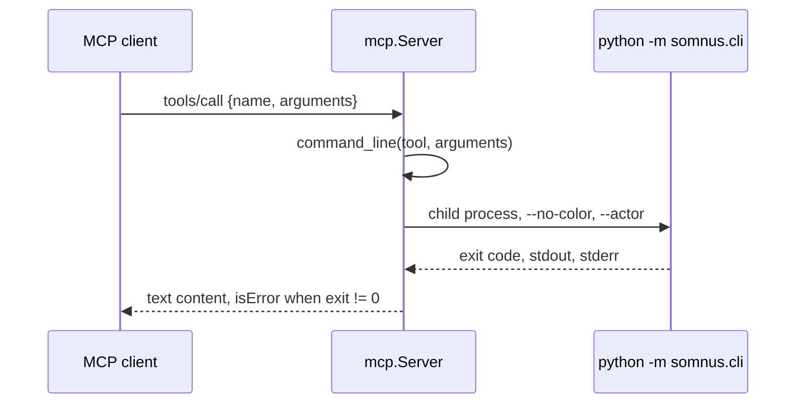

# Agent integration

Active contributors: @calisweetleaf, Christian

`somnus brief` prints a Markdown cheat sheet meant to be pasted into an agent instruction file such as `AGENTS.md`, and `somnus schema` documents any header field or exports the whole header schema as JSON Schema Draft 2020-12. Both are read-only and need no registry. `somnus set` gives agents the header edits the terminal UI gives people, and `somnus mcp` serves every non-interactive command as a Model Context Protocol tool for clients without a shell.

## Purpose

Agents working in a Somnus-managed repository need the handful of rules that keep headers valid (never invent IDs or dates, never edit `id`, change status only through the tool), a way to look up a field's type and vocabulary without reading all of `SPEC.md`, and a way to change header fields without editing the envelope by hand. `brief` covers the rules, `schema FIELD` the lookup, and `set` the edits. `mcp` puts all of them behind one stdio server. The JSON Schema export exists for editors and external tooling that understand JSON Schema; apart from the MCP protocol framing, it is the only JSON the toolkit produces, by design, because D4 forbids JSON in the registry and the toolkit's own output is text or TSV.

## Integration surfaces

| Surface | What exists | Boundary |
| --- | --- | --- |
| CLI and MCP adapter | `src/somnus/cli.py` and `src/somnus/mcp.py`, installed by the `somnus-metadata` distribution | Executable tooling; MCP projects the same CLI rather than implementing another backend. |
| Repository instructions | `AGENTS.md`, `.factory/skills/somnus-metadata-dev/SKILL.md`, and `.claude/skills/somnus-metadata-dev/SKILL.md` | Markdown guidance for agents working in this checkout, not executable extensions or proof of host activation. |
| Distributable coding-agent plugin | No packaged plugin exists | No plugin manifest, marketplace entry, bundled plugin server, or installable plugin artifact is supplied. `PLAN.md` records this as deferred work, not something fulfilled by MCP. |

The two `somnus-metadata-dev` skills describe the authority spine, stdlib-only runtime, verification commands, safe metadata edits, and host-byte preservation. They are repository operating instructions, not a portable plugin installation. `MANIFEST.in` prunes `.factory/` and `.claude/` from source distributions; `pyproject.toml` discovers packages only under `src/`. Installing `somnus-metadata` therefore does not install these skills into a coding-agent host. See [Deployment](../deployment.md) for package boundaries and [Architecture](../overview/architecture.md) for shared runtime owners.

## How it works

### `somnus brief`

```powershell
somnus brief
somnus brief > somnus-brief.md     # then paste the section into AGENTS.md
```

`src/somnus/commands/brief.py` prints the constant `BRIEF` string, a Markdown section headed `## Somnus metadata (core somnus://metadata/core/2.0.0)`. It contains:

- where the normative contract lives (`SPEC.md`) and the three carrier families;
- **Rules for agents**: never hand-invent IDs, dates, actors, licenses, evidence, or acceptance records; never edit `id`; indexed changes are new revisions via `somnus bump`; lifecycle changes go through `somnus status`; unknown fields are errors and tool data goes under `extensions.<owner>`; region markers carry identity only and are registered with `somnus regions PATH --sync --write`; `normative` role is intent, and only `authority.standing: accepted` with an acceptance record is authoritative;
- **Commands**: a table mapping needs (new document, adopt a file, validate, change status, new revision, derive a copy, upgrade v0.1, registry, field docs) to command lines;
- the exit-code meanings `0`, `1`, `2`.

The root `AGENTS.md` of this repository carries the same rules in its "Rules for Somnus-managed files" section. When an authorized rule change is made, keep `BRIEF`, `AGENTS.md`, and `SPEC.md` aligned.

### `somnus schema FIELD`

```powershell
somnus schema                          # the payload root
somnus schema classification
somnus schema lifecycle.status
somnus schema knowledge.claims.region_ref
```

`resolve()` in `src/somnus/commands/schema.py` walks the declarative schema tree in `src/somnus/model/schema.py`. The leading `somnus.` is optional, `[]` is ignored, and array items are stepped through automatically, so `knowledge.claims.region_ref` reaches the field inside each claim. Profile payloads are reachable under `profile_data` through their short keys, for example `somnus schema profile_data.specification`. An unknown member is a usage error (exit 2) naming the part that failed.

The output starts with plain lines:

```text
field: somnus.lifecycle.status
type: one of: draft, proposed, provisional, active, experimental, superseded, deprecated, historical, archived, rejected
required: yes
```

followed by `about:` when the field has documentation. For objects and tagged unions, a `member, required, type, about` table follows (tagged variants are listed as `<tag>=<kind>: <field>`). `--tsv` applies to that table.

### `somnus schema --json-schema`

```powershell
somnus schema --json-schema
somnus schema --json-schema --out build/somnus-core-2.0.0.schema.json
```

`export()` in `src/somnus/model/jsonschema_export.py` converts the same schema tree:

- `$schema` is `https://json-schema.org/draft/2020-12/schema` and `$id` is the core schema URI;
- every object is closed with `additionalProperties: false` and lists its `required` members;
- enums, `date-time` and `date` formats with the SPEC patterns, string patterns, `minLength`, numeric bounds, `minItems`, and `uniqueItems` are carried over;
- named objects and tagged unions become `$defs` entries referenced with `$ref`; tagged unions become `oneOf` with a `const` on the tag;
- the specification and benchmark profile payload schemas are added to `$defs` with a `$comment` naming their profile URI.

A top-level `$comment` states the limit: restricted-YAML rules, cross-field consistency, references, regions, and profile key binding are enforced only by the `somnus` validator. A document that passes the JSON Schema can still fail `somnus check`. `--out` writes the file atomically; using `--out` without `--json-schema` is a usage error.

### `somnus set`

```powershell
somnus set notes/plan.md "title=Rollout Plan" "classification.tags=release, ops" --reason "retitle"
somnus set notes/plan.md summary=          # an empty optional field is removed
```

`src/somnus/commands/set_fields.py` is the non-interactive twin of the header editor in [Terminal UI](../systems/tui.md) (decision D16). It accepts exactly the fields in `FIELDS` from `src/somnus/tui/form.py`: `title`, `summary`, `purpose`, `classification.category`, `classification.type`, `classification.role`, `classification.scope`, `classification.tags`, `access.visibility`, and `ingestion.disposition`. A leading `somnus.` is optional, and the value is everything after the first `=`.

`run()` loads the document with `load_valid()`, feeds every assignment through `FormModel.apply()` (tags are comma-separated and de-duplicated; an empty `summary` or `purpose` is removed), and compares the result with the loaded payload. If nothing changed it prints `no changes` and writes nothing. Otherwise it calls `bump_revision()`, writes through `commit()` (core validation plus host-byte preservation), and records a `set` event naming the changed fields and the `--reason`.

Refusals leave the file untouched:

| Input | Exit | Diagnostic |
| --- | --- | --- |
| A field outside `FIELDS` (`id`, `lifecycle.status`, ...) | 2 | Lists the settable fields |
| An argument without `=`, or the same field twice | 2 | Usage error |
| A value outside a vocabulary | 1 | `E_SCHEMA` with the allowed values |
| A result that fails core validation (for example an empty title) | 1 | The validator's diagnostics |

### `somnus mcp`

```powershell
somnus mcp                       # stdio server; register this command with an MCP client
somnus --actor my-agent mcp      # actor recorded for every write made through the server
```

`src/somnus/mcp.py` implements a stdlib-only MCP server over newline-delimited UTF-8 JSON-RPC 2.0 on stdin and stdout (decision D17, detailed in `SPEC.md` section 20). It handles `initialize`, `ping`, `tools/list`, and `tools/call`, ignores notifications and stray responses, and answers malformed protocol input with JSON-RPC errors (`-32700` parse, `-32600` invalid request, `-32601` unknown method, `-32602` bad params or unknown tool). Batches are accepted. The `initialize` result carries the `BRIEF` text as server instructions and negotiates the protocol version from `PROTOCOL_VERSIONS`.



`build_tools()` in `src/somnus/mcp.py` generates the current 16 tools from the argparse definitions collected by `build_parser(parsers)` in `src/somnus/cli.py`, so a new supported command or flag shows up in MCP without a separate hand-maintained tool list. Each input schema is a closed object (`additionalProperties: false`). `edit` and `mcp` are excluded (`EXCLUDED`), and the global `--actor`, `--debug`, and `--no-color` stay server-side. Required positionals become required properties; optional positionals stay optional. `store_true` flags become booleans, repeatable and multi-value arguments become string arrays, `type=int` becomes an integer, and `choices` become an `enum`. Tools in `READ_ONLY` (`brief`, `check`, `ls`, `q`, `stale`) carry `readOnlyHint: true`.

`command_line()` in `src/somnus/mcp.py` checks argument types and turns them into an argv: options as `--flag=value` and positionals after `--`, so a title or SQL string that starts with `-` is never read as an option. Conversion failures return a tool error (`isError: true`) rather than a JSON-RPC error. Malformed protocol parameters and unknown tool names use the JSON-RPC error layer. `Server.call()` now checks that a tool name is a string before dictionary lookup, so non-string names also receive `-32602` instead of falling into an internal lookup error. This is request hardening, not a new tool surface.

`run_cli()` in `src/somnus/mcp.py` runs that argv with the server's own interpreter, with `PYTHONIOENCODING=utf-8`, no stdin, a 600-second timeout, and no console window on Windows. The result contains exactly one text content item with the command's stdout and stderr, with Windows line endings normalized. A non-zero exit sets `isError` and appends `[exit N]`, so agents keep the 0/1/2 distinction. JSON-RPC is transport framing; registry output remains text or TSV. The explicit JSON Schema export is still returned as text content.

The adapter maintains no application state between calls. Each command reads or writes files and the registry independently. Relative paths in tool arguments resolve against the server's working directory, so absolute paths are the safe choice.

### Acceptance boundary

`tests/test_mcp.py` covers protocol handling, generated schemas, argument conversion, and a child-process stdio session. Separately, `tests/acceptance/installed_package_acceptance.py` builds and installs an isolated wheel and launches the installed `somnus mcp` outside the checkout. Its real stdio client checks initialization, exactly 16 tools and closed schemas, text/TSV content, failing-command and argument errors, unknown-method and parse errors, session survival, and empty server stderr.

`PLAN.md` records a prior 60/60 result for the complete installed CLI/SQLite/file/MCP/POSIX PTY harness, not 60 MCP checks or a new result from this documentation refresh. This harness requires explicit invocation and is not collected by unittest discovery. See [Testing](../how-to-contribute/testing.md).

These are adapter and installed-package checks, not acceptance in an external MCP host or validation of coding-agent skill loading. Registering the command in a particular client, enabling/trusting it, and exercising real calls there remains a separate integration boundary. Native Windows terminal behavior is not established by the POSIX acceptance run.

## Integration points

- Header editing shared with the TUI: [Terminal UI](../systems/tui.md).
- The schema tree both commands read: [Data models](../reference/data-models.md) and [Validation](../systems/validation.md).
- Why JSON appears only in the schema export and MCP framing: D4 and D17 in [Design decisions](../background/design-decisions.md).
- Getting an agent started in a new repository: [Getting started](../overview/getting-started.md).
- Actor, roots, and registry location: [Configuration](../reference/configuration.md).
- Full command list: [CLI commands](cli-commands.md).

## Entry points for modification

- Cheat sheet text: the `BRIEF` constant in `src/somnus/commands/brief.py`.
- Field documentation strings: the `doc` arguments on fields in `src/somnus/model/schema.py`. Both `schema FIELD` and the JSON Schema `description` values come from them.
- Mapping of schema node types to JSON Schema keywords: `_Exporter.node()` in `src/somnus/model/jsonschema_export.py`. A new node type in `src/somnus/model/schema.py` needs a branch here, or export raises `TypeError`.
- Profile short keys for field lookup: `_PROFILE_KEYS` in `src/somnus/commands/schema.py`.
- Settable fields: `FIELDS` in `src/somnus/tui/form.py`. A change there changes `somnus set` and the TUI together.
- MCP tool generation: `_param()` and `build_tools()` in `src/somnus/mcp.py`. A new argparse action kind needs a branch in `_param()`. Tests are in `tests/test_mcp.py`, including a live stdio session against a child server.

## Key source files

| File | Role |
| --- | --- |
| `src/somnus/commands/brief.py` | `somnus brief` and the `BRIEF` text |
| `src/somnus/commands/schema.py` | `somnus schema`, field resolution, member tables |
| `src/somnus/commands/set_fields.py` | `somnus set`: validated, revisioned header edits |
| `src/somnus/mcp.py` | MCP stdio server, argparse-to-tool generation, child-process runner |
| `src/somnus/commands/mcp.py` | `somnus mcp` entry point |
| `src/somnus/model/jsonschema_export.py` | JSON Schema Draft 2020-12 export |
| `src/somnus/model/schema.py` | Declarative schema tree shared by validation, docs, and export |
| `AGENTS.md` | Repository agent rules that mirror the brief |
| `.factory/skills/somnus-metadata-dev/SKILL.md` | Factory/Droid repository operating instructions, not a packaged plugin |
| `.claude/skills/somnus-metadata-dev/SKILL.md` | Corresponding repository skill instructions for Claude |
| `tests/test_mcp.py` | Protocol, generated schemas, conversion, and subprocess stdio coverage |
| `tests/acceptance/installed_package_acceptance.py` | Explicit isolated-wheel CLI and real stdio MCP acceptance |
| `pyproject.toml`, `MANIFEST.in` | Distribution/package discovery and exclusion of repository-only instruction directories |
