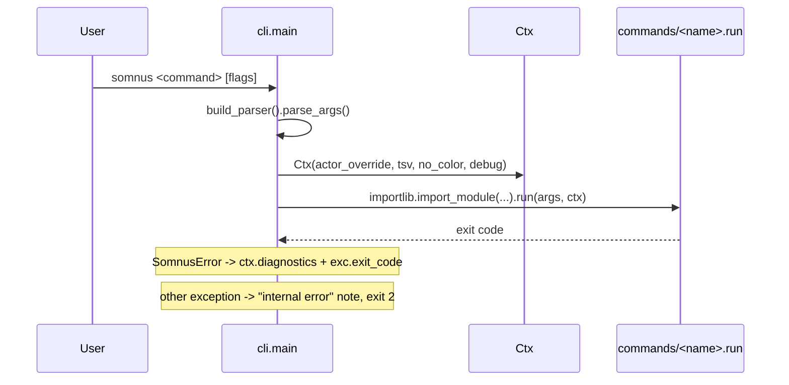

# CLI commands

`somnus` is an argparse CLI with 18 subcommands, each implemented as one module under `src/somnus/commands/` and imported only when invoked. Every command receives the same `Ctx` object, which supplies configuration, output formatting, registry access, and event recording.

## Purpose

The CLI is the only supported way to create, adopt, revise, and retire Somnus-managed files. It enforces the SPEC rules that hand edits tend to break: IDs are minted rather than typed, lifecycle changes follow the state machine, every write is validated before it reaches disk, and every mutation is logged to the registry ledger. The command table in SPEC §20 is the normative contract; `src/somnus/cli.py` implements it.

## Subcommands

"Writes" means the command changes files or the registry. "Dry run" means it prints a unified diff and changes nothing unless `--write` is given.

| Command | Purpose | Key flags | Effect | Source |
| --- | --- | --- | --- | --- |
| `init` | Create `$SOMNUS_HOME`, `config.toml`, and the registry; register roots. Idempotent. | `--root DIR` (repeatable) | Writes home, config, registry | `src/somnus/commands/init.py` |
| `new` | Scaffold a conformant Markdown artifact `<slug>.md` with a fresh UUIDv7 at revision 1. | `TYPE TITLE`, `--dir`, `--carrier frontmatter\|html-comment`, `--status` (default `draft`), `--force` | Writes a new file | `src/somnus/commands/new.py` |
| `stamp` | Infer and inject a header into unmanaged files (embedded or sidecar). | `PATH...`, `--write`, `--type`, `--title` | Dry run unless `--write` | `src/somnus/commands/stamp.py` |
| `check` | Validate documents and print diagnostics. | `[PATH...]`, `--all`, `--level carrier\|core\|semantic\|canon` (default `core`) | Read-only | `src/somnus/commands/check.py` |
| `index` | Reconcile roots into the registry. | `[ROOT...]`, `--full` | Writes registry | `src/somnus/commands/index.py` |
| `q` | Read-only SQL or shortcut queries. | `[SQL]`, `--docs\|--conflicts\|--history\|--tables`, `--limit N` | Read-only | `src/somnus/commands/query.py` |
| `ls` | List present artifacts from the `docs` view. | `--type`, `--status`, `--standing`, `--tag`, `--path-contains` | Read-only | `src/somnus/commands/ls.py` |
| `status` | Validated lifecycle transition; writes a new revision. | `PATH NEW_STATUS`, `--reason`, `--replacement REF` (repeatable) | Writes file | `src/somnus/commands/status.py` |
| `bump` | New revision; resolves `revision` and `identity` conflicts. | `PATH`, `--reason` | Writes file | `src/somnus/commands/bump.py` |
| `set` | Change the header fields the `edit` form exposes, in one new revision. Other fields are refused. | `PATH FIELD=VALUE...`, `--reason` | Writes file; nothing when no value changes | `src/somnus/commands/set_fields.py` |
| `fork` | New artifact derived from an existing revision. | `PATH`, `--out`, `--title` | Writes a new file | `src/somnus/commands/fork.py` |
| `regions` | Audit region markers against `knowledge.regions`. | `PATH`, `--sync`, `--write` | Read-only; `--sync` is a dry run unless `--write` | `src/somnus/commands/regions.py` |
| `migrate` | Upgrade v0.1 documents to core 2.0.0. | `PATH...`, `--write` | Dry run unless `--write` | `src/somnus/commands/migrate.py` |
| `stale` | Report stale drafts, unresolved replacements, missing files, near-duplicate titles, open conflicts. | `--days N` (default 30) | Read-only | `src/somnus/commands/stale.py` |
| `schema` | Field documentation, or JSON Schema Draft 2020-12 export. | `[FIELD]`, `--json-schema`, `--out` | Read-only; `--json-schema --out` writes one file | `src/somnus/commands/schema.py` |
| `brief` | Print a Markdown cheat sheet for agent instruction files. | none | Read-only | `src/somnus/commands/brief.py` |
| `edit` | Terminal UI: document browser, or header editor for one file. | `[PATH]` | Interactive; the header editor can write | `src/somnus/commands/edit.py` |
| `mcp` | Serve every command except `edit` as MCP tools over stdio. | none (global `--actor` is passed to each call) | Runs until stdin closes; each tool call has its command's effect | `src/somnus/commands/mcp.py`, `src/somnus/mcp.py` |

`q`, `ls`, and `stale` open the registry through `connect_readonly`, so they fail with `E_IO` (exit 2) when `somnus init` has not been run. `index` opens the registry for writing with `create=False` and has the same requirement.

## How it works

### Dispatcher

`build_parser()` in `src/somnus/cli.py` builds one subparser per command. `main()` parses arguments, builds a `Ctx`, and imports `somnus.commands.<name>` with `importlib`. The `_MODULES` table maps the two exceptions: `q` lives in `src/somnus/commands/query.py` and `set` in `src/somnus/commands/set_fields.py`. When `build_parser()` is given a dict, it also collects each subcommand's parser into it; `src/somnus/mcp.py` uses that to generate its tools. Each module exposes `run(args, ctx) -> int`.



Error handling in `main()`:

- A parse failure or missing command returns exit 2.
- `SomnusError` prints its diagnostics and returns its `exit_code` (1 by default, 2 for usage and I/O).
- `KeyboardInterrupt` prints `interrupted` and returns 1.
- Any other exception prints `somnus: internal error: ...` and returns 2. With `--debug` the traceback is printed instead.

### Global flags

The global flags are registered twice: once on the top-level parser and once on a shared parent parser (with `argparse.SUPPRESS` defaults) that every subparser inherits. They can therefore appear before or after the subcommand name.

| Flag | Effect |
| --- | --- |
| `--actor NAME` | Actor recorded in the event ledger; overrides `actor` from configuration. |
| `--tsv` | Tab-separated output for tables and diagnostics; also disables color. |
| `--no-color` | Disable ANSI color. Color is also off when `NO_COLOR` is set or stdout is not a TTY. |
| `--debug` | Print tracebacks for internal errors. |
| `--version` | Print `somnus <version>` (top level only). |

### Dry-run diff, then `--write`

Commands that modify an existing host file (`stamp`, `migrate`, `regions --sync`) default to printing a unified diff produced by `_common.unified()`. New sidecars diff against `/dev/null`. Passing `--write` writes the same text atomically through `document.atomic_write`. Every candidate text passes `check_text()` (core validation of the rendered envelope) before it is shown or written, and `Document.render()` refuses with `E_HOST` when bytes outside the envelope would change.

```powershell
somnus stamp notes/ideas.md            # print the diff
somnus stamp notes/ideas.md --write    # apply it
somnus migrate archive/v0.1/examples/specification-example.md
```

`new`, `status`, `bump`, `set`, and `fork` write immediately; they have no dry-run mode.

### The shared context: `_common.Ctx`

`src/somnus/commands/_common.py` defines `Ctx` and the helpers commands share.

| Member | Role |
| --- | --- |
| `cfg` | Lazily loads `config.load(Path.cwd(), actor=...)`; a `ConfigError` becomes an `E_IO` diagnostic with exit 2. |
| `actor`, `fmt`, `color` | Ledger actor, `text` or `tsv`, and ANSI color decision. |
| `diagnostics(diags)`, `table(headers, rows)` | Render diagnostics or an aligned table (or TSV). An empty text table prints `no rows` to stderr. |
| `registry_exists()`, `store()`, `readonly()` | Check for and open the registry (`store()` never creates it). |
| `resolver()` | Registry-backed reference resolver, or an empty `Resolver` when no registry exists. |
| `record(action, path, ...)` | When a registry exists: append an event, resolve named conflict kinds, and re-observe the file. Without a registry it does nothing. |

Module-level helpers: `load_valid()` (load and refuse unless the document passes a level), `commit()` (render, `check_text()`, atomic write), `check_text()`, `refuse()`, `new_payload()` and `inferred_payload()` (see [Adopting files](adopting-files.md)), `walk()` and `is_candidate()` (file discovery honoring exclude globs and preferring sidecars), `unified()`, `display()`, and `note()` (stderr messages).

## Integration points

- Configuration precedence and keys: [Configuration](../reference/configuration.md).
- Rendering and host preservation: [Carriers](../systems/carriers.md) and [Document model](../systems/document-model.md).
- Levels and diagnostic codes: [Validation](../systems/validation.md).
- Events, conflicts, and views: [Registry](../systems/registry.md).
- `somnus edit`: [Terminal UI](../systems/tui.md).
- `somnus set` and `somnus mcp`: [Agent integration](agent-integration.md).

## Entry points for modification

- Add a command: register its parser in `build_parser()` in `src/somnus/cli.py`, create `src/somnus/commands/<name>.py` with `run(args, ctx)`, and add the row to SPEC §20. Add a `_MODULES` entry only if the module name differs from the command name. The new command becomes an MCP tool automatically; add it to `EXCLUDED` in `src/somnus/mcp.py` if it needs a terminal, or to `READ_ONLY` if it never writes.
- Add a global flag: extend `_globals()` in `src/somnus/cli.py` and the `Ctx` dataclass.
- Change shared write behavior: `commit()` and `check_text()` in `src/somnus/commands/_common.py`.

## Key source files

| File | Role |
| --- | --- |
| `src/somnus/cli.py` | Parser, global flags, lazy dispatch, exit-code boundary |
| `src/somnus/commands/_common.py` | `Ctx`, payload builders, commit helpers, file walking |
| `src/somnus/commands/*.py` | One module per subcommand |
| `src/somnus/output.py` | `Diagnostic`, `SomnusError`, exit-code constants, table rendering |
| `SPEC.md` | §19.3 exit codes, §20 CLI contract |
