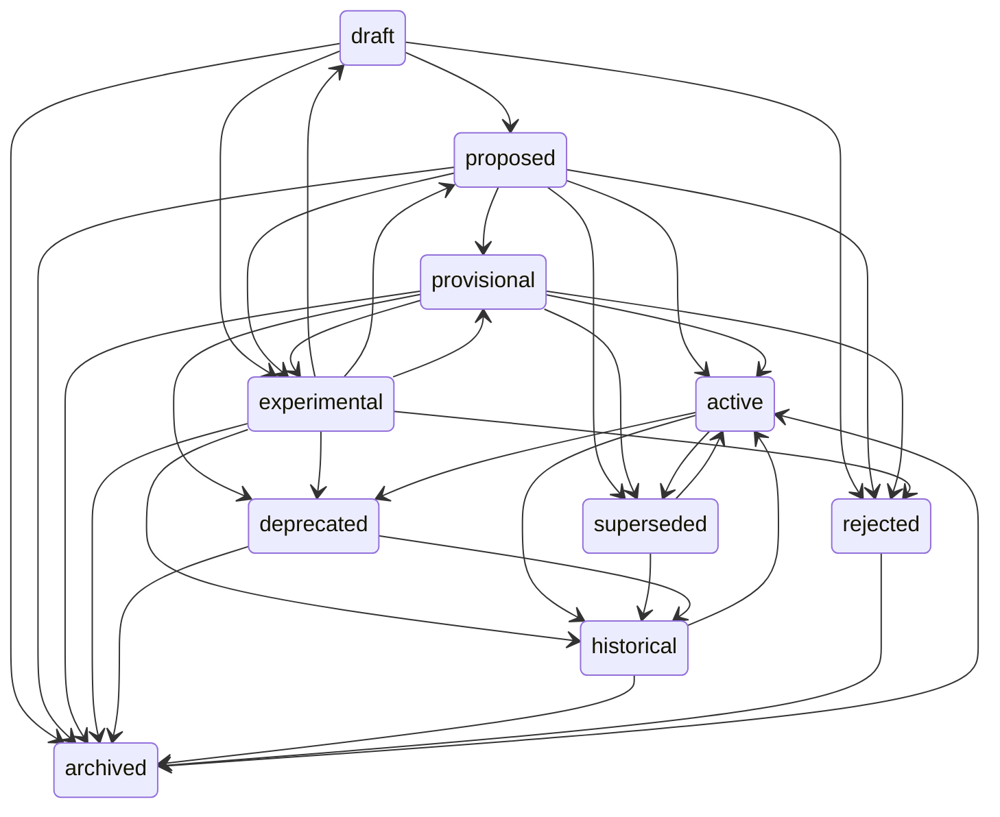

# Lifecycle and revisions

Active contributors: calisweetleaf, Christian

`somnus status` moves an artifact through the SPEC §7 lifecycle state machine, `somnus bump` records a new revision without a status change, and `somnus fork` creates a separate artifact that keeps a `derived_from` link to its parent. All three write a new header revision and validate it before it reaches disk.

## Purpose

An artifact's `id` never changes, and any indexed change to its header or body is a new `revision` (SPEC §3.2). These commands are the only supported way to produce new revisions. Hand-editing `lifecycle.status` or `revision` bypasses the transition table, the reason requirements, and the reactivation reset, and it tends to produce `revision` conflicts in the registry.

## How it works

### `somnus status`

```powershell
somnus status docs/plan.md proposed
somnus status docs/old-spec.md superseded --replacement urn:somnus:artifact:0190f3c2-...
somnus status docs/plan.md archived --reason "Abandoned in favor of the v2 plan"
somnus status docs/legacy.md active --reason "Reinstated after review"
```

`src/somnus/commands/status.py` does the following:

1. `load_valid(path)` loads the document and refuses unless it passes core validation.
2. Each `--replacement` value is normalized with `ids.normalize_legacy_ref()` (so legacy `urn:somnus:doc:` references become artifact URNs) and must be a Somnus URN or external reference; otherwise exit 2.
3. `check_transition()` in `src/somnus/model/lifecycle.py` returns the reasons the move is refused. Any problem becomes an `E_LIFECYCLE` refusal on `somnus.lifecycle.status` (exit 1).
4. `apply_transition()` returns the new payload, and `commit()` validates and writes it.
5. `ctx.record("status", ...)` logs `"<old> -> <new>"` and resolves open `revision` conflicts for the artifact.

The permitted transitions live in `TRANSITIONS`:



`check_transition()` refuses when:

- the current or target status is unknown, or the target equals the current status;
- the target is not in `TRANSITIONS[current]` (the message lists the allowed targets);
- the move is an **abandonment** (`archived` from `draft`, `proposed`, `provisional`, or `experimental`) or a **reactivation** (`active` from `historical`, `superseded`, or `archived`) and `--reason` is missing or blank;
- the target is `superseded` and neither the existing `replacement_refs` nor the new `--replacement` values supply at least one reference.

`apply_transition()` then:

- sets `lifecycle.status`; sets `lifecycle.reason` when a reason is given and removes any old reason otherwise;
- appends new replacement references to `lifecycle.replacement_refs` without duplicates; when no new references are given and the target is not `superseded`, `historical`, or `archived`, it drops `replacement_refs`;
- on reactivation, if `authority.standing` is `accepted`, resets it to `candidate` and removes `authority.valid_time` and `authority.acceptance_ref`. The command prints a note that renewed review is required. A reactivated artifact never keeps an acceptance it earned under its previous life;
- calls `bump_revision()`.

### `somnus bump`

```powershell
somnus bump docs/plan.md --reason "Body rewritten after review"
```

`src/somnus/commands/bump.py` loads a core-valid document, calls `bump_revision()`, and commits. `bump_revision()` increments `revision` and sets `time.updated_at` to the current UTC instant, clamped to `time.created_at` if the clock reads earlier than the recorded creation time (so the header never fails the temporal ordering check). The reason is not written into the header; it goes into the event detail as `"<old> -> <new>: <reason>"`.

`bump` is how a revision conflict is resolved. When the registry sees the same artifact and revision with different digests, it keeps the stored revision and opens a `revision` conflict (SPEC §18.3). Bumping produces a revision number the registry has not seen, and `ctx.record()` resolves open `revision` and `identity` conflicts for that artifact and re-observes the file.

```powershell
somnus q --conflicts          # find the conflict
somnus bump docs/plan.md      # resolve it with a new revision
```

### `somnus fork`

```powershell
somnus fork docs/region-grammar.md --title "Region Grammar (experimental)"
somnus fork data/results.csv --out data/results-v2.csv
```

`src/somnus/commands/fork.py` derives a new artifact from the parent's current revision. `forked_payload()` builds the header:

| Field | Value in the fork |
| --- | --- |
| `id`, `revision` | New UUIDv7 URN, revision 1 |
| `title` | `--title`, default `"<parent title> (fork)"` |
| `lifecycle` | `{status: draft}` |
| `authority` | Configured default standing with a self-scope; `accepted` is downgraded to `candidate` |
| `time` | Only `created_at` (now) |
| `names` | Only the new slug; aliases are not carried over |
| `locations`, `representations` | Dropped |
| `knowledge.subjects` | Parent ID replaced by the new ID |
| `knowledge.relations` | Relations whose subject was the parent are rewired to the fork, and a new `derived_from` relation is appended |
| Everything else | Copied (classification, summary, regions, claims, access, ingestion, extensions) |

The appended relation has ID `rel-derived-from-parent` (suffixed `-2`, `-3` on collision), subject the fork, object `{ref: <parent id>, revision: <parent revision>}`, `assessment: unassessed`, and `valid_time: {basis: open, from: <now>}`.

Output placement:

- Default path: the parent's directory, named `<slug of new title>` plus all of the parent's suffixes. `--out` overrides it. An existing output file is refused with `E_IO`.
- Embedded carriers: the parent's body is copied with the new header rendered in. `--out` must map to the same carrier type as the parent, otherwise `E_HOST`.
- Sidecars: the host file is copied byte-for-byte, the `primary` binding is retargeted to the new file name, and a new sidecar is written. If the new sidecar fails validation the copied host is removed.

The `fork` event is recorded against the new file with the detail `"derived from <parent id> revision <n>"`. The parent file is not modified.

## Integration points

- State machine and authority rules in the standard: SPEC §7 and §8; see [Document model](../systems/document-model.md).
- Core validation run by `load_valid()` and `commit()`: [Validation](../systems/validation.md).
- Revision and identity conflicts, events: [Registry](../systems/registry.md).
- Lifecycle and authority field definitions: [Data models](../reference/data-models.md).

## Entry points for modification

- Transition table, abandonment and reactivation sets: `TRANSITIONS`, `ABANDONABLE`, `REACTIVATABLE` in `src/somnus/model/lifecycle.py`. Keep them identical to the SPEC §7.1 table.
- What a transition changes in the header: `apply_transition()` in `src/somnus/model/lifecycle.py`.
- Revision increment and `updated_at` clamping: `bump_revision()` in `src/somnus/model/lifecycle.py`.
- Which conflict kinds a command resolves: the `resolve=` argument to `ctx.record()` in `src/somnus/commands/status.py` and `src/somnus/commands/bump.py`.
- Fork header derivation: `forked_payload()` in `src/somnus/commands/fork.py`.

## Key source files

| File | Role |
| --- | --- |
| `src/somnus/model/lifecycle.py` | Transition table, `check_transition()`, `apply_transition()`, `bump_revision()`, `now_utc()` |
| `src/somnus/commands/status.py` | `somnus status` |
| `src/somnus/commands/bump.py` | `somnus bump` |
| `src/somnus/commands/fork.py` | `somnus fork` and `forked_payload()` |
| `src/somnus/commands/_common.py` | `load_valid()`, `commit()`, `Ctx.record()` |
