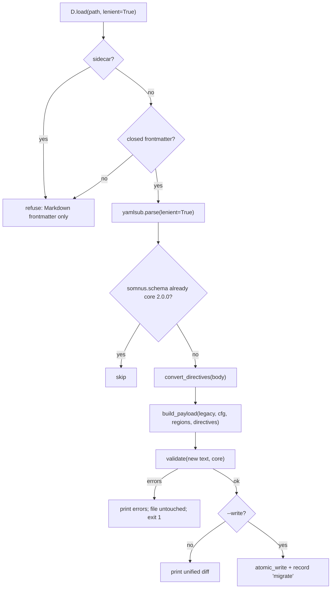

# Migration from v0.1

`somnus migrate` upgrades v0.1 hybrid Markdown documents to core `somnus://metadata/core/2.0.0`. It keeps the legacy UUID, turns relation buckets into qualified relations, replaces `:::submatter` directives with region markers, and preserves every value it cannot map under `extensions.somnus-migration`.

## Purpose

v0.1 documents put identity and classification at the root of YAML frontmatter (`id`, `title`, `classification`, `lifecycle.is_canonical`, `relations` buckets) and marked body regions with `:::submatter:<kind>{...}` fenced directives. Core 2.0.0 nests everything under one `somnus:` key, uses a closed schema, and marks regions with HTML comment markers. The migration is the normative mapping in SPEC §22. The sample inputs are in `archive/v0.1/examples/` (`specification-example.md`, `benchmark-example.md`, `submatter-example.md`); `archive/` is historical and is never imported by `src/`.

## How it works

```powershell
somnus migrate archive/v0.1/examples/submatter-example.md          # dry-run diff
somnus migrate docs/legacy/*.md --write                            # apply
```



`plan()` in `src/somnus/commands/migrate.py` parses the frontmatter in lenient mode, which accepts plain (unquoted) scalars that the strict restricted-YAML subset rejects. A file whose `somnus.schema` already equals the core schema is skipped. The new file is `---`, the canonical header, `---`, then the converted body, using the file's original newline style and trailing newline.

### Header mapping

`build_payload()` follows SPEC §22 steps 1 to 8.

| v0.1 input | Core 2.0.0 output |
| --- | --- |
| `id` (UUID, or `urn:somnus:doc:<uuid>`) | `id: urn:somnus:artifact:<uuid>`. The UUID is wrapped, never reminted. `revision: 1`. |
| `title` | `title`; when missing or blank, inferred from the filename |
| `description`, `purpose` | `summary`, `purpose` |
| `slug` (kebab-case) | `names.slug` |
| `aliases` | `names.aliases[]` with IDs `alias-<slug>`, `kind: short-name`, `valid_time.basis: unknown` |
| `classification.type`, `category`, `role`, `scope`, `subtype`, `tags` | Same fields when the values are in the vocabulary; invalid values fall back to inferred values (scope falls back to `defaults.scope`), and the original value is preserved in the extension |
| `lifecycle.status` | `lifecycle.status`, or `draft` when not a valid status |
| `lifecycle.is_canonical` | Not mapped. Standing is always `candidate` with a self-scope, regardless of `is_canonical` or configured defaults |
| `created_at`, `updated_at`, `lifecycle.reviewed_at` | `time.*` when they are valid RFC 3339 timestamps. A date-only `created_at` becomes `time.authored_on`. An `updated_at` earlier than `created_at` is moved to the extension. |
| `relations.supersedes`, `derived_from`, `cites` | `knowledge.relations[]`: IDs `rel-<bucket>-<n>`, subject the artifact, `assessment: unassessed`, `valid_time.basis: unknown` |
| `relations.superseded_by` | `lifecycle.replacement_refs` when the status is `superseded`; otherwise preserved in the extension |
| `location.path`, `location.historical_paths`, `origin.path` | `locations[]` of kind `repository-path` with roles `primary`, `historical`, `origin` |
| `access`, `ingestion` | Built from configured `defaults` (`visibility`, `allowed_uses`, `disposition`), with `body_role` inferred from the type |

Inverse buckets such as `superseded_by` (outside a superseded status), `complements`, or `cited_by` are not converted into relations. References that do not normalize to a Somnus URN or external reference are left in the extension rather than dropped.

### Unmapped keys

Everything not consumed above is collected into one extension block:

```yaml
extensions:
  somnus-migration:
    schema: "somnus://metadata/extension/migration-v0.1/1.0.0"
    data:
      somnus: { version: "0.1.0", schema: "somnus://core/v1" }
      classification: { profile: "somnus://profiles/engineering/specification/v1" }
      lifecycle: { is_canonical: false }
      location: { repository: "...", repository_root: "..." }
      origin: { repository: "...", initial_commit: "..." }
      provenance: { authors: [...], operators: [...] }
      directives: [ { region: r-invariant-019d4846, directive: invariant, attributes: {...} } ]
```

The shape is illustrative of `archive/v0.1/examples/submatter-example.md`; the real output is canonical block YAML. `_clean()` removes null values so the data stays serializable. The extension is preserved by the validator but excluded from trusted semantics (SPEC §4.3).

### Directive conversion

`convert_directives()` walks the body lines, skipping anything inside Markdown code (via `regions.markdown_code_mask`), so directive text inside a fenced example is left alone.

- An opening line `:::submatter:<kind>{attrs}` (three or more colons) becomes `<!-- somnus:region:begin <rid> -->`. The matching close is a bare colon line with the same colon count, which becomes `<!-- somnus:region:end <rid> -->`. Nesting uses more colons on the outer directive, as in the v0.1 examples.
- Region IDs from `_region_id()`: an `id` attribute that is already a valid local ID is kept; a UUID-style `id` becomes `r-<kind>-<first 8 hex>`; otherwise `r-<kind>-<ordinal>`. Collisions get `-2`, `-3` suffixes.
- Each directive adds a `knowledge.regions` record `{id, kind, selector: {kind: marker, name: rid}}`. The kind is kept when it is a registered region kind (`section`, `definition`, `invariant`, `decision`, `hypothesis`, `evidence`, `equation`, `table`, `code`, `example`, `archive`), otherwise it becomes `section`.
- Directive attributes (`status`, `authority`, `test_ref`, and the original `id`) are not mapped to claims or authority. They are preserved under `data.directives`.
- Blank lines are inserted around markers when needed, which avoids `W_REGION_SPACING`.

### Refusals

A migration refusal prints an `E_SCHEMA` diagnostic, leaves the file untouched, and makes the run exit 1. Each path is handled independently. Refusals happen when:

- the target is a sidecar, or the file has no closed YAML frontmatter;
- the frontmatter cannot be parsed even in lenient mode, or is not a mapping;
- the legacy `id` is missing or is not a UUID;
- the status is `superseded` but no resolvable `superseded_by` reference exists;
- a `:::submatter` directive is never closed;
- the generated text fails core validation (those diagnostics are printed instead).

## Integration points

- Lenient parsing mode: [YAML subset](../systems/yaml-subset.md).
- Region marker syntax and registry: [Document model](../systems/document-model.md) and [Validation](../systems/validation.md).
- After `--write`, `ctx.record("migrate", ...)` logs `"v0.1 -> core 2.0.0; <n> region(s)"` and re-indexes the file when a registry exists: [Registry](../systems/registry.md).
- Defaults used for `access` and `ingestion`: [Configuration](../reference/configuration.md).

## Entry points for modification

- Field mapping: `build_payload()` in `src/somnus/commands/migrate.py`. Any change must match SPEC §22.
- Converted relation buckets: `_RELATION_BUCKETS` in `src/somnus/commands/migrate.py`.
- Directive grammar: the `_OPEN`, `_CLOSE`, and `_ATTR` regular expressions and `convert_directives()`.
- Region ID policy: `_region_id()`.
- Extension owner and schema: `EXTENSION_OWNER` in `src/somnus/commands/migrate.py` and `MIGRATION_EXTENSION` in `src/somnus/__init__.py`.

## Key source files

| File | Role |
| --- | --- |
| `src/somnus/commands/migrate.py` | `plan()`, `build_payload()`, `convert_directives()`, `run()` |
| `src/somnus/carriers/markdown.py` | `frontmatter_bounds()` |
| `src/somnus/regions.py` | `markdown_code_mask()` |
| `src/somnus/infer.py` | Fallback type, title, category, role, and body role |
| `archive/v0.1/examples/` | v0.1 migration inputs (historical, not normative) |
| `SPEC.md` | §22 Migration from v0.1 |
