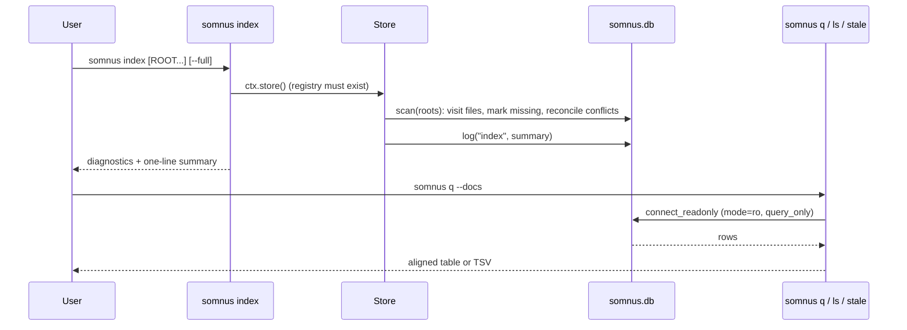

# Querying the registry

`somnus index` reconciles files on disk into the global SQLite registry at `$SOMNUS_HOME/somnus.db`, and `somnus q`, `ls`, and `stale` read it back as aligned text or TSV. `somnus regions` audits one file's region markers, and `somnus check --all` validates every configured root.

## Purpose

The registry answers questions a single file cannot: which artifacts exist across all roots, where they live now, which revisions were observed, which conflicts are open, and what the tool has done (the append-only `events` ledger). Decision D4 keeps it free of JSON: headers are stored as canonical restricted YAML text and every column is a plain value, so output is text or TSV only.

## How it works



### `somnus index`

```powershell
somnus init --root C:\work\docs
somnus index                 # every registered root
somnus index docs --full     # one root, re-read every file
```

`src/somnus/commands/index.py` opens the registry for writing (it never creates it; run `somnus init` first). With `ROOT` arguments it scans those directories and registers them as roots through `Store.add_root()`. With no arguments it scans every registered root, falling back to the configured `index.roots`. `Store.scan()` in `src/somnus/db/store.py`:

- walks each root with the configured `exclude` globs, pruning VCS directories and preferring a sidecar when a host has one;
- skips a location whose `(file_mtime, file_size)` is unchanged unless `--full` is given;
- records revisions, locations, tags, regions, relations, entities, and claims, and opens or resolves `revision`, `duplicate-id`, `identity`, and `authority` conflicts (SPEC §18.3);
- marks files that disappeared as `present = 0`, never deleting them;
- appends an `index` event with the summary.

It prints diagnostics followed by a summary line such as `scanned 42, indexed 3, unchanged 39, new revisions 1, unmanaged 5, examples 0, invalid 0, missing 0, conflicts opened 0, resolved 1`. The exit code is 1 when any error diagnostic appeared or any conflict was opened.

### `somnus q`

```powershell
somnus q                                  # same as --docs
somnus q --conflicts
somnus q --history --limit 20
somnus q --tables
somnus q "SELECT type, count(*) AS n FROM docs GROUP BY type" --tsv
```

`src/somnus/commands/query.py` runs either one shortcut or a raw SQL statement:

| Shortcut | Query |
| --- | --- |
| `--docs` (default) | `id, title, type, status, standing, revision, path` from the `docs` view, ordered by path |
| `--conflicts` | `id, kind, artifact_id, revision, path, detail, opened_at` from `open_conflicts` |
| `--history` | `id, at, actor, action, artifact_id, revision, path, detail` from `history` (newest first) |
| `--tables` | Names and types of all tables and views, excluding `sqlite_*` |

The shortcuts are mutually exclusive, and a shortcut takes precedence over a SQL argument. `--limit N` applies `fetchmany(N)` to whatever query runs.

Raw SQL is read-only by construction. `connect_readonly()` opens the database with a `mode=ro` URI and sets `PRAGMA query_only = ON`, so `INSERT`, `UPDATE`, `DELETE`, or DDL fails. `run_query()` turns any `sqlite3.Error` into an `E_IO` diagnostic `query failed: ...` with exit 2. A missing registry is also exit 2 with the message `run 'somnus init'`.

### `somnus ls`

```powershell
somnus ls --type specification --status active
somnus ls --tag directives --path-contains docs/
```

`src/somnus/commands/ls.py` calls `Store.list_docs()`, which filters the `docs` view by exact `type`, `status`, and `standing`, by tag (an `EXISTS` subquery on `tags`), and by substring of the path (`instr`). Columns match `q --docs`.

### `somnus stale`

```powershell
somnus stale --days 14
```

`src/somnus/commands/stale.py` prints one row per finding with columns `finding, artifact, title, detail`. It is a report: the exit code is always 0.

| Finding | Condition |
| --- | --- |
| `stale-draft`, `stale-proposed` | Status `draft` or `proposed` and the newest present location's mtime is older than `--days` (default 30) |
| `unresolved-replacement` | A `superseded` artifact has a `replacement_refs` artifact URN that has no present location |
| `unreadable-header` | The stored `header_yaml` of a superseded artifact cannot be parsed |
| `missing-file` | The artifact has no present location |
| `near-duplicate-title` | Two present artifacts whose case-folded titles have a difflib ratio of at least 0.85 |
| `conflict-<kind>` | Each open conflict, with the first line of its detail |

### `somnus regions`

```powershell
somnus regions docs/guide.md
somnus regions docs/guide.md --sync           # diff
somnus regions docs/guide.md --sync --write   # apply
```

`src/somnus/commands/regions.py` compares body markers with the file's own `knowledge.regions` list (the in-header region registry of SPEC §13.1); it does not need the SQLite registry. It loads a core-valid document, scans markers with `regions.scan_markers()`, and prints a table of `marker, begin, end, depth, parent, kind, registered`, plus a `missing markers` row for each registered marker region with no markers in the body. Marker problems are printed as diagnostics.

With `--sync`, `regions.sync_registry()` appends a `{kind: section, selector: {kind: marker}}` record for every unregistered marker, bumps the revision, and either prints the diff or (with `--write`) commits and records a `regions.sync` event that also resolves open `revision` conflicts. Sync is refused while marker errors remain. Registered regions whose markers are missing are reported and left in place.

### `somnus check --all`

```powershell
somnus check --all --level semantic
somnus check SPEC.md DECISIONS.md --level semantic
```

`src/somnus/commands/check.py` validates named files or walks directories. With `--all`, or with no paths at all, it also walks every configured root (`index.roots` from configuration, defaulting to the current directory). Unmanaged Markdown files found by walking produce `W_UNMANAGED`; other unmanaged files are skipped silently. At `semantic` and `canon` levels, references resolve against the registry (when it exists) plus every document in the current check set. Exit 1 when any error is reported.

### Output formats

All tables go through `Ctx.table()`: aligned text by default, or TSV with a header row under `--tsv`. Diagnostics follow `path:line:col: severity CODE field: message`, or seven tab-separated columns with no header under `--tsv`. The only JSON the toolkit emits is `somnus schema --json-schema` (see [Agent integration](agent-integration.md)).

## Integration points

- Tables, views, and conflict semantics: [Registry](../systems/registry.md) and [Data models](../reference/data-models.md).
- Region markers and selectors: [Document model](../systems/document-model.md).
- Validation levels used by `check`: [Validation](../systems/validation.md).
- Roots and excludes: [Configuration](../reference/configuration.md).
- Rationale for zero JSON: [Design decisions](../background/design-decisions.md).
- `somnus edit` with no path is a browser over the same `docs` data: [Terminal UI](../systems/tui.md).

## Entry points for modification

- Add a `q` shortcut: extend `SHORTCUTS` in `src/somnus/commands/query.py` and add the flag to the mutually exclusive group in `src/somnus/cli.py`.
- New `ls` filters: `Store.list_docs()` in `src/somnus/db/store.py` plus the flag in `src/somnus/cli.py`.
- New stale findings or thresholds: `_findings()` in `src/somnus/commands/stale.py`.
- Scan behavior: `Store.scan()` and `ScanReport` in `src/somnus/db/store.py`.

## Key source files

| File | Role |
| --- | --- |
| `src/somnus/commands/index.py` | `somnus index` |
| `src/somnus/commands/query.py` | `somnus q` and its shortcuts |
| `src/somnus/commands/ls.py` | `somnus ls` |
| `src/somnus/commands/stale.py` | `somnus stale` |
| `src/somnus/commands/regions.py` | `somnus regions` |
| `src/somnus/commands/check.py` | `somnus check` |
| `src/somnus/db/store.py` | `Store.scan()`, `list_docs()`, `similar_titles()`, `connect_readonly()`, `run_query()` |
| `src/somnus/db/schema.sql` | Registry DDL |
