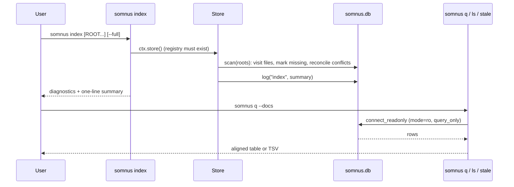

# Querying the registry

Active contributors: calisweetleaf

`somnus index` reconciles files on disk into the global SQLite registry at `$SOMNUS_HOME/somnus.db`, and `somnus q`, `ls`, and `stale` read it back as aligned text or TSV. `somnus q --text` searches indexed metadata and host content with ranked excerpts. `somnus regions` audits one file's region markers, and `somnus check --all` validates every configured root.

## Purpose

The registry answers questions a single file cannot: which artifacts exist across all roots, where they live now, which revisions were observed, which conflicts are open, and what the tool has done (the append-only `events` ledger). Decision D4 keeps it free of JSON: headers are stored as canonical restricted YAML text and every column is a plain value, so output is text or TSV only.

## How it works



### `somnus index`

```powershell
somnus init --root C:\work\docs
somnus index                 # every registered root
somnus index docs --full     # one root, re-read every file
```

`src/somnus/commands/index.py` opens the registry for writing (it never creates it; run `somnus init` first). With `ROOT` arguments it scans those directories and registers them as roots through `Store.add_root()`. With no arguments it scans every registered root, falling back to the configured `index.roots` only when none are registered. In that fallback branch, any root equal to `Path.home().resolve()` or its filesystem anchor is refused with exit 2; the message suggests `somnus init --root DIR` or `somnus index DIR`. Explicit and already registered broad roots are not subject to this fallback-only guard. `Store.scan()` in `src/somnus/db/store.py`:

- walks each root with the configured `exclude` globs, pruning VCS directories and preferring a sidecar when a host has one;
- skips a location whose `(file_mtime, file_size)` is unchanged unless `--full` is given or the available FTS5 index lacks its row;
- records revisions, locations, tags, regions, relations, entities, and claims, and opens or resolves `revision`, `duplicate-id`, `identity`, and `authority` conflicts (SPEC §18.3);
- refreshes the FTS5 search row for each indexed observation when FTS5 is available, including conflicting revisions;
- marks files that disappeared as `present = 0` and removes only their derived search rows, retaining registry history;
- appends an `index` event with the summary.

It prints diagnostics followed by a summary line such as `scanned 42, indexed 3, unchanged 39, new revisions 1, unmanaged 5, examples 0, invalid 0, missing 0, conflicts opened 0, resolved 1`. The exit code is 1 when any error diagnostic appeared or any conflict was opened.

When a visited document has no envelope and no loading issues, `ScanReport.unmanaged_paths` records its absolute host path with forward slashes. After the summary, `index` prints at most 10 such paths, adds `and N more` if necessary, and explains that these files are not searchable. It suggests `somnus stamp PATH` for a preview, then `somnus stamp PATH --write` to adopt. These stderr notes are informational, not warning/error diagnostics; unmanaged files alone do not cause exit 1.

### `somnus q`

```powershell
somnus q                                  # same as --docs
somnus q --conflicts
somnus q --history --limit 20
somnus q --tables
somnus q --text "host bytes" --limit 10
somnus q --text naming conventions         # both words must match
somnus q --text "validat*" --tsv
somnus q "SELECT type, count(*) AS n FROM docs GROUP BY type" --tsv
```

`src/somnus/commands/query.py` runs a shortcut, a full-text search, or a raw SQL statement:

| Shortcut | Query |
| --- | --- |
| `--docs` (default) | `id, title, type, status, standing, revision, path` from the `docs` view, ordered by path |
| `--conflicts` | `id, kind, artifact_id, revision, path, detail, opened_at` from `open_conflicts` |
| `--history` | `id, at, actor, action, artifact_id, revision, path, detail` from `history` (newest first) |
| `--tables` | Names and types of tables and views, excluding `sqlite_*` and FTS5 `search_*` shadow tables; `search` itself remains visible |
| `--text WORDS` | Ranked `id, title, type, status, path, excerpt` rows from present indexed locations |

The shortcuts and `--text` are mutually exclusive in `src/somnus/cli.py`. A non-search shortcut takes precedence over a SQL argument. With `--text`, however, `src/somnus/commands/query.py` joins the text value and optional positional `[SQL]` value with a space and passes both to `fts_query()` as search words; the positional value is not executed as SQL. This supports the two-word unquoted example above, not arbitrary unquoted word counts: argparse still accepts only one optional positional slot, so quote longer strings. `--limit N` applies `fetchmany(N)` to whatever query runs.

Raw SQL is read-only by construction. `connect_readonly()` opens the database with a `mode=ro` URI and sets `PRAGMA query_only = ON`, so `INSERT`, `UPDATE`, `DELETE`, or DDL fails. `run_query()` turns any `sqlite3.Error` into an `E_IO` diagnostic `query failed: ...` with exit 2. A missing registry is also exit 2 with the message `run 'somnus init'`.

### Full-text search

`fts_query()` in `src/somnus/db/store.py` splits `--text` on whitespace and quotes each term as an FTS5 literal, escaping embedded quotes. Every term must match somewhere in the indexed row; `word*` preserves a trailing prefix operator. Quoting the shell argument does not turn it into a phrase, and `OR`, column filters, and other raw FTS5 operators are not interpreted as operators on this surface. Tokenization uses Porter stemming over `unicode61` with diacritic removal, as defined in `src/somnus/db/search.sql`.

`SEARCH` in `src/somnus/commands/query.py` ranks matches by BM25, with weights path 2, title 10, summary 5, tags 5, and body 1; ties sort by path. Excerpts use FTS5 `snippet()` with automatic column selection, a 12-token budget, `[` and `]` around matches, and `...` for omissions. They may come from metadata rather than the body.

Search scope is the last successfully indexed observation of each managed location, not every file under the current directory and not every historical revision. `searchable_body()` in `src/somnus/db/store.py` excludes embedded envelopes or decodes the sidecar host as UTF-8 with optional BOM. Non-UTF-8 sidecar hosts have no indexed body; metadata remains searchable. The body is capped at 1,000,000 characters, not the combined column size. Unmanaged, invalid, and example-URN documents are not newly indexed.

Results join artifact-level title/type/status to location-level search text. A conflicting observation is searchable without replacing the stored revision, so its excerpt can differ from the artifact title displayed. Mirrors may yield multiple paths for one ID. See [Registry](../systems/registry.md) for reconciliation and retention details.

After a schema-1 upgrade, run `somnus index` to create and backfill the index; missing search rows defeat the ordinary unchanged-file skip. Use `somnus index --full` to re-read eligible files even when mtime and size match. The database remains usable without SQLite FTS5, but full-text search requires it.

| Input or condition | Outcome in `src/somnus/commands/query.py` |
| --- | --- |
| Empty/whitespace-only or wildcard-only `--text` | Exit 2: at least one search word is required |
| Positional `[SQL]` argument plus `--text` | Both values become literal search words, not SQL |
| Missing `search` table | Exit 2: run `somnus index` with SQLite FTS5 |
| `--text` plus another shortcut | Parser usage error, exit 2 |
| No text-search matches | Exit 0; normal empty table plus an informational adoption/reindex hint |

For zero matches, aligned text prints `no rows` to stderr; TSV retains its column header on stdout. Both formats also receive the stderr note `no matches; only files with a Somnus header are indexed`, followed by guidance to use `somnus stamp PATH --write`, then `somnus index`. This does not mean unmanaged files were searched, and the note is not an error.

For raw phrases, Boolean operators, or column filters, use SQL `MATCH` directly:

```powershell
somnus q "SELECT path FROM search WHERE search MATCH 'title:metadata OR body:envelope'" --tsv
```

Raw SQL does not automatically add the shortcut's joins, ranking, or excerpts. The virtual table is defined in `src/somnus/db/search.sql`; join `search.rowid` to `locations.id` and filter `locations.present = 1` when composing location-aware queries.

### `somnus ls`

```powershell
somnus ls --type specification --status active
somnus ls --tag directives --path-contains docs/
```

`src/somnus/commands/ls.py` calls `Store.list_docs()`, which filters the `docs` view by exact `type`, `status`, and `standing`, by tag (an `EXISTS` subquery on `tags`), and by substring of the path (`instr`). Columns match `q --docs`.

### `somnus stale`

```powershell
somnus stale --days 14
```

`src/somnus/commands/stale.py` prints one row per finding with columns `finding, artifact, title, detail`. It is a report: the exit code is always 0.

| Finding | Condition |
| --- | --- |
| `stale-draft`, `stale-proposed` | Status `draft` or `proposed` and the newest present location's mtime is older than `--days` (default 30) |
| `unresolved-replacement` | A `superseded` artifact has a `replacement_refs` artifact URN that has no present location |
| `unreadable-header` | The stored `header_yaml` of a superseded artifact cannot be parsed |
| `missing-file` | The artifact has no present location |
| `near-duplicate-title` | Two present artifacts whose case-folded titles have a difflib ratio of at least 0.85 |
| `conflict-<kind>` | Each open conflict, with the first line of its detail |

### `somnus regions`

```powershell
somnus regions docs/guide.md
somnus regions docs/guide.md --sync           # diff
somnus regions docs/guide.md --sync --write   # apply
```

`src/somnus/commands/regions.py` compares body markers with the file's own `knowledge.regions` list (the in-header region registry of SPEC §13.1); it does not need the SQLite registry. It loads a core-valid document, scans markers with `regions.scan_markers()`, and prints a table of `marker, begin, end, depth, parent, kind, registered`, plus a `missing markers` row for each registered marker region with no markers in the body. Marker problems are printed as diagnostics.

With `--sync`, `regions.sync_registry()` appends a `{kind: section, selector: {kind: marker}}` record for every unregistered marker, bumps the revision, and either prints the diff or (with `--write`) commits and records a `regions.sync` event that also resolves open `revision` conflicts. Sync is refused while marker errors remain. Registered regions whose markers are missing are reported and left in place.

### `somnus check --all`

```powershell
somnus check --all --level semantic
somnus check SPEC.md DECISIONS.md --level semantic
```

`src/somnus/commands/check.py` validates named files or walks directories. With `--all`, or with no paths at all, it also walks every configured root (`index.roots` from configuration, defaulting to the current directory). Unmanaged Markdown files found by walking produce `W_UNMANAGED`; other unmanaged files are skipped silently. At `semantic` and `canon` levels, references resolve against the registry (when it exists) plus every document in the current check set. Exit 1 when any error is reported.

### Output formats

All tables go through `Ctx.table()` in `src/somnus/commands/_common.py`: aligned text by default, or TSV with a header row under `--tsv`. Diagnostics follow `path:line:col: severity CODE field: message`, or seven tab-separated columns with no header under `--tsv`. Registry results never use JSON. `somnus schema --json-schema` is the explicit export exception; MCP uses JSON-RPC framing around text/TSV tool content (see [Agent integration](agent-integration.md)).

## Integration points

- Tables, views, and conflict semantics: [Registry](../systems/registry.md) and [Data models](../reference/data-models.md).
- Region markers and selectors: [Document model](../systems/document-model.md).
- Validation levels used by `check`: [Validation](../systems/validation.md).
- Roots and excludes: [Configuration](../reference/configuration.md).
- Rationale for zero JSON: [Design decisions](../background/design-decisions.md).
- `somnus edit` with no path is a browser over the same `docs` data: [Terminal UI](../systems/tui.md).

## Entry points for modification

- Add a `q` shortcut: extend `SHORTCUTS` in `src/somnus/commands/query.py` and add the flag to the mutually exclusive group in `src/somnus/cli.py`.
- New `ls` filters: `Store.list_docs()` in `src/somnus/db/store.py` plus the flag in `src/somnus/cli.py`.
- New stale findings or thresholds: `_findings()` in `src/somnus/commands/stale.py`.
- Scan behavior: `Store.scan()` and `ScanReport` in `src/somnus/db/store.py`.
- Search extraction and literal conversion: `searchable_body()` and `fts_query()` in `src/somnus/db/store.py`; ranking and excerpts: `SEARCH` in `src/somnus/commands/query.py`. Search cases are in `tests/test_store.py` and `tests/test_commands.py`; `TestSearch.test_unquoted_words_and_hints` covers two unquoted words, unmanaged-file notes, and a zero-match success, while `TestBasics.test_index_refuses_home_as_implicit_root` covers fallback refusal. The parent refresh's unittest discovery run passed 486 tests; installed-package acceptance and external MCP-host integration were not rerun.

## Key source files

| File | Role |
| --- | --- |
| `src/somnus/commands/index.py` | `somnus index` |
| `src/somnus/commands/query.py` | `somnus q` and its shortcuts |
| `src/somnus/commands/ls.py` | `somnus ls` |
| `src/somnus/commands/stale.py` | `somnus stale` |
| `src/somnus/commands/regions.py` | `somnus regions` |
| `src/somnus/commands/check.py` | `somnus check` |
| `src/somnus/db/store.py` | `Store.scan()`, `list_docs()`, `similar_titles()`, `connect_readonly()`, `run_query()` |
| `src/somnus/db/schema.sql` | Registry DDL |
| `src/somnus/db/search.sql` | FTS5 columns and tokenizer |
| `src/somnus/cli.py` | Mutually exclusive query modes and search help |
| `tests/test_commands.py` | Root-fallback refusal, search behavior, and informational hints |
