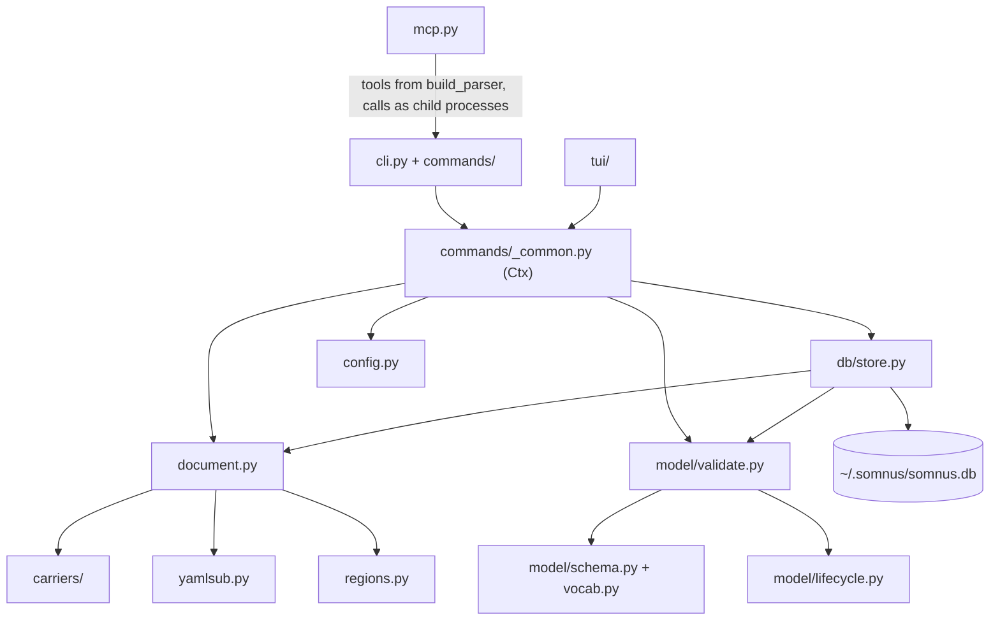
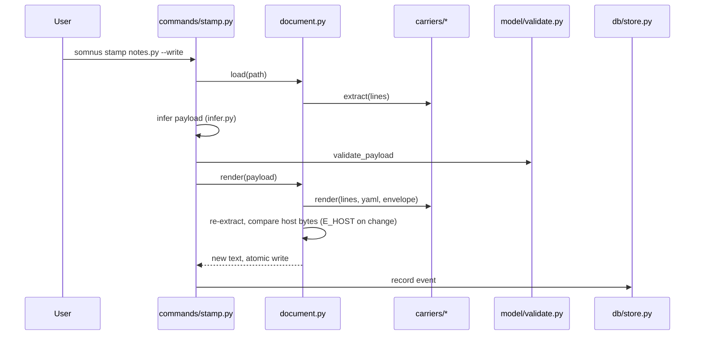
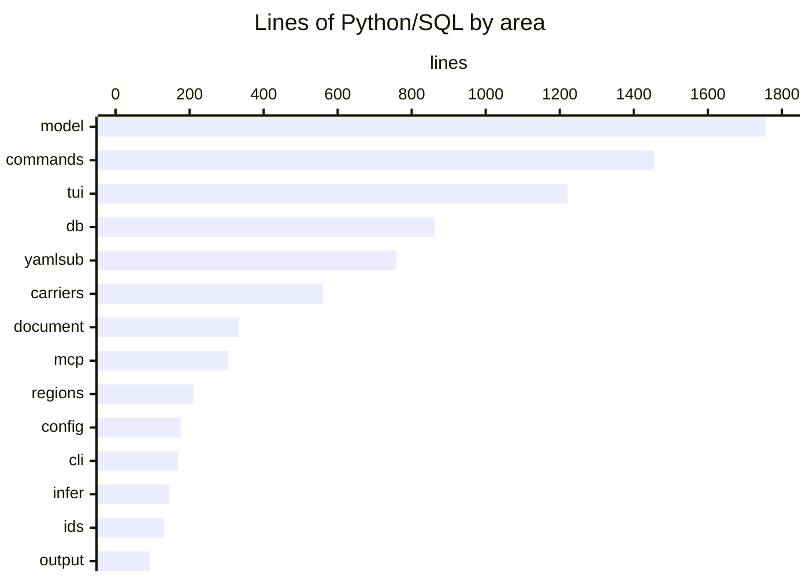

# Architecture

The toolkit is a layered, stdlib-only Python package. Text parsing sits at the bottom, a `Document` object wraps a file plus its header, validation and the registry consume documents, and the CLI and TUI sit on top. The MCP server sits above the CLI and runs it as a child process.

## Layers

| Layer | Modules | Responsibility |
| --- | --- | --- |
| Text | `src/somnus/yamlsub.py`, `src/somnus/ids.py` | Restricted YAML subset parser and canonical serializer; UUIDv7 and URN handling |
| Placement | `src/somnus/carriers/`, `src/somnus/regions.py` | Find, extract, and render the header envelope for each file type; scan region markers |
| Document | `src/somnus/document.py` | Load a file, locate its envelope, expose the payload, render and save with host-byte preservation |
| Model | `src/somnus/model/` | Field order, vocabularies, lifecycle state machine, the four-level validator, JSON Schema export |
| Registry | `src/somnus/db/schema.sql`, `src/somnus/db/store.py` | Global SQLite registry, scanning, conflict detection, read-only queries |
| Interface | `src/somnus/cli.py`, `src/somnus/commands/`, `src/somnus/tui/`, `src/somnus/mcp.py` | 18 subcommands, the terminal UI, and the stdio MCP server |
| Support | `src/somnus/config.py`, `src/somnus/infer.py`, `src/somnus/output.py` | Layered config, header inference, diagnostics and table output |

## Main data flow: writing a header

Every write goes through `Document.render`, which re-extracts the result and refuses the write if any byte outside the envelope changed. That check is the main safety property of the toolkit.

## Main data flow: indexing

`somnus index` calls `Store.scan` in `src/somnus/db/store.py`. For each configured root it walks files, loads each managed document, validates it, and reconciles it against the registry: new revisions are inserted, locations are updated, and duplicate IDs, revision mismatches, overlapping accepted authorities, and identity reuse open rows in the `conflicts` table. Cycles in acyclic relations (`supersedes`, `derived_from`, `part_of`) are reported as `E_GRAPH` diagnostics. Files that vanish are marked `present = 0`, never deleted. See [Registry](../systems/registry.md).

## Size by area

The runtime in `src/somnus/` contains 8,016 physical lines of Python and 175 of SQL. There are no third-party runtime dependencies in `pyproject.toml`; build and CI tools are separate. See [By the numbers](../by-the-numbers.md) for the measurement scope.

## Repository automation

`.github/workflows/ci.yml` checks the runtime across an eight-entry OS/Python matrix, enforces dependency and archive-import policies, and builds and tests an installed wheel on Ubuntu. `.github/workflows/codeql.yml` adds static security analysis; `.github/workflows/release.yml` configures tagged package releases. `.github/workflows/droid-wiki-refresh.yml` generates documentation with read-only repository permissions, then passes the pages and metadata to a separate write-enabled publish job. That job updates a rolling wiki pull request, not the runtime package. These are configured checks, not a report of hosted execution. See [Automation](../deployment.md).

## Related pages

- [Systems](../systems/index.md) documents each layer in detail.
- [Patterns and conventions](../how-to-contribute/patterns-and-conventions.md) covers error handling and the exit-code contract.
