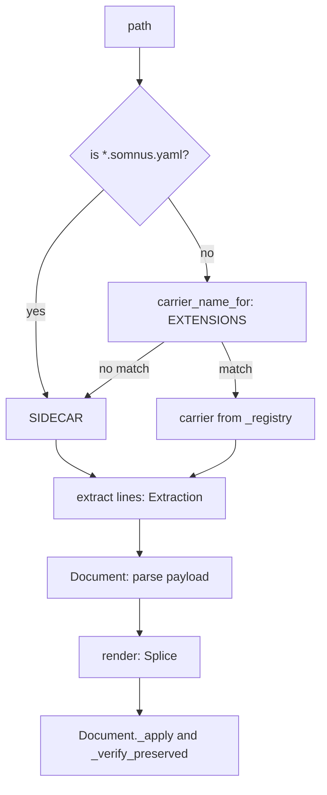

# Carriers

A carrier knows how one family of file types stores the `somnus:` envelope: where it may appear, how its lines are delimited and prefixed, and how to write it back without touching any other line. The carriers live in `src/somnus/carriers/` and implement SPEC section 17.

## Purpose

The YAML payload is identical in every file type. Only its wrapping differs: frontmatter in Markdown, `# ` comment lines in Python, `/* */` in CSS, a separate `.somnus.yaml` file for JSON or binaries. Carriers isolate that wrapping so that `src/somnus/document.py` can load, validate, and save any managed file through one interface, and so that writes can be checked for host byte preservation (`E_HOST`).

## Directory layout

```
src/somnus/carriers/
  __init__.py       Carrier protocol, Envelope/Extraction/Splice/Issue, registry, EXTENSIONS, sidecar paths
  markdown.py       MarkdownCarrier: frontmatter and hidden HTML comment envelope
  linecomment.py    LineCarrier, HashCarrier, preamble_end() for # % // -- hosts
  blockcomment.py   BlockCarrier with the CSS and XML instances
  sidecar.py        SidecarCarrier (SIDECAR), binding_issues(), primary_target()
src/somnus/regions.py   markdown_code_mask() used by the Markdown carrier
tests/test_carriers.py
```

## Key abstractions

| Name | File path | Description |
| --- | --- | --- |
| `Carrier` | `src/somnus/carriers/__init__.py` | Protocol: `name`, `capability`, `forbid`, `region_style`, `extract(lines)`, `render(lines, payload, envelope, style)`. |
| `Envelope` | `src/somnus/carriers/__init__.py` | 0-based `[start, end)` line span, `kind`, `payload_lines`, `payload_start`, `col_offset`, and a region-scan mask span. |
| `Extraction` | `src/somnus/carriers/__init__.py` | The found `envelope` (or `None`) plus a list of `Issue`. |
| `Splice` | `src/somnus/carriers/__init__.py` | "Replace `lines[start:end]` with `new_lines`", the only form a write takes. |
| `Issue` | `src/somnus/carriers/__init__.py` | Carrier-level problem with 1-based `line`, `col`, `code`, `message`. |
| `CarrierError` | `src/somnus/carriers/__init__.py` | Raised by `render` or preamble checks when the envelope cannot be placed safely (code `E_HOST`). |
| `EXTENSIONS`, `get`, `for_path`, `carrier_name_for` | `src/somnus/carriers/__init__.py` | Suffix-to-carrier lookup and the cached registry. |
| `MarkdownCarrier` | `src/somnus/carriers/markdown.py` | Frontmatter (default) or HTML comment envelope. |
| `LineCarrier`, `HashCarrier` | `src/somnus/carriers/linecomment.py` | Prefixed-line envelopes in the leading comment area. |
| `BlockCarrier` (`CSS`, `XML`) | `src/somnus/carriers/blockcomment.py` | Opener and closer lines with a forbidden closing sequence. |
| `SidecarCarrier` (`SIDECAR`) | `src/somnus/carriers/sidecar.py` | Whole file is payload. |
| `binding_issues` | `src/somnus/carriers/sidecar.py` | Checks the primary-binding contract of a sidecar. |

## How it works



### The protocol

Carriers work on a file's lines with line endings already removed (`src/somnus/document.py` keeps endings separately). `extract` must return at most one authoritative `Envelope`; every other candidate becomes an `E_ENVELOPE` issue ("more than one metadata envelope"). `render` receives the canonical payload text and returns a `Splice`. It replaces the existing envelope span, or inserts a new block at a safe position when there is none. Carriers never rewrite lines outside the splice, which is what makes the later byte-preservation check in `Document._verify_preserved` meaningful.

`Envelope.col_offset` is the prefix width stripped from each payload line (for example 2 for `# `), so payload columns can be mapped back to file columns. `mask_start`/`mask_end` default to the envelope span. The partial-frontmatter case widens them to cover the whole frontmatter block, so region scanning ignores other host frontmatter keys too.

### Extension table and registry

`EXTENSIONS` maps a suffix to a registry name. `carrier_name_for` tries the exact suffix first, then its lowercase form, so `.R` resolves to `r`. Files named `*.somnus.yaml` are always sidecars, never YAML hash carriers. Any unknown suffix returns `None`, which means "use a sidecar".

| Registry name | Class | Prefix or delimiters | Suffixes |
| --- | --- | --- | --- |
| `markdown` | `MarkdownCarrier` | `---` frontmatter or `<!-- somnus:metadata:v2` ... `somnus:end -->` | `.md .markdown .mdx` |
| `python` | `HashCarrier` | `# ` | `.py .pyw` |
| `shell` | `HashCarrier` | `# ` | `.sh .bash .zsh` |
| `powershell` | `HashCarrier` | `# ` | `.ps1 .psm1 .psd1` |
| `r` | `HashCarrier` | `# ` | `.r` (and `.R`) |
| `toml`, `yaml` | `HashCarrier` | `# ` | `.toml`, `.yaml .yml` |
| `tex` | `LineCarrier` | `% ` | `.tex .sty .cls .ltx` |
| `js` | `LineCarrier` | `// ` | `.js .mjs .cjs .jsx .ts .tsx` |
| `slash` | `LineCarrier` | `// ` | `.rs .c .h .cc .cpp .hpp .go .java .kt .swift .cs` |
| `sql` | `LineCarrier` | `-- ` | `.sql` |
| `css` | `BlockCarrier` | `/* somnus:metadata:v2` ... `somnus:end */` | `.css .scss .less` |
| `xml` | `BlockCarrier` | `<!-- somnus:metadata:v2` ... `somnus:end -->` | `.html .htm .xhtml .xml .svg` |
| `sidecar` | `SidecarCarrier` | whole file | anything else, and `*.somnus.yaml` |

SPEC section 17 groups these as `hash` and `slash`. The code keeps one instance per host (for example `js` separate from `slash`) because preamble rules differ: JavaScript and TypeScript allow a shebang, other `//` hosts do not. `Envelope.kind` is the registry name for comment carriers, and `frontmatter`, `frontmatter-full`, `html-comment`, or `sidecar` otherwise. Each carrier advertises a `capability` string such as `somnus-adapter-hash-comment@1`.

### Markdown

`frontmatter_bounds` requires line 1 to be exactly `---` and closes at the next exact `---`. An unclosed opener is `E_ENVELOPE` and stops extraction. Inside the frontmatter, `_top_blocks` splits on column-0 keys and trims trailing blank and comment lines from each block. Only blocks starting with `somnus:` are envelopes; a second one is "duplicate 'somnus' key in frontmatter". When `somnus:` is the only key, the envelope kind is `frontmatter-full` and spans the `---` delimiters. Otherwise it is `frontmatter`, covering just the `somnus:` block, so other host keys stay verbatim.

After the frontmatter, the carrier looks for the exact line `<!-- somnus:metadata:v2`, skipping lines that `markdown_code_mask` (in `src/somnus/regions.py`) marks as fenced or indented code. The envelope closes at the exact line `somnus:end -->`. Any payload line containing `--` is `E_ENVELOPE`. Frontmatter and HTML envelopes together count as two envelopes.

`render` keeps the existing style. With no envelope it inserts frontmatter by default: it adds `---` delimiters at line 0, or inserts the `somnus:` block just before the closing `---` of existing frontmatter. With `style="html-comment"` it inserts the comment envelope after any frontmatter. `MarkdownCarrier.forbid` is `None`; `Document.render` switches to `forbid="html"` itself when the envelope kind is `html-comment`.

### Line-comment carriers

`LineCarrier.extract` starts at `preamble_end(host, lines)` and walks the leading comment area. An opener (`# somnus:metadata:v2`, compared after stripping trailing whitespace) starts an envelope. Each following line must start with the exact prefix, or equal the bare prefix (`#`, `%`, `//`, `--`) as a blank payload line. Exactly one prefix is stripped and deeper indentation is kept. Any other line is "envelope line must start with ..." and an unclosed envelope is reported at the opener. Blank lines and comment lines (any line whose stripped form starts with the bare prefix) are skipped. The first other line ends the leading area. `render` writes the opener, prefixed body, and closer, either over the old span or at `preamble_end`.

Line carriers set no `forbid` mode, because a comment line cannot be closed early by its content.

### Preambles

Envelopes are never inserted above lines the host requires at the top.

| Host | Code | Preserved lines |
| --- | --- | --- |
| Python | `preamble_end` in `src/somnus/carriers/linecomment.py` | Line-1 `#!` shebang; a `coding[:=]` cookie on line 1, or on line 2 when line 1 is a comment (including the shebang) |
| Shell, R, JS/TS | `preamble_end` | Line-1 `#!` shebang |
| PowerShell | `preamble_end` | Line-1 shebang, then leading `#Requires` lines (case-insensitive) |
| TeX | `preamble_end` | Leading `% !TeX` magic comments (case-insensitive) |
| CSS | `BlockCarrier.preamble_end` in `src/somnus/carriers/blockcomment.py` | `@charset "...";` alone on line 1; any other `@charset` line raises `CarrierError` `E_HOST` |
| XML, HTML, SVG | `BlockCarrier.preamble_end` | Leading `<?xml ...?>` and `<!DOCTYPE ...>` lines; a multi-line declaration raises `E_HOST` |

TOML, YAML, SQL, and `slash` hosts have no preamble. During `extract`, a `CarrierError` from the preamble check is swallowed and scanning starts at line 0, so the file can still be read. During `render` it propagates, and `Document.render` turns it into an `E_HOST` refusal.

### Block-comment carriers and forbidden sequences

`BlockCarrier` scans the area after the preamble, skipping blank lines and single-line comments (`/* ... */` for CSS, `<!-- ... -->` for XML), until it finds the exact opener line. The closer is `somnus:end */` or `somnus:end -->`.

| Carrier | Forbidden in payload | Serializer escape (`forbid`) |
| --- | --- | --- |
| `css` | `*/` | `"block"`: `/` after `*` becomes `\u002f` |
| `xml` | `--` | `"html"`: `-` after `-` becomes `\u002d` |
| `markdown` HTML envelope | `--` | `"html"` (chosen by `Document.render`) |

Extraction reports a forbidden sequence as `E_ENVELOPE` at its column. `render` also checks the body and raises `CarrierError("E_HOST", "payload contains ...; use a sidecar")`. In normal use the serializer escapes make this unreachable for string content. See [YAML subset](yaml-subset.md) for the escaping.

### Sidecars

`SidecarCarrier.extract` treats every line except trailing empty lines as payload, with no delimiters; an empty file is `E_ENVELOPE`. `render` replaces the whole content. `region_style` is empty, so sidecar documents cannot use marker regions.

Path helpers in `src/somnus/carriers/__init__.py`: `sidecar_for(path)` appends `.somnus.yaml`, `host_for(sidecar)` strips it, and `is_sidecar_path` tests the suffix.

`binding_issues(somnus, sidecar_path)` enforces the binding contract, and `src/somnus/model/validate.py` reports each problem as `E_ENVELOPE`:

- `bindings` must be a non-empty list with exactly one `role: "primary"` entry.
- That entry must set `required: true`.
- A string `target` must exist relative to the sidecar's directory and resolve to the same file as the sidecar's name minus `.somnus.yaml`.
- A non-string target must be a reference object (a mapping).

`primary_target` returns the resolved path of a string target; validation uses it to resolve region selectors against the bound file. A host with both an embedded envelope and a sidecar is reported by `document.load` as `E_ENVELOPE`.

### Inert lookalikes

Text that looks like an envelope but is not in an allowed position is ignored rather than reported:

- Line-comment and block-comment carriers only look in the leading area. An opener after the first code line, for example inside a string literal or a docstring example, is never seen.
- Markdown HTML openers inside fenced or indented code are masked by `markdown_code_mask`.
- Opener and closer lines must match exactly (trailing whitespace aside). An indented `<!-- somnus:metadata:v2` in Markdown or a `#somnus:metadata:v2` without the space is not an opener.

## Integration points

- `src/somnus/document.py` picks the carrier with `for_path`, calls `extract` in `load` and `from_text`, and calls `render` in `Document.render`, followed by `_verify_preserved`, which re-runs `extract` on the result. See [Document model](document-model.md).
- `src/somnus/regions.py` reads `region_style` (`("markdown",)`, `("prefix", prefix)`, `("block", "/* ", " */")`, or `()`) to choose the marker syntax, and the line carriers expose `host` so Python markers are checked against real comment tokens.
- `src/somnus/model/validate.py` imports `SIDECAR`, `binding_issues`, and `primary_target`; see [Validation](validation.md).
- `src/somnus/infer.py` and the `stamp`/`new` commands decide the carrier for new files; see [CLI commands](../features/cli-commands.md).

## Entry points for modification

- **New file extension for an existing carrier:** add it to `EXTENSIONS` in `src/somnus/carriers/__init__.py` and to the SPEC section 17 table.
- **New host with a comment prefix:** add a `LineCarrier` or `HashCarrier` entry in `_registry()`, and add a branch in `preamble_end` if the host has mandatory leading lines.
- **New block-comment host:** construct a `BlockCarrier` with its opener, closer, forbidden sequence, `forbid` mode, and region style, and add a matching escape mode in `src/somnus/yamlsub.py` if needed.
- Tests: `tests/test_carriers.py` for carrier behavior and `tests/test_conformance.py` for the SPEC section 21 fixtures.

## Key source files

| File | Role |
| --- | --- |
| `src/somnus/carriers/__init__.py` | Protocol, data classes, registry, extension table, sidecar paths |
| `src/somnus/carriers/markdown.py` | Frontmatter and HTML comment envelopes |
| `src/somnus/carriers/linecomment.py` | Prefixed-line envelopes and host preambles |
| `src/somnus/carriers/blockcomment.py` | CSS and XML block envelopes |
| `src/somnus/carriers/sidecar.py` | Sidecar carrier and binding checks |
| `src/somnus/regions.py` | `markdown_code_mask` for inert code contexts |
| `tests/test_carriers.py` | Unit tests |

Related: [Architecture](../overview/architecture.md), [Glossary](../overview/glossary.md), [Design decisions](../background/design-decisions.md).
