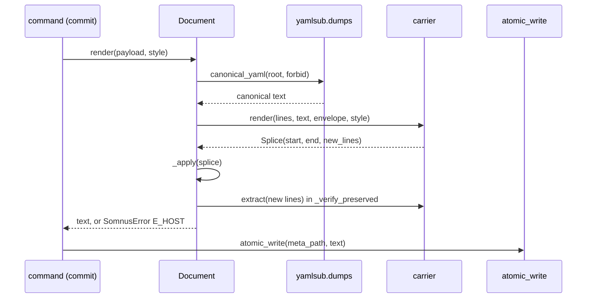

# Document model

Active contributors: calisweetleaf, Christian

`src/somnus/document.py` turns a file on disk into a `Document`: its lines and line endings, its carrier, the located envelope, and the parsed payload. It also owns the write path that refuses any change outside the envelope. `src/somnus/regions.py` adds the body-side view: in-body region markers, headings, and TeX labels.

## Purpose

Every command and the validator need the same answers about a file: where its header is, what it says, where each field sits for diagnostics, and how to write a new header without disturbing the host. The document model answers those once. It implements the encoding and atomic-write rules of SPEC section 16.3, delegates envelope placement to [carriers](carriers.md) (SPEC section 17), and implements region marker syntax from SPEC section 13.3.

## Directory layout

```
src/somnus/
  document.py     Document, load(), from_text(), atomic_write(), canonical_yaml(), field_name()
  regions.py      markdown_code_mask(), scan_markers(), headings(), tex_labels(), sync_registry()
  carriers/       envelope extract/render per file type
  yamlsub.py      payload parser and serializer
tests/
  test_document.py
  test_regions.py
```

## Key abstractions

| Name | File path | Description |
| --- | --- | --- |
| `Document` | `src/somnus/document.py` | Dataclass: `path` (host), `meta_path` (file holding the envelope), `carrier`, `lines`, `endings`, `had_bom`, `envelope`, `data`, `spans`, `issues`, `host_bytes`. |
| `load(path, lenient=False)` | `src/somnus/document.py` | Reads a file or its sidecar and parses the envelope. Only I/O and encoding failures raise. |
| `from_text(path, text, lenient=False)` | `src/somnus/document.py` | Builds a `Document` from in-memory text for dry runs, re-validation, and tests. |
| `Document.render` / `save` | `src/somnus/document.py` | Produce (and atomically write) the full file text with a new payload. |
| `atomic_write(path, text)` | `src/somnus/document.py` | Same-directory temp file, `fsync`, mode copy, `os.replace`. |
| `body_digest` / `payload_digest` | `src/somnus/document.py` | SHA-256 of host content outside the envelope, and of the canonical payload. |
| `pos(path)` / `diag(...)` | `src/somnus/document.py` | Map a payload path to a file `(line, col)` and build a `Diagnostic`. |
| `RegionRange`, `MarkerScan` | `src/somnus/regions.py` | A paired marker range (1-based lines, depth, parent) and a scan result. |
| `scan_markers` | `src/somnus/regions.py` | Finds live markers and pairs them with a stack. |
| `markdown_code_mask` | `src/somnus/regions.py` | Marks fenced and indented code lines as inert. |
| `sync_registry` | `src/somnus/regions.py` | Adds unregistered marker ranges to `knowledge.regions`. |

## How it works

### Loading

`load` resolves the path and picks one of three routes:

1. A `*.somnus.yaml` path loads as a sidecar for the host named by `carriers.host_for`.
2. A path with no embedded carrier (`carriers.for_path` returns `None`) loads its sidecar.
3. Otherwise the file is read with its carrier. If a sidecar also exists, an embedded envelope plus sidecar is `E_ENVELOPE`. With no embedded envelope, the sidecar is loaded instead.

Reading and decoding:

- `_read` turns `OSError` into `E_IO` with exit code 2 (`EXIT_USAGE`). A missing file is also `E_IO` "file not found".
- `_decode` strips a UTF-8 BOM (`EF BB BF`), sets `had_bom`, and decodes strictly. Invalid UTF-8 is `E_IO` "file is not valid UTF-8 (byte N); use a sidecar".
- `_split` uses `str.splitlines(keepends=True)` and stores each line's ending (`\r\n`, `\n`, `\r`, or `""` for a final line with no newline) in a parallel `endings` list. This is how mixed and CRLF files survive a write.

The wrapped `OSError` and `UnicodeDecodeError` remain available as the raised `SomnusError.__cause__` through explicit exception chaining. The direct missing-file check in `load()` creates its own diagnostic rather than wrapping a read exception.

The carrier's `extract` locates the envelope, and its `Issue`s become `E_ENVELOPE` diagnostics in `doc.issues`. `_parse_into` then runs `yamlsub.parse` on `envelope.payload`. A `YAMLError` becomes `E_YAML` at `payload_start + line`, `col + col_offset`. A payload that is not a mapping is `E_YAML` "payload must be a mapping". Envelope and YAML problems are recorded, not raised, so the validator can report them all.

For sidecars, `_load_sidecar` also reads the host's bytes into `host_bytes` (or `None` when the host is missing). If the sidecar does not exist, the `Document` has no lines and no envelope, and validation reports "no metadata envelope found".

`from_text` follows the same path without disk access. It falls back to `SIDECAR` when the path has no carrier and strips a leading U+FEFF from the string.

### Payload and positions

`Document.payload` returns `data["somnus"]` when it is a mapping, otherwise `None`. `copy_payload()` returns a deep copy for commands to modify.

`pos(path)` walks the payload path up to the nearest recorded span from `yamlsub.Parsed` and returns `(envelope.payload_start + line, col + envelope.col_offset)`. Because `payload_start` is 0-based and payload lines are 1-based, the sum is the 1-based file line. `col_offset` adds back the stripped comment prefix (2 for `# `). `diag` uses this to build `path:line:col: severity CODE field: message` diagnostics, with `field_name` formatting the path as `somnus.a.b[0].c`.

`ignore_span` exposes `(envelope.mask_start, envelope.mask_end)` for body scans; it is `(-1, -1)` for sidecars or when there is no envelope. `body_lines()` returns every line outside `[envelope.start, envelope.end)`.

### Rendering and host byte preservation



`render` picks the serializer escape mode: `"html"` when the envelope kind is `html-comment`, otherwise the carrier's own `forbid`. A `CarrierError` from the carrier becomes a `SomnusError` with the carrier's code (normally `E_HOST`), retaining the original exception as `__cause__`.

`_apply` splices `new_lines` into `lines`. New lines get the file's dominant newline (`newline` is CRLF only when CRLF endings outnumber LF, so new files and ties use LF). Two edge cases keep the text well-formed:

- When inserting after a final line that had no newline, that line gets one.
- When the splice runs to end of file, the last new line inherits the old final ending, or the dominant newline if that ending was empty. An untouched body line after the envelope still preserves its missing trailing newline.

The final join uses `zip(lines, endings, strict=True)`: a mismatched internal line/ending shape raises `ValueError` instead of silently truncating content. The preview reconstruction paths in `src/somnus/commands/stamp.py`, `src/somnus/commands/migrate.py`, and `src/somnus/commands/regions.py` enforce the same pairing.

`_verify_preserved` splits the new text, runs the carrier's `extract` again, and requires exactly one envelope with no issues and `new_body == self.body_lines()`. Anything else raises `E_HOST` "refusing to write: content outside the envelope would change". Sidecars skip this check because the host file is never written. The comparison is on lines without endings. Endings outside the splice are copied unchanged, with one exception: a final line that had no newline gains one when the envelope is inserted after it.

`save` renders and calls `atomic_write` on `meta_path`. `atomic_write` creates a temp file named `.<name>.*.tmp` in the target directory, writes UTF-8 with `newline=""` so no translation happens, `fsync`s, copies the existing file's mode, and `os.replace`s it into place. The temp file is removed on any failure. Commands normally go through `commit` in `src/somnus/commands/_common.py`, which also re-validates the rendered text at core level through `from_text` before writing.

The BOM is not re-emitted: `had_bom` is recorded, but `atomic_write` writes plain UTF-8. This matches SPEC section 16.3, "accepted on input and never emitted".

### Digests

The registry stores both digests per revision and location (see [Registry](registry.md)):

- `body_digest()` hashes host content outside the envelope. For embedded carriers it joins the kept lines with `\n` (only where the original line had an ending), so CRLF and LF versions of the same content hash the same. For sidecars it hashes `host_bytes` with `\r\n` replaced by `\n`, or empty bytes when the host is missing.
- `payload_digest()` hashes `canonical_yaml(self.data)`, so formatting differences in the source header do not change it, but any change to canonical layout in `src/somnus/yamlsub.py` does.

### Regions

`scan_markers(lines, style, ignore, host)` takes the carrier's `region_style`:

| Style | Exact marker |
| --- | --- |
| `("markdown",)` (Markdown and XML/HTML carriers) | `<!-- somnus:region:begin r-id -->` at column 0 |
| `("prefix", p)` (line carriers) | `<p> somnus:region:begin r-id`, leading whitespace allowed |
| `("block", ...)` (CSS) | `/* somnus:region:begin r-id */`, leading whitespace allowed |
| `()` (sidecar) | none; the scan is empty |

Lines are skipped when they fall inside `ignore` (the envelope mask) or, for markdown style, inside `markdown_code_mask`. That mask covers backtick or tilde fences of length 3 or more (a closing fence must use the same character, be at least as long, and carry no info text; a backtick fence whose info string contains a backtick is not a fence) and indented code blocks (4 spaces or a tab after a blank line, continuing across blanks). For Python hosts, `_python_comment_lines` tokenizes the file and only whole-line `COMMENT` tokens are live, so markers inside strings are inert. If tokenizing fails, every line is eligible.

A line that matches a loose pattern (`<!--\s*somnus:region:`, `#\s*somnus:region:`, and so on) but not the exact one is `E_REGION` "malformed region marker". Region IDs must pass `is_local_id` from `src/somnus/ids.py`.

Pairing uses a stack. `begin` pushes, and a repeated `begin` ID is a duplicate error. `end` pops when it matches the top and records a `RegionRange` with `depth` (stack size after the pop) and `parent` (new top), so nesting is allowed. An `end` that matches a deeper entry is "crosses region" and that entry is dropped from the stack. An `end` with no matching entry is "has no matching begin". Entries left on the stack are "never closed". All of these are `E_REGION`. Markdown-style markers with non-blank neighbours get `W_REGION_SPACING`; a neighbour inside the envelope counts as blank.

`headings(lines, ignore)` returns ATX headings (0 to 3 leading spaces, 1 to 6 `#`, closing `#`s removed) outside code and the envelope, for `heading` selectors. `tex_labels` returns `\label{...}` occurrences in the part of each line before the first unescaped `%`, for `tex-label` selectors.

`sync_registry(somnus, scan)` appends `{"id": rid, "kind": "section", "selector": {"kind": "marker", "name": rid}}` for each scanned range, in begin-line order, whose ID is neither an existing region `id` nor an existing marker selector `name`. It never removes entries and returns `(added, missing)`, where `missing` lists registered marker names with no body markers.

## Integration points

- `src/somnus/model/validate.py` consumes `Document` throughout. `marker_regions` calls `scan_markers` and reports registered-but-missing markers as `E_REGION`, unregistered markers as `W_REGION_UNREGISTERED`, and marker selectors on sidecars as `E_REGION`. `selectors` uses `headings` and `tex_labels`. See [Validation](validation.md).
- `src/somnus/commands/regions.py` implements `somnus regions [--sync] [--write]`: it prints the marker table, refuses to sync while marker errors remain, bumps the revision, and shows a diff unless `--write` is given. See [CLI commands](../features/cli-commands.md).
- `src/somnus/commands/_common.py` (`load_valid`, `commit`, `check_text`) is the standard load and write path for commands. `new`, `stamp`, `fork`, `migrate`, `schema`, and `init` call `atomic_write` directly.
- `src/somnus/db/store.py` records `payload_digest()` and `body_digest()`. See [Registry](registry.md).
- The [terminal UI](tui.md) saves edits through `commit` in `src/somnus/tui/app.py`, so it uses the same render and preservation path.

## Entry points for modification

- Encoding or newline policy: `_decode`, `_split`, `_dominant_newline`, and `_apply` in `src/somnus/document.py`. Keep `_verify_preserved` as the final gate on every embedded write.
- New body-scan contexts (for example another inert code construct): `markdown_code_mask` or a host-specific eligibility function like `_python_comment_lines` in `src/somnus/regions.py`.
- New marker syntax for a carrier: `_marker_pattern` in `src/somnus/regions.py` plus the carrier's `region_style`.
- Tests: `tests/test_document.py` (CRLF preservation, BOM handling, atomic writes, body immutability, chained I/O/carrier failures, and aligned line/ending rendering) and `tests/test_regions.py`. The added rendering cases cover empty input, missing final newlines, and CRLF files. Both suites passed as part of this refresh's existing 534-test checkout run; see [Testing](../how-to-contribute/testing.md).

## Key source files

| File | Role |
| --- | --- |
| `src/somnus/document.py` | Loading, positions, rendering, preservation check, atomic write, digests |
| `src/somnus/regions.py` | Code masks, marker scanning and pairing, headings, TeX labels, registry sync |
| `src/somnus/commands/_common.py` | `load_valid`, `commit`, `check_text` |
| `src/somnus/commands/regions.py` | `somnus regions` command |
| `src/somnus/commands/stamp.py`, `src/somnus/commands/migrate.py` | Adoption/migration previews with strict line/ending pairing |
| `tests/test_document.py` | Document tests |
| `tests/test_regions.py` | Region tests |

Related: [Architecture](../overview/architecture.md), [Glossary](../overview/glossary.md), [Data models](../reference/data-models.md), [Design decisions](../background/design-decisions.md).
