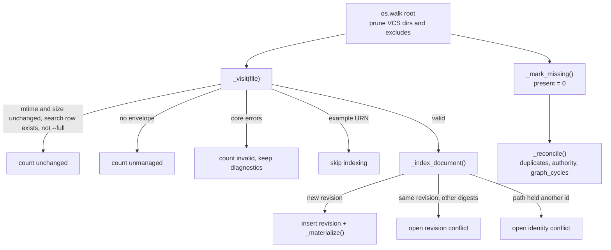

# Registry

Active contributors: calisweetleaf, Christian

The registry is one global SQLite database (default `~/.somnus/somnus.db`) that indexes managed files under registered roots. `Store` in `src/somnus/db/store.py` scans roots, records immutable revision states, reconciles conflicts, and records actions in an append-only `events` ledger. Its full-text index is derived from observed locations, not an authority over files. Read paths (`somnus q`, the TUI browser, semantic resolution) use a separate read-only connection.

## Purpose

- Give every artifact one row keyed by its URN, with its observed revisions and locations (SPEC section 18).
- Detect revision, duplicate-ID, identity, and authority conflicts across files and roots, and resolve them automatically when the condition disappears.
- Supply reference-resolution facts (`Resolver`) to the `semantic` and `canon` validation levels.
- Store no JSON anywhere: headers are kept as canonical restricted YAML text and every other column is a plain value (decision D4).

## Directory layout

```
src/somnus/db/
  __init__.py   re-exports ScanReport, Store, connect_readonly, glob_regex, matches_any, now_iso, run_query
  schema.sql    base DDL, schema version 2 (tables, triggers, views)
  search.sql    derived FTS5 index (path, title, summary, tags, body)
  store.py      Store class, scan and reconciliation, resolver(), read-only helpers
```

## Key abstractions

| Name | File path | Description |
| --- | --- | --- |
| `Store` | `src/somnus/db/store.py` | Writable connection plus actor name; context manager that commits on exit and rolls back on exception. |
| `Store.open(db_path, actor, create)` | `src/somnus/db/store.py` | Creates the parent directory when allowed, connects with a 10 s timeout, sets `foreign_keys = ON` and `journal_mode = WAL`, then runs `_migrate()`. Closes the connection on failed setup; transfers ownership to the returned store only after success. |
| `Store._migrate()` | `src/somnus/db/store.py` | Refuses a newer `PRAGMA user_version`; runs base DDL and sets version 2 on older registries, then ensures the FTS5 table on every writable open. `DB_USER_VERSION` lives in `src/somnus/__init__.py`. |
| `Store._ensure_search()`, `Store._index_text()` | `src/somnus/db/store.py` | Create the optional FTS5 index and replace one location's searchable observation. |
| `searchable_body()`, `fts_query()` | `src/somnus/db/store.py` | Extract bounded host text and safely quote the plain-word query surface. |
| `ScanReport` | `src/somnus/db/store.py` | Counters (scanned, indexed, unchanged, unmanaged, examples, invalid, missing, new revisions, conflicts opened/resolved), diagnostics, and `unmanaged_paths` (absolute POSIX-form host paths) for one pass. |
| `Store.log()` | `src/somnus/db/store.py` | Inserts one `events` row with `now_iso()`, the actor, action, artifact, revision, path, and detail. |
| `Store.scan()`, `Store.observe()` | `src/somnus/db/store.py` | Full reconciliation of roots, or re-indexing of one file under a registered root. |
| `Store.resolver()` | `src/somnus/db/store.py` | Builds a `Resolver` (from `src/somnus/model/validate.py`) from `artifacts`, `revisions`, `regions`, `claims`, `entities`, and `open_conflicts`. |
| `connect_readonly()`, `run_query()` | `src/somnus/db/store.py` | Read-only connection (`?mode=ro` URI plus `PRAGMA query_only = ON`) and single-statement execution returning headers and rows. |
| `glob_regex()`, `matches_any()` | `src/somnus/db/store.py` | Exclude-pattern globs over POSIX relative paths: `**` crosses directories, `*` and `?` do not. |
| `intervals_overlap()` | `src/somnus/db/store.py` | Half-open overlap test for two `valid_time` objects; missing bounds count as unbounded, so `timeless` and `unknown` overlap everything. |

## How it works

### Connection ownership and failed opens

`Store.open()` in `src/somnus/db/store.py` owns the newly allocated connection until setup and `_migrate()` both succeed. Previously, a failure after `sqlite3.connect()` could leave that connection open: a malformed database raises a SQLite error during setup, while a newer schema is refused by `_migrate()` with a `SomnusError`. Catching only SQLite exceptions was not enough to clean up both paths.

The local connection starts as `None`, and a `finally` block closes it if it has been allocated. After successful migration, the local reference is cleared before returning the store, so cleanup does not close a live store's connection. SQLite failures become `E_IO` with exit 2 and retain their original exception as the cause; the newer-schema refusal also reports `E_IO` with exit 2 and leaves `user_version` unchanged. Successful callers still own normal shutdown through `Store.close()` or the context manager.

`TestOpenFailures` in `tests/test_store.py` checks both refusal paths and tracks their actual connections: executing `SELECT 1` afterward must raise `sqlite3.ProgrammingError` because the connection is closed. The separate read-only setup path has the same cleanup obligation, described under [Read-only access](#read-only-access).

### Tables and views

`src/somnus/db/schema.sql` defines:

| Table | Key | Contents |
| --- | --- | --- |
| `roots` | `id`, unique `path` | Registered root directories, `added_at`, `last_scan_at` |
| `artifacts` | `id` (URN) | Title, type, category, role, scope, status, standing, visibility of the highest non-conflicting observed revision; `current_revision >= 1` |
| `revisions` | `(artifact_id, revision)` | Immutable observed state: `header_yaml`, `payload_digest`, `body_digest`, `observed_at` |
| `locations` | `id`, unique `(root_id, rel_path)` | Artifact, revision, carrier name, `file_mtime`, `file_size`, digests, `present` (0 or 1) |
| `tags` | `(artifact_id, tag)` | Classification tags of the current revision |
| `regions`, `relations`, `entities`, `claims` | `(artifact_id, revision, local id)` | Knowledge rows per revision; `relations.known_predicate` flags registered predicates |
| `conflicts` | `id`; unique open `(kind, conflict_key)` | `kind` in `revision`, `duplicate-id`, `authority`, `identity`; `state` `open` or `resolved` |
| `events` | `id` autoincrement | Append-only ledger: `at`, `actor`, `action`, `artifact_id`, `revision`, `path`, `detail` |

`src/somnus/db/search.sql` separately defines the FTS5 virtual table `search(path, title, summary, tags, body)`, keyed by `rowid = locations.id`. Its tokenizer is `porter unicode61 remove_diacritics 2`. This is a location index: identical mirrors can produce separate results, while artifact rows remain keyed by URN.

Triggers `events_no_update` and `events_no_delete` raise `events are append-only` on any `UPDATE` or `DELETE` of `events`. The partial unique index `conflicts_one_open` allows only one open conflict per `(kind, conflict_key)`.

Views:

- `docs`: present locations joined to artifacts and roots, with `path` built as the root path plus `/` plus `rel_path`, and both `revision` (artifact current) and `file_revision` (the revision found at that path).
- `open_conflicts`: conflicts with `state = 'open'`.
- `history`: all events, newest first.

### Paths

`add_root()` stores `Path(path).resolve().as_posix()`, and `_rel()` stores relative paths with `as_posix()`, so rows use forward slashes on Windows too. Ledger paths written through `Ctx.record()` in `src/somnus/commands/_common.py` are also converted to forward slashes by `path_text()`. `root_for()` picks the deepest registered root containing a path.

Root-selection safety belongs to `src/somnus/commands/index.py`, not a blanket `Store.add_root()` restriction. Explicit `index ROOT...` arguments win, followed by registered roots; only if neither exists does the command use configured roots. That fallback refuses a root equal to the resolved home directory or filesystem anchor with exit 2 and suggests `somnus init --root DIR` or `somnus index DIR`. Explicitly named or already registered broad roots are not universally banned.

### Scan reconciliation

`scan(roots, exclude, full)` registers any roots passed in (or uses all registered roots), then walks each with `os.walk`, pruning `.git`, `.hg`, `.svn`, and excluded directories. A file is visited when it is a sidecar, or when it has a known carrier and no sidecar beside it.



`_visit()` details:

- For a sidecar the location is recorded under the host file's relative path, and the change check uses the later of the two mtimes and the sum of both sizes.
- Unchanged locations are skipped unless `full` is set or the available search index lacks their row. With no FTS5 index, the search-row check does not prevent skipping. `observe()` always passes `full=True`.
- A document with no envelope and no loading issues increments `unmanaged` and appends `host.as_posix()` to `ScanReport.unmanaged_paths`; this is an absolute host path, not a sidecar path. It is not indexed. The CLI displays up to 10 paths, adds `and N more` when needed, and suggests previewing with `somnus stamp PATH` before `somnus stamp PATH --write`. These are informational stderr notes, not diagnostic warnings or errors, and unmanaged files alone do not fail the scan.
- Files that fail `validate(doc, "core")` are counted invalid and their errors are added to the report; they are not indexed.
- `urn:somnus:example:*` artifacts are counted and never indexed.

Failure handling in `src/somnus/db/store.py` is per-file where possible: a failed stat or a `SomnusError` from document loading increments `invalid`, records diagnostics, and returns the host relative path so an already indexed location is not treated as missing merely because it could not be read. A root that is not a directory gets an `E_IO` diagnostic and is skipped. `TestScanFailures` in `tests/test_store.py` covers invalid UTF-8 and an unstatable dangling symlink alongside a valid file, a missing root, and an unreadable stored authority header. The symlink case skips when the host cannot create symlinks; these tests do not prove behavior on every filesystem.

`_index_document()` details:

- Inserts the artifact row on first sight.
- Computes `payload_digest()` and `body_digest()` from `src/somnus/document.py` and the canonical header text with `canonical_yaml()`.
- A new `(artifact_id, revision)` inserts a `revisions` row, writes knowledge rows through `_materialize()`, and logs `observe`.
- An existing revision with different digests opens a `revision` conflict keyed `<id>#<rev>@<path>`. The detail includes the candidate header. The stored revision is kept.
- Any other open `revision` conflict on the same path is resolved as "no longer observed".
- When there is no conflict and the revision is at least the current one, the artifact columns and tags are updated. Otherwise only `last_seen_at` changes.
- The location row is inserted or updated with `present = 1`. If the path previously held a different artifact ID, an `identity` conflict keyed by the path is opened.
- `_index_text()` then replaces that location's search row, even when the observed revision conflicts with its stored state. Search text describes the file just observed; it does not replace the immutable revision or resolve its conflict.

`_materialize()` uses `INSERT OR IGNORE` for regions, relations, entities, and claims of the new revision. Extensions are never read into these tables (SPEC section 4.3).

`_mark_missing()` sets `present = 0` for every present location of the root not seen in this pass, removes its derived search row, logs `missing`, and resolves open `revision` conflicts on that path. Artifact, revision, and location history is retained.

### Full-text maintenance

`Store._migrate()` in `src/somnus/db/store.py` upgrades a version-1 registry through the idempotent base DDL, sets `PRAGMA user_version = 2`, and calls `_ensure_search()`. It also calls `_ensure_search()` when the version is already 2. Opening the registry creates the virtual table but does not populate old locations; the next scan backfills missing search rows even when file mtime and size have not changed. Read-only queries do not migrate.

If SQLite reports an `OperationalError` whose message contains `fts5` (case-insensitive) while creating the table, `_ensure_search()` disables search for that store but leaves the registry usable. This is the no-FTS5 fallback, not a blanket suppression of DDL failures. Other operational errors propagate; during `Store.open()` they become `E_IO` and the failed-open connection is closed. `TestOpenFailures` in `tests/test_store.py` injects `no such module: fts5` to check `search = False` and the no-backfill fast path, then injects `disk I/O error` to check that an unrelated DDL error is not swallowed. `somnus q --text` reports a missing index with exit 2 and asks for `somnus index` using SQLite with FTS5. Schema version 2 alone is therefore not proof that full-text search is available.

Each indexed observation supplies its absolute host path, title, optional summary, space-joined classification tags, and body. `searchable_body()` in `src/somnus/db/store.py` reads body lines outside embedded envelopes, or decodes the sidecar host as UTF-8 with optional BOM. Invalid UTF-8 sidecar hosts contribute an empty body but retain searchable metadata. Only the body is capped at `SEARCH_BODY_LIMIT = 1_000_000` characters; this is not a limit on all columns or on file loading.

`somnus index --full` re-reads eligible files in the selected roots and refreshes their search rows without inventing new revisions. Ordinary incremental scans use mtime, size, and search-row presence, not a fresh content hash. Search covers successfully indexed, core-valid, non-example managed documents; it is not a general crawl of unmanaged files.

`SEARCH` in `src/somnus/commands/query.py` joins present locations and artifact rows, ranks with BM25 weights path 2, title 10, summary 5, tags 5, body 1, then breaks ties by path. Returned title/type/status come from the artifact row, while matching text and excerpts come from the location observation. During a revision conflict those can differ. See [Querying](../features/querying.md) for plain-word and raw FTS5 syntax.

In text mode, the query command combines `--text` with its optional positional argument before literal conversion through `fts_query()`; that positional value is additional search text, not executable SQL. Zero matches still exit 0 and render an empty table plus an informational stderr note explaining the managed-file scope and suggesting adoption, then reindexing. Neither hint widens search scope to unmanaged content.

### Registry-wide reconciliation

`_reconcile()` runs after every `scan()` and `observe()`:

| Step | Rule |
| --- | --- |
| `_reconcile_duplicates()` | An artifact present at several paths with more than one distinct `(payload_digest, body_digest)` pair gets a `duplicate-id` conflict keyed by the artifact ID. Byte-identical mirrors are allowed. Open duplicate conflicts that no longer hold are resolved. |
| `_reconcile_authority()` | For each pair of present `accepted` artifacts (scopes parsed back from the stored `header_yaml`), overlapping `valid_time` plus the same scope `target_ref` plus a shared aspect opens an `authority` conflict for each side, keyed `a|b|target|aspect`. Stale ones are resolved. An unreadable stored header produces an `E_AUTHORITY` diagnostic instead. |
| `graph_cycles()` | Builds one graph per acyclic predicate (`supersedes`, `derived_from`, `part_of`) from the current revisions of present artifacts and runs `find_cycle()`. Cycles are returned as `E_GRAPH` diagnostics in the report; they are not stored as conflicts, because `conflicts.kind` admits only the four kinds above. |

`_open_conflict()` and `_resolve_rows()` log `conflict.open` and `conflict.resolve` events. Operators and commands can resolve conflicts explicitly with `resolve_conflicts(kinds, path=, artifact_id=, reason=)`; `Ctx.record()` uses this when a command passes `resolve=`: `somnus bump` resolves `revision` and `identity` conflicts (`src/somnus/commands/bump.py`), and the TUI save resolves `revision` conflicts.

### Read-only access

`connect_readonly()` raises `E_IO` (exit 2) if the database file does not exist, then opens it with a `file:` URI and `mode=ro` and sets `query_only`. `run_query()` executes one statement and wraps any `sqlite3.Error` as `E_IO`. `somnus q` (`src/somnus/commands/query.py`), `ls`, `new`, `stale`, `Ctx.resolver()`, and the TUI's `load_rows()` all use this path, so they cannot write. See [Querying](../features/querying.md).

If SQLite setup fails after allocating the read-only connection, `connect_readonly()` in `src/somnus/db/store.py` closes it before raising `E_IO` with the SQLite exception as its cause. On success it returns the open connection to the caller, which must close it. `TestOpenFailures` in `tests/test_store.py` injects a failure in `PRAGMA query_only`, verifies exit 2 and the preserved cause, and checks that the allocated connection is closed. Missing-registry coverage also checks the `somnus init` recovery hint. Read-only opens never run migrations.

`list_docs()` filters the `docs` view by type, status, standing, tag, and a path substring. `similar_titles()` uses `difflib.SequenceMatcher` with a 0.85 default threshold for near-duplicate titles.

## Integration points

- `src/somnus/commands/init.py` creates the database with `Store.open(..., create=True)`; `src/somnus/commands/index.py` calls `scan()` with the configured exclude globs.
- `Ctx.store()`, `Ctx.readonly()`, `Ctx.resolver()`, and `Ctx.record()` in `src/somnus/commands/_common.py` are the only registry entry points used by other commands. `record()` logs the action, optionally resolves conflicts, and calls `observe()` on the written file.
- `src/somnus/model/validate.py` provides `validate()`, `find_cycle()`, `Resolver`, and `ArtifactFacts`. See [Validation](validation.md).
- `src/somnus/document.py` provides loading, digests, and canonical YAML. See [Document model](document-model.md).
- Database location and excludes come from `src/somnus/config.py`. See [Configuration](../reference/configuration.md).

## Entry points for modification

- Schema changes: edit `src/somnus/db/schema.sql`, increase `DB_USER_VERSION` in `src/somnus/__init__.py`, and extend `_migrate()`. The current base migration runs idempotent DDL; structural changes to existing tables need explicit migration steps. FTS5 DDL lives separately in `src/somnus/db/search.sql`.
- New conflict kind: extend the `CHECK` constraint on `conflicts.kind`, add a reconcile step in `_reconcile()`, and map it to a diagnostic code in `canon()` in `src/somnus/model/validate.py`.
- New materialized knowledge: add a table to `src/somnus/db/schema.sql`, write it in `_materialize()`, and read it in `resolver()` if validation needs it.
- `tests/test_store.py` covers reconciliation, FTS5 migration/backfill, refresh/removal, query quoting, sidecar extraction, refused-open cleanup, read-only setup failure, optional-FTS5 fallback, and scan diagnostics. `tests/test_commands.py` covers CLI search results, prefixes, all-word matching, usage errors, implicit-home-root refusal, two-word unquoted search, unmanaged-file adoption notes, and zero-match success. See [Testing](../how-to-contribute/testing.md) for suite commands and verification boundaries.

This refresh passed the existing 534-test suite across 14 modules, semantic validation, and isolated mypy 1.18.2. `PLAN.md` records separate historical operator results of 88.76% coverage, 65/65 acceptance checks, and 374 Doctor issues including 71 serious issues (reviewed, with a nonzero gate). Those records are not fresh runner results or proof of native Windows behavior, an installed package, or an external MCP host.

## Key source files

| File | Role |
| --- | --- |
| `src/somnus/db/schema.sql` | Tables, append-only triggers, views, indexes |
| `src/somnus/db/search.sql` | FTS5 columns and tokenizer |
| `src/somnus/db/store.py` | `Store`, scanning, conflict reconciliation, `resolver()`, read-only helpers |
| `src/somnus/commands/query.py` | Search joins, ranking, excerpts, and query errors |
| `src/somnus/__init__.py` | Package 2.1.0, database schema 2, unchanged core 2.0.0 |
| `src/somnus/db/__init__.py` | Public re-exports |
| `src/somnus/commands/_common.py` | `Ctx` registry helpers and `record()` |
| `src/somnus/commands/index.py`, `src/somnus/commands/init.py` | `somnus index` and `somnus init` |
| `tests/test_store.py` | Registry behavior, `TestOpenFailures` connection cleanup/fallback tests, and `TestScanFailures` diagnostics |
| `tests/test_commands.py` | CLI root-safety, text-search, and informational-hint coverage |

Related: [Architecture](../overview/architecture.md), [Glossary](../overview/glossary.md), [Data models](../reference/data-models.md), [Design decisions](../background/design-decisions.md).
