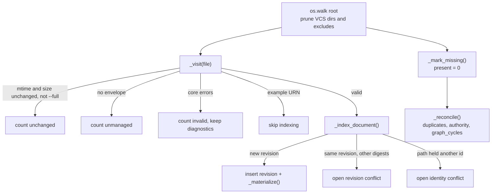

# Registry

The registry is one global SQLite database (default `~/.somnus/somnus.db`) that indexes every managed file under the registered roots. `Store` in `src/somnus/db/store.py` scans roots, records immutable revision states, reconciles conflicts, and appends every mutating action to an append-only `events` ledger. Read paths (`somnus q`, the TUI browser, semantic resolution) use a separate read-only connection.

## Purpose

- Give every artifact one row keyed by its URN, with its observed revisions and locations (SPEC section 18).
- Detect revision, duplicate-ID, identity, and authority conflicts across files and roots, and resolve them automatically when the condition disappears.
- Supply reference-resolution facts (`Resolver`) to the `semantic` and `canon` validation levels.
- Store no JSON anywhere: headers are kept as canonical restricted YAML text and every other column is a plain value (decision D4).

## Directory layout

```
src/somnus/db/
  __init__.py   re-exports ScanReport, Store, connect_readonly, glob_regex, matches_any, now_iso, run_query
  schema.sql    authoritative DDL, schema version 1 (tables, triggers, views)
  store.py      Store class, scan and reconciliation, resolver(), read-only helpers
```

## Key abstractions

| Name | File path | Description |
| --- | --- | --- |
| `Store` | `src/somnus/db/store.py` | Writable connection plus actor name; context manager that commits on exit and rolls back on exception. |
| `Store.open(db_path, actor, create)` | `src/somnus/db/store.py` | Creates the parent directory when allowed, connects with a 10 s timeout, sets `foreign_keys = ON` and `journal_mode = WAL`, then runs `_migrate()`. |
| `Store._migrate()` | `src/somnus/db/store.py` | Reads `PRAGMA user_version`; refuses a newer version, returns when equal to `DB_USER_VERSION` (1, in `src/somnus/__init__.py`), otherwise runs `schema.sql` and sets the version. |
| `ScanReport` | `src/somnus/db/store.py` | Counters (scanned, indexed, unchanged, unmanaged, examples, invalid, missing, new revisions, conflicts opened/resolved) and diagnostics for one pass. |
| `Store.log()` | `src/somnus/db/store.py` | Inserts one `events` row with `now_iso()`, the actor, action, artifact, revision, path, and detail. |
| `Store.scan()`, `Store.observe()` | `src/somnus/db/store.py` | Full reconciliation of roots, or re-indexing of one file under a registered root. |
| `Store.resolver()` | `src/somnus/db/store.py` | Builds a `Resolver` (from `src/somnus/model/validate.py`) from `artifacts`, `revisions`, `regions`, `claims`, `entities`, and `open_conflicts`. |
| `connect_readonly()`, `run_query()` | `src/somnus/db/store.py` | Read-only connection (`?mode=ro` URI plus `PRAGMA query_only = ON`) and single-statement execution returning headers and rows. |
| `glob_regex()`, `matches_any()` | `src/somnus/db/store.py` | Exclude-pattern globs over POSIX relative paths: `**` crosses directories, `*` and `?` do not. |
| `intervals_overlap()` | `src/somnus/db/store.py` | Half-open overlap test for two `valid_time` objects; missing bounds count as unbounded, so `timeless` and `unknown` overlap everything. |

## How it works

### Tables and views

`src/somnus/db/schema.sql` defines:

| Table | Key | Contents |
| --- | --- | --- |
| `roots` | `id`, unique `path` | Registered root directories, `added_at`, `last_scan_at` |
| `artifacts` | `id` (URN) | Title, type, category, role, scope, status, standing, visibility of the highest non-conflicting observed revision; `current_revision >= 1` |
| `revisions` | `(artifact_id, revision)` | Immutable observed state: `header_yaml`, `payload_digest`, `body_digest`, `observed_at` |
| `locations` | `id`, unique `(root_id, rel_path)` | Artifact, revision, carrier name, `file_mtime`, `file_size`, digests, `present` (0 or 1) |
| `tags` | `(artifact_id, tag)` | Classification tags of the current revision |
| `regions`, `relations`, `entities`, `claims` | `(artifact_id, revision, local id)` | Knowledge rows per revision; `relations.known_predicate` flags registered predicates |
| `conflicts` | `id`; unique open `(kind, conflict_key)` | `kind` in `revision`, `duplicate-id`, `authority`, `identity`; `state` `open` or `resolved` |
| `events` | `id` autoincrement | Append-only ledger: `at`, `actor`, `action`, `artifact_id`, `revision`, `path`, `detail` |

Triggers `events_no_update` and `events_no_delete` raise `events are append-only` on any `UPDATE` or `DELETE` of `events`. The partial unique index `conflicts_one_open` allows only one open conflict per `(kind, conflict_key)`.

Views:

- `docs`: present locations joined to artifacts and roots, with `path` built as the root path plus `/` plus `rel_path`, and both `revision` (artifact current) and `file_revision` (the revision found at that path).
- `open_conflicts`: conflicts with `state = 'open'`.
- `history`: all events, newest first.

### Paths

`add_root()` stores `Path(path).resolve().as_posix()`, and `_rel()` stores relative paths with `as_posix()`, so rows use forward slashes on Windows too. Ledger paths written through `Ctx.record()` in `src/somnus/commands/_common.py` are also converted to forward slashes by `path_text()`. `root_for()` picks the deepest registered root containing a path.

### Scan reconciliation

`scan(roots, exclude, full)` registers any roots passed in (or uses all registered roots), then walks each with `os.walk`, pruning `.git`, `.hg`, `.svn`, and excluded directories. A file is visited when it is a sidecar, or when it has a known carrier and no sidecar beside it.



`_visit()` details:

- For a sidecar the location is recorded under the host file's relative path, and the change check uses the later of the two mtimes and the sum of both sizes.
- Unchanged locations are skipped unless `full` is set. `observe()` always passes `full=True`.
- Files that fail `validate(doc, "core")` are counted invalid and their errors are added to the report; they are not indexed.
- `urn:somnus:example:*` artifacts are counted and never indexed.

`_index_document()` details:

- Inserts the artifact row on first sight.
- Computes `payload_digest()` and `body_digest()` from `src/somnus/document.py` and the canonical header text with `canonical_yaml()`.
- A new `(artifact_id, revision)` inserts a `revisions` row, writes knowledge rows through `_materialize()`, and logs `observe`.
- An existing revision with different digests opens a `revision` conflict keyed `<id>#<rev>@<path>`. The detail includes the candidate header. The stored revision is kept.
- Any other open `revision` conflict on the same path is resolved as "no longer observed".
- When there is no conflict and the revision is at least the current one, the artifact columns and tags are updated. Otherwise only `last_seen_at` changes.
- The location row is inserted or updated with `present = 1`. If the path previously held a different artifact ID, an `identity` conflict keyed by the path is opened.

`_materialize()` uses `INSERT OR IGNORE` for regions, relations, entities, and claims of the new revision. Extensions are never read into these tables (SPEC section 4.3).

`_mark_missing()` sets `present = 0` for every present location of the root not seen in this pass, logs `missing`, and resolves open `revision` conflicts on that path. Rows are never deleted.

### Registry-wide reconciliation

`_reconcile()` runs after every `scan()` and `observe()`:

| Step | Rule |
| --- | --- |
| `_reconcile_duplicates()` | An artifact present at several paths with more than one distinct `(payload_digest, body_digest)` pair gets a `duplicate-id` conflict keyed by the artifact ID. Byte-identical mirrors are allowed. Open duplicate conflicts that no longer hold are resolved. |
| `_reconcile_authority()` | For each pair of present `accepted` artifacts (scopes parsed back from the stored `header_yaml`), overlapping `valid_time` plus the same scope `target_ref` plus a shared aspect opens an `authority` conflict for each side, keyed `a|b|target|aspect`. Stale ones are resolved. An unreadable stored header produces an `E_AUTHORITY` diagnostic instead. |
| `graph_cycles()` | Builds one graph per acyclic predicate (`supersedes`, `derived_from`, `part_of`) from the current revisions of present artifacts and runs `find_cycle()`. Cycles are returned as `E_GRAPH` diagnostics in the report; they are not stored as conflicts, because `conflicts.kind` admits only the four kinds above. |

`_open_conflict()` and `_resolve_rows()` log `conflict.open` and `conflict.resolve` events. Operators and commands can resolve conflicts explicitly with `resolve_conflicts(kinds, path=, artifact_id=, reason=)`; `Ctx.record()` uses this when a command passes `resolve=`: `somnus bump` resolves `revision` and `identity` conflicts (`src/somnus/commands/bump.py`), and the TUI save resolves `revision` conflicts.

### Read-only access

`connect_readonly()` raises `E_IO` (exit 2) if the database file does not exist, then opens it with a `file:` URI and `mode=ro` and sets `query_only`. `run_query()` executes one statement and wraps any `sqlite3.Error` as `E_IO`. `somnus q` (`src/somnus/commands/query.py`), `ls`, `new`, `stale`, `Ctx.resolver()`, and the TUI's `load_rows()` all use this path, so they cannot write. See [Querying](../features/querying.md).

`list_docs()` filters the `docs` view by type, status, standing, tag, and a path substring. `similar_titles()` uses `difflib.SequenceMatcher` with a 0.85 default threshold for near-duplicate titles.

## Integration points

- `src/somnus/commands/init.py` creates the database with `Store.open(..., create=True)`; `src/somnus/commands/index.py` calls `scan()` with the configured exclude globs.
- `Ctx.store()`, `Ctx.readonly()`, `Ctx.resolver()`, and `Ctx.record()` in `src/somnus/commands/_common.py` are the only registry entry points used by other commands. `record()` logs the action, optionally resolves conflicts, and calls `observe()` on the written file.
- `src/somnus/model/validate.py` provides `validate()`, `find_cycle()`, `Resolver`, and `ArtifactFacts`. See [Validation](validation.md).
- `src/somnus/document.py` provides loading, digests, and canonical YAML. See [Document model](document-model.md).
- Database location and excludes come from `src/somnus/config.py`. See [Configuration](../reference/configuration.md).

## Entry points for modification

- Schema changes: edit `src/somnus/db/schema.sql`, increase `DB_USER_VERSION` in `src/somnus/__init__.py`, and extend `_migrate()`. The current migration only runs the full DDL (all statements use `IF NOT EXISTS`), so a version 2 change to existing tables would need explicit `ALTER` steps.
- New conflict kind: extend the `CHECK` constraint on `conflicts.kind`, add a reconcile step in `_reconcile()`, and map it to a diagnostic code in `canon()` in `src/somnus/model/validate.py`.
- New materialized knowledge: add a table to `schema.sql`, write it in `_materialize()`, and read it in `resolver()` if validation needs it.
- Tests live in `tests/test_store.py`.

## Key source files

| File | Role |
| --- | --- |
| `src/somnus/db/schema.sql` | Tables, append-only triggers, views, indexes |
| `src/somnus/db/store.py` | `Store`, scanning, conflict reconciliation, `resolver()`, read-only helpers |
| `src/somnus/db/__init__.py` | Public re-exports |
| `src/somnus/commands/_common.py` | `Ctx` registry helpers and `record()` |
| `src/somnus/commands/index.py`, `src/somnus/commands/init.py` | `somnus index` and `somnus init` |
| `tests/test_store.py` | Registry tests |

Related: [Architecture](../overview/architecture.md), [Glossary](../overview/glossary.md), [Data models](../reference/data-models.md), [Design decisions](../background/design-decisions.md).
