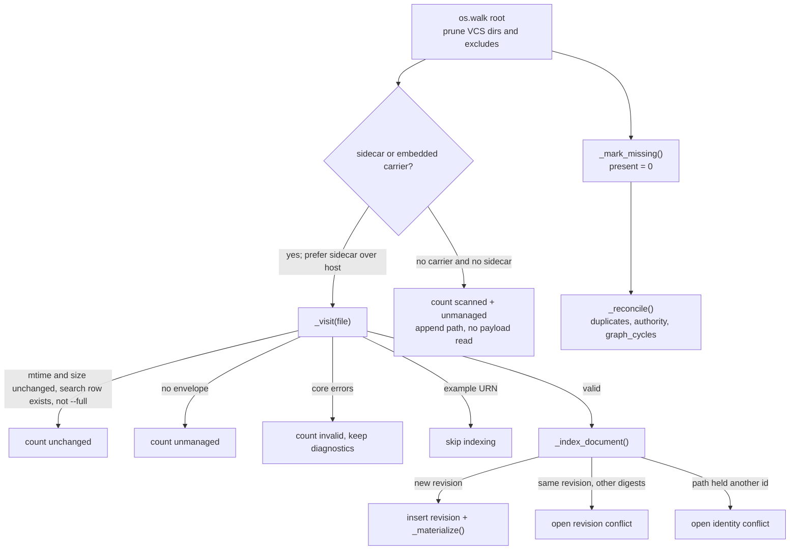

# Registry

Active contributors: calisweetleaf, Christian

The registry is one global SQLite database (default `~/.somnus/somnus.db`) that indexes managed files under registered roots. `Store` in `src/somnus/db/store.py` scans roots, records immutable revision states, reconciles conflicts, and records actions in an append-only `events` ledger. Its full-text index is derived from observed locations, not an authority over files. Read paths (`somnus q`, the TUI browser, semantic resolution) use a separate read-only connection.

## Purpose

- Give every artifact one row keyed by its URN, with its observed revisions and locations (SPEC section 18).
- Detect revision, duplicate-ID, identity, and authority conflicts across files and roots, and resolve them automatically when the condition disappears.
- Supply reference-resolution facts (`Resolver`) to the `semantic` and `canon` validation levels.
- Store no JSON anywhere: headers are kept as canonical restricted YAML text and every other column is a plain value (decision D4).

## Directory layout

```
src/somnus/db/
  __init__.py   re-exports ScanReport, Store, connect_readonly, glob_regex, matches_any, now_iso, run_query
  schema.sql    base DDL, schema version 2 (tables, triggers, views)
  search.sql    derived FTS5 index (path, title, summary, tags, body)
  store.py      Store class, scan and reconciliation, resolver(), read-only helpers
```

## Key abstractions

| Name | File path | Description |
| --- | --- | --- |
| `Store` | `src/somnus/db/store.py` | Writable connection plus actor name; context manager that commits on exit and rolls back on exception. |
| `Store.open(db_path, actor, create)` | `src/somnus/db/store.py` | Creates the parent directory when allowed, connects with a 10 s timeout, sets `foreign_keys = ON` and `journal_mode = WAL`, then runs `_migrate()`. Closes the connection on failed setup; transfers ownership to the returned store only after success. |
| `Store._migrate()` | `src/somnus/db/store.py` | Refuses a newer `PRAGMA user_version`; runs base DDL and sets version 2 on older registries, then ensures the FTS5 table on every writable open. `DB_USER_VERSION` lives in `src/somnus/__init__.py`. |
| `Store._ensure_search()`, `Store._index_text()` | `src/somnus/db/store.py` | Create the optional FTS5 index and replace one location's searchable observation. |
| `searchable_body()`, `fts_query()` | `src/somnus/db/store.py` | Extract bounded host text and safely quote the plain-word query surface. |
| `ScanReport` | `src/somnus/db/store.py` | Counters (scanned, indexed, unchanged, unmanaged, examples, invalid, missing, new revisions, conflicts opened/resolved), diagnostics, and `unmanaged_paths` (absolute POSIX-form host paths) for one pass. |
| `Store.log()` | `src/somnus/db/store.py` | Inserts one `events` row with `now_iso()`, the actor, action, artifact, revision, path, and detail. |
| `Store.scan()`, `Store.observe()` | `src/somnus/db/store.py` | Full reconciliation of roots, or re-indexing of one file under a registered root. |
| `Store.resolver()` | `src/somnus/db/store.py` | Builds a `Resolver` (from `src/somnus/model/validate.py`) from `artifacts`, `revisions`, `regions`, `claims`, `entities`, and `open_conflicts`. |
| `connect_readonly()`, `run_query()` | `src/somnus/db/store.py` | Read-only connection (`?mode=ro` URI plus `PRAGMA query_only = ON`) and single-statement execution returning headers and rows. |
| `glob_regex()`, `matches_any()` | `src/somnus/db/store.py` | Exclude-pattern globs over POSIX relative paths: `**` crosses directories, `*` and `?` do not. |
| `intervals_overlap()` | `src/somnus/db/store.py` | Half-open overlap test for two `valid_time` objects; missing bounds count as unbounded, so `timeless` and `unknown` overlap everything. |

## How it works

### Connection ownership and failed opens

`Store.open()` in `src/somnus/db/store.py` owns the newly allocated connection until setup and `_migrate()` both succeed. Previously, a failure after `sqlite3.connect()` could leave that connection open: a malformed database raises a SQLite error during setup, while a newer schema is refused by `_migrate()` with a `SomnusError`. Catching only SQLite exceptions was not enough to clean up both paths.

The local connection starts as `None`, and a `finally` block closes it if it has been allocated. After successful migration, the local reference is cleared before returning the store, so cleanup does not close a live store's connection. SQLite failures become `E_IO` with exit 2 and retain their original exception as the cause; the newer-schema refusal also reports `E_IO` with exit 2 and leaves `user_version` unchanged. Successful callers still own normal shutdown through `Store.close()` or the context manager.

`TestOpenFailures` in `tests/test_store.py` checks both refusal paths and tracks their actual connections: executing `SELECT 1` afterward must raise `sqlite3.ProgrammingError` because the connection is closed. The separate read-only setup path has the same cleanup obligation, described under [Read-only access](#read-only-access).

### Tables and views

`src/somnus/db/schema.sql` defines:

| Table | Key | Contents |
| --- | --- | --- |
| `roots` | `id`, unique `path` | Registered root directories, `added_at`, `last_scan_at` |
| `artifacts` | `id` (URN) | Title, type, category, role, scope, status, standing, visibility of the highest non-conflicting observed revision; `current_revision >= 1` |
| `revisions` | `(artifact_id, revision)` | Immutable observed state: `header_yaml`, `payload_digest`, `body_digest`, `observed_at` |
| `locations` | `id`, unique `(root_id, rel_path)` | Artifact, revision, carrier name, `file_mtime`, `file_size`, digests, `present` (0 or 1) |
| `tags` | `(artifact_id, tag)` | Classification tags of the current revision |
| `regions`, `relations`, `entities`, `claims` | `(artifact_id, revision, local id)` | Knowledge rows per revision; `relations.known_predicate` flags registered predicates |
| `conflicts` | `id`; unique open `(kind, conflict_key)` | `kind` in `revision`, `duplicate-id`, `authority`, `identity`; `state` `open` or `resolved` |
| `events` | `id` autoincrement | Append-only ledger: `at`, `actor`, `action`, `artifact_id`, `revision`, `path`, `detail` |

`src/somnus/db/search.sql` separately defines the FTS5 virtual table `search(path, title, summary, tags, body)`, keyed by `rowid = locations.id`. Its tokenizer is `porter unicode61 remove_diacritics 2`. This is a location index: identical mirrors can produce separate results, while artifact rows remain keyed by URN.

Triggers `events_no_update` and `events_no_delete` raise `events are append-only` on any `UPDATE` or `DELETE` of `events`. The partial unique index `conflicts_one_open` allows only one open conflict per `(kind, conflict_key)`.

Views:

- `docs`: present locations joined to artifacts and roots, with `path` built as the root path plus `/` plus `rel_path`, and both `revision` (artifact current) and `file_revision` (the revision found at that path).
- `open_conflicts`: conflicts with `state = 'open'`.
- `history`: all events, newest first.

### Paths

`add_root()` stores `Path(path).resolve().as_posix()`, and `_rel()` stores relative paths with `as_posix()`, so rows use forward slashes on Windows too. Ledger paths written through `Ctx.record()` in `src/somnus/commands/_common.py` are also converted to forward slashes by `path_text()`. `root_for()` picks the deepest registered root containing a path.

The three unmanaged-host regressions in `tests/test_store.py` also resolve their expected paths before calling `as_posix()` (commit `07a6039`). Temporary-directory aliases, such as macOS `/var` symlinks or Windows short names, must not be confused with changed scanner behavior. This correction changes no runtime code; see [Testing](../how-to-contribute/testing.md#canonical-temporary-paths).

Root-selection safety belongs to `src/somnus/commands/index.py`, not a blanket `Store.add_root()` restriction. Explicit `index ROOT...` arguments win, followed by registered roots; only if neither exists does the command use configured roots. That fallback refuses a root equal to the resolved home directory or filesystem anchor with exit 2 and suggests `somnus init --root DIR` or `somnus index DIR`. Explicitly named or already registered broad roots are not universally banned.

### Scan reconciliation

`scan(roots, exclude, full)` registers any roots passed in (or uses all registered roots), then walks each with `os.walk`, pruning `.git`, `.hg`, `.svn`, and excluded directories. File exclusions apply before discovery. A sidecar reaches `_visit()`; its host is skipped so it is observed only once. A known-carrier file without a sidecar also reaches `_visit()`.

Since toolkit 2.1.1, a host with neither an embedded carrier nor a sidecar increments `scanned` and `unmanaged` and appends its absolute POSIX-form path to `ScanReport.unmanaged_paths`, without reading the payload. JSON, text, extensionless files, and binaries are therefore discoverable without a separate embedded-only walk. This branch creates no metadata, registry location, or FTS row; it does not change carriers or schema 2. The report retains all discovered unmanaged paths, while `src/somnus/commands/index.py` displays at most ten examples. Zero unmanaged describes only the scanned roots and exclusions, not validation success or files outside that boundary.



`_visit()` details:

- For a sidecar the location is recorded under the host file's relative path, and the change check uses the later of the two mtimes and the sum of both sizes.
- Unchanged locations are skipped unless `full` is set or the available search index lacks their row. With no FTS5 index, the search-row check does not prevent skipping. `observe()` always passes `full=True`.
- A document with no envelope and no loading issues increments `unmanaged` and appends `host.as_posix()` to `ScanReport.unmanaged_paths`; this is an absolute host path, not a sidecar path. It is not indexed. The CLI displays up to 10 paths, adds `and N more` when needed, and suggests previewing with `somnus stamp PATH` before `somnus stamp PATH --write`. These are informational stderr notes, not diagnostic warnings or errors, and unmanaged files alone do not fail the scan.
- Files that fail `validate(doc, "core")` are counted invalid and their errors are added to the report; they are not indexed.
- `urn:somnus:example:*` artifacts are counted and never indexed.

Failure handling in `src/somnus/db/store.py` is per-file where possible: a failed stat or a `SomnusError` from document loading increments `invalid`, records diagnostics, and returns the host relative path so an already indexed location is not treated as missing merely because it could not be read. A root that is not a directory gets an `E_IO` diagnostic and is skipped. `TestScanFailures` in `tests/test_store.py` covers invalid UTF-8 and an unstatable dangling symlink alongside a valid file, a missing root, and an unreadable stored authority header. The symlink case skips when the host cannot create symlinks; these tests do not prove behavior on every filesystem.

`TestUnmanagedSidecarHosts` in `tests/test_store.py` covers the separate discovery branch with real JSON/text/binary hosts, exclusion handling, unchanged host bytes, and no sidecar creation. A 64 MB sparse binary keeps traced allocation below 8 MB. Its real CLI stamping case then deletes the sidecar: the next scan reports the host unmanaged, does not add it to the seen managed set, and marks the old location missing. Existing `_mark_missing()` logic removes its search row while preserving history.

`_index_document()` details:

- Inserts the artifact row on first sight.
- Computes `payload_digest()` and `body_digest()` from `src/somnus/document.py` and the canonical header text with `canonical_yaml()`.
- A new `(artifact_id, revision)` inserts a `revisions` row, writes knowledge rows through `_materialize()`, and logs `observe`.
- An existing revision with different digests opens a `revision` conflict keyed `<id>#<rev>@<path>`. The detail includes the candidate header. The stored revision is kept.
- Any other open `revision` conflict on the same path is resolved as "no longer observed".
- When there is no conflict and the revision is at least the current one, the artifact columns and tags are updated. Otherwise only `last_seen_at` changes.
- The location row is inserted or updated with `present = 1`. If the path previously held a different artifact ID, an `identity` conflict keyed by the path is opened.
- `_index_text()` then replaces that location's search row, even when the observed revision conflicts with its stored state. Search text describes the file just observed; it does not replace the immutable revision or resolve its conflict.

`_materialize()` uses `INSERT OR IGNORE` for regions, relations, entities, and claims of the new revision. Extensions are never read into these tables (SPEC section 4.3).

`_mark_missing()` sets `present = 0` for every present location of the root not seen in this pass, removes its derived search row, logs `missing`, and resolves open `revision` conflicts on that path. Artifact, revision, and location history is retained.

### Recorded operator corpus

The current top sections of `PLAN.md` and `HANDOFF.md` supersede the five-artifact baseline and earlier 160-path checkpoint. Five non-overlapping parent roots are configured and registered. Redundant nested registrations were previously consolidated only after an online SQLite backup and verification of equivalent parent-root observations; integrity and foreign keys passed. This was operator reconciliation, not an automatic root-deduplication feature.

The latest recorded scan in `docs/USAGE_GUIDE.md` section 9 reports **2,659 managed / 21,554 unmanaged hosts**, with **0 invalid / 0 missing / 0 conflicts**, and notes adoption is now optional usage, not a completion gate. The prior dated checkpoint below records **1,064 managed / 23,148 unmanaged hosts**, also with 0 invalid / 0 missing / 0 conflicts:

| Root | Managed present hosts | Remaining unmanaged hosts |
| --- | ---: | ---: |
| Repositories | 161 | 2,780 |
| LAB | 0 | 19,736 |
| Somnus-MCP | 0 | 632 |
| Documents | 899 | 0 |
| Projects | 4 | 0 |

Documents and Projects were complete under exclusions at that checkpoint. The operator has since stopped bulk adoption (operator correction, 2026-11-01), so the remaining unmanaged hosts in the other three roots are preserved files, not unfinished work. The earlier **21,174 embedded-only** count is obsolete. `PLAN.md` records native body-digest checks for the 903 newly adopted Documents/Projects hosts, with no `E_HOST` refusal. Preservation follows SPEC normalization, including acceptance but no re-emission of a leading BOM; it is not a whole-file byte-identity claim. Two malformed Sentari Markdown files remain explicitly excluded after `E_ENVELOPE`, not repaired. Preserve exclusions for credentials, archives/research, dependencies/caches, model weights, generated state, and the live Somnus-MCP data plane. The 54,826 excluded pnpm-store files are generated dependency state, not authored source.

The earlier reduction from 27,202 to 23,148 unmanaged hosts (the prior checkpoint above) was due to preservation exclusions, not new adoption or a changed scan mechanism. These include generated hosting/runtime/test-run objects, private account-derived exports, and machine-owned `SOTA_RUN.md` artifacts; see [Configuration](../reference/configuration.md). A native-generated standard-sidecar fixture for protected source passed literal host-byte preservation, semantic validation, and native registry observation in isolation. No bulk protected-host rollout or Repositories sidecar adoption has occurred.

Earlier Droid/Codex MCP calls found 3 hits each for `host byte preservation`, `lifecycle`, and `carrier`; specification listing returned 1, stale returned 7 near-title advisories, and conflicts returned 0. Both hosts proved complete paths with TSV. After the host-agnostic plugin 1.1.1 update, Droid read its installed skill and called `q(text="host agnostic", limit=3, tsv=true)`, returning three full paths; Codex independently made the same successful MCP call. The subsequent clean reinstall of plugin/skill 1.1.1 (commit 3000082) for Codex and Factory Droid, with the installed skill read at both requested paths, was later identified as a direct skill/MCP adapter report, not native plugin registration (operator correction, 2026-11-02). The corrected native record is plugin 1.2.0 (source commit 4deee50, 25 tests, hosted CI 41399524229 passed): natively installed and enabled in both Codex and Factory as `somnus-metadata-plugin@somnus-metadata-plugin` after a native remove/install refresh, with both native cached skill trees and custom skill copies matching the canonical shared skill, and fresh Codex and Factory sessions calling native-plugin MCP `q(text="lifecycle", limit=1, tsv=true)` and both returning the lifecycle.py source path. Commit `fe19ce3` then records plugin 1.2.1 (source commit 35c228a, 26 tests, hosted CI 41402125903 passed) as a clean production payload correction: both catalogs select the checked-in reproducible 8-file native export instead of the development checkout, and both installed caches were inspected after a clean native remove/install with 0 .somnus.yaml files; the backend remains 2.1.1 and the 1.2.0 native verification above stands as the installed/enabled evidence. Human tables clip cells to 60 characters in `src/somnus/output.py`; use CLI `--tsv` or MCP `tsv: true` for full paths. These are recorded operator results for a partial corpus, not fresh checks from this wiki update or proof against the final expanded corpus. On 2026-11-01 the operator retired bulk adoption as a completion gate: the corrected commission is release and installation, which `PLAN.md` and `HANDOFF.md` record as complete, and the remaining unmanaged files across the five roots are preserved rather than awaiting adoption. The Codex skill-read gap and shared skill/plugin alignment are recorded complete for Codex and Factory Droid through the clean reinstall and skill reads above. See [Adopting files](../features/adopting-files.md), [Querying](../features/querying.md), and [Agent integration](../features/agent-integration.md).

### Full-text maintenance

`Store._migrate()` in `src/somnus/db/store.py` upgrades a version-1 registry through the idempotent base DDL, sets `PRAGMA user_version = 2`, and calls `_ensure_search()`. It also calls `_ensure_search()` when the version is already 2. Opening the registry creates the virtual table but does not populate old locations; the next scan backfills missing search rows even when file mtime and size have not changed. Read-only queries do not migrate.

If SQLite reports an `OperationalError` whose message contains `fts5` (case-insensitive) while creating the table, `_ensure_search()` disables search for that store but leaves the registry usable. This is the no-FTS5 fallback, not a blanket suppression of DDL failures. Other operational errors propagate; during `Store.open()` they become `E_IO` and the failed-open connection is closed. `TestOpenFailures` in `tests/test_store.py` injects `no such module: fts5` to check `search = False` and the no-backfill fast path, then injects `disk I/O error` to check that an unrelated DDL error is not swallowed. `somnus q --text` reports a missing index with exit 2 and asks for `somnus index` using SQLite with FTS5. Schema version 2 alone is therefore not proof that full-text search is available.

Each indexed observation supplies its absolute host path, title, optional summary, space-joined classification tags, and body. `searchable_body()` in `src/somnus/db/store.py` reads body lines outside embedded envelopes, or decodes the sidecar host as UTF-8 with optional BOM. Invalid UTF-8 sidecar hosts contribute an empty body but retain searchable metadata. Only the body is capped at `SEARCH_BODY_LIMIT = 1_000_000` characters; this is not a limit on all columns or on file loading.

`somnus index --full` re-reads eligible files in the selected roots and refreshes their search rows without inventing new revisions. Ordinary incremental scans use mtime, size, and search-row presence, not a fresh content hash. Search covers successfully indexed, core-valid, non-example managed documents; it is not a general crawl of unmanaged files.

`SEARCH` in `src/somnus/commands/query.py` joins present locations and artifact rows, ranks with BM25 weights path 2, title 10, summary 5, tags 5, body 1, then breaks ties by path. Returned title/type/status come from the artifact row, while matching text and excerpts come from the location observation. During a revision conflict those can differ. See [Querying](../features/querying.md) for plain-word and raw FTS5 syntax.

In text mode, the query command combines `--text` with its optional positional argument before literal conversion through `fts_query()`; that positional value is additional search text, not executable SQL. Zero matches still exit 0 and render an empty table plus an informational stderr note explaining the managed-file scope and suggesting adoption, then reindexing. Neither hint widens search scope to unmanaged content.

### Registry-wide reconciliation

`_reconcile()` runs after every `scan()` and `observe()`:

| Step | Rule |
| --- | --- |
| `_reconcile_duplicates()` | An artifact present at several paths with more than one distinct `(payload_digest, body_digest)` pair gets a `duplicate-id` conflict keyed by the artifact ID. Byte-identical mirrors are allowed. Open duplicate conflicts that no longer hold are resolved. |
| `_reconcile_authority()` | For each pair of present `accepted` artifacts (scopes parsed back from the stored `header_yaml`), overlapping `valid_time` plus the same scope `target_ref` plus a shared aspect opens an `authority` conflict for each side, keyed `a|b|target|aspect`. Stale ones are resolved. An unreadable stored header produces an `E_AUTHORITY` diagnostic instead. |
| `graph_cycles()` | Builds one graph per acyclic predicate (`supersedes`, `derived_from`, `part_of`) from the current revisions of present artifacts and runs `find_cycle()`. Cycles are returned as `E_GRAPH` diagnostics in the report; they are not stored as conflicts, because `conflicts.kind` admits only the four kinds above. |

`_open_conflict()` and `_resolve_rows()` log `conflict.open` and `conflict.resolve` events. Operators and commands can resolve conflicts explicitly with `resolve_conflicts(kinds, path=, artifact_id=, reason=)`; `Ctx.record()` uses this when a command passes `resolve=`: `somnus bump` resolves `revision` and `identity` conflicts (`src/somnus/commands/bump.py`), and the TUI save resolves `revision` conflicts.

### Read-only access

`connect_readonly()` raises `E_IO` (exit 2) if the database file does not exist, then opens it with a `file:` URI and `mode=ro` and sets `query_only`. `run_query()` executes one statement and wraps any `sqlite3.Error` as `E_IO`. `somnus q` (`src/somnus/commands/query.py`), `ls`, `new`, `stale`, `Ctx.resolver()`, and the TUI's `load_rows()` all use this path, so they cannot write. See [Querying](../features/querying.md).

If SQLite setup fails after allocating the read-only connection, `connect_readonly()` in `src/somnus/db/store.py` closes it before raising `E_IO` with the SQLite exception as its cause. On success it returns the open connection to the caller, which must close it. `TestOpenFailures` in `tests/test_store.py` injects a failure in `PRAGMA query_only`, verifies exit 2 and the preserved cause, and checks that the allocated connection is closed. Missing-registry coverage also checks the `somnus init` recovery hint. Read-only opens never run migrations.

`list_docs()` filters the `docs` view by type, status, standing, tag, and a path substring. `similar_titles()` uses `difflib.SequenceMatcher` with a 0.85 default threshold for near-duplicate titles.

## Integration points

- `src/somnus/commands/init.py` creates the database with `Store.open(..., create=True)`; `src/somnus/commands/index.py` calls `scan()` with the configured exclude globs.
- `Ctx.store()`, `Ctx.readonly()`, `Ctx.resolver()`, and `Ctx.record()` in `src/somnus/commands/_common.py` are the only registry entry points used by other commands. `record()` logs the action, optionally resolves conflicts, and calls `observe()` on the written file.
- `src/somnus/model/validate.py` provides `validate()`, `find_cycle()`, `Resolver`, and `ArtifactFacts`. See [Validation](validation.md).
- `src/somnus/document.py` provides loading, digests, and canonical YAML. See [Document model](document-model.md).
- Database location and excludes come from `src/somnus/config.py`. See [Configuration](../reference/configuration.md).

## Entry points for modification

- Schema changes: edit `src/somnus/db/schema.sql`, increase `DB_USER_VERSION` in `src/somnus/__init__.py`, and extend `_migrate()`. The current base migration runs idempotent DDL; structural changes to existing tables need explicit migration steps. FTS5 DDL lives separately in `src/somnus/db/search.sql`.
- New conflict kind: extend the `CHECK` constraint on `conflicts.kind`, add a reconcile step in `_reconcile()`, and map it to a diagnostic code in `canon()` in `src/somnus/model/validate.py`.
- New materialized knowledge: add a table to `src/somnus/db/schema.sql`, write it in `_materialize()`, and read it in `resolver()` if validation needs it.
- `tests/test_store.py` covers reconciliation, FTS5 migration/backfill, refresh/removal, query quoting, sidecar extraction, refused-open cleanup, read-only setup failure, optional-FTS5 fallback, and scan diagnostics. `tests/test_commands.py` covers CLI search results, prefixes, all-word matching, usage errors, implicit-home-root refusal, two-word unquoted search, unmanaged-file adoption notes, and zero-match success. See [Testing](../how-to-contribute/testing.md) for suite commands and verification boundaries.

Current operator records at the top of `PLAN.md` report **537 passing source tests**, semantic validation with 0 errors/0 warnings, mypy clean across 49 source files, configured Ruff selection exit 0, and **67/67 installed acceptance checks**, also passed by the exact uploaded 2.1.1 wheel outside the checkout. The harness adds JSON/binary discovery and derives version expectations from `pyproject.toml`. Older 65/65 and 66/66 runs, 88.76% coverage, and import-linter results remain historical. Source Doctor records 373 findings / 71 serious across 49 files; root Doctor records 1,758 / 277 across 64 files, with the intentional isolated CLI subprocess finding dispositioned, not suppressed. These are not fresh checks from this page update. Native Windows execution, OpenCode in-session calls, and host writes remain NOT RUN; earlier Droid/Codex search proof and four fresh 16-tool / 2.1.1 doctor handshakes are separate evidence boundaries.

## Key source files

| File | Role |
| --- | --- |
| `src/somnus/db/schema.sql` | Tables, append-only triggers, views, indexes |
| `src/somnus/db/search.sql` | FTS5 columns and tokenizer |
| `src/somnus/db/store.py` | `Store`, scanning, conflict reconciliation, `resolver()`, read-only helpers |
| `src/somnus/commands/query.py` | Search joins, ranking, excerpts, and query errors |
| `src/somnus/output.py` | Human-table clipping versus complete cleaned TSV cells |
| `src/somnus/__init__.py` | Package 2.1.1, database schema 2, unchanged core 2.0.0 |
| `src/somnus/db/__init__.py` | Public re-exports |
| `src/somnus/commands/_common.py` | `Ctx` registry helpers and `record()` |
| `src/somnus/commands/index.py`, `src/somnus/commands/init.py` | `somnus index` and `somnus init` |
| `tests/test_store.py` | Registry behavior, unmanaged sidecar-host discovery/adoption/removal, connection cleanup/fallback, and scan diagnostics |
| `tests/test_commands.py` | CLI root-safety, text-search, and informational-hint coverage |
| `PLAN.md`, `HANDOFF.md`, `docs/USAGE_GUIDE.md` | Current operator root consolidation, partial-corpus counts, exclusions, and search proof |

Related: [Architecture](../overview/architecture.md), [Glossary](../overview/glossary.md), [Data models](../reference/data-models.md), [Design decisions](../background/design-decisions.md).
