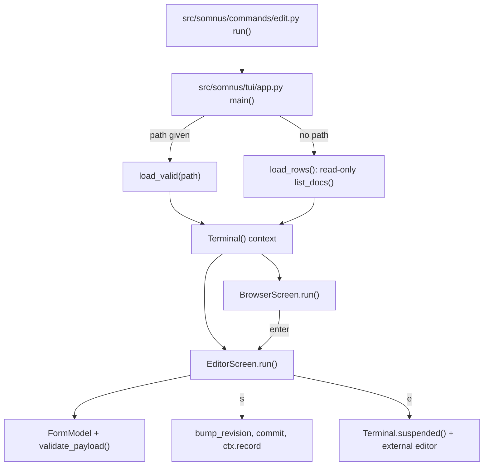

# Terminal UI

Active contributors: calisweetleaf, Christian

`somnus edit` opens a full-screen, stdlib-only terminal UI. Without a path it shows a filterable browser over the registry; with a path, or after choosing a row, it shows a header editor for a fixed set of fields that validates on every change and saves as a new revision. Registry notes are routed into the active frame instead of stderr. Coverage includes headless checks, real POSIX PTY tests, and an explicit installed-wheel acceptance harness; native Windows console paths remain unexercised.

## Purpose

- Let an operator browse registered documents and edit common header fields without hand-editing YAML. Agents get the same edits without a terminal through `somnus set`, which reuses this form model (see [Agent integration](../features/agent-integration.md)).
- Keep the same write rules as the CLI: edits are validated, every save bumps the revision, the write goes through `commit()` (core validation plus atomic write), and the action is recorded in the registry ledger.
- Keep lifecycle and authority out of the form: status, standing, scopes, ID, and revision are shown read-only, and the screen points to `somnus status` for lifecycle changes.

## Directory layout

```
src/somnus/commands/edit.py   `somnus edit` entry; refuses non-interactive stdin/stdout
src/somnus/tui/
  __init__.py   package docstring
  term.py       Terminal: platform modes, alternate screen, key decoding, frame diffing
  widgets.py    pure widgets: fit(), ListView, Picker, TextInput, split()
  form.py       FIELDS, READONLY, FormModel
  app.py        NoteBuffer, BrowserScreen, EditorScreen, main(), editor_command()
```

## Key abstractions

| Name | File path | Description |
| --- | --- | --- |
| `Terminal` | `src/somnus/tui/term.py` | Context manager for a full-screen session: enters the alternate screen and raw/VT modes, draws frames, reads keys, and restores everything on exit. |
| `_WindowsConsole` | `src/somnus/tui/term.py` | Uses `ctypes` and `kernel32` (`GetStdHandle`, `GetConsoleMode`, `SetConsoleMode`) to save both console modes and enable `ENABLE_VIRTUAL_TERMINAL_PROCESSING` on stdout. |
| `_PosixTty` | `src/somnus/tui/term.py` | Saves `termios` attributes of stdin, calls `tty.setraw`, restores with `TCSADRAIN`. |
| `decode_char`, `decode_windows_special`, `decode_escape` | `src/somnus/tui/term.py` | Pure key decoders that map raw input to names such as `up`, `pgdn`, `enter`, `esc`, `backspace`, `ctrl-c`. |
| `frame_updates()` | `src/somnus/tui/term.py` | Normalizes a frame to `rows` lines of `cols - 1` cells and returns the rows that differ from the previous frame. |
| `fit()` | `src/somnus/tui/widgets.py` | Clips and pads text to an exact cell width, counting wide CJK as 2 and combining marks as 0, keeping SGR styles and replacing other control characters with spaces. |
| `ListView` | `src/somnus/tui/widgets.py` | Scrolling selection list with a `/` case-insensitive substring filter. |
| `Picker` | `src/somnus/tui/widgets.py` | Radio list over a fixed vocabulary; marks the current value `(*)`; a letter jumps to the next choice starting with it. |
| `TextInput` | `src/somnus/tui/widgets.py` | Single-line editor with a reverse-video cursor and horizontal scrolling. |
| `split()`, `split_widths()` | `src/somnus/tui/widgets.py` | Join two columns with a ` │ ` separator at a width ratio. |
| `Field`, `FIELDS`, `READONLY` | `src/somnus/tui/form.py` | The ten editable fields and five read-only fields. |
| `FormModel` | `src/somnus/tui/form.py` | Working copy of a payload with `apply()`, `revert()`, `dirty`, and live `errors` from `validate_payload()`. |
| `BrowserScreen` | `src/somnus/tui/app.py` | Registry list on the left (55% width) and a wrapped detail pane on the right. |
| `EditorScreen` | `src/somnus/tui/app.py` | Header form with overlays, save, external body editing, and quit confirmation. |
| `NoteBuffer` | `src/somnus/tui/app.py` | Callable collector shared by browser and editor; `drain()` joins pending notes with `; ` and clears them. |
| `capture_notes()` | `src/somnus/commands/_common.py` | Re-entrant context manager installing a process-wide informational-note sink and restoring the previous sink in `finally`. |
| `main(ctx, path)` | `src/somnus/tui/app.py` | Chooses the browser or the editor and converts `TerminalError` to a `SomnusError` with exit code 2. |

## How it works

### Startup

`run()` in `src/somnus/commands/edit.py` raises a usage error (exit 2) unless both stdin and stdout are TTYs, then imports `somnus.tui.app.main` lazily. `main()` loads the work before entering the terminal: for a path it calls `load_valid(path)` (core validation must pass), otherwise `load_rows(ctx)` reads `Store.list_docs()` through a read-only connection and fails with "no registry; run 'somnus init' and 'somnus index'" when there is no database. Errors at this point print as normal diagnostics because the screen has not been switched yet.



### Terminal lifecycle

`Terminal._enter()` creates `_WindowsConsole` on Windows (`sys.platform == "win32"`) or `_PosixTty` otherwise, enables it, and writes `ENTER_SCREEN` (alternate screen, hidden cursor, clear, home). If anything fails during entry, it calls `_leave()` before re-raising. `_leave()` writes `LEAVE_SCREEN` (reset styles, show cursor, leave the alternate screen) inside `try`, and restores the saved modes in `finally`, so modes are restored even when the write fails. `__exit__` always calls `_leave()`, which covers exceptions raised inside the screens. `suspended()` is a context manager that leaves the screen, yields, and re-enters in `finally`.

`_WindowsConsole` refuses construction when `sys.platform != "win32"`; its `enable()` raises `TerminalError` when stdout is not a console or rejects VT processing. `_PosixTty.enable()` converts `termios.error` to `TerminalError`.

### Key decoding

- Windows: `msvcrt.getwch()`; a `\x00` or `\xe0` prefix is followed by a scan character decoded by `_WINDOWS_SPECIAL` (`H` up, `P` down, `K` left, `M` right, `G` home, `O` end, `I` pgup, `Q` pgdn, `S` delete).
- POSIX: bytes from `os.read` go through an incremental UTF-8 decoder. A lone ESC with nothing readable within 50 ms is `esc`. After `ESC [` or `ESC O`, characters are read until a final byte (`@` to `~`) or 16 characters, then `decode_escape()` maps CSI letters (`A`/`B`/`C`/`D`/`H`/`F`) and `~` sequences (`1`/`7` home, `4`/`8` end, `3` delete, `5` pgup, `6` pgdn). Modifier parameters such as `[1;5C` are ignored. Unknown sequences become `""`. A closed input raises `EOFError`, which ends the screen loops.
- Plain characters: `\r` and `\n` are `enter`, `\x08` and `\x7f` are `backspace`, `\t` is `tab`, `\x03` is `ctrl-c`; anything else is returned as the character.

### Frame diffing

`Terminal.draw(lines)` reads the size from `shutil.get_terminal_size()`. A size change clears the screen and forgets the previous frame. `frame_updates()` fits every row to `cols - 1` cells (the last column stays empty so terminals that scroll on a bottom-right write do not scroll) and returns only the changed rows, which are written with absolute cursor moves in one write. `invalidate()` forces a full repaint; the app calls it after saving and after returning from the editor screen.

### Widgets

All widgets are pure: they take key names and return rendered rows of exactly the given width, so they can be tested without a terminal.

| Widget | Keys |
| --- | --- |
| `ListView` | `up`/`down`/`pgup`/`pgdn`/`home`/`end` move; `/` opens the filter prompt; in the prompt printable keys extend the query, `backspace` shortens it, `enter` closes it, `esc` closes and clears it; with the prompt closed, `esc` clears an active filter. Unconsumed keys return `False` to the caller. |
| `Picker` | Navigation keys move; `enter` sets `value` and `done`; `esc` sets `cancelled` and `done`; a printable key jumps to the next matching choice. |
| `TextInput` | `left`/`right`/`home`/`end` move the cursor; `backspace`, `delete`, and printable keys edit; `enter` finishes; `esc` cancels. |

### Form model

Editable fields (`FIELDS` in `src/somnus/tui/form.py`):

| Path | Kind |
| --- | --- |
| `title` | `text` |
| `summary`, `purpose` | `optional` (empty input removes the key) |
| `classification.category`, `.type`, `.role`, `.scope` | `choice` from `vocab` |
| `classification.tags` | `tags` (comma-separated, trimmed, deduplicated in order) |
| `access.visibility`, `ingestion.disposition` | `choice` from `vocab` |

Read-only rows (`READONLY`): `id`, `revision`, `lifecycle.status`, `authority.standing`, `authority.scopes`.

`FIELDS` is also the complete list of fields `somnus set` accepts (decision D16), and `src/somnus/commands/set_fields.py` applies values through the same `FormModel.apply()`, so the two surfaces parse values identically.

`FormModel` deep-copies the payload twice (original and working copy). `apply()` raises `ValueError` for a choice outside the vocabulary; otherwise it writes the value and calls `revalidate()`, which keeps the error-severity diagnostics of `validate_payload()` (core structural and consistency checks without a body). `status()` returns `valid` or the error count with the first error. `dirty` compares working and original payloads.

### Screen key bindings

| Screen | Key | Action |
| --- | --- | --- |
| Browser | `/`, navigation | Handled by `ListView` first |
| Browser | `enter` | `load_valid()` the selected row's path; on success run `EditorScreen`, then invalidate and reload rows; on failure show the first diagnostic |
| Browser | `r` | Reload rows from the registry |
| Browser | `q`, `esc`, `ctrl-c` | Quit (`esc` only when the list did not consume it) |
| Editor | `up`/`down` | Move between fields |
| Editor | `enter` | Open a `Picker` for choice fields or a `TextInput` otherwise |
| Editor | `s` | Save |
| Editor | `u` | Revert all edits |
| Editor | `e` | Edit the body in the external editor |
| Editor | `q`, `esc`, `ctrl-c` | Quit; with unsaved changes asks "quit anyway? [y/N]" and only `y`/`Y` quits |

While an overlay is open every key goes to it. On completion the overlay value is applied to the field, or the message reports "edit cancelled" or the `ValueError` text.

### Save path

`EditorScreen.save()` refuses when the document is stale (a reload failed), when the form has errors, or when nothing changed. Otherwise it:

1. Deep-copies the working payload and calls `bump_revision()` from `src/somnus/model/lifecycle.py` (revision plus one, `time.updated_at` set to now).
2. Calls `commit(self.doc, payload)` from `src/somnus/commands/_common.py`, which renders the payload into the host, re-validates the rendered text at `core` level, and writes it atomically. `SomnusError` and `OSError` leave the file untouched and show "not saved: ...".
3. Calls `ctx.record("edit", path, id, revision, "header edited in TUI", resolve=("revision",))`, which logs an event, resolves open `revision` conflicts for the artifact, and re-observes the file when a registry exists. A registry failure is appended to the message but does not undo the write.
4. Invalidates the screen and reloads the document from disk.

### Note routing

`Ctx.record()` in `src/somnus/commands/_common.py` sends error diagnostics returned by `Store.observe()` through `note("registry: CODE message")`. Previously, a registry-wide `part_of` cycle could surface `E_GRAPH` after a successful save and write directly over the alternate-screen frame.

The owning mechanism is now `note()`, not a replacement in each caller. Many command modules import `note` by name; the function reads the module-level `_note_sink` at call time, so those existing bindings follow the active route. `capture_notes(sink)` saves the previous sink, installs the new one, and restores the previous sink in `finally`, including nested captures and exceptions. This is process-wide state, not a per-screen or thread-local channel, and it captures only `note()` calls, not arbitrary stdout/stderr or external-editor output.

`main()` in `src/somnus/tui/app.py` creates one `NoteBuffer` and wraps loading and the entire `Terminal()` session in `capture_notes(notes)`. Both `BrowserScreen.run()` and `EditorScreen.run()` drain that buffer immediately before drawing each frame. Pending notes are joined with `; `, cleared, and appended to the screen's existing status message. `BrowserScreen.open_selected()` passes the same buffer to its editor, so switching screens does not introduce a competing sink.

Normal status rows are clipped by `fit()` from `src/somnus/tui/widgets.py` to the usable width (`cols - 1`); a long diagnostic is not fully visible or scrollable there. The frame can therefore show `saved revision N; registry: E_GRAPH ...` without corrupting terminal layout. Use `somnus index` and `somnus q --conflicts` for registry diagnosis; the event ledger records the edit separately. Ordinary CLI commands install no sink: `note()` still strips trailing newlines and writes one line to stderr. Sink restoration happens after terminal cleanup, even on failure.

See [Patterns and conventions](../how-to-contribute/patterns-and-conventions.md) for the shared routing rule.

### External editor

`edit_body()` refuses while header edits are unsaved. `editor_command()` uses `$EDITOR`, then `$VISUAL`, then `notepad` on Windows or `vi` elsewhere. A value that is an existing path is used as-is (so Windows paths with spaces work); otherwise it is split with `shlex` (non-POSIX mode on Windows, with surrounding double quotes stripped). The editor runs with `subprocess.call` inside `Terminal.suspended()`. An `OSError` launching it is shown as a message; a `TerminalError` from re-entering the screen propagates. Afterwards `reload()` runs `load_valid()` again; if the file no longer passes core validation the screen keeps the old view, sets `stale`, and disables saving until a later reload succeeds.

## Integration points

- `Ctx` from `src/somnus/commands/_common.py` supplies `registry_exists()`, `readonly()`, and `record()`; that module also owns `load_valid()`, `commit()`, `note()`, and `capture_notes()`.
- `Store.list_docs()` in `src/somnus/db/store.py` provides browser rows `(id, title, type, status, standing, revision, path)`. See [Registry](registry.md).
- `validate_payload()` in `src/somnus/model/validate.py` drives live form validation; `bump_revision()` in `src/somnus/model/lifecycle.py` creates the new revision. See [Validation](validation.md) and [Lifecycle and revisions](../features/lifecycle-and-revisions.md).
- Rendering and host-byte preservation come from `Document.render()` in `src/somnus/document.py`. See [Document model](document-model.md) and [Carriers](carriers.md).
- CLI registration of `edit [PATH]` is described in [CLI commands](../features/cli-commands.md).
- `src/somnus/commands/set_fields.py` imports `FIELDS`, `Field`, `FormModel`, and `get_path` from `src/somnus/tui/form.py`. The form module has no terminal dependencies, which is what makes that reuse safe.

## Entry points for modification

- Add an editable field: append a `Field` to `FIELDS` in `src/somnus/tui/form.py`. Choice fields need a vocabulary tuple from `src/somnus/model/vocab.py`. Do not add `id`, `revision`, `lifecycle.status`, or `authority.*`; those have dedicated commands. A new field also becomes settable with `somnus set` and appears in its usage error, so update the `set` row in SPEC §20 when the list changes.
- Add a key binding: extend the `actions` mapping in `EditorScreen.handle()` or the branches in `BrowserScreen.handle()` in `src/somnus/tui/app.py`, and update the matching `_help()` or footer text.
- Add a key name: extend `_WINDOWS_SPECIAL`, `_CSI_LETTERS`, `_CSI_TILDE`, or `_PLAIN` in `src/somnus/tui/term.py`.
- Note routing: keep the sink in `src/somnus/commands/_common.py` and pass the shared `NoteBuffer` through `src/somnus/tui/app.py`; redirecting just one imported caller misses other notes.
- Tests: extend the relevant headless, registry, or POSIX PTY checks in `tests/test_tui.py`, and the installed-browser/editor checks in `tests/acceptance/installed_package_acceptance.py` when changing the consumed boundary. Native Windows behavior still needs a Windows host.

## Evidence and limits

| Boundary | Source-backed checks |
| --- | --- |
| Pure rendering and editing | `tests/test_tui.py` covers widgets, key decoding, frame diffing, form validation, and screens with `FakeScreen`/`FakeCtx`. |
| Note routing | `NoteSinkTest` checks default stderr, nested restoration, and exception restoration; `NoteBufferTest` checks join-and-clear and status absorption. `RegistryNoteRoutingTest` saves against real files/SQLite with a `part_of` cycle and separately asserts ordinary CLI stderr is unchanged. |
| POSIX terminal | `PosixTerminalTest` exercises real PTY raw-mode entry and attribute restoration with kernel-owned `PENDIN` masked, suspend/re-entry, key reads, redraw, EOF, and entry failure. Some output assertions use an in-memory stream. |
| Save chain | `TuiSaveChainPtyTest` drives `main()` through real PTY input and a real registry cycle, asserting revision 2, no registry note on stderr, and a width-bounded, cursor-positioned frame row containing `registry: E_GRAPH`. |
| Installed consumers | `tests/acceptance/installed_package_acceptance.py` explicitly builds and installs an isolated wheel outside the checkout; its PTY phases cover browser enter/leave, an editor round trip, and editor save-note routing. This harness is not collected by ordinary unittest discovery. |
| Windows | `WindowsConsoleGuardTest` checks refusal off Windows only. It does not exercise native `msvcrt` input or `ctypes` console modes. POSIX PTY coverage does not establish Windows Terminal or legacy-console behavior. |

In `tests/test_tui.py`, `PosixTerminalTest.attrs()` masks only `getattr(termios, "PENDIN", 0)` from the local-mode flags before comparison. The test comment explains that macOS sets this status bit when canonical mode toggles and `tcsetattr()` cannot restore it. Commit `b0cc64e` changes this comparison helper, not the terminal implementation in `src/somnus/tui/term.py`.

This refresh passed all 59 existing TUI tests on Linux with Python 3.12.3. It did not run on macOS or Windows. `PLAN.md` records a prior 60/60 installed-harness result, not a new result from this documentation refresh. See [Testing](../how-to-contribute/testing.md) for invocation and acceptance boundaries.

## Key source files

| File | Role |
| --- | --- |
| `src/somnus/commands/edit.py` | `somnus edit` command and TTY check |
| `src/somnus/commands/_common.py` | Shared commit/record chain and process-wide `note()` sink |
| `src/somnus/tui/app.py` | Shared `NoteBuffer`, screens, save and reload, external editor, `main()` |
| `src/somnus/tui/form.py` | Editable and read-only field tables, `FormModel` |
| `src/somnus/tui/widgets.py` | Width-exact rendering and widgets |
| `src/somnus/tui/term.py` | Platform modes, key decoding, differential redraw |
| `tests/test_tui.py` | Headless, real registry note-routing, POSIX PTY, and Windows guard tests |
| `tests/acceptance/installed_package_acceptance.py` | Explicit installed-wheel browser/editor PTY checks |

Related: [Architecture](../overview/architecture.md), [Glossary](../overview/glossary.md).
