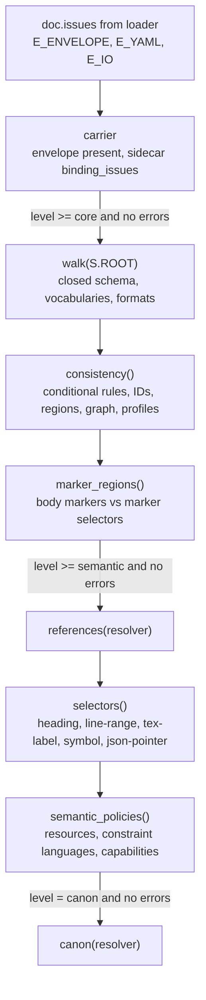
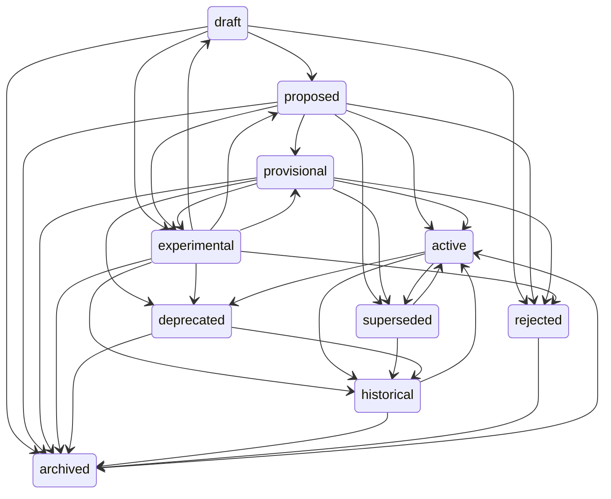

# Validation

Active contributors: calisweetleaf, Christian

The validator checks one loaded `Document` in four cumulative levels (`carrier`, `core`, `semantic`, `canon`) and returns a list of `Diagnostic` records. It is driven by a declarative schema tree, a set of controlled vocabularies, and a `Resolver` that supplies registry facts for cross-document checks. The same package holds the lifecycle state machine and the JSON Schema exporter.

## Purpose

- Enforce the core 2.0.0 contract of SPEC section 4 (closed objects, required fields, canonical order) and the profile contracts of SPEC section 6.
- Enforce authority rules (SPEC section 8), lifecycle rules (SPEC section 7), and the validation pipeline and diagnostic codes of SPEC section 19.
- Give every writing command (`new`, `stamp`, `bump`, `status`, `fork`, `edit`) one gate: `commit()` in `src/somnus/commands/_common.py` re-validates rendered text at `core` level before writing.

## Directory layout

```
src/somnus/model/
  __init__.py            package marker
  schema.py              declarative schema tree, patterns, node_at(), make_order(), describe()
  vocab.py               controlled vocabularies, relation predicates, LEVELS
  validate.py            pipeline stages, Resolver, validate(), validate_payload(), permits_use()
  lifecycle.py           TRANSITIONS table, check_transition(), apply_transition(), bump_revision()
  jsonschema_export.py   export() to JSON Schema Draft 2020-12
```

## Key abstractions

| Name | File path | Description |
| --- | --- | --- |
| `Str`, `Int`, `Num`, `Bool`, `AnyValue`, `Arr` | `src/somnus/model/schema.py` | Leaf and array schema nodes. `Str` carries an optional `enum`, full-match `pattern`, `fmt` (`timestamp` or `date`), and `min_len` (default 1, so strings are nonempty unless declared otherwise). |
| `Obj`, `Field`, `F()` | `src/somnus/model/schema.py` | Closed object node. Field declaration order is the canonical serialization order (`Obj.order`). |
| `Tagged` | `src/somnus/model/schema.py` | Object discriminated by a tag member; used only for region `selector` (tag `kind`). |
| `MapOf` | `src/somnus/model/schema.py` | Open-keyed mapping with a key pattern; used for `profile_data` and `extensions`. |
| `Union_` | `src/somnus/model/schema.py` | String-or-object choice; used for sidecar `binding.target`. |
| `SOMNUS`, `ROOT`, `PROFILES` | `src/somnus/model/schema.py` | The 25-field core payload, the `{somnus: ...}` root, and the two profile payload nodes keyed by schema URI. |
| `make_order(payload)` | `src/somnus/model/schema.py` | Builds the key-order callback passed to the YAML serializer; resolves profile payload nodes from the payload's `profiles` declarations. |
| `RELATION_PREDICATES` | `src/somnus/model/vocab.py` | Maps each registered predicate to `(inverse view name, acyclic)`. `supersedes`, `derived_from`, and `part_of` are acyclic. |
| `LEVELS`, `LEVEL_RANK` | `src/somnus/model/vocab.py`, `src/somnus/model/validate.py` | `("carrier", "core", "semantic", "canon")` and their numeric ranks. |
| `ArtifactFacts`, `Resolver` | `src/somnus/model/validate.py` | Reference-resolution context: per-artifact type, status, standing, revisions, region and claim IDs per revision, known entity URNs, and open conflict kinds per artifact. |
| `_Run` | `src/somnus/model/validate.py` | Per-document diagnostic accumulator. `err`/`warn` map a payload key path to a file position through `Document.diag`; `at` records a raw line and column. |
| `validate(doc, level, resolver)` | `src/somnus/model/validate.py` | Pipeline entry point. |
| `validate_payload(somnus)` | `src/somnus/model/validate.py` | Structural and consistency checks for an in-memory payload with no host body; used by the TUI form and `src/somnus/commands/_common.py`. |
| `permits_use(somnus, use, region_id)` | `src/somnus/model/validate.py` | Header-level answer to "may this artifact (or region) be used for `use`". |
| `TRANSITIONS` | `src/somnus/model/lifecycle.py` | Lifecycle state machine, one frozen set of targets per status. |
| `export()` | `src/somnus/model/jsonschema_export.py` | Core envelope schema as JSON Schema Draft 2020-12, with profile payloads under `$defs`. |

## How it works

### Pipeline

`validate()` in `src/somnus/model/validate.py` starts from the issues the loader already recorded (`doc.issues`, which carry `E_ENVELOPE`, `E_YAML`, `E_HOST`, and `E_IO` from `src/somnus/document.py` and the carriers). Each later stage runs only when the requested level reaches it and no error has been recorded so far.



| Level | Checks performed in code |
| --- | --- |
| `carrier` | An envelope exists (`E_ENVELOPE` "no metadata envelope found" otherwise); loader issues; for sidecars, `binding_issues()` from `src/somnus/carriers/sidecar.py` (`E_ENVELOPE`). |
| `core` | `walk()` over `S.ROOT`: types, unknown fields, required fields, enums, patterns, timestamps and dates, array minimums and uniqueness. Then `consistency()` and `marker_regions()`. |
| `semantic` | `references()` against the document, the check set, and the registry; `selectors()` for non-marker selectors; `semantic_policies()`. |
| `canon` | `canon()`: standing `accepted`, `acceptance_ref` resolving to an `active` `decision-record`, status `active` or `provisional`, no open registry conflict naming the artifact. |

`somnus check` defaults to `core`. For `semantic` and `canon` it builds a resolver with `ctx.resolver()` (registry facts via a read-only connection, or an empty `Resolver` when no registry exists) and then calls `Resolver.add_payload()` for every document in the check set, so documents checked together can reference each other (`src/somnus/commands/check.py`).

### Closed objects and unknown fields

`_walk_obj()` reports every key not declared on the `Obj` as `E_SCHEMA unknown field`; at the top of the payload the message adds a hint that experimental keys belong under `somnus.extensions`. The only open values are `AnyValue` nodes: `extensions.<owner>.data`, claim `object.value`, and `profile_data` entries (which are then walked against their own profile node if the profile URI is known). This matches SPEC section 4.2.

### Field order

The order of `Field` declarations in each `Obj` is the canonical key order. `make_order(payload)` returns a callback `order(path)` that looks up the node at a key path with `node_at()` and returns `Obj.order` or `Tagged.order` (tag first, then members in first-seen variant order). `src/somnus/document.py` passes it to `yamlsub.dumps`, which is how every write produces canonical member order. For `Union_` nodes the object option's order is used.

### Consistency rules (core level)

`consistency()` implements the conditional requirements that a schema walk cannot express:

| Rule | Code |
| --- | --- |
| `authority.scopes` empty while standing is not `unasserted` | `E_AUTHORITY` |
| Standing `accepted` without `valid_time` or `acceptance_ref` | `E_AUTHORITY` |
| Region `authority.standing: accepted` while the document is not accepted | `E_AUTHORITY` |
| Status `superseded` without `replacement_refs` | `E_SCHEMA` |
| `time.updated_at` earlier than `created_at` | `E_TEMPORAL` |
| `valid_time` basis rules: `bounded` needs `from` < `until`, `open` needs `from` and forbids `until`, `timeless`/`unknown` forbid both (checked at every depth except `extensions`) | `E_TEMPORAL` |
| `rights.status: specified` without `license_expression`, or a license expression under any other status | `E_SCHEMA` |
| Duplicate local IDs among aliases, regions, claims, relations, terms, entity aliases; duplicate entity `ref` | `E_SCHEMA` |
| Region `claim_ids` that are undeclared or whose claim points at a different region; claim, relation, term, ingestion, or `equation_region_ids` references to undeclared regions | `E_REGION` |
| Region visibility wider than the document's, or region `allowed_uses` not in the document's | `E_POLICY` |
| Claim `object` without exactly one of `ref`/`value`; `supported` assessment without `evidence_refs` | `E_SCHEMA` |
| Unregistered relation predicate | `W_PREDICATE` (preserved, not used) |
| Self-edge or cycle on an acyclic predicate within one document (`find_cycle()` depth-first search) | `E_GRAPH` |
| Profile declarations: duplicate key or schema, unknown profile URI, `profile_data` keys not equal to declared keys, profile payload walk, `normative_region_refs` to undeclared regions | `E_SCHEMA`, `E_REGION` |

`marker_regions()` runs `scan_markers()` from `src/somnus/regions.py` over the body. Carrier-level marker problems come back as `E_REGION` or `W_REGION_SPACING`. A marker selector with no paired markers is `E_REGION`; paired markers that no region registers are `W_REGION_UNREGISTERED`. Sidecars cannot carry markers, so any marker selector in a sidecar is `E_REGION`.

### Semantic level

- `references()` collects every reference position by walking the schema tree in parallel with the payload (`_collect_refs()`), skipping `extensions` and the `ref` of entity declarations. External references (`doi:`, `http(s)://`, foreign URNs) pass. Self-references check the region, claim, and revision against this document. Example URNs (`urn:somnus:example:*`) resolve only when declared as entities in the same document. Artifact URNs must exist in the resolver; pinned revisions, regions, and claims are checked against the facts for that revision. Other Somnus URNs (entity, actor, concept) must be declared locally or known to the registry. Failures are `E_REFERENCE`.
- `selectors()` resolves `heading` (text plus occurrence), `line-range` (bounds inside the file, pinned to the current revision), `tex-label` (exactly one `\label{}`), `symbol` (Python only, exactly one `def`/`class` of that name via `ast`), and `json-pointer` (sidecar only, resolved against the primary target's JSON). Failures are `E_REGION`.
- `semantic_policies()` reports missing required local resources and macro sources (`E_EXTRACTION`, plus an extra `E_EXTRACTION` when `extraction.state` is `complete` despite them), unregistered constraint languages (`E_REFERENCE`), and unknown `ingestion.requires` capabilities (`E_POLICY`).

### Canon level

`canon()` maps open registry conflicts to codes: `revision` to `E_REVISION`, `authority` to `E_AUTHORITY`, and other kinds (`duplicate-id`, `identity`) to `E_REFERENCE`.

### Diagnostic codes

| Code | Raised by |
| --- | --- |
| `E_ENVELOPE` | Carriers, `src/somnus/document.py`, `validate()` |
| `E_HOST` | `src/somnus/document.py`, `src/somnus/carriers/blockcomment.py`, `src/somnus/commands/fork.py` |
| `E_YAML` | `src/somnus/document.py` (restricted YAML parse) |
| `E_IO` | Loader, commands, `src/somnus/db/store.py` |
| `E_SCHEMA` | `walk()`, `consistency()`, `_profiles()`, `src/somnus/commands/migrate.py` |
| `E_TEMPORAL` | `walk()` formats, `consistency()` |
| `E_AUTHORITY` | `consistency()`, `canon()`, `src/somnus/db/store.py` (unreadable stored header) |
| `E_POLICY` | `consistency()`, `semantic_policies()` |
| `E_REGION` | `consistency()`, `marker_regions()`, `selectors()`, `src/somnus/regions.py` |
| `E_GRAPH` | `consistency()`, `Store.graph_cycles()` |
| `E_REFERENCE` | `references()`, `semantic_policies()`, `canon()` |
| `E_EXTRACTION` | `semantic_policies()` |
| `E_REVISION` | `canon()` |
| `E_LIFECYCLE` | `src/somnus/commands/status.py` (from `check_transition()`) |
| `W_PREDICATE`, `W_REGION_UNREGISTERED` | `consistency()`, `marker_regions()` |
| `W_REGION_SPACING` | `src/somnus/regions.py` |
| `W_UNMANAGED` | `src/somnus/commands/check.py` |

Diagnostics render as `path:line:col: severity CODE field: message` through `src/somnus/output.py`.

### Lifecycle state machine

`TRANSITIONS` in `src/somnus/model/lifecycle.py` is the complete table (it matches SPEC section 7.1):



- `check_transition(current, target, reason, replacement_refs)` returns refusal reasons: unknown status, no-op, a target not in the table, a missing reason for abandonment (`draft`/`proposed`/`provisional`/`experimental` to `archived`) or reactivation (`historical`/`superseded`/`archived` to `active`), and `superseded` with no replacement.
- `apply_transition()` deep-copies the payload, sets the status, sets or removes `reason`, merges replacement refs (dropping them for targets other than `superseded`, `historical`, `archived`), demotes `accepted` standing to `candidate` and drops `valid_time`/`acceptance_ref` on reactivation, and calls `bump_revision()`.
- `bump_revision()` increments `revision` and sets `time.updated_at` to now (UTC, seconds), clamped so it never precedes `created_at`.

### permits_use

`permits_use(somnus, use, region_id=None)` starts from `access.allowed_uses`, intersects with `{archive}` when `ingestion.disposition` is `excluded` and with `{archive, search}` when it is `archive-only`. For a region it also intersects with the region's own `allowed_uses` and reduces to `{archive}` when the region is in `ingestion.exclude_regions`. The docstring notes that external policy may be stricter.

### JSON Schema export

`export()` in `src/somnus/model/jsonschema_export.py` emits a Draft 2020-12 document with `$id` set to the core schema URI. Every `Obj` becomes `"additionalProperties": false` with `required` and per-field `description`; `Tagged` becomes `oneOf` with a `const` tag; `MapOf` becomes `propertyNames` plus `additionalProperties`; `AnyValue` becomes `{"not": {"type": "null"}}`. Profile nodes are added to `$defs` with a `$comment` naming their URI. The top-level `$comment` states that restricted YAML, cross-field consistency, references, regions, and profile key binding are enforced only by the somnus validator. The export is interchange only and is never stored (decision D4). It is reached through `somnus schema --json-schema` in `src/somnus/commands/schema.py`.

## Integration points

- `src/somnus/document.py` supplies `Document` (lines, envelope, payload, `diag()` for key-path positions) and imports `make_order` for serialization. See [Document model](document-model.md) and [YAML subset](yaml-subset.md).
- `src/somnus/carriers/sidecar.py` supplies `binding_issues()` and `primary_target()`; `src/somnus/regions.py` supplies marker scanning, headings, and TeX labels. See [Carriers](carriers.md).
- `src/somnus/db/store.py` calls `validate(doc, "core")` before indexing, reuses `find_cycle()` for registry-wide cycles, and builds `Resolver` objects with `Store.resolver()`. See [Registry](registry.md).
- `src/somnus/commands/_common.py` provides `load_valid()` and `commit()`/`check_text()`, the gates used by every writing command and the TUI. See [CLI commands](../features/cli-commands.md).
- `src/somnus/commands/status.py` uses `check_transition()` and `apply_transition()`. See [Lifecycle and revisions](../features/lifecycle-and-revisions.md).
- `src/somnus/tui/form.py` uses `validate_payload()` for live form validation. See [Terminal UI](tui.md).

## Entry points for modification

- New core field or vocabulary value: add the `F(...)` entry in `src/somnus/model/schema.py` in its canonical position, or the value in `src/somnus/model/vocab.py`. SPEC section 5.2 treats this as a schema release, so `SPEC.md` changes first.
- New conditional rule: add it to `consistency()` (core) or the semantic stage functions in `src/somnus/model/validate.py`, and add a fixture test in `tests/test_validate.py` or `tests/test_conformance.py`.
- New profile: define an `Obj` in `src/somnus/model/schema.py`, register it in `PROFILES`, and add the URI constant to `src/somnus/__init__.py`.
- New selector kind: add a variant to `SELECTOR`, the kind to `vocab.SELECTOR_KINDS`, and a branch in `selectors()`.
- Lifecycle changes: edit `TRANSITIONS`, `ABANDONABLE`, and `REACTIVATABLE` in `src/somnus/model/lifecycle.py` together with SPEC section 7.1; `tests/test_lifecycle.py` covers the table.

## Key source files

| File | Role |
| --- | --- |
| `src/somnus/model/validate.py` | Pipeline stages, `Resolver`, `validate()`, `validate_payload()`, `permits_use()`, `find_cycle()` |
| `src/somnus/model/schema.py` | Schema node types, core and profile trees, `node_at()`, `make_order()`, `describe()` |
| `src/somnus/model/vocab.py` | Controlled vocabularies, `RELATION_PREDICATES`, `VISIBILITY_RANK`, `LEVELS` |
| `src/somnus/model/lifecycle.py` | Transition table and revision bumping |
| `src/somnus/model/jsonschema_export.py` | Draft 2020-12 export |
| `src/somnus/commands/check.py` | `somnus check`: level selection and check-set resolver |
| `tests/test_validate.py`, `tests/test_lifecycle.py`, `tests/test_conformance.py` | Validator, state machine, and SPEC section 21 fixture tests |

Related: [Architecture](../overview/architecture.md), [Glossary](../overview/glossary.md), [Data models](../reference/data-models.md), [Design decisions](../background/design-decisions.md).
