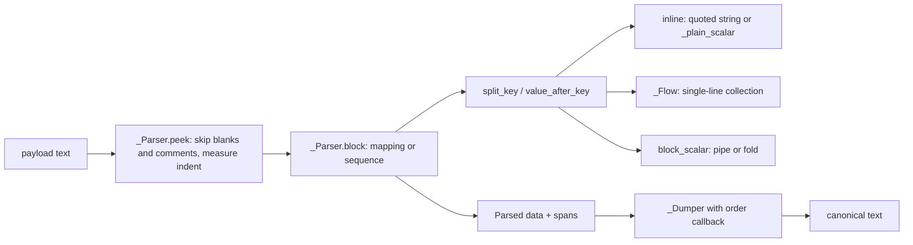

# YAML subset

Active contributors: calisweetleaf, Christian

`src/somnus/yamlsub.py` is a self-contained parser and canonical serializer for the restricted YAML 1.2.2 subset that every Somnus payload uses (SPEC section 16). It has no dependencies, records source positions for diagnostics, and guarantees that `dumps(loads(s)) == s` for canonical input.

## Purpose

Headers must mean the same thing to every reader and must round-trip byte for byte. Full YAML has implicit typing (`NO` becomes `false`, `2026-10-11` becomes a date), anchors, tags, and other features that make that impossible. The subset removes them, so a payload has one reading and one canonical spelling. The rationale is decision D7; see [design decisions](../background/design-decisions.md).

## Directory layout

```
src/somnus/
  yamlsub.py          parser (_Parser, _Flow), scalars, serializer (_Dumper)
  document.py         canonical_yaml() wraps dumps() with schema key order
  model/schema.py     make_order() supplies the declared key order
tests/
  test_yamlsub.py     parser and serializer tests
```

## Key abstractions

| Name | File path | Description |
| --- | --- | --- |
| `parse(text, lenient=False)` | `src/somnus/yamlsub.py` | Parses a document and returns `Parsed` (data plus spans). |
| `loads(text, lenient=False)` | `src/somnus/yamlsub.py` | Same as `parse` but returns only the value. |
| `dumps(value, order=, forbid=, width=88)` | `src/somnus/yamlsub.py` | Canonical serializer; output always ends with `\n`. |
| `Parsed` | `src/somnus/yamlsub.py` | Dataclass with `data` and `spans`; `position(path)` walks up to the nearest recorded span. |
| `YAMLError` | `src/somnus/yamlsub.py` | `ValueError` subclass carrying `message`, 1-based `line` and `col`. |
| `_Parser` | `src/somnus/yamlsub.py` | Line-based block parser for mappings, sequences, and block scalars. |
| `_Flow` | `src/somnus/yamlsub.py` | Character parser for single-line `[...]` and `{...}` collections. |
| `_Dumper` | `src/somnus/yamlsub.py` | Emits mappings and sequences in canonical layout. |
| `iter_strings(value)` | `src/somnus/yamlsub.py` | Yields every key and string value in a parsed tree. |
| `SAFE_INT` | `src/somnus/yamlsub.py` | `2**53 - 1`, the integer bound for both parse and dump. |

## How it works



### Line scanning

`_Parser.__init__` drops a leading U+FEFF and normalizes `\r\n` and `\r` to `\n`. `peek()` skips blank lines and lines whose first non-space character is `#`, then:

- `_measure` counts leading spaces and raises "tab characters are forbidden in indentation" on any tab before content.
- At column 0, `---`, `...`, or a line starting with `--- ` raises "document markers are forbidden inside the payload". A line starting with `%` raises "directives are forbidden".
- `_strip_comment` removes a trailing `#` comment only when the `#` follows a space or tab and is outside single or double quotes.

`document()` requires non-empty input that starts at column 1 and rejects any content left over after the top-level block.

### Block structure

`block()` dispatches to `sequence()` when the line is `-` or starts with `- `, otherwise to `mapping()`. Child indentation is taken from the first child line, and siblings must match it exactly ("unexpected indentation" otherwise). The parser does not enforce a two-space step; `a:\n    b: 1` parses. Only the serializer fixes indentation at two spaces.

`split_key` accepts a quoted key or a plain key matching `[A-Za-z_$][A-Za-z0-9_.$\-]*`, requires `:` directly after it, and requires a space after the colon. `_check_plain_key` rejects `<<` (merge keys) and the plain words in `_RESERVED_PLAIN` (`null`, `~`, `true`, `False`, and so on) as "non-string mapping key". Flow-collection keys (`[`/`{`) as block keys are refused. Duplicate keys raise at every depth, in both block and flow mappings.

A key with no inline value must be followed by a more-indented block or by a sequence at the same indent. Otherwise the parser raises "missing value; null is forbidden". An empty `-` item with nothing nested raises "empty sequence item; null is forbidden".

### Scalars

Quoted strings are single-line. `_read_double` supports the YAML escape set (`\0 \a \b \t \n \v \f \r \e \" \/ \\ \N \_ \L \P` and escaped space) plus `\xXX`, `\uXXXX`, and `\UXXXXXXXX`, and rejects unknown escapes, malformed hex, and code points above U+10FFFF. `_read_single` treats `''` as a literal quote.

`_plain_scalar` decides every unquoted value:

| Input | Result |
| --- | --- |
| empty, `null`, `Null`, `NULL`, `~` | `YAMLError` (null is forbidden) |
| starts with `&`, `*`, `!` | `YAMLError` (anchors, aliases, tags) |
| starts with `@`, `` ` ``, `%` | `YAMLError` (reserved indicator) |
| `true`, `false` (lowercase only) | `bool` |
| `-?(0\|[1-9][0-9]*)` | `int`, rejected outside ±(2^53 − 1) |
| decimal with optional fraction and exponent | finite `float`; `.inf` and `.nan` are rejected |
| anything else | `YAMLError` "strings must be quoted", or the raw token when `lenient=True` |

There is no implicit typing beyond this table. `True`, `yes`, `on`, and `2026-10-11` unquoted are errors in strict mode, and quoted they are always strings.

### Strict and lenient modes

Strict mode is the default everywhere. `lenient=True` only changes the last row of the table: unquoted plain strings are returned as strings instead of raising. It exists to read v0.1 headers during migration, and its only callers are in `src/somnus/commands/migrate.py`. `src/somnus/document.py` threads the flag through `load()` and `from_text()`. Every other rule, including null, anchor, and duplicate-key refusal, still applies in lenient mode.

### Block scalars

`block_scalar` accepts the headers `|`, `>`, `|-`, `|+`, `>-`, and `>+`. Explicit indentation indicators are refused ("unsupported block scalar header"), and the header must end its line. The block indent comes from the first non-blank line, which must be deeper than the parent key. Lines inside the block are read raw, so `#` is content there, not a comment. Tabs in a block line's indentation are still refused.

Chomping follows YAML: clip (no indicator) keeps one final newline, `-` strips all trailing newlines, and `+` keeps them all. `_fold` joins `>` lines with spaces, keeps blank lines as newlines, and leaves more-indented lines unfolded. The serializer never emits block scalars.

### Flow collections

`_Flow` parses `[...]` and `{...}` that open and close on the same line. Items may be quoted strings, plain scalars, or nested flow collections. Trailing commas in sequences, missing `:` after a flow key, and text after the closing bracket raise errors.

### Spans and positions

Every mapping key, sequence item, and flow value records `spans[path] = (line, col)`, where `path` is a tuple of string keys and integer indices and positions are 1-based within the payload. `Parsed.position(path)` returns the nearest ancestor's span. `Document.pos` in `src/somnus/document.py` adds the envelope's `payload_start` and `col_offset` to turn this into a file position, which is what diagnostics print. See [Document model](document-model.md).

### Canonical serializer

`dumps(value, order=None, forbid=None, width=88)` requires a top-level `dict` and implements SPEC section 16.2:

- **Key order.** `order(path)` returns the declared key list for the mapping at `path` (sequence items appear as `"[]"` in the path). Declared keys present in the dict come first in declared order, then any other keys in source order. `canonical_yaml` in `src/somnus/document.py` passes `make_order(root)` from `src/somnus/model/schema.py`.
- **Keys.** Plain when they match the plain-key pattern and are not reserved; otherwise double-quoted.
- **Strings.** Always double-quoted by `_quote`. It escapes `\`, `"`, `\n`, `\t`, `\r`, and writes other C0 controls, DEL, C1 controls (U+0080 to U+009F), U+2028, U+2029, and U+FEFF as `\uXXXX`. Other Unicode stays literal.
- **Numbers and booleans.** `true`/`false`, `str(int)` within `SAFE_INT`, and `repr(float)` for finite floats. `None` raises "null cannot be serialized; omit the field".
- **Flow or block.** A list of scalars is written as `key: ["a", "b"]` when the whole line, including indentation and key, fits in `width` (88) columns; otherwise each item gets its own `- ` line indented two spaces under the key. Lists containing mappings are always block form. Empty containers are `[]` and `{}`.
- **Carrier escaping.** `forbid="html"` writes every `-` that follows another `-` as `\u002d`, so `--` can never appear in an HTML or XML comment envelope. `forbid="block"` writes every `/` that follows `*` as `\u002f`, so `*/` cannot close a CSS envelope early. `Document.render` chooses the mode from the carrier; see [Carriers](carriers.md).

## Integration points

- `src/somnus/document.py` calls `yamlsub.parse` on every envelope payload in `_parse_into`, converting `YAMLError` into an `E_YAML` diagnostic at the file position, and calls `yamlsub.dumps` through `canonical_yaml` for every write and for `payload_digest`.
- `src/somnus/model/schema.py` supplies key order through `make_order`.
- `src/somnus/commands/migrate.py` is the only caller of lenient parsing.
- Validation in `src/somnus/model/validate.py` consumes the parsed tree and spans; see [Validation](validation.md).

## Entry points for modification

- To accept or reject a new kind of plain scalar, change `_plain_scalar` and the `_INT_RE`, `_FLOAT_RE`, `_NULLS`, and `_RESERVED_PLAIN` constants. Keep SPEC section 16.1 in sync, since SPEC is normative.
- To change canonical layout (width, quoting, escapes), edit `_quote`, `_scalar`, and `_Dumper`. Any change alters `payload_digest` values stored in the registry, so existing revisions would no longer match.
- Add a carrier-specific escape by adding a `forbid` mode in `_quote` and setting it on the carrier.
- Tests live in `tests/test_yamlsub.py`; the round-trip property is also exercised by `tests/test_conformance.py`.

## Key source files

| File | Role |
| --- | --- |
| `src/somnus/yamlsub.py` | Parser, scalar rules, serializer |
| `src/somnus/document.py` | `canonical_yaml`, `_parse_into` (error-to-diagnostic mapping) |
| `src/somnus/model/schema.py` | `make_order` key order |
| `src/somnus/commands/migrate.py` | Lenient parsing of v0.1 headers |
| `tests/test_yamlsub.py` | Unit tests |
| `SPEC.md` | Section 16, the normative serialization rules |

Related: [Architecture](../overview/architecture.md), [Glossary](../overview/glossary.md), [Data models](../reference/data-models.md).
