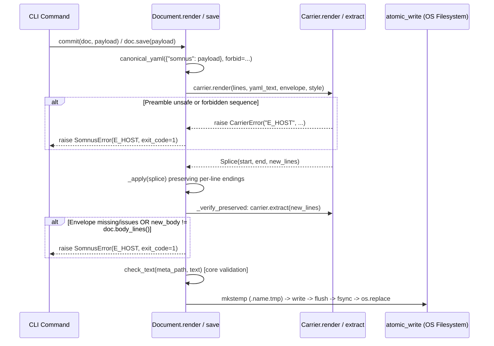

# Runbook: Host-Byte Preservation and `E_HOST` Incident Response

```
DOCUMENT TITLE: Host-Byte Preservation and E_HOST Incident Response Runbook
Classification: INTERNAL
Version: 1.0
Date: 2026-10-22
Author/Origin: somnus-metadata engineering
Status: OPERATIONAL
```

## 1. Executive Summary

This runbook defines the diagnostic, containment, and recovery procedures for `E_HOST` refusals and unexpected host-file modifications in the Somnus metadata toolkit. Under `SPEC.md` §§16.3, 17, and 19.2 and ratified decision D8, every write to a managed host file must preserve all bytes outside the metadata envelope (`E_HOST` otherwise). When a write is refused with `E_HOST` or when an external tool corrupts a managed file's envelope or body, operators use this runbook to diagnose the exact trigger, inspect the file against its carrier contract, apply safe dry-run diffs (`somnus stamp`), and recover last-known-good headers and digests from the global SQLite registry (`~/.somnus/somnus.db`).

## 2. Table of Contents

1. [Executive Summary](#1-executive-summary)
2. [Table of Contents](#2-table-of-contents)
3. [Technical Specifications: `E_HOST` and Carrier Contracts](#3-technical-specifications-e_host-and-carrier-contracts)
4. [Write Verification Pipeline](#4-write-verification-pipeline)
5. [Operational Procedures](#5-operational-procedures)
   - [5.1 Diagnosing an `E_HOST` Refusal](#51-diagnosing-an-e_host-refusal)
   - [5.2 Inspecting a Damaged or Modified File](#52-inspecting-a-damaged-or-modified-file)
   - [5.3 Safe Envelope Injection: `somnus stamp` vs. `somnus stamp --write`](#53-safe-envelope-injection-somnus-stamp-vs-somnus-stamp---write)
   - [5.4 Recoverability from the Global Registry (`somnus.db`)](#54-recoverability-from-the-global-registry-somnusdb)
6. [Security and Data-Preservation Invariants](#6-security-and-data-preservation-invariants)
7. [Validation and Verification Criteria](#7-validation-and-verification-criteria)

## 3. Technical Specifications: `E_HOST` and Carrier Contracts

Per `SPEC.md` §19.2, diagnostic code `E_HOST` means **Placement would alter host semantics** and exits with code `1` (`EXIT_INVALID`, `src/somnus/output.py:10`). Every condition in the toolkit that raises `E_HOST` is enumerated below from the implementation source:

| Trigger Condition | Exact Diagnostic Message | Source Location & SPEC Reference |
| --- | --- | --- |
| Post-render body mismatch or envelope re-extraction failure | `refusing to write: content outside the envelope would change` | `src/somnus/document.py:156-169` (`Document._verify_preserved`), `SPEC.md` §16.3, §17 |
| CSS `@charset` preamble shared with other tokens on line 1 | `@charset declaration must be alone on the first line` | `src/somnus/carriers/blockcomment.py:29-31` (`BlockCarrier.preamble_end`), `SPEC.md` §17.5 |
| Multi-line XML declaration (`<?xml ...` without `?>` on same line) | `multi-line XML declaration cannot be preserved safely` | `src/somnus/carriers/blockcomment.py:36-38`, `SPEC.md` §17.5 |
| Multi-line `<!DOCTYPE` declaration (without `>` on same line) | `multi-line DOCTYPE cannot be preserved safely` | `src/somnus/carriers/blockcomment.py:40-42`, `SPEC.md` §17.5 |
| Block-comment payload contains unescaped closer (`*/` in CSS or `--` in XML) | `payload contains '*/'; use a sidecar` (or `'--'`) | `src/somnus/carriers/blockcomment.py:94-96` (`BlockCarrier.render`), `SPEC.md` §17.4 |
| `somnus fork --out` targets an extension with a different carrier type | `--out must use the same carrier type as the parent` | `src/somnus/commands/fork.py:81-82`, `SPEC.md` §17, §20 |

### Mandatory Host Preambles (`SPEC.md` §17.5)

Inserting an envelope at byte 0 regardless of host is forbidden (`SPEC.md` §17.5). Line-comment and block-comment carriers preserve mandatory host preambles before placing the envelope:

| Host / Carrier | Preserved Before Envelope (`preamble_end`) | Implementation |
| --- | --- | --- |
| Python (`python`) | Line-1 `#!` shebang; encoding cookie (`coding[:=]`) on line 1, or on line 2 when line 1 is a comment | `src/somnus/carriers/linecomment.py:19-25` |
| Shell, R, JS/TS (`shell`, `r`, `js`) | Line-1 `#!` shebang | `src/somnus/carriers/linecomment.py:19-20` |
| PowerShell (`powershell`) | Line-1 `#!` shebang and all contiguous leading `#Requires` lines (case-insensitive) | `src/somnus/carriers/linecomment.py:19-20, 26-28` |
| TeX (`tex`) | Contiguous leading `% !TeX ...` magic comments (case-insensitive) | `src/somnus/carriers/linecomment.py:29-31` |
| CSS (`css`) | Single-line `@charset "...";` on line 1 | `src/somnus/carriers/blockcomment.py:28-33` |
| XML/HTML/SVG (`xml`) | Contiguous single-line `<?xml ...?>` and `<!DOCTYPE ...>` declarations | `src/somnus/carriers/blockcomment.py:34-46` |
| Unrecognized extensions (`.json`, `.pdf`, `.png`, `.ipynb`, etc.) | Detached `<file>.somnus.yaml` sidecar (`SIDECAR`); host file bytes are never touched | `src/somnus/carriers/__init__.py:14, 156-167`, `SPEC.md` §17.6 |

## 4. Write Verification Pipeline



**Annotation:** When `E_HOST` fires during `doc.render()` or `doc._verify_preserved()`, it aborts in memory **before** `atomic_write` (`src/somnus/document.py:207-225`) is called. An `E_HOST` refusal from a Somnus command never leaves a partially written file on disk.

## 5. Operational Procedures

> **Note:** In a source checkout without an installed `somnus` binary on `PATH`, replace `somnus` in the commands below with `PYTHONPATH=src python -m somnus.cli`.

### 5.1 Diagnosing an `E_HOST` Refusal

When a command exits with code `1` and prints `path:line:col: error E_HOST -: <message>`, match `<message>` against the table below:

1. **`@charset declaration must be alone on the first line` / `multi-line XML declaration cannot be preserved safely` / `multi-line DOCTYPE cannot be preserved safely`:**
   - **Cause:** The CSS or XML/HTML/SVG host file has a leading preamble that spans multiple lines or shares line 1 with CSS rules (`src/somnus/carriers/blockcomment.py:28-46`).
   - **Remediation:** Format the host's `@charset`, `<?xml ...?>`, or `<!DOCTYPE ...>` onto a single dedicated leading line, or manage the artifact via a `<file>.somnus.yaml` sidecar if the host declaration cannot be normalized.

2. **`--out must use the same carrier type as the parent`:**
   - **Cause:** `somnus fork PATH --out OTHER` specified an output filename whose extension maps to a different carrier than `PATH` (`src/somnus/commands/fork.py:81-82`).
   - **Remediation:** Provide an `--out` path with an extension belonging to the same carrier family (see `src/somnus/carriers/__init__.py:115-129`).

3. **`refusing to write: content outside the envelope would change`:**
   - **Cause:** `Document._verify_preserved` (`src/somnus/document.py:156-169`) re-extracted the envelope from the rendered candidate text and found either (a) carrier extraction issues (`extraction.issues` non-empty, such as a duplicate envelope or unclosed delimiter), (b) `extraction.envelope is None` (e.g., an envelope was inserted after a non-comment host line), or (c) `new_body != self.body_lines()`.
   - **Remediation:** Run `somnus check PATH --level carrier` to check for pre-existing duplicate or malformed envelopes in the file. Verify that no decoy `<!-- somnus:metadata:v2` or `# somnus:metadata:v2` opener appears ahead of the intended envelope.

### 5.2 Inspecting a Damaged or Modified File

When a file is suspected of out-of-band corruption (e.g., an external formatter, editor, or whitespace hook altered the envelope or body):

1. **Run carrier and core validation:**

   ```sh
   somnus check PATH --level carrier
   somnus check PATH --level core
   ```

2. **Compare the live file's digests against the last indexed revision in `somnus.db`:**
   `Document.payload_digest()` computes the SHA-256 of `canonical_yaml(doc.data)` (`src/somnus/document.py:109-111`). `Document.body_digest()` computes the SHA-256 of UTF-8 host bytes outside the envelope with line endings normalized to LF (`\n`) (`src/somnus/document.py:98-107`, `SPEC.md` §18.3). Run this read-only diagnostic script to compare the file on disk against the registry:

   ```sh
   PYTHONPATH=src python3 - PATH <<'PY'
   import sys
   from pathlib import Path
   from somnus import config, document as D
   from somnus.db import connect_readonly

   target = Path(sys.argv[1]).resolve()
   doc = D.load(target)
   print("File:", target)
   print("Carrier:", doc.carrier.name, "| BOM:", doc.had_bom, "| Issues:", len(doc.issues))
   for issue in doc.issues:
       print("  Issue:", issue.code, issue.message)

   if doc.payload:
       aid = doc.payload.get("id")
       rev = doc.payload.get("revision")
       pd, bd = doc.payload_digest(), doc.body_digest()
       print(f"Live    -> id={aid} rev={rev}")
       print(f"Live    -> payload_digest={pd}")
       print(f"Live    -> body_digest   ={bd}")

       cfg = config.load(target.parent)
       if cfg.db_path.exists():
           conn = connect_readonly(cfg.db_path)
           row = conn.execute(
               "SELECT payload_digest, body_digest, observed_at FROM revisions WHERE artifact_id = ? AND revision = ?",
               (aid, rev),
           ).fetchone()
           conn.close()
           if row:
               print(f"Stored  -> payload_digest={row[0]} (match={row[0] == pd})")
               print(f"Stored  -> body_digest   ={row[1]} (match={row[1] == bd})")
               print(f"Stored  -> observed_at   ={row[2]}")
           else:
               print("Stored  -> (no stored row for this id and revision)")
   PY
   ```

3. **Check git working-tree diff (when inside a git repository):**

   ```sh
   git diff -- PATH
   ```

### 5.3 Safe Envelope Injection: `somnus stamp` vs. `somnus stamp --write`

`somnus stamp` (`src/somnus/commands/stamp.py`, `SPEC.md` §20, D6) infers and injects a `somnus:` header into unmanaged files:

- **Already-managed guard (`src/somnus/commands/stamp.py:15-20, 46-48`):** If `doc.envelope is not None`, `doc.issues` is non-empty, or (for sidecar hosts) `<file>.somnus.yaml` already exists, `somnus stamp` prints `<path>: already managed; skipped` to stderr and makes no changes. It will never overwrite an existing envelope.
- **No fabricated timestamps (`DECISIONS.md` D6, `src/somnus/commands/_common.py:217-225`):** Unlike `somnus new`, `somnus stamp` writes `time: {}` because the true creation time of a pre-existing unmanaged file is unknown.
- **Dry-run by default (`src/somnus/commands/stamp.py:50-52`):** Invoking `somnus stamp PATH` without `--write` renders the candidate file in memory, runs both `Document._verify_preserved()` (`E_HOST` check) and `check_text()` (core validation), and emits a unified diff (`--- a/PATH`, `+++ b/PATH`) to stdout without touching the filesystem.
- **Atomic write with `--write` (`src/somnus/commands/stamp.py:53-55`):** Only after dry-run verification succeeds should `--write` be passed:

  ```sh
  # Step 1: Preview the exact splice and verify E_HOST / core rules in memory
  somnus stamp PATH

  # Step 2: Apply atomically via tempfile + fsync + os.replace and record in registry
  somnus stamp --write PATH
  ```

### 5.4 Recoverability from the Global Registry (`somnus.db`)

When a managed file on disk is damaged or deleted, understand exactly what `~/.somnus/somnus.db` stores (`src/somnus/db/schema.sql:26-37`, `SPEC.md` §18.2):

| Artifact Component | Stored in `somnus.db`? | Recovery Capability |
| --- | --- | --- |
| Metadata Header (`somnus:` block) | **Yes** — `revisions.header_yaml` stores the complete canonical restricted-YAML text of every indexed revision. | **100% recoverable** for any previously indexed revision. |
| Host Body Content (bytes outside envelope) | **No** — `revisions.body_digest` and `locations.body_digest` store only the 64-character SHA-256 hex digest of the LF-normalized host body. | **Not recoverable from `somnus.db`**. Body bytes must be restored from Git (`git checkout` / `git restore`), filesystem backups, or a byte-identical mirror location recorded in `locations`. |
| Other Frontmatter Keys (Markdown host keys outside `somnus:`) | **No** — preserved in the file on disk (`SPEC.md` §4, §17.1), included in `body_digest`, not copied into `revisions.header_yaml`. | Recover from Git or backups; verify restoration against `revisions.body_digest`. |

#### Procedure: Recovering a Damaged Header from `revisions.header_yaml`

If a file's host body is intact (or restored from Git/backup) but its `somnus:` envelope was corrupted or accidentally stripped, extract the exact canonical YAML header for its latest (or specific) revision from `~/.somnus/somnus.db`:

```sh
# 1. Query the revision history for the file path or artifact ID
somnus q "SELECT r.artifact_id, r.revision, r.observed_at, l.rel_path FROM revisions r JOIN locations l ON l.artifact_id = r.artifact_id WHERE l.rel_path LIKE '%<FILENAME>%' ORDER BY r.revision DESC"

# 2. Extract the stored canonical header_yaml for a known artifact_id and revision
PYTHONPATH=src python3 - "urn:somnus:artifact:<UUID>" "<REVISION>" <<'PY'
import sys
from somnus import config
from somnus.db import connect_readonly

aid, rev = sys.argv[1], int(sys.argv[2])
cfg = config.load()
conn = connect_readonly(cfg.db_path)
row = conn.execute(
    "SELECT header_yaml, payload_digest, body_digest FROM revisions WHERE artifact_id = ? AND revision = ?",
    (aid, rev),
).fetchone()
conn.close()
if not row:
    sys.exit(f"No stored revision found for {aid} rev {rev}")
print(f"# payload_digest: {row[1]}")
print(f"# body_digest:    {row[2]}")
print(row[0], end="")
PY
```

Once the header is restored into the file's carrier envelope (or `<file>.somnus.yaml` sidecar), verify that both `payload_digest` and `body_digest` match the stored revision and that `somnus index --full` reports zero conflicts.

## 6. Security and Data-Preservation Invariants

- **Atomic Replacement (`src/somnus/document.py:207-225`):** `atomic_write` writes UTF-8 bytes to `.{name}.{random}.tmp` in the same directory, flushes and calls `os.fsync()`, copies file mode bits (`os.chmod`), and executes `os.replace()`. If any exception occurs prior to `os.replace()`, the temporary file is unlinked in the `except BaseException:` handler.
- **Line-Ending and BOM Fidelity (`src/somnus/document.py:20-40, 143-154, 228-236`):** `_split` retains each line's exact line ending (`\r\n`, `\n`, `\r`, or `""`). `_apply` preserves existing line endings on untouched host lines and uses `_dominant_newline` for newly spliced envelope lines. A leading UTF-8 BOM (`\xef\xbb\xbf`) is stripped on load and never re-emitted (`DECISIONS.md` D8). Non-UTF-8 files raise `E_IO` (`file is not valid UTF-8 ...; use a sidecar`, exit code `1`).
- **Pre-Commit Hook Exclusions (`.pre-commit-config.yaml:28-31`):** `trailing-whitespace` and `end-of-file-fixer` explicitly exclude `\.md$|^archives?/|^tests/` because Somnus-managed Markdown artifacts and test fixtures are byte-sensitive.

## 7. Validation and Verification Criteria

After resolving an `E_HOST` incident or restoring a damaged envelope:

```sh
# 1. Validate the recovered file at semantic level
PYTHONPATH=src python -m somnus.cli check PATH --level semantic

# 2. Re-index with --full to confirm no revision or identity conflict opens
PYTHONPATH=src python -m somnus.cli index --full

# 3. Run the 21-fixture conformance suite and unit test suite
PYTHONPATH=src python -m unittest discover -s tests
```
