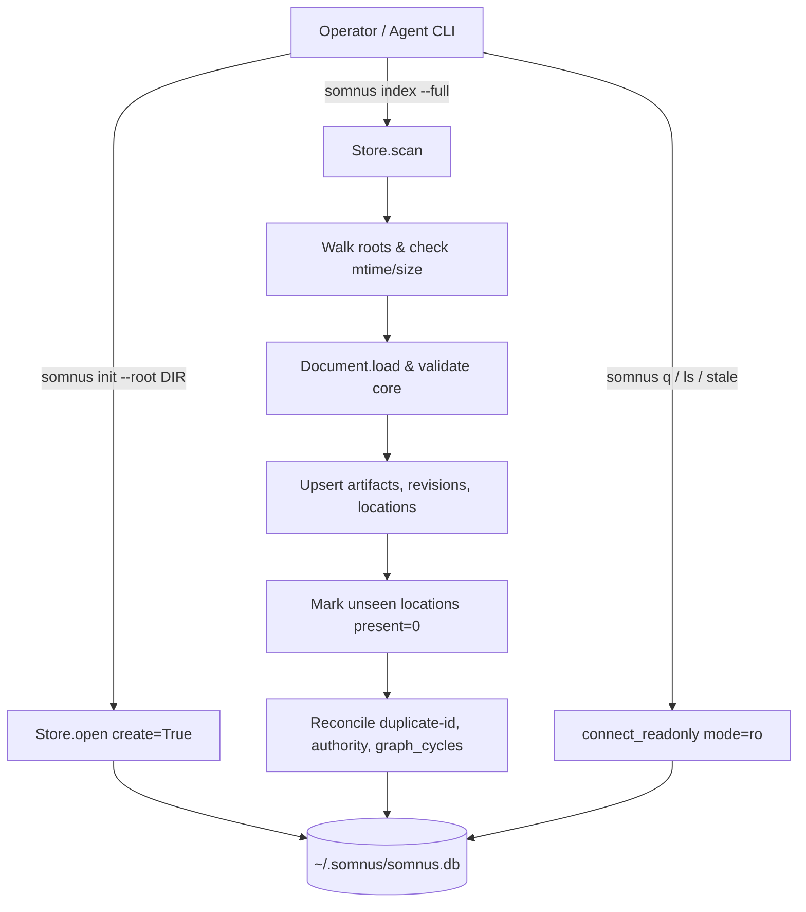

# Runbook: Global Registry Recovery and Reconciliation

```
DOCUMENT TITLE: Global Registry Recovery and Reconciliation Runbook
Classification: INTERNAL
Version: 1.0
Date: 2026-10-22
Author/Origin: somnus-metadata engineering
Status: OPERATIONAL
```

## 1. Executive Summary

This runbook specifies the operational procedures for inspecting, backing up, restoring, and reconciling the Somnus global SQLite registry (`$SOMNUS_HOME/somnus.db`, default `~/.somnus/somnus.db`). The registry is an observation store and append-only event ledger defined in `SPEC.md` §18 and ratified decision D4; it holds revision history, observed filesystem locations, knowledge records, and conflict states without storing JSON. Following host directory moves, out-of-band file edits, or SQLite database corruption, operators execute these procedures to restore registry integrity and resolve open conflicts without inventing metadata or mutating host body bytes.

## 2. Table of Contents

1. [Executive Summary](#1-executive-summary)
2. [Table of Contents](#2-table-of-contents)
3. [Technical Specifications](#3-technical-specifications)
4. [Registry Architecture and State Flow](#4-registry-architecture-and-state-flow)
5. [Operational Procedures](#5-operational-procedures)
   - [5.1 Read-Only Inspection and Conflict Triage](#51-read-only-inspection-and-conflict-triage)
   - [5.2 SQLite Backup and Restore of somnus.db](#52-sqlite-backup-and-restore-of-somnusdb)
   - [5.3 Reconciling Host Moves and Unindexed Edits](#53-reconciling-host-moves-and-unindexed-edits)
   - [5.4 Resolving Open Registry Conflicts](#54-resolving-open-registry-conflicts)
   - [5.5 When and How to Re-Initialize ($SOMNUS_HOME)](#55-when-and-how-to-re-initialize-somnus_home)
6. [Security and Integrity Considerations](#6-security-and-integrity-considerations)
7. [Validation and Verification Criteria](#7-validation-and-verification-criteria)

## 3. Technical Specifications

All paths, tables, views, and exit codes are governed by `SPEC.md` §§18–20, `src/somnus/config.py`, `src/somnus/db/schema.sql`, and `src/somnus/db/store.py`.

| Parameter / Component | Specification | Source Authority |
| --- | --- | --- |
| Home Directory (`$SOMNUS_HOME`) | Environment variable `SOMNUS_HOME`; defaults to `~/.somnus` | `src/somnus/config.py:84-87`, `SPEC.md` §18.1 |
| Global Configuration | `$SOMNUS_HOME/config.toml` | `src/somnus/config.py:150`, `SPEC.md` §18.1 |
| Local Configuration | Nearest `.somnus.toml` at or above the working path | `src/somnus/config.py:14,90-99`, `SPEC.md` §20 |
| Config Precedence | CLI flag > `.somnus.toml` > `$SOMNUS_HOME/config.toml` > built-in defaults | `src/somnus/config.py:1`, `SPEC.md` §20 |
| Registry Database Path | `$SOMNUS_HOME/somnus.db` (default `~/.somnus/somnus.db`) | `src/somnus/config.py:78-81`, `SPEC.md` §18.1 |
| SQLite Pragmas | `foreign_keys = ON`, `journal_mode = WAL`, `user_version = 1` (`DB_USER_VERSION`) | `src/somnus/db/store.py:156-172`, `SPEC.md` §18.1 |
| Read-Only Query Mode | URI `?mode=ro` with `PRAGMA query_only = ON` | `src/somnus/db/store.py:660-670`, `SPEC.md` §18.1 |
| Append-Only Ledger | `events` table protected by `events_no_update` and `events_no_delete` triggers | `src/somnus/db/schema.sql:132-151`, `SPEC.md` §18.1 |
| Built-In Exclude Globs | `["archive/**", ".git/**", "node_modules/**", "**/__pycache__/**"]` (plus `.git`, `.hg`, `.svn` directory pruning) | `src/somnus/config.py:30`, `src/somnus/db/store.py:21` |
| CLI Exit Codes | `0` = clean/ok; `1` = validation errors, refusals, or open conflicts during index; `2` = usage, config, or I/O errors | `src/somnus/output.py:9-11`, `SPEC.md` §19.3 |

### Registry Tables and Views (`src/somnus/db/schema.sql`)

| Name | Kind | Operational Role |
| --- | --- | --- |
| `roots` | Table | Registered filesystem root directories (`id`, `path`, `added_at`, `last_scan_at`) |
| `artifacts` | Table | One row per artifact URN; columns reflect the highest non-conflicting observed revision |
| `revisions` | Table | Immutable observed revision states (`artifact_id`, `revision`, `header_yaml`, `payload_digest`, `body_digest`, `observed_at`) |
| `locations` | Table | Observed filesystem paths per root (`root_id`, `rel_path`, `artifact_id`, `revision`, `carrier`, `file_mtime`, `file_size`, `payload_digest`, `body_digest`, `present`) |
| `conflicts` | Table | Conflict records (`kind` in `'revision'`, `'duplicate-id'`, `'authority'`, `'identity'`; `state` in `'open'`, `'resolved'`) |
| `events` | Table | Append-only audit ledger (`id`, `at`, `actor`, `action`, `artifact_id`, `revision`, `path`, `detail`) |
| `docs` | View | Present artifacts (`locations.present = 1`) joined with `artifacts` and `roots` |
| `open_conflicts` | View | Active conflicts (`WHERE state = 'open'`) |
| `history` | View | Ledger events ordered newest first (`ORDER BY id DESC`) |

## 4. Registry Architecture and State Flow



**Annotation:** `somnus q`, `somnus ls`, and `somnus stale` open `~/.somnus/somnus.db` strictly in read-only mode (`?mode=ro` and `PRAGMA query_only = ON`). Only mutating commands (`init`, `index`, `new`, `stamp --write`, `status`, `bump`, `set`, `fork`, `regions --sync --write`, `migrate --write`, `edit`) open `Store` in read-write WAL mode.

## 5. Operational Procedures

> **Note:** In a source checkout without an installed `somnus` binary on `PATH`, replace `somnus` in the commands below with `PYTHONPATH=src python -m somnus.cli`.

### 5.1 Read-Only Inspection and Conflict Triage

Before modifying the registry or working tree, inspect current registry tables, open conflicts, and stale/missing locations using read-only commands:

```sh
# List all tables and views in the registry
somnus q --tables

# Inspect all currently open conflicts (revision, duplicate-id, authority, identity)
somnus q --conflicts

# Report stale drafts, unresolved replacements, missing files (no present location), near-duplicates, and open conflicts
somnus stale --days 30

# Inspect recent append-only event ledger entries
somnus q --history --limit 25

# Inspect registered roots and their last scan timestamps
somnus q "SELECT id, path, added_at, last_scan_at FROM roots ORDER BY id"

# Inspect locations marked missing (present = 0)
somnus q "SELECT root_id, rel_path, artifact_id, revision, last_seen_at FROM locations WHERE present = 0"
```

### 5.2 SQLite Backup and Restore of `somnus.db`

Because `~/.somnus/somnus.db` uses SQLite Write-Ahead Logging (`PRAGMA journal_mode = WAL`), live state may span `somnus.db`, `somnus.db-wal`, and `somnus.db-shm`. Do not copy `somnus.db` with `cp` while a write connection is active without accounting for WAL frames.

#### Safe Online Backup

Use Python's stdlib `sqlite3` backup API (which safely checkpoints and copies pages even under WAL mode) to snapshot `~/.somnus/somnus.db`:

```sh
python3 - <<'PY'
import os, pathlib, sqlite3, time

home = pathlib.Path(os.environ.get("SOMNUS_HOME", "~/.somnus")).expanduser().resolve()
src_db = home / "somnus.db"
dst_db = home / f"somnus.db.bak.{int(time.time())}"

with sqlite3.connect(str(src_db)) as src, sqlite3.connect(str(dst_db)) as dst:
    src.backup(dst)
print(f"Backup written to: {dst_db}")
PY
```

#### Integrity Verification of a Database File

Verify structural and foreign-key integrity of the SQLite file before or after restoration:

```sh
python3 - <<'PY'
import os, pathlib, sqlite3

home = pathlib.Path(os.environ.get("SOMNUS_HOME", "~/.somnus")).expanduser().resolve()
db = home / "somnus.db"

conn = sqlite3.connect(f"{db.as_uri()}?mode=ro", uri=True)
print("integrity_check:", conn.execute("PRAGMA integrity_check").fetchall())
print("foreign_key_check:", conn.execute("PRAGMA foreign_key_check").fetchall())
print("user_version:", conn.execute("PRAGMA user_version").fetchone()[0])
conn.close()
PY
```

#### Restoring from Backup

1. Ensure no `somnus` CLI, TUI (`somnus edit`), or `somnus mcp` child process is actively writing to `$SOMNUS_HOME/somnus.db`.
2. Remove stale WAL/SHM side files so SQLite does not replay mismatched frames against the restored database, then move the backup into place:

```sh
SOMNUS_DIR="${SOMNUS_HOME:-$HOME/.somnus}"
rm -f "$SOMNUS_DIR/somnus.db-wal" "$SOMNUS_DIR/somnus.db-shm"
cp -p "$SOMNUS_DIR/somnus.db.bak.<TIMESTAMP>" "$SOMNUS_DIR/somnus.db"
```

3. Reconcile the restored database with the current filesystem state using a full scan:

```sh
somnus index --full
```

### 5.3 Reconciling Host Moves and Unindexed Edits

By default, `somnus index` is incremental (`SPEC.md` §18.3, `src/somnus/db/store.py:343`): if a location's `(file_mtime, file_size)` matches the stored row in `locations` and `present = 1`, the file is skipped.

1. **Moving files within a registered root:**
   Run `somnus index`. The scanner observes the file at its new relative path (`rel_path`), marks the old `locations` row as `present = 0` (`_mark_missing`, `src/somnus/db/store.py:488-503`), and automatically resolves any stale `revision` conflict anchored at the old path. Disappearance during a scan is never a deletion or tombstone (`SPEC.md` §18.3, D10).

2. **Moving an entire repository / root directory:**
   Register and scan the new root path:

   ```sh
   somnus init --root /new/path/to/repo
   somnus index --full
   ```

   > **Operational Warning:** If the old root directory still exists on disk with copies of the managed files and different edits occur, `somnus index` will observe the same `id` at two present paths with differing digests and open a `duplicate-id` conflict. If the old root directory was removed or renamed, scanning all roots (`somnus index`) will report `E_IO` (`root is not a directory`, `src/somnus/db/store.py:276`) for the missing old root. See Section 5.5 if stale roots must be purged.

3. **Forcing full digest verification (`--full`):**
   After backup restoration, clock skew, or edits that preserve file size and timestamp, force `somnus index` to re-read and re-validate every managed file across all registered roots:

   ```sh
   somnus index --full
   ```

### 5.4 Resolving Open Registry Conflicts

When `somnus index` exits with code `1` and reports `conflicts opened`, inspect the conflict kind via `somnus q --conflicts` and apply the matching resolution procedure (`src/somnus/db/store.py:400-454, 520-576`):

| Conflict Kind | Cause (`SPEC.md` §18.3) | Resolution Procedure |
| --- | --- | --- |
| `revision` | A file has the same `id` and `revision` as a stored row in `revisions`, but its `payload_digest` or `body_digest` differs (e.g., body or header was edited without bumping revision). | Run `somnus bump PATH --reason "..."` (or `somnus set` / `somnus status` if making a field/status change). `bump` increments `revision`, updates `time.updated_at`, writes the new revision to `revisions`, and resolves open `revision` and `identity` conflicts for that artifact (`src/somnus/commands/bump.py:21`). Alternatively, revert the file to match the stored revision and run `somnus index --full`. |
| `duplicate-id` | One artifact `id` is present (`present = 1`) at two or more paths with different `(payload_digest, body_digest)` pairs. (Byte-identical mirrors are permitted.) | If the second file is an intended derivative rather than a mirror, mint a distinct artifact identity using `somnus fork` (or remove/sync the divergent copy), then run `somnus index --full`. The conflict resolves automatically when `somnus index` no longer observes distinct states (`src/somnus/db/store.py:529`). |
| `identity` | A filesystem path (`root_id`, `rel_path`) previously held artifact `A` and now holds artifact `B` (`loc.artifact_id != aid`). | Verify whether the file replacement at that path was intentional. If intentional, running `somnus bump PATH --reason "confirm identity at path"` resolves open `identity` conflicts for the current artifact ID (`src/somnus/commands/bump.py:21`). |
| `authority` | Two present artifacts with `authority.standing: "accepted"` declare overlapping `authority.scopes` (`target_ref` and shared `aspects`) over overlapping `valid_time` intervals (`SPEC.md` §8). | Transition the superseded or retired artifact via `somnus status PATH superseded --replacement <URN> --reason "..."` (or retire/adjust its `valid_time` / `authority`), then run `somnus index --full`. |

### 5.5 When and How to Re-Initialize (`$SOMNUS_HOME`)

Because `events` is strictly append-only (enforced by SQLite `BEFORE UPDATE` and `BEFORE DELETE` triggers in `src/somnus/db/schema.sql:143-151`) and `revisions` stores immutable historical snapshots, **do not delete `somnus.db` during normal operations**. Deleting `somnus.db` destroys the observation history of prior revisions that are no longer on disk and erases the `events` audit ledger.

Re-initialization from scratch is warranted **only** when:
1. `somnus.db` is irreparably corrupted (`PRAGMA integrity_check` fails) and no valid `.bak` snapshot exists; or
2. The operator intentionally decommissions the local registry to rebuild observation state solely from the current working trees on disk (accepting the loss of historical revision rows and prior event ledger rows).

#### Re-Initialization Procedure

```sh
SOMNUS_DIR="${SOMNUS_HOME:-$HOME/.somnus}"

# 1. Preserve the damaged or retired database for forensic reference
mv "$SOMNUS_DIR/somnus.db" "$SOMNUS_DIR/somnus.db.retired.$(date +%Y%m%dT%H%M%SZ)" 2>/dev/null || true
rm -f "$SOMNUS_DIR/somnus.db-wal" "$SOMNUS_DIR/somnus.db-shm"

# 2. Recreate the registry schema and register active roots (preserves existing config.toml)
somnus init --root /home/daeron/Repositories/somnus-metadata

# 3. Populate the registry from the current files on disk
somnus index --full
```

## 6. Security and Integrity Considerations

- **No JSON in Registry (`SPEC.md` §18.1, D4):** Never insert JSON into `somnus.db` tables. Headers in `revisions.header_yaml` are stored as canonical restricted YAML text.
- **Trigger Protection (`src/somnus/db/schema.sql:143-151`):** `events_no_update` and `events_no_delete` raise `ABORT` (`events are append-only`) on any attempt to mutate or delete rows in `events`. Do not drop or bypass these triggers.
- **Schema Version Guard (`src/somnus/db/store.py:165-167`):** `Store._migrate()` checks `PRAGMA user_version` against `DB_USER_VERSION` (`1`). If the database has a higher `user_version` than the toolkit supports, `Store.open` refuses with `E_IO` (exit code `2`) rather than risking schema downgrade corruption.
- **Fixture Isolation (`SPEC.md` §3.1, §18.3):** Artifacts with `urn:somnus:example:*` identities and entities with example URNs are skipped during `somnus index` (`src/somnus/db/store.py:366-368, 616`) so test fixtures never pollute production registry state.

## 7. Validation and Verification Criteria

After completing any recovery or reconciliation procedure, all three verification checks below must pass:

```sh
# 1. Full reconciliation scan exits 0 with 0 invalid files and 0 conflicts opened
somnus index --full

# 2. Conflict query returns "no rows" (stderr) and exits 0
somnus q --conflicts

# 3. Repository normative artifacts pass semantic validation against the registry
PYTHONPATH=src python -m somnus.cli check SPEC.md DECISIONS.md --level semantic
```
